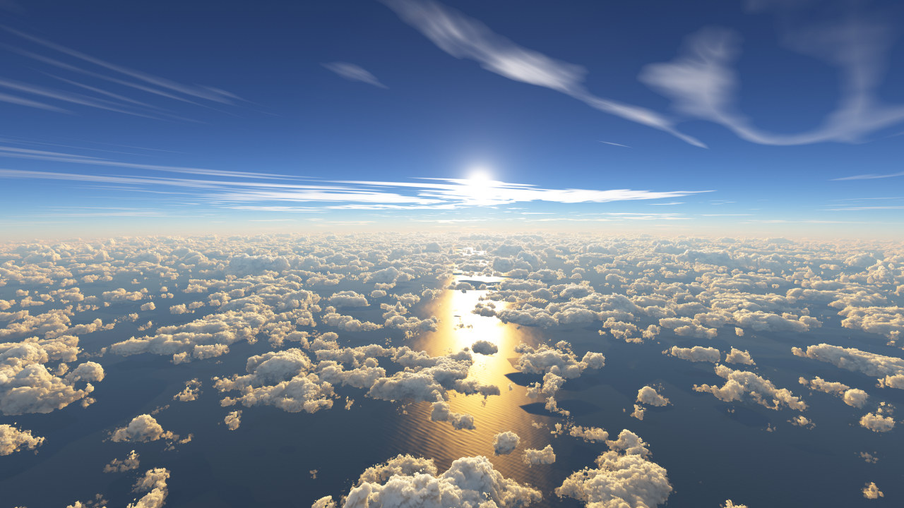
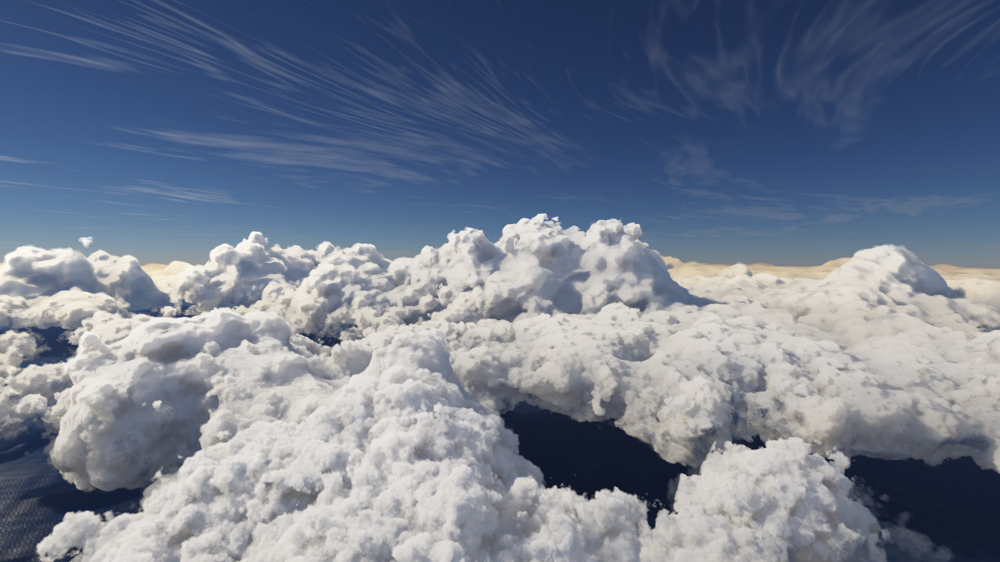
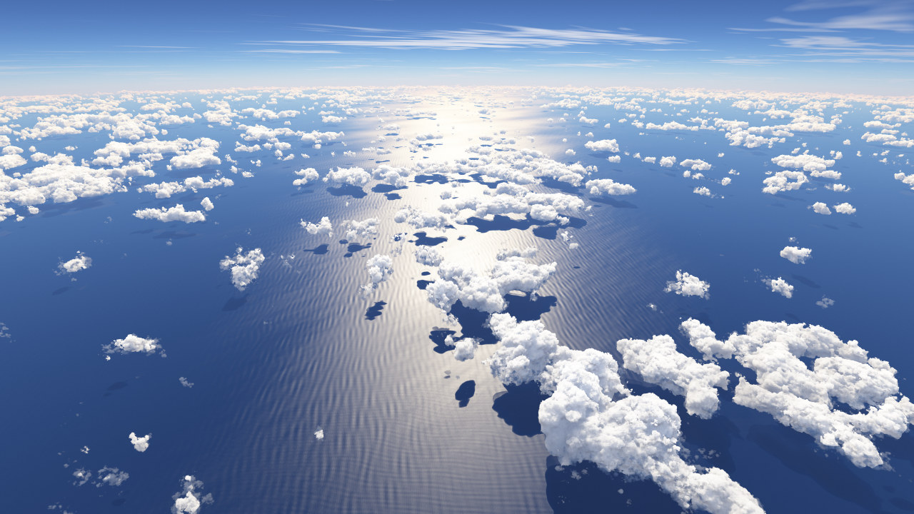
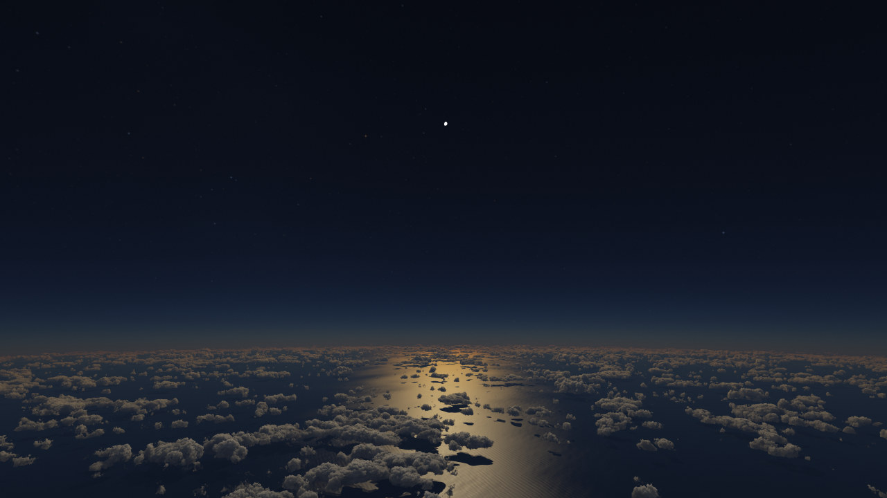

# Sky

航空機の窓から見た空を、ブラウザーで描くページです。
空気、低い雲、海、高い空の薄雲、太陽、月、星を、光の散乱を計算して描きます。
ページの下には、天窓の光で照らされた部屋の壁もあります。

**ページ: https://sf624.github.io/sky/**

絵をクリックすると、その景色でページが開きます。

## 使い方

上の画面をドラッグすると、まわりを見回せます。上下は 89 度まで向けます。

下のパネルで、時刻や天気を変えられます。

- **▶**: 時間を進めます。1 日を 1 分半で回ります。もう一度押すと止まります。
- **時刻**: 0 時から 24 時まで。太陽が真南に来るのが 12 時です。場所は北緯 35 度です。
- **日付**: 1 月 1 日から 12 月 31 日まで。初めは今日です。日付を動かすと、月齢もその日のものに変わります。
- **月**: 月齢。0 日から 29.5 日まで。
- **大気の霞**: 空気中のちりや小さな水滴の量。0 から 6 まで(初めは 0.35)。多いほど、地平線と太陽のまわりが白く霞みます。
- **海上の風**: 1 m/s から 15 m/s まで。強いほど、太陽の照り返しの帯が広く淡くなり、白波が立ちます。
- **高度**: 300 m から 13,000 m まで(初めは 11,000 m)。
- **速度**: 0 から 3,000 km/h まで(初めは 900 km/h)。雲と海が流れていきます。0 にすると止まります。
- **雲**: 低い雲の量。なしから一面まで。
- **薄雲**: 高い空の薄い雲(巻雲)の量。
- **解像度**: 上の画面を描く画素数の上限です。フルHD、WQHD(初め)、4K から選びます。選んだものはブラウザーに残ります。画面の実際の画素数より細かくは描きません。

下の部屋では、天窓に見える空と、壁の日なたの位置と色が、時刻に合わせて変わります。

景色はアドレスでも指定できます。たとえば `?time=16.75&yaw=60&pitch=-6` です。
指定できるものの一覧は [docs/development.md](docs/development.md) にあります。

## 絵のしくみ

- 空: 12 の波長ごとに、空気の分子とちりが光を散らす量を、視線に沿って足し合わせます。オゾンの吸収と、何度も散った光も入れています。
- 雲: 形は 3 次元のノイズで作ります。視線に沿って雲の中を進み、光の当たり方は、太陽の方へ雲をたどって決めます。
- 海: 波の傾きの分布から、太陽のきらめき、空の映り込み、水の中から戻る青い光、白波を計算します。
- 薄雲: 風に引き伸ばされた、氷の粒の筋です。太陽のまわりに 22 度のかさも出ます。
- 夜: 月は太陽に照らされた球なので、満ち欠けが出ます。星の位置と明るさは Hipparcos 星表によります。
- 1 枚の絵は、少しずつずらして描いた何枚もの絵の平均です。止まっていると数十フレームで滑らかになり、描くのをやめます。動いている間は、前の絵を動きに合わせてずらして重ねます。

## 必要なもの

- WebGL2 が使えるブラウザー。使えないときは、空の色のグラデーションだけが出ます。
- 速い GPU。このページは GPU に重い処理をさせます。RTX 3090 で測った、上の画面の 1 フレームの描画時間は次のとおりです(初めの景色、飛行中)。
  - 1920×1080: 約 5.5 ms
  - 2560×1440: 約 9.3 ms
  - 3840×2160: 約 19 ms

  飛んでいる間は、毎フレーム描き続けます。ノート PC やスマートフォンでは遅くなります。
  遅いときは、動いている間だけ、描く画素数を自動で減らします。
  速度を 0 にするか、解像度をフルHD にすると、軽くなります。

ページは HTML ファイル 1 つだけで、ほかに読み込むものはありません。

## ライセンス

MIT ライセンスです([LICENSE](LICENSE))。
ページに埋め込んだ星のデータは、別の条件です。[NOTICE](NOTICE) を見てください。

## 開発する方へ

しくみと開発の手順は [docs/](docs/) にあります(英語)。

- [docs/design.md](docs/design.md): 1 フレームができるまで
- [docs/development.md](docs/development.md): 動かし方、確かめ方、決まりごと
