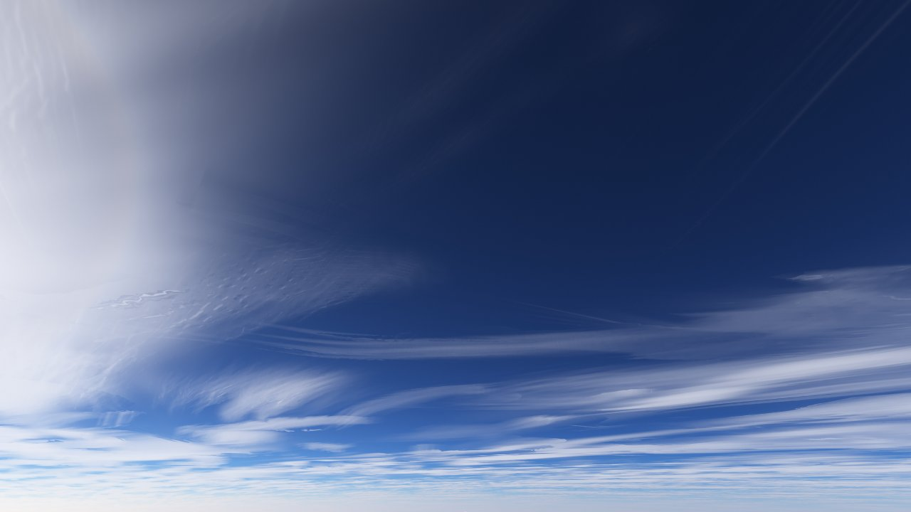

# How Sky draws a frame

This document follows one frame from the address bar to the pixel. It
describes the code on `main` as it is. Names are those of `index.html`:
functions, constants, uniforms and element ids. Plans and known flaws are
in the [issues](https://github.com/sf624/sky/issues), not here.

## The page

`index.html` holds everything: the markup, the CSS and ten `<script>`
blocks. It loads no other file.

| Block | Kind | What it is |
|---|---|---|
| (no id) | JS | `TEXT`, the strings in Japanese and English, and `applyLanguage`. It runs right after the panel. |
| `stars` | data | The star catalogue, base64 (see [Stars](#sun-moon-stars)). One very long line: never print it. |
| `noise` | fragment shader | Draws the cloud noise and the weather map once, at start. |
| `waves` | fragment shader | Draws the map of the waves on the sea once, at start. |
| `fs` | fragment shader | The scene: air, clouds, sea, cirrus, sun, moon, stars. |
| `mean` | fragment shader | Joins each new frame of the aircraft's view to the picture so far. |
| `show` | fragment shader | Copies that picture to the canvas, with dither. |
| `meter` | fragment shader | Meters the picture for the exposure, block by block. |
| (no id) | JS | `SkySound`: the background sound (see [Sound](#sound)). |
| (no id) | JS | Everything else, in one function that runs at load and starts the loading. |

There is one canvas, `#sky`, the hero: the view from an aircraft. Clouds,
sea, cirrus, glare. It flies (900 km/h by default) and is drawn as a mean
over frames. It fills the window, and the page does not scroll.
`makeSky(canvas, view, { done, shown })` makes its renderer, a step at a
time (see the next section).

## Conventions

- **Lengths** are in km, in the shaders and in the JS.
- **Axes**: x west, y up, z south. The centre of the planet is the origin.
  The eye is at `(0, RG + uAlt, 0)`, with `RG` = 6360 km (the ground) and
  `RT` = 6460 km (the top of the air).
- **Directions**: `yaw` 0 looks south, 90 degrees west, -90 degrees east;
  a larger `yaw` turns the view to the right (clockwise seen from above),
  and a drag to the right lowers it. `pitch` is positive upwards.
  `camera(yaw, pitch)` gives the column-major `uCam`: right, up, forward.
  `uTan` is the tangent of half the vertical field of view (`FOV` = 62
  degrees for the hero).
- **Spectra** are twelve wavelengths, 405 to 680 nm in steps of 25 (`WL`),
  stored as `vec4 X[3]`: four wavelengths per `vec4`. Loops run
  `for (int k = 0; k < 3; k++)`. `uWL` holds each wavelength divided by
  550 nm.
- **Light** is in units of the sun's irradiance. The weights `uWR`, `uWG`,
  `uWB` turn a spectrum into linear sRGB with the solar spectrum folded in
  (`W` in the JS, from the CIE 1931 functions `CMF` and `SOLAR`); the bare
  sun has luminance 1. `main` multiplies by `ISUN` = 20.
- **The way flown.** The aircraft does not move: the world does. `state.drift`
  is the way made over the sea, in km, wrapped to `[0, WEATHER_KM)` with
  `WEATHER_KM` = 256 so that it keeps its precision in single-precision
  floats. The shader reads clouds, sea and cirrus at `p.xz + uDrift`. When
  the drift wraps, every pattern read there jumps by 256 km, so **every
  pattern must repeat a whole number of times in 256 km**, or a seam shows.
  Hence `BASE_KM` = 8 (32 tiles of the noise), `DETAIL` = 7 (whole tiles of
  the fine noise per tile), the wave bands and the cells of the foam
  rounded to whole numbers per map (`rep`, `cells`), the swells with whole
  numbers of crests (`SWELL`), the cirrus frame stepping by whole numbers
  (`CI_DIR`, `CI_FREQ`, `CI_FIB`, `ciNoise` with a whole `period`), and the
  `bend` of the cirrus written with whole-number frequencies. The `bend`
  sum appears twice, in `noise` and in `ciDepth`: change both together.
- Comments in the code are plain English sentences that say what and why.

## From the address bar to the first frame

The page shows at once in its loading state: the hero is dark (`.loading`,
a gradient of a night sky), with the title over it. After 0.3 s a thin line
of progress and a word (`TEXT.loading`) fade in, so a quick start shows only
the dark. The panel and the full-screen button stay hidden (no clicks, no
focus) until the first picture. All of this is HTML and CSS: it needs no
script.

The JS then runs once, at load, and does little:

1. **Inputs.** URL parameters with the id of a slider set that slider's
   value (the browser clamps it to the slider's range and step). Then
   `readInputs()` copies the sliders into `state`. `now`, `rate` and `play`
   then act as the now button, the select and the play button, but the
   time does not run yet (see below). `yaw`, `pitch`, `heading`, `at`,
   `pixels` and `res` are read directly (see
   [development.md](development.md#url-parameters)). Without `yaw`, the view
   starts 65 degrees to the side of the sun; without `heading`, the
   aircraft flies 60 degrees to the left of the view.
2. **The loading.** After the first paint (an animation frame, then a
   message), `makeSky` for `#sky` makes the renderer. It is an `async`
   function: it waits a frame (`nextFrame`) wherever it would otherwise
   hold the main thread or wait for the GPU. Its steps:
   - `getContext`, and the extensions.
   - Every program (`fs`, `noise`, `waves`, `mean`, `show`, `meter`) is
     compiled and linked at once, and nothing asks how it went yet. With
     `KHR_parallel_shader_compile`, the GPU process compiles them on threads
     of its own; the page asks `COMPLETION_STATUS_KHR` once a frame. Without
     it, asking waits, so the page asks for one program a frame. A failed
     program throws the compiler's or the linker's message.
   - Meanwhile the tables of the CPU, in slices of about 8 ms, one a frame
     (`slices`). Each is a generator (a job) that yields every little while;
     `finish(job)` runs one at once.
     - `odTable` (`buildDepths`): optical depth to the top of the air
       towards the sun, over altitude (48 rows, squared spacing) and the
       cosine of the sun's zenith angle (96 columns from -0.2), 64 steps
       each. Read by `sunDepth()` in the JS only.
     - `starData` (`buildStars`): the star texture.
     - the table of `depthToTop` (`depthTable`, see [The air](#the-air)).
     - `msData` (`buildMultiScatter(haze)`): the multiple-scattering table
       (see [The air](#the-air)), for the haze given, the longest (0.2 to
       0.3 s). It starts after the others and goes on in slices while the
       GPU compiles the programs and draws the textures; the first frame
       waits for it. Run before the programs, it held the first picture back
       by some 0.7 s.
     - With them goes a constant, `NIGHT`: the moonless night sky
       (airglow), 8.59e-10 of the sun's irradiance, about 4e-8 of the
       daytime sky.
   - The textures (see [Textures made at start](#textures-made-at-start)).
     The noise and the weather map are drawn in batches (`batches`), the
     weather map in strips of 64 rows (the scissor; each pixel is the
     same as from one draw). After each batch the page waits for a fence
     (`settle`); a batch doubles while the GPU gets through it in under
     100 ms and halves over 250 ms. The GPU process draws the whole
     browser, and a slow GPU given seconds of work at once would freeze it.
   - `prime`: the first frame is drawn as the first frame will draw it
     (`render` as a probe, which then puts its state back), and `show` once
     without a pixel (the scissor). Some drivers finish a program only at
     its first draw, which can take a second: that happens now. Once a
     fence says the GPU is done, the meter of that frame is read: the read
     does not wait.
3. **The hand-over.** The hero's `data-sky` becomes `ready` (`failed`
   without WebGL2 or if a program failed: the error goes to the console,
   the loading state fades out, and the canvas keeps its CSS gradient).
   `kick()` asks for the first frame; a time-lapse asked for in the address
   starts now; the title's and the panel's timers start (see `.told` and
   `.still`). Before this, `kick()` and `schedule()` do nothing.
4. **The first picture.** The first frame is only metered, as always (see
   [Exposure](#exposure-and-the-tone-curve)); if what it is drawn from is
   what `prime` drew, prime's reading stands, else it reads the meter at
   once. The second frame goes to the canvas, and `render` calls `shown()`:
   the hero gets `.shown`, and the loading state fades out over the picture
   in 0.8 s (it lets the pointer through at once), while the panel fades
   in. The class and the picture reach the screen in the same frame, and
   the fade starts from opaque: nothing empty or half drawn shows.

So no step holds the main thread for long, except `getContext` itself.
The pictures are the same as when everything ran at once: the jobs and
batches only split the same work.

A hidden tab has no animation frames: there `nextFrame` waits 100 ms
instead (the browser slows that down further), so the loading goes on
slowly; the first frame waits until the tab is shown.

**The loop.** `update()` marks the state changed and calls `kick()`,
which asks for one `requestAnimationFrame(frame)`.

`frame(now)` then:

- does nothing in a hidden tab;
- if something changed: rebuilds `msData` when the haze has changed (at
  once, with `finish`; it takes about a quarter of a second: while the haze
  slider moves, it is built `HAZE_WAIT` = 250 ms after the last move), runs
  `celestial()` and sets the panel's labels;
- moves the aircraft: `state.drift` grows by `speed / 3600 * dt` along
  `state.heading` (`dt` capped at 0.1 s, and 0 after a pause, so the
  aircraft never jumps);
- calls the renderer;
- asks for another frame only if the renderer returned true.

The renderer returns true while the aircraft flies, while its picture is
still settling, or while the exposure moves. So the page draws nothing at rest once the picture is
clean, or in a hidden tab. `visibilitychange` calls `kick()` again.

**Playing.** The play button runs the time at the rate of the select beside
it (`pace`, a factor of real time; 960 at first, a day in a minute and a
half). Each `tick()` moves the time by the time elapsed since the last tick
(`performance.now()`) times the rate. A gap longer than a quarter of a second
is not a frame (the tab was hidden): at real time the time catches up with
it, at the faster rates it counts as 0.25 s, so the time does not leap. A
new rate applies from the moment it is chosen. Past 24:00 the date moves
on by a day, and from the last day of the year to the first. The moon's age
runs on with the time, a day of age a day, and so does the sun on the
ecliptic (`state.dayShift`, see below): nothing jumps at midnight. At the
faster rates, ticks come with the frames (`requestAnimationFrame`), and
every frame is drawn again.

**Real time.** The sun moves a quarter of a degree a minute. At the default
drawing limit (WQHD, 1440 rows over the 62 degrees of the view) that is
less than a pixel in 10 s. So at real time the ticks come from a timer,
once a second, and the time that is drawn (`state.time`) moves in steps of
10 s (`REAL_STEP`): each step draws the picture again and lets it settle
(39 frames), and nothing is drawn in between, about 6 % of the frames.
The panel's clock shows the minute, which changes only on a step. In a
hidden tab the timer runs on (the browser slows it); `visibilitychange`
brings the time to the present at once. In flight every frame is drawn
anyway.

**Now.** The now button sets the date to today, the time to the device's
clock (taken as local solar time), the moon's age as moving the date does,
the rate to real time, and plays.

## Sun, moon and sky in the JS

`celestial()` places the sun, the moon and the stars for `state.day` and
`state.time`:

- The observer is at `LATITUDE` = 35 degrees north. The time is local solar
  time: the sun is due south at 12:00.
- The sun moves along the ecliptic (`OBLIQUITY` = 23.44 degrees), at
  longitude 0 on day 80.
- The moon runs ahead of the sun along the ecliptic by its age
  (`state.moonAge / 29.53` of a turn). Its orbit's tilt is left out.
- Moonlight is 2.5e-6 of sunlight at full moon, falling with the phase
  angle. It counts (`state.moonI`) only when the sun is below -3 degrees and
  the moon above -18.
- `state.sunOn` (`uSunI`) fades from 1 to 0 as the sun goes from 18 to 21
  degrees down (a smoothstep), so that no step shows when it stops
  mattering.
- One light for the clouds and the sea (`uLight`, `uLightI`): the sun while
  it is above -3 degrees, else the moon.
- `state.sky` (`uSky`) turns J2000 equatorial directions into local axes.

The date slider covers the current year. The moon's age starts from the
date (`moonAgeOn`: the mean lunation, from the new moon of 6 January 2000)
and is set again whenever the date slider moves; the moon slider then
changes it alone. With `date` and no `moon` in the address, it follows the
given date.

The sun's place on the ecliptic comes from the day number, one step a day.
While the time plays past midnight, `state.dayShift` (in days) holds the
sun where the time has carried it: it grows with the time and loses a day
when the date moves on, so the sun and the stars turn on smoothly. Setting
the date or the time sets it back to 0.

## The air

`main` in `fs` marches along the view ray from the eye to the top of the
air, or to the sea. The air is three species, with densities from
`density(h)`:

- Rayleigh: `exp(-h / HR)`, `HR` = 8 km; scattering `uBR` = 13.558e-3 per km
  at 550 nm, falling with the fourth power of the wavelength (`BR`).
- Mie (aerosol): `exp(-h / HM)`, `HM` = 1.2 km, the haze of the lowest
  kilometres, plus two thin layers above it (`AERO_FREE`, `AERO_STRAT` in
  `fs`, `AERO_UP` and `mieDensity` in the JS): 0.7 of the sea level's
  density at 6 km (half-width 5 km, the free troposphere) and 0.2 at
  20 km (half-width 8 km, the stratosphere: an optical depth of 0.0045
  at the default haze, about that of the stratosphere's background
  aerosol, 0.004 to 0.01 at 525 nm, where it was 0.0011). Scattering `BETA_M` =
  3.996e-3 per km times `uHaze`, extinction `MIE_EXT` = 1.11 times that.
  Grey: the same at every wavelength. The layers matter in twilight: their
  forward scattering of the sun's light, from below the horizon, makes
  the glow over the sunset a taller warm gradient (orange, yellow, pale,
  then blue) instead of a thin orange line under a blue sky; by day they
  widen the sun's aureole a little.
- Ozone: a triangle from 10 to 40 km, peaking at 25 km; absorption `uBO`
  from the Chappuis cross-sections (`OZONE`) for 300 Dobson units.

Phase functions (`phases`): Rayleigh, and the Cornette-Shanks form for Mie
with `g` = `MIE_G` = 0.7 (an asymmetry of 0.76, that of sulphate and
continental aerosol, 0.6 to 0.75; `g` = 0.8 gave 0.84, a narrower and
stronger aureole).

**The march.** `NV` = 20 samples at
`t = tmax * f * f`: denser near the eye. In twilight the view ray may pass
through the planet's shadow: in parallel light, a cylinder of radius `RG`
behind the planet (`shadowSpan`). Then the march has three runs, each
denser at its start: `NV` samples from the eye to the shadow, `NSHADE` = 8
in it, and `NFAR` = 16 in the lit air beyond (a run of no length is
skipped). The light scattered once rises steeply from the shadow's edge;
20 samples over the whole ray left layers of colour above the band of
glow that came and went with the angle (a purple one at 7 degrees with the
sun 14 degrees down). A ray that misses the shadow is marched as before,
so the day's picture is unchanged. Each sample adds, for the sun and for
the moon, `addLight`:

- light scattered once, if the planet does not hide the source: the
  transmittance from the eye to the sample and from the sample to the top
  (`depthToTop`) times the phase functions, times `direct`,
  which the shadow of the clouds lowers near the sea, and times
  `grazeCut`;
- light scattered many times: the multiple-scattering table times the
  local scattering coefficient, times the transmittance to the eye.

The clouds and the cirrus enter the march as two layers (see
[Low clouds](#low-clouds) and [Cirrus](#cirrus)). At each layer the march
ends a sample exactly there (`tLayer`), adds the layer's light (`C` or
`H`) dimmed by the air before it, and multiplies what lies beyond by the
layer's transmittance (`vis *= Tc` or `Th`). Behind a thick cloud
(`vis` = 0) the march stops.

**`grazeCut(p, s)`**: light from below the local horizon grazes the
planet on its way, along hundreds of kilometres of the lowest air, where
haze and cloud that the model does not draw (the deck below the aircraft
among them) take it out. Light that passes lower than `GRAZE` = 1 km is
cut, above 5 km kept, smoothly in between. It applies to the light
scattered once in the air, to the sunlight on the low clouds and on the
cirrus, and to the light gathered for the multiple-scattering table
(`grazeCut` in the JS), not to the eye's own view of the sun. By day
nothing changes. Without it the air just outside the planet's shadow was
lit by deep red light that had passed a few hundred metres above the sea:
from 11 km, the shadow's band came out pink, the sky over it lavender and
the Belt of Venus magenta, where photographs show a blue-grey band, a pale
blue sky and a pink to peach belt.

**`depthToTop(p, d)`**, the optical depth from `p` to the top of the air:

- One filtered read of the depth table `uDepth` (512 by 128, `DEPTH_MU` by
  `DEPTH_R`), made at start in `makeSky` by a 16-step midpoint sum. Its axes follow Bruneton (2017): the distance to the top, between
  its least and its most at that height, and the distance to the horizon
  (`rho / H_TOP`). The table is RGBA32F where the GPU can filter full floats
  (`OES_texture_float_linear`), else RGBA16F.
- The table repeats the density profile. The profile is written out twice:
  `density()` in `fs`, and in the JS (`mieDensity` for the aerosol, used
  by `buildDepths`, `buildMultiScatter` and this table in `makeSky`).
  Change both.

**Multiple scattering** (`buildMultiScatter`, after Hillaire, 2020): for
each altitude (`NH` = 12 rows, squared spacing) and cosine of the sun's
zenith angle (`NMU` = 40 columns from `MS_MU_MIN` = -0.35), the mean light
that reaches a point, to be times the scattering coefficient there:

- The light scattered once is gathered over the sphere, with the phase
  functions of the air and the aerosol for the sun's light scattered
  towards the point, and with sunlight bounced off the ground (`ALBEDO` =
  0.07). In twilight that light comes from the lit air towards the sun,
  scattered forwards; gathered as if isotropic, the table held 0.65 to
  0.75 of the reference's (below) in the planet's shadow, now 0.85 to 0.95:
  16 bands of height, narrower near the horizon (edges at `x |x|` for
  even `x`), each counted by its share of the sphere, times 4 directions
  over half the sphere, mirrored; 14 steps each. In twilight that light
  comes from the lit air low on the horizon: 8 even bands, the nearest
  3.6 degrees off it, missed most of it, and the sky of nautical twilight
  came out 3 to 5 times too dark.
- The higher orders follow as a geometric series (Hillaire).
- Then, while the sun stands lower than 17 degrees (blended in down to
  9), one more gathering of that field itself, an order computed rather
  than guessed. The series keeps the colour of the light scattered twice;
  in deep twilight that is the red glow on the horizon, and the air came
  out orange where the sky above is blue. One more order is enough: a
  second changes the table by less than 1 %.

A second table holds the sky's light on the low clouds (`cloudSky`): as
bright as the mean light, but in the colour of the light from above on a
level surface (gathered over the upper half of the sphere times the
cosine, all orders), relative to that of the mean light with the sun at
30 degrees at the same height. It is the mean light itself while the sun
stands higher than 6 degrees, and fully the light from above from -3
degrees down. The mean light holds the glow on the horizon and the dark
sea below: in deep twilight the clouds came out mauve and brown under a
blue sky.

One value per wavelength. The texture is `NMU` by `6 * NH`: the three
groups of four wavelengths of the air stacked in y, then those of the
clouds. It depends on the haze, so `frame` rebuilds it when the haze
changes, and the renderer uploads it again. `fs` reads it through the
GPU's filter (`textureLod`; RGBA16F when full floats cannot be filtered).

**Against measurements** (a float64 copy of the model, with the aerosol
layers and `grazeCut`). Integrated over the sky at sea level (haze
0.35, 128 klx of sunlight outside the air), the model gives, against the
horizontal illuminance table in Schlyter, "Radiometry and photometry in
astronomy": sun at 0 degrees, 937 lx (measured 759); -6, 6.3 lx (3.4);
-12, 0.016 lx (0.008). The zenith, against a fit to sky quality meter
readings (hnsky.org, "SQM twilight"): 0 degrees, 148 cd/m2 (216); -6, 0.89
(0.63); -10, 0.014 (0.013); -14, 5.1e-4 (4.7e-4). Within a factor of two
throughout. The layers and the cut change these figures by less than
10 %: they matter for the colours low in the sky, not for these totals. Before the bands, the extra order and the shadow's runs, the
zenith at -10 and -14 degrees was 3 and 6 times too dark.

**Against a reference** (November 2026). A Monte Carlo solver of the same
atmosphere (spherical shells, the twelve wavelengths, Rayleigh, both
aerosol layers, ozone, a ground of albedo 0.07, every order; the
light scattered once by a fine march, the rest by paths with a
track-length estimate of the sun's light on each segment and the hero
wavelength scheme of Wilkie et al., 2014), against a float64 copy of
`fs`'s march with the page's own tables, over elevations -5 to 60
degrees at 0, 90 and 180 degrees from the sun, from 0.3, 4 and 11 km,
the sun at 2, -2, -4, -6 and -10 degrees. The light scattered once
agrees within 2 % (towards the sun 0.96 to 1.00). The table's light is
about 0.6 of the reference's towards the sun in twilight (the second
scattering at the point is taken as isotropic, while that light comes
from the glow, scattered forwards), 0.85 to 1.2 to the side and away;
by day 0.6 to 0.95. Towards the sun it is 5 to 20 % of the sky, so the
sky there is within 5 to 10 % of the reference, with its colour (the
chromaticity within 0.02). So the thin band of glow is what this
atmosphere gives: with the same air, the reference's band is as thin.
The aerosol aloft and the tone curve (see [Exposure](#exposure-and-the-tone-curve))
make the difference.

## Low clouds

Low clouds live in a shell from `CB` = 0.6 km to `CT` = 5 km.

**The field.** A signed field says where cloud is: positive inside,
rising by about 1 per km of depth under the surface. `cloudShape` builds it
as a sum:

- the weather map `uWeather` at `p.xz + uDrift` (R: cover, G: towers),
  against a level set by `uCloud` (a cubic in `uCloud`);
- less what height costs: a dome over a flat base (`y` cubed over the
  cube of `top`), thicker where the map is higher; the lowest 180 m
  rounded off (`rim`);
- plus the noise of the tile (`uNoise`, one tile per `BASE_KM` = 8 km),
  read at a depth that drifts from place to place (`far`) so that no two
  tiles look alike. Worley values are rounded into domes (`v (2 - v)`).
  `lump` says how far a place stands out of the billows; `body` how thick
  the cloud is there; `q.w` how rough;
- a flat base, 30 to 80 m over `CB`.

`cloudDetail` adds the fine noise: `DETAIL` = 7 tiles per tile, and a
finer octave still when the pixel is small against it (`lod < -1`).
`cloudField` adds it only near the surface (`f > -0.35 * RELIEF`), more
strongly on thin cloud, whose edge frays.

`cloudExtinction` turns the field into extinction: `SIGMA` = 90 per km
once the field is past the edge (`EDGE` = 0.04, wider where the field is
smoothed), with more water higher up and in thicker clouds.

**The march** (`clouds`) runs from where the ray enters the shell (`ta`) to
where it leaves it (`tb`, at most 600 km). A ray that goes on to the sea
leaves it at the cloud base; from under the base, such a ray has no
clouds.

- The steps grow with the distance: `ds = max(DS_MIN, rel * t)`, with
  `DS_MIN` = 20 m and `rel` at least `DS_REL` = 0.0045. On a long path
  `rel` grows so that the march ends within its budget (`COARSE * 80`
  steps' worth); the near steps stay fine. At most `CLOUD_STEPS` = 160
  steps, and the march stops when less than 1 % gets through.
- The plan must not jump where the end of the ray does: a ray that meets
  the sea is planned as if the sea were a mirror and the ray went on up to
  `CT`. So a cloud in front of the horizon looks the same above and below
  it.
- In clear air the field tells roughly how far the next surface is: steps
  of `0.35 * |f|`, between `FINE * ds` and `COARSE * ds`. A long stride
  that lands inside a cloud steps back, and the next three steps in clear
  air are at most `ds`, so edges come out crisp. Inside, steps of
  `0.5 * f`, at most `ds`.
- The detail of the noise read (`lod`) follows the pixel's footprint at
  that distance, or a fifth of the step if that is larger.
- The start is jittered per pixel and per frame
  (`ign(gl_FragCoord.xy + 5.588238 * uPass)`, interleaved gradient noise);
  the mean over frames removes the noise.

**The light** is worked out at each sample inside a cloud while more
than a quarter of the light still gets through, and at the first sample
of each cloud the ray enters; deeper samples share the last result. At a
sample just past the surface it is worked out on the surface itself,
found between the last two samples. For each:

- `lightDepth`: six steps towards the light, growing by 1.6 each. The first
  two see the fine noise (`crisp`: the shadows of the small billows). The
  last three are moved sideways at random each frame (`off`, up to
  `PENUMBRA` = 60 m): over the frames the shadows soften. The third has
  neither. It also gives
  the slope of the field towards the light, hence `facing`.
- The rise of the field towards the sky over `reach` gives `open`: how much
  skylight a place gets.
- Five phase terms stand for the orders of scattering: `p0` (scattered
  once: two Henyey-Greenstein lobes, dimmed by the whole depth) and `p1` to
  `p4` (scattered many times: wider lobes that go deeper). `white` makes
  only thick clouds brilliant; `billow` lights the tops of the big billows
  far off, where the fine ones are below a pixel; `bounce` lights a side
  turned from the sun with the sunlit cloud around it.

`clouds` returns what gets through (`Tc`), the light per unit of sunlight
scattered once (`sOne`) and many times (`sMany`), per unit of skylight
(`sAmb`), and the mean distance it comes from (`tBar`). `main` turns them
into the spectrum `C` at `tBar`: sunlight through the air above (and
through the cirrus, `cirrusShadow`), plus skylight from the
table of the sky's light on the clouds (`cloudSky`, see
[The air](#the-air)), plus airglow.

**Shadows.** `shadowDepth` sums the clouds' depth towards the light from a
point under their tops (ten samples, denser low down). `main` uses it for
the sea's shadow and the glare. Where the ray meets no sea, the air near
the sea is dimmed by the cloud amount alone (`shade`).

## The sea

`addSea`, where the ray meets the sphere `RG`:

- **Wind.** `uWind`, varied by gusts (B of the weather map) and streaks (A of
  the wave map). The slopes have the variance of Cox and Munk (1954):
  `s2 = 0.003 + 0.00512 * wind`.
- **Waves the picture shows.** Three bands of wind waves read from the wave
  map `uWaves` (R, G: slopes) at sizes a factor 6 apart, the longest set by
  the wind; and eight swells (`SWELL`), each smoothed over the footprint.
  Reads use `textureGrad` with the pixel's footprint on the sea (long when
  seen aslant). What the footprint averages away stays in the variance
  (`hidden`, from B of the wave map), so the glitter has the same light
  from near and from far.
- **Glitter.** The share of slopes that mirror the light to the eye, with
  Fresnel and Smith's shadowing term (`waveShade`, in the rational form of
  Walter et al., 2007).
- **Mirrored sky.** `skyAt` marches 8 steps of air in the mirrored
  direction of the tilted footprint. Rough water mirrors less at grazing
  angles (the mean Fresnel factor of Bruneton et al., 2010). Three samples
  of `cloudDensity` up the layer tell how much of that sky the clouds hide.
- **Light from below.** `SEA`: blue light scattered back out of clear water.
- **Foam.** Whitecaps cover `2.95e-6 U^3.52` of the sea (Monahan and
  O'Muircheartaigh, 1980), as separate breakers in a grid of cells: counted
  sharp from near, averaged from far.

The shadow on the sea is the `tau` passed in: `shadow` in `main`, the
depth of the clouds (`shadowDepth`) and of the cirrus (`cirrusShadow`)
towards the light.

## Cirrus

`highCloud`. The cirrus fills a shell from `CI_LO` =
12.2 to `CI_HI` = 12.8 km, but its pattern is drawn on one height: where
the ray crosses the middle of the shell (or halfway along a ray that only
grazes it).

The crossings of the eye's ray with `CI_LO`, `CI_HI` and the middle height
come from `eyeSphere`, which takes them from the heights, not from
`raySphere`: the slider stops on all three heights, and from an eye at a
sphere's own height `raySphere` puts the near crossing a hair ahead or
behind, ray by ray (see [development.md](development.md#glsl-rules)). From
`CI_LO`, a ray down leaves the shell at once.

- `ciDepth` gives the vertical optical depth at a place on the map: patches
  from A of the weather map, against a level set by `uCirrus`; streaks drawn
  out along the wind (three octaves, `CI_DIR`, `CI_FREQ`); lumps and tufts;
  Worley noise from `uNoise` eating into the edges; and from near, fine
  fibres (`CI_FIB`). Each octave fades out before it gets finer than the
  pixel's footprint (`foot`, `across`, `fibre`), so the pattern is filtered
  rather than aliased.
- The depth along the ray is that times the path through the shell over
  the shell's thickness.
- Light: forward scattering by ice (three Henyey-Greenstein lobes), the
  22-degree halo with the dispersion of ice, light scattered once with the
  sheet's own shadow, a share scattered many times, skylight from the
  multiple-scattering table, and light from the low clouds below.
- `cirrusShadow` dims the direct light on the low clouds and the sea (half
  the depth counts: ice scatters mostly forward).

`highCloud` returns `Th`, `H` and `tHigh`; the march through the air treats
it as its second layer.

## Sun, moon, stars

Rays that reach the top of the air (no sea, not behind a thick cloud) get,
all dimmed and reddened by the air:

- **The sun**: a disc of 0.267 degrees radius, of a fixed brightness (2000
  in these units).
- **The moon**: a sphere lit by the sun (`uSun`), so its phase comes out by
  itself, with darker seas from noise. The dark side holds a dim grey
  (`uEarth`: earthshine, capped so the night exposure does not burn it out).
- **Airglow** (`uNight`), brighter towards the horizon (van Rhijn's factor),
  and **the Milky Way** (`milkyWay`): a noise pattern on the real galactic
  plane, brighter towards its centre.
- **Stars** from Wikidata (CC0), to magnitude 6.5 (the `stars` block: six
  bytes per star, brightest first, about 8,800 stars; built by
  `tools/make-stars.py`, the source is named in `THIRD_PARTY_NOTICES.md`). About a hundred
  stars that Wikidata gives no V magnitude have one estimated from their
  other bands.
  `buildStars` puts them into a `GRID` by `GRID` (128) octahedral map of the
  sphere with up to `SLOTS` = 8 stars per cell, and enters each star in
  every cell its disc can reach, so the shader reads one cell per pixel
  (`starCell`). A star is a spot about a pixel wide, with a colour from its
  B-V index (Ballesteros's temperature, then a tilt of the spectrum) and a
  compressed brightness (a "look"). The brightest get diffraction spikes
  fixed to the screen.

**Glare**: a glow of a few degrees around the sun, as strayed
light in a lens, dimmed by the clouds and the cirrus towards the sun.

## Exposure and the tone curve

The exposure follows the picture, as the eye or a camera's automatic
exposure does: it is set from what the view shows, sky, clouds, sea,
glitter and the inside of a cloud alike.

**The level.** `fs` writes, in the alpha of each frame, the level of the
pixel: log2 of its luminance before exposure, coded from 0 to 1 over
`LOG_RANGE` (-34 to 18, `uLogRange`). `mean` carries it along with the
colour, so the picture's level is as clean as its colours.

**The meter.** After `mean`, the shader `meter` draws a target of 64 by 36
texels (`METER`): each is a block of the picture and holds the mean level
of 4 by 4 points in it, in 16 bits over two 8-bit channels. The JS reads
it back `METER_LAG` = 3 frames later, when the GPU has long drawn it, so
that the read does not wait for the GPU's work. Counting frames, not
polling a fence, keeps the page's frames the same from run to run on a
stepped clock (the tools' fake clock). A read still costs a round trip to
the GPU process (about 2 ms on the test machine), so the meter is read at
most every `METER_MS` = 100 ms of the page's time. The first frame of
the page is metered at once, not shown, and drawn again at its exposure:
the page starts adapted. The loading has drawn that frame before and read
its meter without waiting (`prime`, see
[From the address bar](#from-the-address-bar-to-the-first-frame)); only if
something changed since (a resize, say) does the first frame read it
itself, the one read that waits.

**The exposure the picture asks for** (`exposureFor`, log2) comes from the
2304 block levels, sorted:

- `low`, the level of the darker quarter (`LOW_SHARE`), but at least
  `NIGHT_LEVEL` = -25.5 (a moonless night sky);
- `high`, the level that only the brightest 3% of the blocks pass
  (`HIGH_SHARE`);
- `key` = `KEY` - `EYE` * `low` (`KEY` = -1.3): as the view darkens,
  the eye opens up `EYE` = 0.85 stops for each stop, not all the way. So
  a night is darker than a day and dusk is in between, and black sea at night is exposed as
  the night sky, not lifted into noise;
- `white` brings `high` to `WHITE` (2^0.3 before the tone curve: just
  below white) in daylight (`high` at `DAY_HIGH` = 0.5 or more), and `DIM`
  = 0.6 stops lower for each stop that `high` is below that: the
  brightest parts of a dim view are not white either (the moonlit clouds
  of a night);
- `mid`, the median level, but at least `NIGHT_LEVEL`;
- by day and by night, the exposure is the lesser of `key` and `white`, but not less than a
  floor: the exposure that takes `mid` only `DEEP` = 0.8 of the way from
  the key's level down to the night's (`MID_GAP` = 0.5: in a night sky the
  median stands about half a stop above the darker quarter), and never
  more than `key`. So dusk darkens steadily into the night, rather than
  reaching the night's level early and staying there. The floor is on the
  median, not on the darker quarter: after sunset the sea and the clouds
  below darken sooner than the sky, and a floor on them brightened the
  sky again for some ten minutes;
- in twilight another exposure takes over, blended in as the sun goes
  from `DUSK` = 2.5 to -0.5 degrees (a smoothstep, times `sunOn`): one set
  by the sky, the level that the brighter third of the picture passes
  (`DUSK_SHARE` = 0.65), so that the view is shown as the eye sees it and
  not held down by its highlights. At sunset and in civil twilight the
  sky is light and pastel, its clouds lit, and the band of glow its
  brightest part; then the view darkens steadily into the night. That
  level is shown at `DUSK_SHOWN` = -2.2 (log2 after exposure) when it stands at
  `DUSK_MID` = -3 (about sunset: as by day), and at the night's level
  (the key's, `KEY - EYE * NIGHT_LEVEL + NIGHT_LEVEL + MID_GAP`, -4.6)
  when it stands at the night's (`NIGHT_LEVEL + MID_GAP`); in between
  along the power `DUSK_POW` = 0.7 of its distance from the night's, so
  that it darkens slowly at first: through civil and nautical twilight
  the eye still sees colours. On top of that, the twilight's picture is
  shown up to `DUSK_LIFT` = 1.2 stops brighter, as a camera on automatic
  exposure brightens it relative to the light after sunset: growing from
  the start of the blend (2.5 degrees) to `LIFT_SPAN` = -2.5 degrees, gone
  again by -8. Without it the views of civil twilight were 1 to 3 stops
  darker than photographs of them. White gives way: the highlights may stand
  up to `ABOVE` = 3.5 stops above white, an allowance that grows over
  `ABOVE_SPAN` = 5 degrees after the blend, so that it does not let the
  exposure leap as the sun sets. The sky, not the median nor the darker
  quarter: the clouds and the sea below darken sooner than the sky after
  sunset, and an exposure that followed them brightened the sky through
  sunset. But the band of glow, the brightest part of a view towards the
  sun (the level that only `PEAK_SHARE` = 0.2 % of the blocks pass, a
  few rows of them), stands at most `PEAK_ABOVE` = 1 stop above white,
  and `DIM_BAND` = 0.1 stops lower for each stop that it is dimmer than
  daylight's highlights (`DAY_HIGH`), at most `DROP` = 1.5 stops lower.
  As a camera's sensor does, the tone curve then takes each channel on
  its own (below): the band's strongest channel runs into white at its
  core, and it comes out white-yellow there, orange at its edges, pale
  above, under a deep blue-grey sky and over a near-black ground, as in
  photographs from the air; deep in the twilight it is a thin orange line
  under a near-black sky (an A330's at about -8 degrees). A view away
  from the glow holds no such peak and keeps the exposure of its sky.
  Before (round 7), a view whose highlights stood well above its sky was
  exposed for them, and a shoulder of the tone curve pressed the band
  together keeping its hue: it stayed a thin saturated red-orange line
  under a saturated blue sky, where photographs show a broad band, yellow
  at its core; and from -6 degrees down that exposure gave way, so the
  sky of deep twilight was lit up blue where photographs show it near
  black. In a time-lapse the picture away from the sun is unchanged; towards
  it, it darkens more in deep twilight, smoothly (the sky's mean level, of
  255, at 11 km: 74 at -2 degrees, 30 at -6, 13 at -10, against 83, 62
  and 52 before; at 0.3 km: 94, 49 and 37 against 113, 78 and 64).

`exposureFor` returns the exposure.

**Adaptation.** Each frame the exposure moves
towards its target by the page's clock (`now`, at most 0.1 s a frame): exponentially in stops, with
a time constant of `ADAPT_FAST` = 0.2 s towards less exposure (a brighter
view) and `ADAPT_SLOW` = 0.5 s towards more. It starts when the target is
`ADAPT_START` = 0.03 stops away and stops within `ADAPT_STOP` = 0.01, so
that the noise of the picture does not keep it moving. In flight, which
draws anyway, it keeps within `ADAPT_TRACK` = 0.002 of the meter.

**The flight check and the meter.** A flight of 61 frames from the
page's load (the tools' `flight` check) differs more from the still at
the place reached than on main, where the exposure did not follow a
meter (cruise 1.55 against 1.13 levels, 3 km 1.48 against 1.09). Nearly
all of it is the exposure: each page starts at the meter of its first,
single frame, the still keeps it (it lies within `ADAPT_START` of the
settled picture's), and the flight follows the meter of its own, noisier
picture from 240 m back; they end 0.01 to 0.02 stops apart, a uniform 1
to 1.5 % (measured: -1.4465 against -1.4342 at cruise, -2.019 against
-1.997 at 3 km). With the exposure held fixed in both, the flight is
within main's margin (1.21 and 1.12).

At the end of `main`:

1. Spectrum to linear sRGB, times `ISUN`; the level for the meter is
   taken here; then times `uExposure`.
   No shoulder keeps the hue: each channel meets the curve of steps 3 to
   5 on its own, as on a camera's sensor.
2. The white balance `uBalance` (`balanceFor`). By day a camera's for
   daylight, `DAY_BALANCE` = (0.932, 1.013, 1.074). In twilight it goes
   `BALANCE_ADAPT` = 0.5 of the way (in log) towards the colour of the
   light on the level ground (the sky's from above, `upData`, kept by
   `buildMultiScatter`, and the sun's while it is up), relative to that
   light with the sun at 30 degrees, as an automatic white balance does
   and as the eye adapts. Blended in as twilight's exposure is (`DUSK`),
   and out again as the sun goes from 4 to 9 degrees down
   (`BALANCE_OUT`), and with height, from 2 to 11 km (`BALANCE_HIGH`):
   from cruise the view is the high sky and the deck far below, which
   photographs keep as blue as by day; this correction, warm for the
   light of the low air, turned that sky lavender-grey and the deck pink.
   Without it the sky away from the sun came out
   lavender and the Belt of Venus magenta, where photographs show a pale
   blue sky and a pink belt; held into the deeper twilight, it turned the
   blue sky grey and the clouds brown.
3. Light far too strong for the screen (1 to 6 times white) turns towards
   white, as on film.
4. A "look": `pow(col, uLook)`, with `AIR_LOOK` = 1.4.
5. Tone mapping `1 - exp(-col)`, channel by channel, then the display
   power `1 / 2.2`. Steps 2 to 5 are those of `main`.
6. Rounding at random to the storage steps (next section).

## The hero's mean over frames

One frame of the hero is noisy: each frame shifts the rays within the
pixel (`uJitter`, Halton (2, 3)) and the samples through the clouds
(`uPass`). The picture is the mean of many frames. `makeSky` keeps three
textures for it, each with a second 8-bit texture beside it (`aux`):

- `shot`: the new frame, drawn by `fs` into two outputs: the colour with
  the level in alpha (`outColor`) and the distance of what each pixel
  shows (`outAux`);
- two `pictures` that take turns: the one so far is read while the next is
  drawn by `mean`; then `show` copies the new one to the canvas.

**Storage.** Half floats (RGBA16F) where the GPU can draw to them
(`EXT_color_buffer_half_float` or `EXT_color_buffer_float`, and the
framebuffer is complete), else RGBA8. Values are kept in steps of
`1 / uSteps` (2048 or 255), rounded up or down at random each frame, so
that the mean neither bands nor sinks. `show` dithers by one 8-bit step
when the picture is in half floats.

**The distance code** (`distanceCode`, read back by `decode` and
`nearness`): `0.5 + log2(t) / 20`, in 16 bits over two 8-bit channels; the
sky is infinitely far (code 1, nearness 0). The pixel's distance is that
of the clouds if they hide a tenth of what is behind or give a twentieth
of its light (`C` against `L`, in one band of wavelengths: a wisp in
front of the dark sea), else of the sea, else
infinity; a cirrus sheet counts when nothing else is there, or when it
hides the rest.

**Reprojection** (`whence` in `mean`): each pixel finds where what it shows
now was a frame ago. Clouds and sea have come nearer by the eye's way since
(`uWay`, from the change of `state.drift` and altitude), at the same height
over the curved ground; the sky stays (the air moves with the eye). The
old camera (`uCamPast`) gives the old pixel. If something nearer was there
a frame ago (the ragged edge of a cloud), the pixel reads the past instead
where a thing at that nearer distance, on this pixel's ray now, was a
frame ago.

**The read** of the past is a Catmull-Rom filter in nine bilinear reads
(Jimenez, 2016), clamped to the four texels around, which also give the
number of frames in the mean (B of `aux`, over 64) and the past distance.

**The neighbourhood check.** If the past was nearer or further by enough to
slip a fraction of a pixel (`doubt`, from the parallax), it counts only as
far as it fits the 3 by 3 neighbourhood of the new frame (clamped to its
minimum and maximum). A past that had to change much was something else:
its count drops to 1.

**The picture's distance** (R, G of the picture's `aux`): the nearer of
the new frame's distance and a mean of the past one and the new one, with
the new one weighed as the new frame's colour is (without a past, the
new frame's distance). So after a miss a
cloud's distance fades only as fast as its light does. While the picture
holds a near cloud's light, the pixel moves with that cloud; once the
cloud has gone, the neighbourhood check lets its light go. If the
distance went back to the sea sooner, the light would stay on the sea
and trail behind a near cloud in flight, in streaks.

**The weights.** The new frame weighs `1 / (n + 1)`, with `n` the past's
count, capped by `uTrust`, which the JS sets per frame:

| Situation | `uTrust` | New frame weighs |
|---|---|---|
| First frame, canvas resized, or a jump of more than 1 km | 0 | 1 |
| The light changed (`look`: time, date, moon, haze, wind, cirrus, altitude, cloud), for `RELIGHT` + 1 = 7 frames | 1 | 1/2 |
| The view moves, the aircraft flies, or the exposure moves | `IN_MOTION - 1` = 9 | 1/10 |
| At rest | 63 | 1/(n + 1): the plain mean |

The frames are tone-mapped before they join the mean, so a frame drawn
at another exposure would linger in it. While the exposure moves, the
mean therefore weighs the frames as in motion: the picture lags the
exposure by a few frames, and once the exposure stops, the plain mean
takes over.

**When drawing stops.** At rest (speed 0, no drag), the renderer counts
the frames since the last change or the last move of the exposure
(`calm`) and stops once it reaches `SETTLE + RELIGHT` = 38: 39 frames in
all after the last change, if the exposure does not move. While the
aircraft flies, it never stops. Playing at real time, each step of 10 s
starts the count again (see [Playing](#from-the-address-bar-to-the-first-frame)).
A still picture for testing therefore needs `speed=0`, and from page load
about 48 frames: the first frame is only metered, and the next ones may
start the mean again (a restart if the drawing size grows).

## The drawing size

`fit()` sizes the canvas: its CSS size times the device pixel ratio (at
most 2), but no more pixels than the resolution choice (`#pixels`,
`HERO_PIXELS`): Full HD (1920 x 1080 pixels' worth), WQHD (2560 x 1440,
the default) or 4K (3840 x 2160). It comes from `?pixels=`, else from
`localStorage` (`sky.pixels`, written when the choice changes), else WQHD.

**Dynamic resolution.** While the view moves or the light
changes (within 150 ms of the last such frame), the frame and the picture
are drawn at `scale` times the canvas size, and `show` stretches them.
The wall clock measures frames that follow one another: two measures in a
row slower than 40 ms shrink `scale` (by `sqrt(30 / ms)`, down to
`MIN_SCALE` = 0.35); faster than 24 ms grows it by 1.12, up to 1. At rest
the picture is drawn at full size; the smaller past then counts as one
frame. `?res=` fixes `scale` for tests.

## Textures made at start

All are made during the loading, in `makeSky`:

| Texture | Unit | Size and format | Made by | Holds |
|---|---|---|---|---|
| `uMS` | 0 | 40 x 72, RGBA32F, or RGBA16F without float filtering | JS, `buildMultiScatter` | Multiple scattering; the sky's light on the clouds |
| `uStars` | 1 | 1024 x 128, RGBA32F, nearest | JS, `buildStars` | Star catalogue |
| `uNoise` | 2 | 128^3, RGBA8, mipmapped, repeating | `noise` shader | R: Perlin-Worley; G, B, A: Worley at 4, 8 and 16 cells per tile |
| `uWeather` | 3 | 1024^2 over 256 km, RGBA8, mipmapped, repeating | `noise` shader | R: cloud cover; G: towers; B: gusts on the sea; A: cirrus |
| `uWaves` | 4 | 512^2, RGBA8, mipmapped, anisotropic where available | `waves` shader | R, G: wave slopes; B: slope squared; A: streaks |
| `uDepth` | 5 | 512 x 128, RGBA32F or RGBA16F | JS, in `makeSky` | Depth to the top of the air |

Units 6 to 9 hold the frame and the picture so far for `mean`; `show`
and `meter` read unit 6.

The weather map draws, on 256 km: systems of some 80 km, open cells of
30 km with cloud along their walls, streets 5 km apart, clumps from 6 km
down to 1 km, towers where the widest clumps are, gusts on the sea, and
the patches and bands of cirrus. The wave map is a sum of plane waves, each
a whole number of times across the map.

Their random numbers come from one integer hash, `ihash`: Wellons'
lowbias32 (two rounds of xor-shift and multiply, from hash-prospector, in
the public domain). The `noise` shader hashes a lattice cell's
coordinates, packed into one word, plus the seed; the `waves` shader the
number of the wave. The word, and its low 21 and 10 bits moved up, are
three random numbers, with 11, 11 and 10 bits of their own. The cirrus's
`ciNoise` in `fs` uses the same hash per pixel: one word per lattice point,
which with its low half moved up is the gradient.

## Sound

`SkySound`, in its own script block, makes the background sound with the
Web Audio API. Nothing is loaded: every part is noise or a tone, filtered
to stand for one source of the real sound. `engine(ctx)` builds the graph
on any `BaseAudioContext`, so that a test can render it in an
`OfflineAudioContext`. `attach({...})` runs it in the page: the controls,
the address, `localStorage`, and the `AudioContext`.

**The noise bed.** One source of noise feeds every branch: Gaussian noise
in a stereo buffer of 11 s (the right channel 0.6 correlated with the
left, for some width that stays safe in mono), multiplied by random signs
from a mono buffer of 10.3 s. The product is Gaussian noise again, and it
repeats only when both loops line up, which is never in practice. A branch
that overlaps others in frequency takes the same noise 0.1 s later
(`late`), so that it neither adds to them nor cancels them.

**The output.** The voices are mixed (cruise near -27 dBFS), high-passed
at 25 Hz, compressed (threshold -24 dB, ratio 4, a look-ahead of a few
ms), trimmed, and held below -1.4 dBFS by a tanh curve; then the volume
(its square) and a fader for the hidden page. At volume 1 the cruise is
near -21 dBFS and the loudest state peaks near -6 dBFS.

**The variations.**

| Variation | Branch | Stands for |
|---|---|---|
| airliner | noise, low-passed twice (450 and 1500 Hz, times `bright`), low shelf | the boundary layer's rush, through the fuselage wall |
| | noise under 85 Hz | the airframe shaking in light turbulence |
| | two tones of 56 Hz with 9 harmonics, panned ±0.35 | the engines' fan shafts; the second 8 to 22 cents faster, so they beat |
| | noise, band-pass at 1340 Hz | the fans' whirr (24 blades) |
| | noise, 1.8 to 7 kHz | the air conditioning |
| airliner-whine | all of the above, and per engine: | |
| | a tone of 1340 Hz with its 2nd and 3rd harmonics | the fan's blade-passing tone |
| | orders 8 to 40 of the shaft, irregular, around 1.1 kHz | buzz-saw: shocks at the fan's tips |
| | a tone of 3.46 kHz | the high-pressure compressor's whine |
| | narrow noise at the fan tone and at the whine; all low-passed at 3.5 kHz | their broadband part; the cabin wall |
| wind | noise, high-pass at 45 to 170 Hz (higher in thinner air), low-pass at 800 Hz times `bright` | the rush past the ears and the frame |
| | noise under 110 Hz | buffeting |
| | two narrow bands (Q 22) at 700 and 1130 Hz times `bright` | whistles on edges |

**What follows the sliders.** Only the air. `flight(alt, speed)` gives the
density (`sigma`, scale height 8 km), the rush's level from the dynamic
pressure (density times speed squared, with a light breeze at speed 0;
0.7 of its change in dB, held softly under +9 dB), `bright` (the square
root of the speed: the rush's low-pass cutoffs and the whistles' pitch
rise with it) and `body` (a low shelf from the density: thin air has less
low end). The engines do not follow the speed: the slider is how fast the
view goes by, not a throttle, and in cruise an airliner's engines hold a
steady speed. They stay at N1 0.9 (`N1`, `SHAFT`), at the level of cruise,
whatever the speed and the altitude. The wind variation has no engine and
follows both sliders. Changes glide (`setTargetAtTime`, 0.4 to 0.6 s).

**Slow movement.** Gusts, swells of turbulence and the wander and beat of
the engines are knots of random values, each voice's `tracks`.
`tick(until)` schedules them on the audio clock; in the page a timer calls
it every second for the next 4 s. It does not depend on the drawing loop,
which stops at rest, and it never asks for a frame.

**In the page.** No `AudioContext` exists before the first click or key
press: a sound chosen in the address or on an earlier visit waits for it,
and the panel says so. Switching variations crossfades (0.15 s time
constant). Off fades out and suspends the context; so does hiding the
page, and showing it again resumes. Without `window.AudioContext` the two
controls are hidden.

