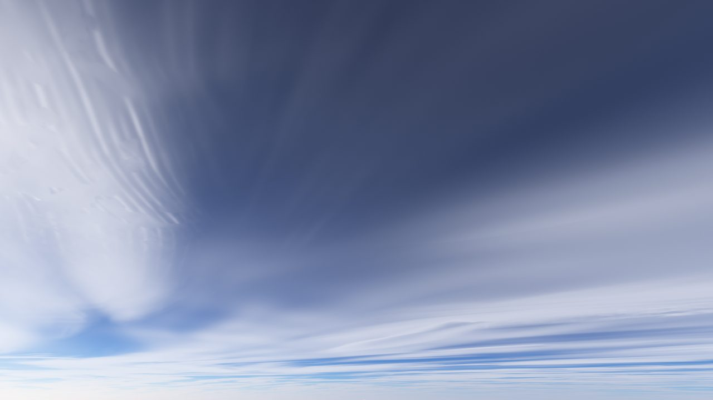

# How Sky draws a frame

This document follows one frame from the address bar to the pixel. It
describes the code on `main` as it is. Names are those of `index.html`:
functions, constants, uniforms and element ids. Plans and known flaws are
in the [issues](https://github.com/sf624/sky/issues), not here.

## The page

`index.html` holds everything: the markup, the CSS and eleven `<script>`
blocks. It loads no other file.

| Block | Kind | What it is |
|---|---|---|
| (no id) | JS | `TEXT`, the strings in Japanese and English, and `applyLanguage`. It runs right after the panel. |
| `stars` | data | The star catalogue, base64 (see [Stars](#sun-moon-stars)). One very long line: never print it. |
| `noise` | fragment shader | Draws the cloud noise and the weather map once, at start. |
| `ice` | fragment shader | Draws the cirrus's map, ice and way once, at start or when cirrus is first shown (see [Cirrus](#cirrus)). |
| `waves` | fragment shader | Draws the map of the waves on the sea once, at start. |
| `fs` | fragment shader | The scene: air, clouds, sea, cirrus, sun, moon, stars. Compiled five more times, each `main` a program of its own: with `CLOUD_PASS` defined, the low clouds along each ray and the first stage of their light, drawn before the scene (see [Low clouds](#low-clouds)); with `CIRRUS_PASS`, the cirrus along each ray, drawn before the scene (see [Cirrus](#cirrus)); with `SHADOW_MAP`, the clouds' depth maps; with `TOPS_MAP`, the map of the tops and the warped weather map; with `SKY_LIGHT`, the sky's light on the clouds. |
| `mean` | fragment shader | Joins each new frame of the aircraft's view to the picture so far. |
| `show` | fragment shader | Copies that picture to the canvas, with dither. |
| `enlarge` | fragment shader | Shows that picture on a canvas with more pixels, enlarged and sharpened, with dither (at `high` and `max`; see [The drawing size](#the-drawing-size)). |
| `meter` | fragment shader | Meters the picture for the exposure, block by block. |
| (no id) | JS | `SkySound`: the background sound (see [Sound](#sound)). |
| (no id) | JS | Everything else, in one function that runs at load and starts the loading. |

There is one canvas, `#sky`, the hero: the view from an aircraft. Clouds,
sea, cirrus, glare. It flies (900 km/h by default) and is drawn as a mean
over frames. It fills the window, and the page does not scroll.
`makeSky(canvas, view, { done, shown })` makes its renderer, a step at a
time (see the next section).

## Conventions

- **Lengths** are in km, in the shaders and in the JS.
- **Axes**: x west, y up, z south. The centre of the planet is the origin.
  The eye is at `(0, RG + uAlt, 0)`, with `RG` = 6360 km (the ground) and
  `RT` = 6460 km (the top of the air). `uAlt` runs from 0.3 to 40 km (see
  [The altitude](#from-the-address-bar-to-the-first-frame)): the eye is
  always inside the air, and every ray starts at the eye.
- **Directions**: `yaw` 0 looks south, 90 degrees west, -90 degrees east;
  a larger `yaw` turns the view to the right (clockwise seen from above),
  and a drag to the right lowers it. `pitch` is positive upwards.
  `camera(yaw, pitch)` gives the column-major `uCam`: right, up, forward.
  With the aircraft banked or climbing, `cameraOf(view)` turns it by the
  aircraft's attitude (see [Steering](#steering)).
  `uTan` is the tangent of half the vertical field of view (`FOV` = 62
  degrees for the hero).
- **Spectra** are twelve wavelengths, 405 to 680 nm in steps of 25 (`WL`),
  stored as `vec4 X[3]`: four wavelengths per `vec4`. Loops run
  `for (int k = 0; k < 3; k++)`. `uWL` holds each wavelength divided by
  550 nm.
- **Light** is in units of the sun's irradiance. The weights `uWR`, `uWG`,
  `uWB` turn a spectrum into linear sRGB with the solar spectrum folded in
  (`W` in the JS, from the CIE 1931 functions `CMF` and `SOLAR`); the bare
  sun has luminance 1. `main` multiplies by `ISUN` = 20.
- **The way flown.** The aircraft does not move: the world does. `state.drift`
  is the way made over the sea, in km, wrapped to `[0, WEATHER_KM)` with
  `WEATHER_KM` = 256 so that it keeps its precision in single-precision
  floats. The shader reads clouds, sea and cirrus at `p.xz + uDrift`. When
  the drift wraps, every pattern read there jumps by 256 km, so **every
  pattern must repeat a whole number of times in 256 km**, or a seam shows.
  Hence `BASE_KM` = 8 (32 tiles of the noise), `DETAIL` = 7 (whole tiles of
  the fine noise per tile), the wave bands and the cells of the foam
  rounded to whole numbers per map (`rep`, `cells`), the swells with whole
  numbers of crests (`SWELL`), the cirrus frames stepping by whole numbers
  (the tile of the ice twice or four times in a unit of each, and every
  noise in the ice with a whole number of cells to the tile), and the bands
  of the cirrus's map written with whole-number frequencies in its frame.
- Comments in the code are plain English sentences that say what and why.

## From the address bar to the first frame

The page shows at once in its loading state: the hero is dark (`.loading`,
a gradient of a night sky), with the title over it. After 0.3 s a thin line
of progress and a word (`TEXT.loading`) fade in, so a quick start shows only
the dark. The panel and the full-screen button stay hidden (no clicks, no
focus) until the first picture. All of this is HTML and CSS: it needs no
script.

The JS then runs once, at load, and does little:

1. **Inputs.** URL parameters with the id of a slider set that slider's
   value (the browser clamps it to the slider's range and step). Then
   `readInputs()` copies the sliders into `state`. `now`, `rate` and `play`
   then act as the now button, the select and the play button, but the
   time does not run yet (see below). `alt`, `yaw`, `pitch`, `heading`, `bank`,
   `climb`, `at`, `pixels` and `res` are read directly (see
   [development.md](development.md#url-parameters)). Without `yaw`, the view
   starts 65 degrees to the side of the sun; without `heading`, the
   aircraft flies 60 degrees to the left of the view.
2. **The loading.** After the first paint (an animation frame, then a
   message), `makeSky` for `#sky` makes the renderer. It is an `async`
   function: it waits a frame (`nextFrame`) wherever it would otherwise
   hold the main thread or wait for the GPU. Its steps:
   - `getContext`, and the extensions.
   - Every program (`fs`, `noise`, `ice`, `waves`, `mean`, `show`, `enlarge`, `meter`) is
     compiled and linked at once, and nothing asks how it went yet. With
     `KHR_parallel_shader_compile`, the GPU process compiles them on threads
     of its own; the page asks `COMPLETION_STATUS_KHR` once a frame. Without
     it, asking waits, so the page asks for one program a frame. A failed
     program throws the compiler's or the linker's message.
   - Meanwhile the tables of the CPU, in slices of about 8 ms, one a task
     (`slices`). Each is a generator (a job) that yields every little while;
     `finish(job)` runs one at once.
     - `odTable` (`buildDepths`): optical depth to the top of the air
       towards the sun, over altitude (48 rows, squared spacing) and the
       cosine of the sun's zenith angle (96 columns from -0.2), 64 steps
       each. Read by `sunDepth()` in the JS only.
     - `starData` (`buildStars`): the star texture.
     - the table of `depthToTop` (`depthTable`, see [The air](#the-air)).
     - `msData` (`buildMultiScatter(haze)`): the multiple-scattering table
       (see [The air](#the-air)), for the haze given, the longest (0.2 to
       0.3 s). It reads `odTable` (through `sunDepth`), so it starts when
       that is done, and goes on beside the star and depth tables, while the
       GPU compiles the programs and draws the textures; the first frame
       waits for it.
     - The slices of all these are paced by timers (`soon`), not by frames:
       while the page starts and the GPU draws the textures, a frame comes
       only every 50 ms or so. Paced by frames, after the other tables, the
       multiple-scattering table took 1.8 s and held the first picture back
       by 0.4 s.
     - With them goes a constant, `NIGHT`: the moonless night sky
       (airglow), 8.59e-10 of the sun's irradiance, about 4e-8 of the
       daytime sky.
   - The textures (see [Textures made at start](#textures-made-at-start)).
     The noise and the weather map are drawn in batches (`batches`), the
     weather map in strips of 64 rows (the scissor; each pixel is the
     same as from one draw), and so is the cirrus's ice in
     pieces of 512 x 512, after the noise, if the page starts with cirrus
     (else `render` draws them all at once when cirrus is first shown; see
     [Cirrus](#cirrus)). The cirrus's map is drawn before the noise, as soon
     as the programs are linked: some drivers finish a program only at its
     first draw (see `prime`), and the ice program is large; its driver
     works on it while the noise is built. After each batch the page waits for a fence
     (`settle`); a batch doubles while the GPU gets through it in under
     100 ms (up to 64 pieces of the ice) and halves over 250 ms. The GPU process draws the whole
     browser, and a slow GPU given seconds of work at once would freeze it.
   - `prime`: the first frame is drawn as the first frame will draw it
     (`render` as a probe, which then puts its state back), and `show` once
     without a pixel (the scissor). Some drivers finish a program only at
     its first draw, which can take a second: that happens now. ANGLE on
     Direct3D 11 (Chrome and Edge on Windows) compiles a program at link
     for one target, and again at its first draw into two or more, while
     the GPU process waits: the scene and the cirrus's pass draw into one
     target each (and the depth), and the ice program, which draws into
     three, is drawn once into a pixel of three as soon as it is linked
     (`warm`), while the others still compile. Once a
     fence says the GPU is done, that frame is metered, and once another
     says the meter is drawn, it is read: the read does not wait. (Metered
     right after its draws, the meter sometimes read the picture before it
     was drawn, about one load in fifteen on the test machine with the
     256^3 body: the first frame then began some 17 stops too bright.)
     Where the night eye hangs on the exposure (late twilight and night),
     the frame is drawn and metered again, at the exposure the last reading
     gave, until a reading lies within `ADAPT_START` of the exposure it was
     drawn at (see [Exposure](#exposure-and-the-tone-curve)); by day one
     reading does.
   - A context lost meanwhile (`webglcontextlost`: the GPU process
     restarted, or its driver gave up) ends the loading with an error at the
     next wait, instead of waiting for a fence for ever.
   - With `?timing` in the address, each part prints to the console as it
     ends (seconds since the page was opened: the tables, each program
     compiled, the noise, the cirrus, the waves, the first frame, the first
     picture), and every 5 s the programs it still waits for.
3. **The hand-over.** The hero's `data-sky` becomes `ready` (`failed`
   without WebGL2 or if the loading failed). A loading that fails (a
   program did not compile, or the context was lost) is tried again a
   quality level lower (see [Quality levels](#quality-levels)). If it
   fails at every level, or there is no WebGL2, the error goes to the
   console and the loading state stays, its line hidden and its word
   changed to `TEXT.failed` (`TEXT.noWebGL`), with what failed at each
   level and the GPU's name under it (`.why`).
   `kick()` asks for the first frame; a time-lapse asked for in the address
   starts now; the title's and the panel's timers start (see `.told` and
   `.still`). Before this, `kick()` and `schedule()` do nothing.
4. **The first picture.** The first frame is only metered, as always (see
   [Exposure](#exposure-and-the-tone-curve)); if what it is drawn from is
   what `prime` drew, prime's reading stands, else it reads the meter at
   once. The second frame goes to the canvas, and `render` calls `shown()`:
   the hero gets `.shown`, and the loading state fades out over the picture
   in 0.8 s (it lets the pointer through at once), while the panel fades
   in. The class and the picture reach the screen in the same frame, and
   the fade starts from opaque: nothing empty or half drawn shows.

So no step holds the main thread for long, except `getContext` itself.
The pictures are the same as when everything ran at once: the jobs and
batches only split the same work.

A hidden tab has no animation frames: there `nextFrame` waits 100 ms
instead (the browser slows that down further), so the loading goes on
slowly; the first frame waits until the tab is shown.

**The loop.** `update()` marks the state changed and calls `kick()`,
which asks for one `requestAnimationFrame(frame)`.

`frame(now)` then:

- does nothing in a hidden tab;
- if something changed: rebuilds `msData` when the haze has changed (at
  once, with `finish`; it takes about a quarter of a second: while the haze
  slider moves, it is built `HAZE_WAIT` = 250 ms after the last move), runs
  `celestial()` and sets the panel's labels;
- flies the aircraft (`fly`, see [Steering](#steering)): the controls,
  the turn, the climb, and `state.drift` grows by `speed / 3600 * dt`
  along `state.heading` (`dt` capped at 0.1 s, and 0 after a pause, so the
  aircraft never jumps);
- calls the renderer, which draws the clouds' depth maps first when they
  are out of date (see [The clouds' shadow](#the-clouds-shadow));
- asks for another frame only if the renderer returned true, or a
  control of the steering is held.

The renderer returns true while the aircraft flies, while its picture is
still settling, or while the exposure moves. So the page draws nothing at rest once the picture is
clean, or in a hidden tab. `visibilitychange` calls `kick()` again.

**Playing.** The play button runs the time at the rate of the select beside
it (`pace`, a factor of real time; 960 at first, a day in a minute and a
half). Each `tick()` moves the time by the time elapsed since the last tick
(`performance.now()`) times the rate. A gap longer than a quarter of a second
is not a frame (the tab was hidden): at real time the time catches up with
it, at the faster rates it counts as 0.25 s, so the time does not leap. A
new rate applies from the moment it is chosen. Past 24:00 the date moves
on by a day, and from the last day of the year to the first. The moon's age
runs on with the time, a day of age a day, and so does the sun on the
ecliptic (`state.dayShift`, see below): nothing jumps at midnight. At the
faster rates, ticks come with the frames (`requestAnimationFrame`), and
every frame is drawn again.

**Real time.** The sun moves a quarter of a degree a minute. At the default
drawing limit (WQHD, 1440 rows over the 62 degrees of the view) that is
less than a pixel in 10 s. So at real time the ticks come from a timer,
once a second, and the time that is drawn (`state.time`) moves in steps of
10 s (`REAL_STEP`): each step draws the picture again and lets it settle
(39 frames), and nothing is drawn in between, about 6 % of the frames.
The panel's clock shows the minute, which changes only on a step. In a
hidden tab the timer runs on (the browser slows it); `visibilitychange`
brings the time to the present at once. In flight every frame is drawn
anyway.

**Now.** The now button sets the date to today, the time to the device's
clock (taken as local solar time), the moon's age as moving the date does,
the rate to real time, and plays.

**The altitude.** `state.alt` runs from `ALT_MIN` = 0.3 to `ALT_MAX` = 40
km. Its slider (`#alt`) has a row of its own under the time's, as long
as the panel, and is not in km: up to `ALT_LINEAR` = 13 km it is even in
km, 635 steps of `ALT_STEP` = 20 m, then even in log(h) over
`ALT_LOG_STEPS` = 400 steps, 37 m a step at 13 km and 112 m at 40 km.
`altPlace` and `altAt` turn a height into the slider's place and back;
every height in steps of 0.1 km up to 13 km has a place of its own. The
heights of `ALT_TICKS` (1, 5, 11, 20 and 40 km) are written under the
track (`.ticks`). On the desktop's panel (a track of 778 px) a pixel is
27 m up to 13 km, 75 m at 20 km and 150 m at 40 km; on a phone 411 px
wide (329 px), 63, 177 and 354 m. Before, the slider shared a row with
three others and was even from 0.3 to 13 km in steps of 0.1 km: 77 m a
pixel on the desktop, 86 m on the phone, 100 m a step. The value beside it
(`#altOut`) is a text field: it shows the height as the other values do
(in m below 20 km, to 10 m; in km above, to 0.1 km) and reads a number
typed into it (`altTyped`): in km below 300, in metres from 300 on (the
heights in km end below 300, those in metres start there), or as `m` or
`km` after it says. The state keeps the height itself, not the slider's
place: `?alt=11` draws at 11 km exactly, as before; a height set by the
slider is rounded to 10 m.

## Steering

The aircraft is steered (`fly`, in the wiring of the script, once a frame
before the renderer). A simple model, not a simulator:

- **State.** `state.heading` (radians, the `yaw` convention), `state.climb`
  (the angle of the flight path, nose up positive) and `state.bank` (right
  wing down positive). The eye's `state.yaw` and `state.pitch` stay in the
  world as before; when the aircraft turns by d (`turnBy`), the eye turns
  by d too, so one keeps looking out of the same window. The sun, the moon
  and the stars do not move.
- **The camera.** Level (`bank` and `climb` both 0), `cameraOf` is
  `camera(yaw, pitch)`, to the last bit: a view without steering draws as
  before. Otherwise it is the aircraft's frame (`basis(heading, climb)`,
  rolled by the bank about the nose) times the eye's direction within it
  (`basis(yaw - heading, pitch)`). Looking ahead the horizon tilts by the
  bank; out of the side window the bank also raises or lowers the view.
  Every reader of `uCam` (the frame, the light pass, the meter's weights
  near the sun, the lens glare, `whence`) takes any rotation; the glare
  lies along the picture's axes, as in a photograph.
- **The turn.** A coordinated turn: the heading changes at g tan(bank) / v
  (`G`, v the speed in km/s), plus the rudder's `YAW_RATE` (3 degrees a
  second), at most `TURN_MAX` (30 degrees a second). The way of a frame
  follows the heading of its middle (the chord of the arc flown), at
  `v cos(climb)`; the altitude changes at `v sin(climb)`, through
  `climbTo` (the sound) and `setAltitude` (the state, the slider, the field,
  the limits `ALT_MIN` and `ALT_MAX`; the one path of every altitude),
  within 0.3 to 40 km. At the top or the bottom of the range the
  climb eases back to 0 at `PITCH_RATE`.
- **The controls** give rates from -1 to 1: the keys (by `code`, so WASD
  sits in the same place on every layout; not while the focus is in a
  control, and they do not wake the panel) and the stick (its deflection
  to the rim; shown on a touch screen or with `?stick=1`, and where the
  panel would cover it, only while the panel has faded; held, it keeps
  the panel away). Roll at `ROLL_RATE` (30 degrees a second) up to
  `BANK_MAX` (60), pitch at `PITCH_RATE` (5) up to `CLIMB_MAX` (15). Let
  go, the attitude stays. Level (`L`, the panel's button, the stick's)
  moves both back to 0 at those rates. The panel has no slider for the
  attitude: the HUD shows it.
- **Speed 0.** The aircraft stands: bank and climb only tilt the view, the
  rudder turns it on the spot. `fly` returns true
  while a control acts, and `frame` then asks for the next frame even when
  the renderer has settled.
- **What follows the place, not the heading:** the clouds, the sea, the
  cirrus (read at `p.xz + uDrift`), the towers' grids (`state.drift`), the
  clouds' depth maps. The sea's wind is fixed in the world. The sound
  follows the speed and the altitude only.

## The HUD

A head-up display over the picture (`drawHud`, `paintHud`, after Steering
in the script), on a 2D canvas of its own (`.hud`) between the picture and
the overlays; it takes no pointer, so a drag on it turns the eye.

- **On and off.** Off at first: the page's aim is a picture like a
  photograph. `?hud=1` / `?hud=0`, else the stored choice (`sky.hud`, as
  `sky.lang`), else off. The panel's switch and `H` (a steering key: the
  same focus rule, it does not wake the panel) turn it over and store the
  choice. Off, the canvas is hidden and never gets a context: no pixels,
  no drawing, and every other picture as before.
- **When it draws.** `frame` calls `drawHud` after the renderer; it draws
  only when its key (the CSS size, the device pixel ratio, `cameraOf(view())`,
  heading, bank, climb, speed, altitude) has changed. At rest nothing is
  drawn; in flight, once a frame (2D lines and text).
- **Two parts, as a helmet's display.** The readouts are fixed to the
  screen (to the eye), so they are always in view; the attitude is drawn
  on a glass fixed to the airframe, so it is seen only where the view
  takes in the direction of flight. Both are laid out in degrees
  (`HUD_DEG`, about 28 degrees across and 25 high): the readouts from the
  middle of the screen, the glass from the nose, at the same size. Looking
  ahead the nose is in the middle of the screen, and the two make one HUD.
- **The helmet's readouts**, upright on the screen (they bank with a view
  from the aircraft, as the head does): the speed (km/h) in a box on the
  left; the altitude (`altText`, the panel's unit) in a box on the right,
  with the vertical speed (m/s) under it; the aircraft's heading (compass
  bearing, `bearing`; not the direction of view) in a box at the top. The
  heading is a number, not a tape: a tape fixed to the screen would put
  bearings where the world shows other ones whenever the eye looks aside.
  On a narrow screen (a phone upright) the side boxes come in to stay
  `HUD_SIDE_PX` from the edges.
- **A glass fixed to the airframe.** A plane square to the nose at a
  distance of 1, with the aircraft's right and up as its axes
  (`airframe`, which `cameraOf` uses too); every point of it is projected
  with the picture's own camera (`cameraOf`, the vertical field `FOV`, the
  canvas's CSS size). So it sits round the nose wherever the eye looks:
  ahead it fills the middle of the view, with the eye 20 degrees aside it
  is seen 20 degrees aside (a little askew, as a glass seen at a slant),
  and out of the side window it is out of view. Lines are cut where they
  would pass behind the eye; the canvas's edge and the ladder's area clip
  the rest, so nothing pops in or out. Where the glass passes under a
  readout it is wiped out (`destination-out`), at full in the readout's
  zone and fading over 0.8 of a degree round it, so the readouts stay
  readable and nothing is shown twice.
- **True to the world.** The horizon line and the pitch ladder (every 5
  degrees, solid above, dashed below, numbered, their tips towards the
  horizon) lie on the glass where the world's directions cross it: the
  horizon line is the plane of zero pitch through the eye, the rungs are
  the elevations on the vertical through the nose, each along its circle
  of elevation. They are clipped to the ladder's area of the glass; a
  rung's number is drawn only where it fits in the area whole, never cut.
  The sea's horizon lies below the line by the dip of the altitude (0.56
  degrees at 0.3 km, 3.4 at 11 km): that is right, not an error.
- **Upright on the glass:** the flight path marker at the nose (the model
  has no angle of attack nor sideslip: the aircraft flies where the nose
  points) and the bank scale round it (10, 20, 30, 45, 60 degrees; its
  pointer at minus the bank, square to the horizon). They bank with the
  airframe; the eye, which turns with the aircraft, sees them upright
  when it looks ahead. Text takes the glass's local transform.
- **Look.** Green (`HUD_GREEN`) over a thin dark edge (each layer is
  stroked dark first, then green), so it reads on a bright cloud deck,
  the blue sky, at dusk and at night. Numbers 1 degree high (12 CSS px on
  a phone upright, 16 at 1080 lines, 21 at 1440), but never smaller than
  `HUD_MIN_PX` (10 CSS px): on a short screen (a phone on its side) the
  whole layout, the glass's too, grows to that, while the ladder's rungs
  stay at their true elevations. Lines of whole device pixels; the canvas
  holds the screen's pixels (`devicePixelRatio`). System fonts only,
  numbers and units only: no language.
- **The panel**, while it is shown, lies over the middle of the screen on
  most screens (on a phone, over nearly all of it), and so over the HUD;
  it fades a few seconds after the last touch, and the HUD is clear. The
  HUD does not move out of its way: no place would be clear of it on a
  phone, and readouts that jump as the panel comes and goes read worse.
- **The default view** looks 60 degrees right of the nose: the glass is
  then out of view (its right edge may touch the left of a wide screen),
  and only the readouts show. A drag to the right (the view turns left),
  or `?yaw=` equal to `?heading=`, looks ahead; the page has no control of
  its own for that.
- `window.__hud()` gives the glass's anchor (the nose on the screen), its
  horizon line as drawn, whether any of it is on the screen (`airframe`),
  the scale of the glass and of a degree of the layout, and the zones of
  the readouts (`helmet`), for the tools (`check steer`).

## Sun, moon and sky in the JS

`celestial()` places the sun, the moon and the stars for `state.day` and
`state.time`:

- The observer is at `state.lat` (35 degrees north at first, `?lat=`), at
  any latitude from pole to pole: `onSky` turns a declination and an hour
  angle into the local sky there, and the star map, the Milky Way and the
  zodiacal light follow through `uSky`. Nothing else depends on the
  latitude: the air's tables take only the sun's elevation, so a new
  latitude costs what a new time does.
- `state.clock` says what the date and the time are. On the solar clock (at
  first) the time is local solar time: the sun is highest at 12:00 (due
  south north of the tropics), and the sun moves evenly along the ecliptic
  (`OBLIQUITY` = 23.44 degrees), at longitude 0 on day 80 (up to 1.5
  degrees from the real sun). The longitude does not matter there: at the
  same solar time the sky is the same at every longitude.
- On the UTC clock (`?clock=utc`) the date and the time are a moment in
  UTC, and the observer stands at `state.lon` (135 degrees east at first).
  `sunAndSidereal` gives the sun's longitude and the local sidereal time
  from the Astronomical Almanac's low-precision formulas (the sun within
  0.01 degree of NOAA's solar calculator). The stars keep their J2000
  places (precession is left out: up to 0.3 degree in 2026). The panel's
  clock keeps the moment when it changes (`setClock`); the sun then moves by
  the solar clock's error, at most 1.5 degrees.
- The place button asks the browser for the place (only when it is
  pressed; the browser asks the reader first), rounds it to 0.1 degree, and
  sets the UTC clock and now. The place stays in the page.
- The moon runs ahead of the sun along the ecliptic by its age
  (`state.moonAge / 29.53` of a turn). Its orbit's tilt is left out.
- Moonlight is 2.5e-6 of sunlight at full moon, falling with the phase
  angle (`state.moonI`). It is there at every hour, by day too. Only its
  light in the air (`uMoonI`, `moonAirFor`) is left out where it cannot
  show: it fades out as the moonlit air (the air's mean light, `airLevel`,
  for each light) goes from 11 to 14 stops below the sunlit air
  (`MOON_AIR`), a twentieth of a step of the screen or less. By day that
  saves a second light in every march (4.8 ms of 22 at 2560 x 1440); with
  a full moon it comes in fully with the sun 5 degrees down.
- A light below the horizon still lights the air above until it is some
  18 degrees down. `state.sunOn` (`uSunI`) fades from 1 to 0 as the sun goes
  from 18 to 21 degrees down (a smoothstep, `lit`), so that no step shows
  when it stops mattering; the moon's light fades the same way.
- One light for the clouds and the sea (`uLight`, `uLightI`): the sun,
  then the moon. It never steps: the sun's share (`state.lightShare`,
  `uLightShare`) fades from 1 to 0 as the sun goes from 3 to 4.5 degrees
  down, the light turns to the moon there, and the moon's share comes in
  by 6 degrees down (`LIGHT_SWAP`). The clouds' shadows (on the sea, in
  the air, and the light of the lit clouds around a shaded side) come and
  go with the share. In between, both lights are faint beside the light of
  the twilight's sky. Before, the light turned from the sun to the moon at
  once at -3 degrees, and with it the shadows on the sea.
- The eye's night vision (`nightEyeFor`, `uNightEye`) follows the eye's
  adaptation, not the hour: it comes in from 0 to 1 as the exposure (log2)
  goes from 5.5 to 9 (`NIGHT_EYE`, a smoothstep). In a view away from the
  sun that is with the sun from about 3 to 6 degrees down; towards the
  glow of the sunset, which holds the exposure down, a degree or two later.
  It sets the rods' grey and the night's tone curve ([Exposure and the
  tone curve](#exposure-and-the-tone-curve)) and the moon's glitter as
  sparkles ([The sea](#the-sea)). At the start the sky is still some 30
  cd/m2, far too bright for the rods to matter. Before, it came in with the
  sun from -3 to -6 degrees, and also raised the Milky Way and set which
  stars were drawn.
- `state.sky` (`uSky`) turns J2000 equatorial directions into local axes.

The date slider covers the current year. The moon's age starts from the
date (`moonAgeOn`: the mean lunation, from the new moon of 6 January 2000)
and is set again whenever the date slider moves; the moon slider then
changes it alone. With `date` and no `moon` in the address, it follows the
given date.

The sun's place on the ecliptic comes from the day number, one step a day.
While the time plays past midnight, `state.dayShift` (in days) holds the
sun where the time has carried it: it grows with the time and loses a day
when the date moves on, so the sun and the stars turn on smoothly. Setting
the date or the time sets it back to 0.

## The air

`main` in `fs` marches along the view ray from the eye to the top of the
air, or to the sea. The air is three species, with densities from
`density(h)`:

- Rayleigh: `exp(-h / HR)`, `HR` = 8 km; scattering `uBR` = 13.558e-3 per km
  at 550 nm, falling with the fourth power of the wavelength (`BR`).
- Mie (aerosol), after published profiles of the background aerosol
  (OPAC, Hess et al. 1998; Shettle and Fenn 1979; SAGE II for the
  stratosphere). The haze of the lowest kilometres, the boundary layer,
  is well mixed up to `BL` = 1.5 km and falls off over about 0.3 km above
  it (`boundaryLayer`: a logistic step, 1 at sea level); above it two thin
  layers (`AERO_FREE`, `AERO_STRAT` in `fs`, `AERO_UP` and `mieUp` in
  the JS): 0.048 of the sea level's density at 6 km (half-width 5 km, the
  free troposphere) and 0.004 at 20 km (half-width 8 km, the
  stratosphere). Scattering `BETA_M` = 0.044 per km at sea level times
  `uHaze` (the haze slider, 1 by default), extinction `MIE_EXT` = 1.05
  times that (a single-scattering albedo of 0.95: between maritime air,
  0.99, and continental, 0.92). By wavelength, times
  `(550 nm / wavelength)^ANGSTROM`, `ANGSTROM` = 1.3 (`MA` in the JS,
  `uMA` in `fs`): a little bluer. At the default haze the optical depth
  at 550 nm is 0.070 in the boundary layer, 0.019 in the free troposphere
  and 0.0026 in the stratosphere, 0.091 in all: a clear day of fair
  weather (0.05 to 0.15 over the sea and the coast; a visibility of about
  65 km at sea level). The slider scales all three: 0.3 is very clean air
  (0.03), 3 to 6 hazy (0.3 to 0.55).
  The default was chosen from a series of haze values beside photographs
  of clear days, from the sea and from the air, by day and at dusk
  (round 10). Round 9 had 0.14 in all, and with the phase function
  of the time the sky near a sun at 30 degrees, seen from near the sea,
  was a milky beige column from the top of the picture down to the
  horizon, and a sun 2 degrees up dimmed so much that its glitter was
  nearly gone.
  Before (round 8), the boundary layer was `exp(-h / 1.2)` with 0.0014 per
  km: an optical depth of 0.002, some 50 times less than real air; the
  horizon was crisp, distant clouds and sea did not fade, and at dusk the
  ground below the band of glow was dark blue where photographs show a
  brown-orange haze.
- Ozone: a triangle from 10 to 40 km, peaking at 25 km; absorption `uBO`
  from the Chappuis cross-sections (`OZONE`) for 300 Dobson units.

Phase functions (`phases`): Rayleigh, and for the aerosol the
Cornette-Shanks form (`cornetteShanks`), by height:

- In the boundary layer, two lobes: a sharp one, `MIE_PHASE` = (0.149,
  0.932, 0.609) — 0.149 of the light with parameter 0.932, from the
  larger particles (sea salt, dust) — and a broad one with 0.609. Fitted
  to Mie theory (computed for this, from Bohren and Huffman's
  recurrences) for humid maritime and continental aerosol after OPAC: the
  mean of the two is matched within 8 % from 2.5 to 90 degrees off the
  light. The asymmetry is 0.715. The sun's aureole is round and bright
  within a few degrees and falls off fast: 2 to 4 times the single
  lobe's (`g` = 0.7) within 2.5 degrees of the sun, 0.8 of it from 10
  to 20 degrees. The
  single lobe of round 9 made the sky from 10 to 30 degrees off the sun
  too bright, and as bright near the horizon as up by the sun: from near
  the sea it drew a pale column under a high sun, with a nearly vertical
  edge.
- Above it (`MIE_G_UP` = 0.6, an asymmetry of 0.66), one broad lobe: the
  free troposphere and the stratosphere hold small sulphate particles,
  whose Mie phase function has no sharp peak (fitted the same way). With
  the boundary layer's lobes there, the stratospheric layer drew a small
  white core over the set sun from cruise.
- `densities(h)` gives the boundary layer's share of the aerosol at `h`
  (its `w`), and `addLight` mixes the two by it. `buildMultiScatter`
  does the same (`phaseM`, `phaseUp`).

**The march.** `NV` = 20 samples at
`t = tmax * f * f`: denser near the eye. In twilight the view ray may pass
through the planet's shadow: in parallel light, a cylinder of radius `RG`
behind the planet (`shadowSpan`: the part of the ray inside the cylinder
and behind the plane through the planet's centre facing the light). By
day the eye is inside the cylinder on the light's side; until issue #54
the span was cut by the chord's middle alone, so that every ray above a
curve through the sun was marched as if it crossed the shadow, with 8
samples instead of 20: a step of about 1 % across the sky. Then the
march has three runs, each
denser at its start: `NV` samples from the eye to the shadow, `NSHADE` = 8
in it, and `NFAR` = 16 in the lit air beyond (a run of no length is
skipped). The light scattered once rises steeply from the shadow's edge;
20 samples over the whole ray left layers of colour above the band of
glow that came and went with the angle (a purple one at 7 degrees with the
sun 14 degrees down). A ray that misses the shadow is marched as before,
so the day's picture is unchanged. Each sample adds, for the sun and for
the moon, `addLight`:

- light scattered once, if the planet does not hide the source: the
  transmittance from the eye to the sample and from the sample to the top
  (`depthToTop`) times the phase functions, times `direct`: the share of
  the light that the clouds let through there (below);
- light scattered many times: the multiple-scattering table times the
  local scattering coefficient, times the transmittance to the eye; and
  for the aerosol, which sends light on forwards, `MIE_LEAN` = 4 times the
  table's lean (below) towards the view, where it is positive: more of
  that light when the view looks where it comes from.

The clouds and the cirrus enter the march as two layers (see
[Low clouds](#low-clouds) and [Cirrus](#cirrus)). At each layer the march
ends a sample exactly there (`tLayer`), adds the layer's light (`C` or
`H`) dimmed by the air before it, and multiplies what lies beyond by the
layer's transmittance (`vis *= Tc` or `Th`). Behind a thick cloud
(`vis` = 0) the march stops.

Light from below the local horizon grazes the planet on its way, through
hundreds of kilometres of the boundary layer, which takes it out. Until
round 8 the air was so clean that this light came through deep red, and
a cut (`grazeCut`) removed light that passed lower than 1 km; with the
real boundary layer the reference and the page agree without it (to 2 %
in the planet's shadow), so it is gone.

**Shafts.** Below the tops of the clouds, `direct` comes from the clouds'
shadow map (`cloudShadow`), sampled more finely than the march: `SHAFTS`
= 16 samples over the part of the ray below `CT` (`ca` to `cb`), denser
near the eye (`f * f`), at new places each frame (`ign`). Each step of the
march takes the mean of `exp(-tau)` over the samples that fall in it,
weighed by the air's scattering there (Rayleigh at 550 nm and Mie), or
reads the map once at its middle if none does. Lit and shaded air
alternate along the ray: shafts of light between the clouds, and the
clouds' shadows in the haze. Above the tops `direct` is 1. Without low
clouds, or without a light, nothing is sampled.

**`depthToTop(p, d)`**, the optical depth from `p` to the top of the air:

- One filtered read of the depth table (512 by 128, `DEPTH_MU` by
  `DEPTH_R`; in `uMS`, after the multiple scattering: one texture less for
  Direct3D 11's 16), made at start in `makeSky` by a 16-step midpoint sum. Its axes follow Bruneton (2017): the distance to the top, between
  its least and its most at that height, and the distance to the horizon
  (`rho / H_TOP`). The table is RGBA32F where the GPU can filter full floats
  (`OES_texture_float_linear`), else RGBA16F.
- The table repeats the density profile. The profile is written out twice:
  `densities()` in `fs`, and in the JS (`boundaryLayer`, `mieUp` and
  `mieDensity` for the aerosol, used by `buildDepths`, `buildMultiScatter`
  and this table in `makeSky`).
  Change both.

**Multiple scattering** (`buildMultiScatter`, after Hillaire, 2020): for
each altitude (`NH` = 12 rows, squared spacing) and cosine of the sun's
zenith angle (`NMU` = 40 columns from `MS_MU_MIN` = -0.35), the mean light
that reaches a point, to be times the scattering coefficient there:

- The light scattered once is gathered over the sphere, with the phase
  functions of the air and the aerosol (each layer's) for the sun's light scattered
  towards the point, and with sunlight bounced off the ground (`ALBEDO` =
  0.07). In twilight that light comes from the lit air towards the sun,
  scattered forwards; gathered as if isotropic, the table held 0.65 to
  0.75 of the reference's (below) in the planet's shadow, now 0.85 to 0.95:
  16 bands of height, narrower near the horizon (edges at `x |x|` for
  even `x`), each counted by its share of the sphere, times 4 directions
  over half the sphere, mirrored; 14 steps each. In twilight that light
  comes from the lit air low on the horizon: 8 even bands, the nearest
  3.6 degrees off it, missed most of it, and the sky of nautical twilight
  came out 3 to 5 times too dark.
- The higher orders follow as a geometric series (Hillaire).
- Then, while the sun stands lower than 17 degrees (blended in down to
  9), one more gathering of that field itself, an order computed rather
  than guessed. The series keeps the colour of the light scattered twice;
  in deep twilight that is the red glow on the horizon, and the air came
  out orange where the sky above is blue. One more order is enough: a
  second changes the table by less than 1 %.

A second table holds the sky's light on the low clouds (`cloudSky`): as
bright as the mean light, but in the colour of the light from above on a
level surface (gathered over the upper half of the sphere times the
cosine, all orders). It is the mean light itself while the sun stands
higher than 6 degrees, and fully the light from above from -3 degrees
down. By day the mean light stands for all that lights a cloud besides
the sun, the sunlit cloud and sea around it among them; once the sun is
down only the sky is left. The colour was taken relative to that of the
mean light with the sun at 30 degrees: it kept the day's warm share into
the twilight, and a deck after sunset came out grey-brown where
photographs show it blue-grey. With the mean light alone, the clouds
were mauve and brown under a blue sky.

A third and fourth hold the mean light's lean (`msLean`): the light
gathered times the direction it comes from (pass 0 and the computed
order), towards the sun's side and up. The table's light is a mean over
directions, but the aerosol scatters forwards: below the band of glow,
seen from cruise, the reference's light (scattered many times by the
boundary layer, coming from the glow) was twice the table's and
brown-orange where the table's was blue. The lean's first moment would
weigh it by 3 times the asymmetry (2.1 in the boundary layer); with the forward peak sharper
than that, 4 fits the reference best, and taking it only where it is
positive keeps the views away from the light as they were (the first
moment taken there too left the sky away from the sun 0.65 of the
reference's).

One value per wavelength. The texture is `NMU` by `12 * NH`: the three
groups of four wavelengths of the air stacked in y, then those of the
clouds, then the lean towards the sun's side and up. It depends on the haze, so `frame` rebuilds it when the haze
changes, and the renderer uploads it again. `fs` reads it through the
GPU's filter (`textureLod`; RGBA16F when full floats cannot be filtered).

**Against measurements** (a float64 copy of the model of round 8, with
its thin aerosol and `grazeCut`; not measured again since). Integrated
over the sky at sea level (haze 0.35 of that aerosol, 128 klx of sunlight outside the air), the model gives, against the
horizontal illuminance table in Schlyter, "Radiometry and photometry in
astronomy": sun at 0 degrees, 937 lx (measured 759); -6, 6.3 lx (3.4);
-12, 0.016 lx (0.008). The zenith, against a fit to sky quality meter
readings (hnsky.org, "SQM twilight"): 0 degrees, 148 cd/m2 (216); -6, 0.89
(0.63); -10, 0.014 (0.013); -14, 5.1e-4 (4.7e-4). Within a factor of two
throughout. The layers and the cut change these figures by less than
10 %: they matter for the colours low in the sky, not for these totals. Before the bands, the extra order and the shadow's runs, the
zenith at -10 and -14 degrees was 3 and 6 times too dark.

**Against a reference** (November 2026). A Monte Carlo solver of the same
atmosphere (spherical shells, the twelve wavelengths, Rayleigh, the
aerosol profile above with its phase functions by height, ozone, a ground
of albedo 0.07, every order; the light scattered once by a fine march,
the rest by paths with a track-length estimate of the sun's light on each
segment and the hero wavelength scheme of Wilkie et al., 2014), against a
float64 copy of `fs`'s march with the page's own tables, over elevations
-10 to 60 degrees at 0, 90 and 180 degrees from the sun, from 0.3, 4 and
11 km, the sun at 30, 2, -2, -4, -6 and -10 degrees (round 10, the
default haze, 4096 paths a ray). Medians over each set of rays:

- The light scattered once agrees within 3 % (1.00 almost everywhere).
- The sky (from the horizon up): 0.90 to 1.0 of the reference by day and
  towards and away from the sun in twilight (0.97 to 1.0 from 4 and
  11 km), with its colour (the r-chromaticity within 0.02). The
  anti-twilight arch and the planet's shadow away from the sun follow the
  reference closely: the pink band is a narrow one in the reference too
  (warm from 0 to 5 degrees, at its warmest at 3). Away from the sun in
  deep twilight from 0.3 and 4 km, 1.2 to 1.35.
- To the side in deep twilight the page is too bright: 1.1 to 1.2 at -6,
  1.6 to 1.8 at -10 (the table's light gathered as a mean).
- Below the horizon towards the sun in twilight (the haze over the ground
  under the band of glow): 0.7 to 1.0 of the reference (0.96 to 0.98 from
  11 km), a little bluer (r-chromaticity up to 0.06 lower); before the
  lean, 0.44 and blue where the reference is brown-orange. By day below
  the horizon, 0.8 to 0.96 (the sea there is the page's own, not the
  reference's grey ground).

So the light of the sky is the page's atmosphere's; what still differs
from photographs is mostly how much aerosol there is, and the exposure
and tone curve (see [Exposure](#exposure-and-the-tone-curve)).

**The air as a table** (`low`, `high` and `max`: the level's `airLut`,
`Q_AIR_LUT` in `fs`; `mid` marches). A phone spent most of the scene's
time on the march above (`?stats=bench3` on an Adreno 660: 107 ms of a
frame without clouds at full scale, 24 ms without the air's march), and a
desktop GPU a third of the frame at `max` (an RTX 3090 at 1920 x 1080, flying at
cruise: the scene 4.9 ms of 13.9; 2.2 ms with the table). There the
scene reads the air from a table made ahead instead, as Hillaire (2020) makes his sky-view and
aerial-perspective tables (written here from the paper's ideas): `fs`
compiled with `AIR_LUT` marches the air (as above, with the level's own
samples but at least 14, 6 and 10: 20, 8 and 16 at `high` and `max`, 14, 6
and 10 at `low`; up to 4 times as many on a ray longer than 150 km, so
that its first step is some 0.4 km; and without the clouds' shadows) for
`LUT_AZ` x `LUT_EL`
directions round the eye and `LUT_S` distances along each (the level's
`airLut`: 64 x 48 and 16 at `low`, 128 x 128 and 64 at `high` and `max`), from `LUT_T0` (0.05 km) to `LUT_T1` (1200 km),
evenly in their log; a ray that ends sooner (at the sea) keeps its end's
values beyond. The directions are the azimuth from the stronger light's (the sun's,
or the moon's at night: `uLutLight`; from the sun's, the moonlit sky
stepped at the table's seam behind it), squeezed towards it (a square
root: its glow), and the elevation from the horizon,
squeezed towards the horizon (a square root on either side), which lies at
5/12 of the rows (`LUT_VH`: 53 of 128, 20 of 48; the rows below it that
it had at the middle serve above it), with some 5 more rows where the rays above the horizon
graze the top of the boundary layer, seen from above 1.6 km (`lutWarp`,
an arctangent step; `lutUV`, `lutDir`). Along such a ray the haze ends
within some 0.6 km of height, and its depth and light change several
times over within a degree; with the square root alone a row spanned 0.8
km of that height at 4 km and 1.5 km at 11 km, the table mixed rays on
either side of the top, and the sky at the horizon in twilight showed a
band a few levels deep, the lower edge of a setting sun a red row (the
depth from the table some 50 % too deep in the haze there). With 96 rows
at `high` and `max`, the sunset's colour along rays that graze 5 to 10 km
up, seen from 11 km and higher, still showed rows 1 to 2 levels deep: 128
halve them, for 28 MB and some 1 ms a frame of a time-lapse on GL. The
whole ray's light (`LUT_END`, and `LUT_SEA`) once came from 20 samples
over the 1000 km or so of a ray along the horizon, its first steps 2.5,
7.5 and 12.5 km long, where a slice of 150 km had steps of 0.4 to 3 km:
in haze, whose light comes from the first km, the whole ray came out
darker than a slice, and clouds at the horizon, whose air comes from the
slices, stood out pale against the haze beside them. Five more slices
hold the sky as the sea sees it, from its surface through the whole air,
for `skyAt` (round `LUT_SEA`), and one the whole ray from the eye, to the
sea or out of the air (`LUT_END`); `LUT_N` = `LUT_S` + 6 slices a part.
The sea's five are for places on the sea where the light stands higher or
lower than over the eye's: they are made with the sky turned about the
axis square to the light's vertical, the light raised by -1, -0.5, 0, 0.5
and 1 times the angle round the Earth to the farthest sea seen
(`lutSeaSpan`), and `skyAt` reads between them by the light's height over
its place on the sea. The sea seen from 40 km reaches 700 km, 6 degrees
round the Earth; with one slice made under the eye, the sea towards a
setting sun seen from 40 km mirrored a sky too dark, 2 to 7 degrees below
the horizon 8 levels darker than a march of many samples (main's skyAt, a
march from each place on the sea, 4). With five, the sea below the horizon
is within 0.0 to 1.9 levels of that march on average (main 0.1 to 2.9).
The light's height is read linearly between slices, where the sky's light
grows several times a degree in twilight: the sea below a light 4 degrees
down comes out 1 to 3 levels too bright. Slices spaced more finely near the
eye's place and coarsely beyond made the sea from 40 km worse again. The table is
one 3D texture of half floats on unit 29, thirteen times as deep
(thirteen parts of `LUT_N` slices, `LUT_PARTS`): the light's three
`vec4`, the optical depth, the three `vec4` of the part of the light
scattered once from the light the clouds' map is of (the part their
shadows take: the moon's, where it lights the clouds while the sun still
lights the air; before, those shadows were left out there, and a low full
moon over clouds showed the march's darker disc round it), and three
`vec4` each of the light of the boundary layer's sharp lobe (`sharpLobe`:
`MIE_PHASE.x` of its light, `MIE_PHASE.y` = 0.932) from the sun and from
the moon, scattered once, without that phase (`addSharp`). The scene
applies the phase for each pixel, towards the sun and towards the moon
(`airSlice`): the lobe is some 4 degrees wide round the light, where the
table's texels lie 1 to 3 degrees apart high in the sky. The rest of the
light keeps its phase in the table (the air's, the broad lobes', 0.609 in
the boundary layer and 0.6 above it: `phases(mu, true)`), and the part the
clouds' shadows take keeps the sharp lobe's light of the map's light apart
too. (Before, the pixels within 8 degrees of the sun or the moon marched
the air as `mid` does: a second way through the air in the scene's
program, which took Direct3D 11 some 1.5 s longer to compile, and which
needed twice `NSHADE` there: with 8, the low air under a full moon 12
degrees up in twilight, seen from 0.3 km, came out up to 20 levels darker
than a march of 160, 64 and 128 samples, and the circle showed its edge.
So the march of `mid`, and of `max` before the table, is that much too
dark there.) Each slice is drawn straight into its layers of the thirteen
parts: in two draws into seven targets where the GPU has seven
(`LUT_MRT`, `Q_LUT_MRT`; `uLutPart` 0: the parts 0 to 6; 1: the sharp
lobe's), else in four into four (`uLutPart` 0: the light and the depth; 1:
the light scattered once; 2 and 3: the sharp lobe's). A draw that writes
fewer parts fills its other targets with two spare layers at the end of
the texture, which nothing reads (`LUT_DRAWS`): ANGLE on Direct3D 11
compiles the program again for each count of targets, and with draws into
seven and six the first frame there took 1.7 to 1.9 s instead of 0.3. The
program is drawn
once into a pixel of seven targets as soon as it links (`warm`), so that
its second compile runs while the scene's programs still compile. A draw of the sharp lobe's
light marches the same samples but for that light alone (no light
scattered many times, no transmittance of the view by itself). A
framebuffer is made once for each draw of each slice, and all are drawn
when the
sun, the moon, the haze, the height or the amount of cloud has changed
(`lut.for`); in flight, none of these changes. (The parts once lay side by
side in its width, each slice drawn into 2D targets and copied in: 462
copies a table at `max`, which took Direct3D 11 some 2 s, before the first
picture and on every frame of a time-lapse.) The light is kept divided by
the light of the air that the stronger of the sun and the moon makes
(`uLutScale`: the light's strength times the air's mean light at the eye
with it at its elevation, `airLevel`), so that half floats hold the
night's, and the azimuth is measured from that one. (Divided by the sun's
strength alone, at the end of twilight, the sun 18 degrees down and still
counted at 0.97, the air's light was some 1e-8 of it, below what half
floats hold: it came out brighter and in steps, a bright block at the
horizon under a crescent moon.)

The scene then takes, for each segment of its ray (the eye to the first
layer, to the second, to the end), the table's light at its end less at
its start, through the layers before it, and the layers' light through the
table's depth at them (`airSlice`), as the march adds them. Between two
slices of distance it mixes them linearly in the distance. The end of the
ray is read from its own slice: mixed from the slices on either side, a
ray that met the sea between them lost the light of the dense air near
its end, and the sea seen from above came out darker (down from 40 km, 10
levels of 255). The table holds
the clouds' shadows only by their mean (the direct light below the tops
times 1 to 0.15 as the amount of cloud goes from 0.4 to 1: without it, the
air under a deck shone orange at its far edge at dusk). So the part of each
segment below the tops is cut into `Q_LUT_SHADE` pieces (16; 4 at `low`),
shorter near the eye, and each takes the shadow at a place in it, new each
frame (`shaftJitter`, as the march's shafts), over that mean: the piece's
light scattered once, for each wavelength, times the light let through
there over the table's mean. (One shadow, the mean of its places,
over the whole part: at sunset the shafts of light and shadow under the
clouds towards the sun faded to a haze. With one place, the mean at rest kept the jitter's
pattern over the far air.) The light scattered many times, the sky's,
keeps the table's mean. (With a share of 0.65 of the light taken as
scattered once, the low air at sunset, lit almost only by the sky, went
dark under the clouds' long shadows; with the true share but one for all
wavelengths, the shadows took too little of the red light scattered once
and too much of the sky's blue, and the horizon under an overcast towards
a low sun turned yellow.) With the mean
alone, the air between the eye and a cloud towards the sun, which lies in
that cloud's shadow, shone with the sun's glow, and a deck overhead looked
thin enough to show the sun through it; and the shafts of shadow over the
sea were gone. The sky the sea mirrors (`skyAt`) is the table's too, the
sharp lobe's phase as for a pixel (with the table's phase alone, the
sun's glow spread over its texels, and mirrored in the glitter it filled
the clouds' shadows on the sea). The pieces take the thin cloud's shade
on the air below 2 km too, as the march does; without low clouds they
cover that part alone (`low` has no such shade, `Q_CI_SHADE` 0).
With 32 slices of distance at `high` and `max`, a deck seen from 11 km
showed rings a few levels deep where its rays end between two slices;
64 halve them. The
sky's light on the clouds (`SKY_LIGHT`) keeps its own march.

## Low clouds

Low clouds live in a shell from `CB` = 0.6 km to `CT` = 5 km. `CB` is
the shell's lower bound, not the height of the bases: they stand 150 to
300 m higher (below), so that nothing that reads `CB` (the march's range,
the shade of the clouds on the sea and the low air) has to change.

Places in the clouds are given from the eye (`p` less `eye()`), and
`heightAt` finds their height. At the Earth's radius a float steps by half
a metre, and the finest noise showed those steps as terraces.

**The field.** One density says where every low cloud is, after
Schneider's clouds for games (2015, 2017): a base shape from the noise,
times a profile over the height of the layer, less what the layer's amount
takes away, all of it in 3D; finer noise then works on its edge.
`cloudShape` gives `CF_K` = 0.5 times that density before it is clamped:
nought at the surface, positive inside, negative outside, where it falls
about as fast as the shape does per km (the march strides by it).
(Until #77 the field was a height field with analytic terms for each kind
of cloud, heaps drawn into the weather map as discs, a baked body of
turrets, rolls, and blends between them; its clouds were hard solids, and
the joins between its kinds drew flat-topped blocks, walls and rims.)

- **A layer** (`cloudLayer`, a record): the level of its bases, its depth,
  its amount, its form and how much of a tower it is, at a place on the
  weather map. From `uWeather` read over 1 km at least (R: amount, G:
  depth, B: the gusts' map, A: where the air rises) and the Clouds slider:
  - `level`: 150 to 300 m over `CB`, higher or lower across tens of km
    (B elsewhere on the map, smoothed: `far`).
  - `form`: 1 for heaps (cumulus), 0 for a sheet of cells (stratocumulus);
    it falls as the slider and the cover over some 20 km (`region`, the
    map's mip 6.5) go from 0.5 to 0.85.
  - `amount`: `0.44 + 0.44 uCloud`, a little less from 0.5 to 0.7, 0.09
    more from 0.6 to 0.8 and 0.04 less again to the top, plus the map:
    2.2 times its R about 0.5 with few clouds (they stand in fields, the
    map's clumps and streets, with clear sea between), 0.6 times from 0.8
    on, and a seventh of that at the top of the slider (the cover is whole
    everywhere). At most 0.72 for heaps: clear air between them inside a
    field. Set so that the share of the sea covered, seen straight down
    from 11 km, is 0.25, 0.46, 0.60, 0.87, 0.92 and 1 at `cloud` 0.25, 0.5,
    0.65, 0.8, 0.9 and 1 (measured on stills).
  - `tower`: where A is over 0.75 to 0.95, from `uCloud` 0.15 to 0.4, for
    heaps.
  - `depth`: a sheet's 0.3 to 1.4 km (G and R); a heap's 0.6 to 1.8 km, most of them under 1 km (G squared: deeper, a heap
    before the sun was two lobes one on the other); a
    tower's 2.8 to 4.2 km.
- **The profile**: `1 - t^k`, `t` the height over the level as a share of
  the depth: flat under, round over, `k` = 2. A tower's `t` is divided
  by 0.55 to 1 (`smoothstep(0.5, 0.9)` of the larger read of the base
  shape, below): it stands highest over the middle of its large cell and
  lower towards its sides, a dome of turrets and not a block with a flat
  top.
- **The base shape**, from `uNoise` (128^3; R Perlin-Worley, G, B, A Worley
  cells of 2 km, 1 km and 500 m in a tile of `BASE_KM` = 8 km), read at a
  depth that drifts from place to place (`far`) so that no two tiles look
  alike, and at a place that leans with the wind's shear (`CF_LEAN`, 0.25
  km per km of height). For heaps: the Perlin-Worley remapped by its
  Worley cells, mixed `CF_BIG` = 0.25 with the same read 4 times larger
  (which gathers heaps), stretched from `CF_LO` to `CF_HI`, plus `CF_SMALL`
  = 0.35 of the 1 km cells by themselves (small heaps between the large).
  A tower is a larger heap: the larger read weighs 0.55 there, not
  `CF_BIG`. (Its shape was read 0.45 as fast upwards, with `k` = 3: its
  cells became columns, which the carving fluted into bundles of needles,
  like a ridge of rock.) For a
  sheet: the Worley cells themselves at every size from 8 km to 500 m,
  which meet in creases; the small ones are read through a matrix that
  draws them out across the wind (whole 32nds, so the pattern still wraps
  with the map), here more and there less (`far.g`).
- **The amount**: the density is `(shape profile - (1 - am)) / am`, with
  `am` the amount, at most `CF_CLOSE` = 0.68. So no cloud stands over
  `tTop = (am (1 + 0.2 CF_KNOB form))^(1/k)` of the depth: the bound of the
  early way out, and of the map of the tops (`uTops`, exact but for a
  margin of 30 m and 6 % of the depth). Over `CF_CLOSE` (to 0.86) a floor
  `CF_FLOOR` = 0.6 under the shape closes the cover instead: the amount
  takes no more, and a closed sheet keeps the relief of its top. A veil
  lies at the base of a closed sheet (`CF_VEIL`: density 0.4, fading over
  the lowest 0.3 of the depth), which the fine noise does not erode:
  through the thinnest places one sees grey cloud, not the sea. (Pits
  through a sheet were dark specks from far above.) The top of a sheet
  stands higher over the largest of its cells of 4 km to 1 km, by up to
  0.7 `CF_RELIEF` = 0.35 of its height (some 100 m; the profile is read at
  `t / (1 + rise)`): relief without holes, which a low sun shows and a
  high one hardly.
- **The fine noise** (`cloudField`): `uNoise` again, 7 times finer
  (`DETAIL`: Worley cells of 285, 143 and 71 m), read at the pixel's own
  mip level (from far, cells of a few pixels thin the cloud evenly and do
  not speckle it), at a place moved by the base shape's noise (`CF_SWIRL`,
  in place of the talks' curl noise), and 8 times finer again near the
  eye (`Q_MICRO`). Low in a cloud the cells' middles go (wisps); from 5 to
  30 % of the depth up, their seams (billows).
  - A sheet is eroded: a remap that takes up to `CF_ERODE` = 0.5 of
    density, the thin places first, less half of `CF_CUT`, and what is
    left is twice as dense (half a heap's sharpness). Reads without the
    fine noise (the light's long steps, the depth maps) take its mean,
    0.45: with none taken, the map of the clouds' shadow held a sheet's top
    some 50 m over the top drawn, and with the sun at 3 degrees no crest
    of a deck was lit. The fine noise is not read where a sheet is dense
    whatever it takes (over 0.6 of density: it was half the cost of the
    clouds' pass).
  - A heap is carved about its surface, by the fine noise and half by the
    base shape's own cells of 1 km and 500 m: `CF_KNOB` = 0.8 of density
    times the noise less 0.2 (heads stand out where it is lower, creases
    go in elsewhere; reads without the fine noise take its mean, 0.54).
    Less `CF_CUT` = 0.1 (the thinnest of it, specks smaller than a step,
    was a grain round a tower, and thin fragments grey ghosts), and what
    is left is `CF_SHARP` = 4 times as dense, up to 1: a hard, knobbly
    outline, dense right behind the surface. Where a pixel is wider than
    that edge, only as sharp as a pixel and a half, for the view's own
    reads; the light's take the full sharpness (thinner, they let the sun
    through a heap, which glowed evenly from behind). On heaps the small
    cells of the fine noise weigh more (0.4, 0.33, 0.27), and the read 8
    times finer twice as much: grain down to some 10 m near the eye.
- **The base**: `min` with the field of a flat floor at the level, 8 per
  km: only the lowest 60 m count as a base (`fb`, for the light under a
  deck).
- **The extinction** (`cloudExtinction`): `SIGMA` = 90 per km times the
  density over `CF_FULL` = 0.18 (at most 1), times the water for the
  height over the base, its 2/3 power per km: 0.3 to 1.2 in a sheet, 1.6
  times that in a heap (0.6 to 1.2).

**The march** (`clouds`) runs from where the ray enters the shell (`ta`) to
where it leaves it (`tb`, at most 600 km). A ray that goes on to the sea
leaves it at the cloud base; from under the base, such a ray has no
clouds.

- The steps grow with the distance: `ds = max(DS_NEAR, t * min(DS_REL *
  (1 + t / L), rel))`, with `DS_NEAR` = 8 m and `DS_REL` = 0.0045 (the
  steps were 20 m up to 4.4 km). Strides through clear air are planned as
  before, with `dsAir = max(DS_MIN, ds)` and `DS_MIN` = 20 m; so are the
  steps under a base, which has no fine noise (rays that grazed it crept
  along it). Steps of 3 m looked the same and cost half as much again. On a
  long path the march must end within its budget (`COARSE * 80` steps'
  worth), all of it for the part beyond the knee (`DS_MIN / DS_REL`, 4.4
  km), wherever the ray enters the shell. The budget used to pay for the
  part before the knee too: once the eye came within about 6 km of the
  tops (below some 6.5 km, looking down 20 degrees), that part ate it,
  the steps beyond grew up to three times longer and the noise read with
  them was smoothed as much, so the clouds went soft between 6.5 and
  5.2 km of altitude. `CLOUD_STEPS` pays for the near part. `rel` is the one rate for the whole ray that does so; `L` the
  distance past which steps of `DS_REL * t` grow by `1 + t / L` and do so
  too (the sum of `dt / ds` from `max(ta, DS_MIN / DS_REL)` to the end has
  a closed form). The lesser of the two keeps the steps fine near the eye
  and as before far off. With `rel` alone, clouds 2 to 5 km off were
  marched in steps of 100 to 200 m on rays that end far away, and their
  edges came out as thin dark squiggles and a hatch. At most
  `CLOUD_STEPS` = 400 steps, and the march stops when less than 1 % gets
  through (320 ran out on a few rays along the horizon under a deck once
  the near part no longer took from the budget). With 160, rays that pass under a deck towards the horizon ran
  out of steps before they met it, and the sky behind showed as a thin
  pale-blue line.
- The plan must not jump where the end of the ray does: a ray that meets
  the sea is planned as if the sea were a mirror and the ray went on up to
  `CT`. So a cloud in front of the horizon looks the same above and below
  it.
- In clear air the field tells roughly how far the next surface is: steps
  of `0.35 * |f|`, between `FINE * ds` and `COARSE * dsAir`. A long stride
  that lands inside a cloud steps back, and the next three steps in clear
  air are at most `ds`, so edges come out crisp. Inside, steps of
  `0.5 * f`, at most `ds` while more than 60 % gets through, growing to
  `dsAir` where little does; in a faint fringe as long as takes a seventh
  of the light, up to `dsAir`.
- The detail of the noise read (`lod`) follows the pixel's footprint at
  that distance, or a fifth of the step if that is larger.
- The start is jittered per pixel and per frame
  (`ign(gl_FragCoord.xy + 5.588238 * uPass)`, interleaved gradient noise)
  over a whole stride (`COARSE * dsAir`); the mean over frames removes the
  noise. Jittered over a fine step only, the strides landed in the same
  places frame after frame, and clouds 3 to 5 km off showed ripples.
  With the eye in a cloud, the first stride lands in it and steps back to
  the eye: there the start keeps a jitter over one fine step. It went back
  to the eye itself in every frame, the steps through the fog were the
  same each time, and where the fog thinned out its edge came out as
  flat facets with stepped outlines.
- **Over the tops** (`uTops`): in clear air, the ray also strides as far
  as it surely meets no cloud. For each texel of the weather map, `uTops`
  holds how high the march may meet cloud within 250 m, 500 m, 1 km and 2
  km of it; a ray above those tops strides until it has come down to them
  or gone that far sideways, less a share of a stride new for each pixel
  and frame (landing in the same places, the steps after it drew
  ripples). The tops are the layer's own bound (see the amount, above),
  found at four
  places in each texel by halving the height between the base and `CT`
  eleven times, 50 m higher, rounded up, then the highest round each.
  Only where the map is read at its own level (`lod` under 2: within some
  100 km), and not again over a stride that met cloud. Above the heaps
  (from 4.6 and 5 km) it saved a third of the march; the picture is the
  same within the noise of the mean (outlines change where steps land).
  (A second map, of how far the nearest tops over four heights stood,
  saved nothing: a heap's bound stands up to 800 m out of it, where its
  bumps may be, so no gap was clear. Radii up to 16 km for far rays did
  not either: some tower within them always stands higher.)
- **The light after the loop.** The march stops at each sample that needs
  the light worked out, and works it out after its loop, then marches on
  (in passes). The pixels that the GPU runs together then work out their
  light together: inside the loop, each pixel that met a cloud at
  another step made the others wait through its light in turn. The same
  picture; the first stage took a third of the time (17.5 to 5.8 ms at
  `alt=2`).
- **Held through the march**: what is worked out before the march stays
  in registers through it, and fewer pixels run at once. The cirrus, the
  phases of the sun and the moon (`main`) and the clouds' own phase terms
  (`p0`, the lobes) are worked out after it or in the light: 0.5 to 0.9 ms
  less in every view, the same picture. (Round 12, rebased on main with
  the night's work, took a third longer for the same reason.)

**Two stages.** The light is most of the cost, and much of it changes
slowly across the picture. So the hero draws the low clouds' pass
(`CLOUD_PASS`) twice a frame (`uStage`): stage 0, at half the width and
height, marches each ray to the first cloud it meets and keeps the slow
parts of its light there (`uLightMap`: seven half floats, two to each of
four 32-bit integers, rounded towards zero as the GPU rounds into a
target of half floats: the distance where the ray entered that cloud, the
depth towards the light past its first two steps with the long shadows,
the depth straight up (`above`), how much of the sky the place sees, the
sky's lean towards the sun's side, the depth towards the light over its
first two steps, and over its own steps past those without the map of the
clouds' shadow, `tauN`, and over those of them within 175 m, `tauNn`), taken an optical depth of 1 into the cloud. (Until #77, where the ray entered it: for a cloud with a soft edge that is its faint fringe, the light there was that of a wisp or of a crease behind one, and stage 1 drew thin dark lines along the lobes of near tops.) A ray that leaves a cloud before the depth its light was to be taken at takes it at the middle, by weight, of what it met there: at the place it left, a ray that grazed a lobe took the light of the lobe's far side. Stage 1 draws the picture and, at a cloud's
light, takes those from those of the four nearest texels whose ray entered
the cloud at the same distance (within 4 % plus 30 m: a bilateral
upsampling, after Kopf et al. 2007), by their weights, however small. It
does so for any cloud along the ray whose distance matches, not only the
first: a ray that grazes the fringe of a billow and goes on to the one
behind it worked out the second in full, 4 ms of the frame among the
tops. Where none did (along outlines), it takes the one of the twelve
texels round those four that matches best (by distance, and by nearness
to the pixel); else it works them out itself, with one direction to the
sky and one column overhead: a few such pixels made whole groups of their
neighbours on the GPU wait. Stage 1 also starts its rays later: the first
stage's rays round a pixel (3 by 3 of them, 6 pixels across) met no cloud
before the nearest that one of them met, so the clear air before it is not
marched again (the ray starts at 95 % of that distance less 30 m, a share
of a stride further for each pixel and frame); and where none of them met
any cloud, nor does this ray (a cloud that all of them miss is under 2
pixels wide; a few specks of a pixel or two go, from 11 km). Together
these took a third off the second stage among the heaps and under a deck.
At `low` (`Q_GAP`), where one of those rays met no cloud, the ray also
ends once it is clear of the farthest cloud that the others met, by a
fifth of that distance and 2 km: what lies beyond, the ray that met none
has found clear a pixel or two away. Rays that slipped past the edge of
a near cloud marched on towards the horizon, up to `CLOUD_STEPS` steps,
and the GPU runs a pixel with its neighbours: a block of 8 by 8 pixels
took as long as its slowest. Counted at `low` on a phone's screen (411 x
781 CSS pixels, November 2026), the most reads of the field in each such
block fell by 18 % in the cruise view and 14 % at 4 km, and next to
nothing under a deck, where every ray meets cloud.
The depth away from the light (`tauB`, below) is not among them: stage 1
works it out at its own point. Taken from the first stage, where the ray
entered the cloud at half the size, the shaded sides of near towers were
flat plates of one grey with angular outlines (the light that went into
the mass grows fivefold as `tauB` goes from 0 to 20, so it followed each
head's own value; measured with the terms of the light drawn one by one
on the view `cE8c`). It costs 2.5 to 4.5 ms of the frame at 1440p near the
heaps. Its stray (below) turns by a hash of its own: by the interleaved
gradient noise of the other draws, the mean over the frames kept a
diagonal hatch.
Stage 1 keeps what the scene takes of the clouds (`tBar`, the sun's light
on them, the sky's and its lean, as their bits, and `Tc` as the depth) in
the second layer of `uPasses` (see [The hero's mean over frames](#the-heros-mean-over-frames)).

**The light** is worked out from optical depths alone, at points inside
each cloud, not on its surface; no normal of the field enters it.

- *Where.* Light comes to the eye from the first few metres of a dense
  cloud (a mean free path is 11 m at `SIGMA` = 90 per km). So each cloud
  the ray enters is lit at one point, at a view's optical depth into the
  cloud between 0 and `LIGHT_TAU` = 4.5, drawn per pixel and frame as the
  light seen through the cloud falls off (`e^-tau`, by interleaved gradient
  noise). The samples before the point wait for its light (their weight is
  kept, `pend`); the later ones take it. A cloud the ray leaves before the
  point (a thin one) is lit where the ray leaves it. The mean over the
  frames is the integral of the light through the cloud's first few
  metres, as the eye sees them. (Two strata, 0 to 1.5 and 1.5 to 4.5, each
  with its point, cost 0.6 to 0.8 ms more among the heaps; with one, the
  frames in flight differ from one another no more than before.) A
  cloud seen through others that already hide more than 85 % of what lies
  behind takes their light (it would show little of its own). (The light
  used to be worked out once, on the surface, and held through the cloud:
  made of normals of the field at two sizes and nine factors that each
  dimmed hollows, creases, clefts, the side turned away. Several measured
  the same shade at sizes that had nothing in common, so a 36 m crease went
  as dark as a 2 km cleft, and their product had a long dark tail: as the
  weights went up, heaps were mottled like rock; as they went down, smooth
  like whipped cream. Fourteen rounds of tuning moved between the two.)
- *The depths*, at each point: `tauF`, towards the light over its first two
  steps (from `0.00625 t`, at least `LIGHT_MIN` = 15 m and at most 50 m,
  growing by 1.6), with the fine noise: the crisp shadows of the small
  billows (where a pixel is wider than 10 m, beyond some 12 km at 1440p,
  from the first stage: its billows are many pixels wide there; worked out
  in the second stage everywhere, it cost 0.5 ms in cruise); `tauCM`, past them out to 27.8 first steps (four more steps, moved
  sideways by up to `PENUMBRA` = 60 m each frame, a third of a turn apart:
  light strays in a cloud, and the shadows soften; the stray grows with
  the depth the light has come through, by 1 + `tau` / `STRAY_TAU` (8), at
  most `STRAY_MAX` = 12 times: light that went far through a cloud comes
  from a wide part of it; every step reads the field at the level of the
  first: read half a level coarser at each step, as until #68, a small
  heap had too little depth towards the light, because the smoothed field
  falls under the cloud's edge where the field itself does not: seen
  towards the sun from 0.3 km, the heaps of `g1` had a median depth
  towards the light of 3.2 where a march of 20 m steps through the field
  finds 6.4, now 5.0, and glowed through; towers did not change, and the
  cost did not change measurably. With the fine noise in the later steps
  too the depth came out at 7, but the shaded sides of towers turned
  mottled), and beyond that the
  map of the clouds' shadow (`cloudShadowOwn`, read where the steps ended:
  it holds the depth along the line of light from that height up), so that
  heaps shade one another out to tens of km, as with the sun low. With the
  light under 15 degrees it reads the map's height above the place alone,
  and between the two by degrees up to 27 degrees. That height lies up to
  5 km farther along a low light (275 m of height at 3 degrees): the way
  to it is marched in 8 more steps, at about the map's own level, by the
  same degrees. (Without them, the cloud on that way was left out, the
  more the lower in each height of the map: lit slabs with flat tops
  across the shaded sides of heaps at dusk.) Read between two
  heights, which lie kilometres apart along a low light, the depth from
  the one below took in the cloud itself behind the place and drew a band
  across the lit walls of towers for each height of the map (#63; a few
  short dashes remain where the place lies just under a height of the
  map, whose line of light still starts inside the same heap); `tauB`,
  away from the light, out to 1.58 km (three steps of 25 m growing by 2,
  out to 175 m, with the fine noise and a sideways stray that grows; the
  rest, with the light more than 27 degrees high, from the map of the
  clouds' shadow, the depth between two places on the line of light, moved
  aside by the stray; with it under 15 degrees three more steps that read
  the field smoothed over 100 to 400 m, as until round 20 of #33, and by
  degrees between: with the light low, the map's heights lie kilometres
  apart along it, and its depth read between them drew bands across the
  sides of heaps, one every 275 m of height): how much of the mass lies behind the place, as the light
  sees it, so that the side of a head turned from the light, with little
  behind it, is grey, as the Monte Carlo has it for small spheres (read
  without the fine noise, the heads were lit as their smooth body: soft
  lobes like cream); `P`, how
  deep the point lies under the surface: its view depth over that of
  `DARK_KM` = 70 m of dense cloud, eased (from the field smoothed over 70 m,
  `P` came out in blotches: 0 or 1 over whole billows). Under a deck, on
  its lower part (where its base bounds it, `basal`), with more than 8 to 14
  of depth overhead and the light above, the depth towards the light is that
  of a flat sheet (`above / sunUp`), as before.
- *Scattered once*: `p0 e^-(tauF + tauCM)`, with `p0` two Henyey-Greenstein
  lobes (the forward one halved with the sun on the horizon: thin fringes
  towards it glowed like red-hot wire).
- *Scattered many times*: a lobe of the first orders, `MS1.x HG(mu, MS1.y)
  e^(-MS1.z tauS)`, which builds up with the cloud behind the place
  (`(MS_UP + K tauB) / (1 + K tauB)`), and the light that went into the
  whole mass and comes back out, `MSD.x / 4 pi * (MSD.z + K tauB) / (1 + K
  (tauCM + tauB))` with `K` = `MSD.y`: the larger the mass behind the place,
  the brighter its lit face; the deeper the place lies from the light, the
  less. Both are less near the surface (`mix(DARK, 1, P)`): the light
  scattered many times builds up over the first tens of metres, so a thin
  billow, a shred or a rim, which the eye sees through before it gets deep,
  is darker than a deep one.
- *In a crease on the lit side* both are less (`crease`; not from the
  Monte Carlo, whose spheres have no creases): by up to `CREASE.x` = 0.8
  as `1 - e^(-tauLoc / CREASE.y)`, `CREASE.y` = 4, where `tauLoc` is the
  depth towards the light near the place, out to `CREASE_KM` = 175 m
  (`tauF`, and `tauNn`: the light's own steps past the first two that end
  within 175 m), and only on the side of a mass that the light falls on:
  by `smoothstep(0.5, 0.9, tauBn / (tauBn + tauLoc))` (`CREASE.zw`), with
  `tauBn` the first three steps of `tauB` (out to 175 m): much more cloud
  behind the place than towards the light.
  On a sphere, a place with much cloud behind it and some depth
  towards the light lies near the edge of the lit face, where light goes
  in right beside it, and the fit keeps it bright (`K` = 0.0074: a depth of
  20 takes 13 % off); in a crease the heads round it take that light. With
  the fit alone, creases on the lit side were 0.85 to 0.9 as bright as the
  heads round them (on the picture, the darkest tenth of the cloud against
  the brightest within 25 pixels at 1280x720), the heaps smooth white
  mounds like snow; photographs of heaps from above and of towers from the
  side show 0.57 to 0.79 (0.84 to 0.89 with the sun behind the eye: then
  the creases are lit too). Then 0.72 to 0.81, and still 0.86 to 0.88 with
  the sun behind the eye or looking straight down (measured before the
  crease read its depths within 175 m; not measured again since).
  A crease is shaded by the heads beside it: read over all the light's
  steps, out to 1.4 km, and with `tauB` out to 1.58 km, with the sun high
  every wall of a tower had the deck and the tower under it behind and the
  tower's top towards the light, and was darkened as a crease: grey walls
  under white ledges, like snow on rocks. With the sun behind the eye
  `tauF` counts less, by `smoothstep(-0.95, -0.6, mu)`: the eye then sees
  what the sun sees, and the depth over the first steps found only the
  shadows of small heads just beside the place, grey blotches on the lit
  walls.
  The map of the clouds' shadow is left out of `tauLoc`: its heights lie
  hundreds of metres apart, and with the sun low it drew bands across the
  towers. The shaded side keeps its light (more cloud towards the light
  than behind), and so do small heaps and thin cloud (little behind).
- *The sky's light*: how much of the sky the place sees (`sky`): the light
  that comes through the cloud along directions drawn over the sky's
  hemisphere by the cosine to the up, new for each pixel and frame, two of
  them mirrored about the vertical (on a wall, one goes into it and one
  away), each through five steps out to 2.4 km (30, 90, 270 and 810 m,
  then the rest; the first two with the fine noise, so that a seam
  between heads sees less of the sky than a crown) and `1 / (1 + SKYV.y
  tau)`.
  The mean over the frames is the whole sky: a top sees all of it, a wall
  half, a base under a deep cloud the little that comes through it. It has
  the gain `SKYV.x` and is less near the surface as above (`SKYV.z`). The
  same directions, times how far each lies towards the sun's side and
  `e^-tau` that way (only the sky seen unscattered keeps its direction;
  through the two streams, a face turned from the glow got nearly as much
  as one turned to it, and a deck at dusk had no relief), give the sky's
  lean with the sun low (`skyLean`; `main` adds it with the lean
  of the mean light, `msLean`, so that a face towards the glow gets 1.4
  times the mean at +2 degrees, as a Monte Carlo study found; 3 pi / 4
  makes a wall towards the sun's side get what it got by its normal). Not
  through a deck, and not by day.
- *The constants* come from a Monte Carlo (forward photons with a
  next-event estimate to an orthographic camera; extinction 90 per km,
  Henyey-Greenstein g = 0.85 at every order, no absorption) of spheres 50 m
  to 2 km in radius, the sun behind the eye, beside it and ahead (mu -0.95
  to 0.9), and of the same lit by a uniform sky over the upper hemisphere
  (6 % from below). The model was integrated along the same rays with the
  same depths and fitted on the logarithm of the light scattered two times
  and more (`MS1` = 1.386, 0.429, 0.111; `MS_UP` = 0.704; `MSD` = 5, 0.0074,
  0.039; `DARK` = 0.589) and of the sky's (`SKYV` = 2.205, 0.0382, 0.317).
  What it leaves (the ratio model to reference, 10th to 90th percentile of
  the pixels): 0.62 to 1.64 on the spheres' light from the sun, rims too
  bright and the middles of big masses seen beside or towards the sun 1.2
  to 2.3 times too bright; 0.77 to 1.69 on the sky's, with no dependence
  on the view (a small cloud seen from above 2.5 times too bright). Without
  `tauB` (only the depth towards the light) no constants did better than a
  factor 1.8 on the spheres: a big mass's lit face is 7 times as bright as a
  50 m head's, and a sphere's shaded side 3.5 times darker than a slab's
  base at the same depth (light leaks out sideways), which nothing along
  the light alone can tell. A two-stream `1 / (1 + 0.11 tau)` along the light
  over-lit the shaded sides of heaps: the fit's `K` came out at 0.004 to
  0.014. The same form fails on slabs (their tops 2 to 4 times too bright
  with the sun 10 degrees high, half as bright with it 60 degrees high: it
  has no factor for the light per unit area of a flat top), so decks keep
  their own terms (below). The sky's unit, a white matt surface facing up
  under the sky as drawn, is worked out (`uSkyLight`, below), against `2
  cloudSky`: 0.29 to 0.71 of it, more low down and at dusk. (Round 15 took
  0.35, measured on the picture by day; it is right at 3 km by day, but
  the cosine-weighted mean of `skyAt` over the sky, which matches the sky
  as drawn within 2 %, is 1.7 times that at 0.6 km and 1.5 to 2 times
  from sunset to 3 degrees after, and a deck at dusk was a dark slab.)
  The moon's and the night's light on the clouds keep 0.35.
- *`uSkyLight`*: 16 heights from `CB` to `CT` by the three `vec4` of
  wavelengths; each texel the sun's part of the sky's light on a white
  matt surface facing up (64 directions by the cosine, `skyAt`), over `2
  uSunI cloudSky`. `fs` draws it (with `SKY_LIGHT`, `skyLightTexel`) before a
  frame whose sun or haze has changed. (In the scene's program, its 64
  directions of `skyAt` took 5.7 s of Microsoft's compiler.) The light through a deck seen from
  under it keeps its unit of `2 cloudSky` (it was set against
  photographs).
- *Seen from below*, the lower part of a cloud (`basal`) under more than
  2 to 6 of depth (`below`) shows the light that came down through the
  cloud, of the sun and of the sky, spread out (`throughDeck`, which the
  sea's mirror uses too): a slab lets through `tDown = 1 / (1 + COLUMN
  above)` of what falls on it (two streams, `COLUMN` = 0.11), the sun's
  light a little more with the sun high (`0.5 + 0.75 mu0`), and what comes
  out of the base is brighter overhead than aslant (`3 (1 + 2 cos) / 7`, the
  overcast sky of the CIE). The sun's part has a gain of `BELOW` = 0.5, set
  against photographs; the sky's part none, plus the 6 % the sea sends
  back up. So a base follows the depth over each place: dark under thick
  cells and rolls, light under thin parts. `above`, the depth straight up:
  the map of the columns (`columnDepth`, see [The clouds'
  shadow](#the-clouds-shadow)), the mean of two columns up to `SPREAD` =
  150 m to either side at angles new each frame (light spreads sideways on
  its way down through a deck). (Until
  round 20 of #33 each point marched its columns, seven steps each.) From below, a deck also shows its cells: Worley cells of
  the noise read at 3.5 and 10 times the tile's frequency (some 600 m and
  100 m across), darker in the thick middle of a cell and lighter at its
  thin rim, by up to half and 60 % more, fading beyond 2 to 6 km (so far
  aslant they made streaks); they are read in one level layer of the
  noise (where a read crossed from one layer to the next, the bends of
  the GPU's filter drew long straight lines).
- *Inside a cloud* (the eye in it), the light is that of two streams in a
  slab, one down and one back up: the stream down goes from about all of
  it near the top to `tDown` at the base, as the depth under the place
  (`under`, the column at the base less the column at the place) is to the whole: `(1 + COLUMN under)
  / (1 + COLUMN (above + under))`; the stream up is that less what the
  whole slab lets through (`r` of the stream down). Looking along a
  direction at cosine `cv` to the up, the eye sees `3 / 7` of
  `(1 + 2 cv) + r (1 - 2 cv)` (Eddington's form): brighter looking up,
  darker looking down, the same grey all round deep in a thick deck.

`clouds` returns what gets through (`Tc`), the light per unit of sunlight
scattered once (`sOne`) and many times (`sMany`), per unit of skylight
(`sAmb`; `sLean`: its part on faces towards the sun's side), and the mean distance it comes from (`tBar`). `main` turns them
into the spectrum `C` at `tBar`: sunlight through the air above (and
through the cirrus, its shadow), plus skylight from the
table of the sky's light on the clouds (`cloudSky`, see
[The air](#the-air)), plus airglow.

The clouds' own light is worked out inside them, as above; past its own
steps it reads their shadow from the same map as everything outside them
(the air, the sea, the glare): the next section.

## The clouds' shadow

Two maps hold the optical depth of the clouds along straight lines, up to
the tops: one towards the light (`uShadow`; `uLight` is the sun, or the
moon at night), how deep in the clouds' shadow a point is, and one
straight up (`uColumn`), how much cloud stands over a place. They are
drawn by `fs` itself, compiled again with `SHADOW_MAP` defined
(`shadowProg` in `makeSky`), with the direction of the lines as a uniform
(`uDir`), into `SHADOW` = 1024 and `COLUMN` = 512 texel square textures of
four layers on units 14 and 20. After the opacity shadow maps of Kim and
Neumann (2001). The air, the sea and the glare read the light's map, and
so does the clouds' own light: past its own steps towards the light (the
long shadows of heaps on one another) and away from it (`tauB`). The
clouds' light from below and inside reads the column's (see the light,
above).

- **The plane.** A map lies on a plane across its lines, through the
  eye, with axes from `mapAxes` (the light's are `shX` and `shY`,
  `shadowAxes`). Each texel is a line. The plane is warped,
  `x / (SHADOW_K + |x|)` per axis with `SHADOW_K` = 40 km: a texel of the
  light's map is 78 m wide at the eye, 310 m at 40 km, 1.25 km at 120 km
  (the column's twice that), and the map's edge is infinitely far. So the
  map has no edge to fade at: far shadows blur into a mean shade. Across
  the light, a low sun's long shadows take few texels: a shadow 100 km long
  on the sea under a sun 3 degrees high is 5 km long on the plane.
- **A texel** (`shadowTexel`) marches its line from where it rises
  through the base `CB` (or its lowest point, if that is higher) to the
  tops `CT`, in equal steps of `cloudDensity` without the fine noise:
  about `SHADOW_DS` = 0.2 km each, as many as the line's slope asks for,
  between 24 and 96. The field is smoothed to half a step or to the
  texel, whichever is larger. Under a sun on the horizon a line climbs
  the shell over some 240 km; its steps are then 2.5 km long, and the
  shadows as smooth along the light. In the column, each step counts
  `(1 + relief)^2` of its depth: a deck's water is not spread evenly, there
  is more of it where its cells and rolls stand higher (in a cloud that
  rises as one, the water grows with the height over the base). (As one
  mean for the whole column, at one height, the creases of its cells,
  straight lines between Worley cells, showed from below as tiles with
  sharp edges.)
- **Heights.** Each texel keeps the depth from `SHADOW_N` = 16 heights
  along its line up to the tops, every 275 m from `CB` (four to a layer,
  in its RGBA): all of it below the base, less higher up. It is 0 at
  `CT`. `mapDepth` takes the depth at a point's height, linearly between
  them (one or two reads). A line that passes its lowest point in the air
  (a sun below the horizon of a point) is read as if it only rose: the
  clouds on its way down are left out. Until round 20 of #33 the light's
  map kept four heights (0.6, 1.3, 2.3, 3.5 km): read between them, a
  point just over a deck or a heap's top took a share of the cloud below
  it as its shadow, and the tops of heaps came out greyer.
- **Storage**: `tau / (tau + SHADOW_ENC)`, `SHADOW_ENC` = 4, in RGBA16F
  where the GPU can draw to half floats, else RGBA8: 8 bits keep thin
  shadows and deep ones apart. It is read through the GPU's filter.
- **When it is drawn.** A layer a draw (`uLayer`), into one target:
  ANGLE on Direct3D 11 compiles a program again, on the GPU's thread, for
  a draw into several targets. A layer marches its lines from its lowest
  height on, in the same steps as the lowest layer, so the four together
  cost 2.5 times one march of the lines. All of the light's map before a
  frame whose light, altitude or cloud amount has changed, all of the
  column's before a frame whose cloud amount has; and a layer once the
  aircraft has flown `SHADOW_STALE` = 0.5 km since it was drawn (every 2 s
  at 900 km/h, every 0.6 s at 3000), one layer a frame (the first stale
  one, the light's before the column's): so in flight a frame draws at
  most one layer, the lowest at most as long as the whole map of round 19
  took. Drawn again, a layer is centred on the eye anew; its texels near
  the eye are fine for a few km. In between, the frames read each layer
  where each point was when it was drawn (`uShadowShift`, `uColumnShift`:
  four each, wrapped like the way flown), so the shadows stay fixed to the
  clouds; a depth between two layers reads each at its own place. At rest
  each layer is drawn once. Without low clouds (and the light's without a
  light) they are not drawn, and `mapDepth` returns 0 without low
  clouds.

What reads the light's map:

- the air: `direct` in the march (see [Shafts](#the-air)). The cirrus is
  not in the map: as before, its shadow where the ray meets the sea
  (`ciShade`) dims the air below 2 km;
- the sea: the shadow passed to `addSea`, with the cirrus's
  (`ciSea`). The sea reads it through `seaShadow`, with soft
  edges: the light `exp(-tau)` is averaged over `SHADOW_TAPS` = 8 points
  across the light, out to a radius of `SHADOW_PEN` (0.035) times the way
  along the light from clouds `SHADOW_OCC` = 1.5 km high (at most 0.75 km),
  spaced evenly out from the middle and turned by a new angle each frame
  (`ign`), and only then made a depth again. That is about 60 m under a
  high sun and 500 m under a sun 6 degrees high; on the sea the edge is
  longer along the light by 1 / sin of its height. The sun is a disc, and
  the light through a cloud's thin edge is spread around it by the
  droplets' forward scattering: a real shadow on the sea fades over tens to
  hundreds of metres. Read once, the map's contour was the edge of the
  glitter, which shows white down to a hundredth of its light: the glitter
  was cut out along it, hard, and with a low sun into blocks (one texel is
  drawn out along the light on the sea). Points spaced evenly over a disc
  left round blots; spaced evenly out from the middle, they weigh it more;
- the glare: the clouds towards the sun dim it (`cloudShadow(o)`);
- the clouds' own light: past its own steps towards the light (`tauCM`), and
  `tauB` past its first three steps, as the depth between two places on a
  line of light. The steps near each point see the cloud in finer detail
  than the map can hold: read between its heights, the map's depth is
  wrong by up to a quarter of the cloud between two heights where a
  surface lies between them, so a point needs its own steps out to about
  a height's spacing along the light.

The light of the sky in the air below 2 km is dimmed by the cloud amount,
to `UNDER` = 30 % under a full deck: else the air under a deck, a hundred
km of it towards the horizon, glowed as a pale-blue band.

## The sea

`addSea`, where the ray meets the sphere `RG`:

- **Wind.** `uWind`, varied by gusts (B of the weather map) and streaks (A of
  the wave map). The slopes have the variance of Cox and Munk (1954):
  `s2 = 0.003 + 0.00512 * wind`.
- **Waves the picture shows.** Three bands of wind waves read from the wave
  map `uWaves` (R, G: slopes) at sizes a factor 6 apart, the longest set by
  the wind; and eight swells (`SWELL`), each smoothed over the footprint.
  Reads use `textureGrad` with the pixel's footprint on the sea (long when
  seen aslant). What the footprint averages away stays in the variance
  (`hidden`, from B of the wave map), so the glitter has the same light
  from near and from far. A band is no longer read where the footprint is
  0.12 of its tile or wider: it is the map's mean there. The read still
  holds some of the longest waves at that size, so it fades into the mean
  over the factor of three before (R, G and B together, and `hidden` after
  the fade): no edge shows where the read stops.
- **Glitter.** The share of slopes that mirror the light to the eye, with
  Fresnel and Smith's shadowing term (`waveShade`, in the rational form of
  Walter et al., 2007).
- **Sparkles at night** (`sparkle`, as the night eye comes in, `uNightEye`). The eye
  sees the moon's glitter as separate glints on black water, not as their
  mean. The sea is cut into facets of `FACET` = 0.5 m, each with a slope
  of its own drawn from the ripples' share of the variance (`s2r`); a facet
  sparkles where its slope is within `FACET_TOL` = 0.02 of that variance
  of the slope that mirrors the moon, as a spot at a place of its own,
  read over the pixel's footprint (as the breakers of the foam). The sum
  is divided by its mean over all facets, so the glitter keeps its light.
  Where the footprint is wider than a facet, the facets are taken four at
  a time, level by level, as one that sparkles four times as often.
  Where the footprint holds more than a few sparkles (from 1 to 8 at the
  middle of the path; `sparkleCount`), they are counted instead: cells of
  the sea about as wide as the footprint (or a sixth of its length) each
  hold a number of sparkles drawn as a lognormal of mean 1 and variance
  `GRAIN` = 4 over the count expected in the cell, read as value noise at
  `GRAIN_N` = 6 points along the footprint. The mean stays the glitter's
  at every distance, and the grain gets finer and fainter as the count
  grows, so that the separate sparkles near the sea merge into a grainy
  band and, towards the horizon, a bright streak, with no line where one
  way hands over to the other. The facets and the cells stay put on the
  sea, so a still holds still; in flight the slope that mirrors the moon
  moves on, and the sparkles twinkle, while the far grain moves with the
  sea. By day the sun's glitter is drawn as before. Before (round 1), the
  moon's path from near the sea was a smooth pale column with a grey halo;
  photographs of short exposure (B4, 1/5 s) show separate sparkles on
  black water. In round 2 the sparkles merged into their mean beyond a
  footprint of some 20 m: from 0.3 km a horizontal line crossed the path
  at about 2 km, beyond which it was a smooth white column striped by the
  swell.
- **Mirrored sky.** `skyAt` marches 8 steps of air in the mirrored
  direction of the tilted footprint. Rough water mirrors less at grazing
  angles (the mean Fresnel factor of Bruneton et al., 2010).
- **Clouds in the mirror.** The waves too small to show (`s2r`) spread
  what the sea mirrors over some ten to twenty degrees each way, so the
  sea shows the mean light of a wide patch of the clouds, never their
  single cells. Four directions stand for the spread: the slopes of the
  footprint plus or minus `sigma` along and across the view, each weighed
  by how much of its facets the eye sees (more of those tilted towards
  it, so the mirror shows a higher, brighter part of an overcast). Each
  reads the cloud straight up through the shell where it meets the
  clouds' middle (four reads, from 0.2 km under to 1.8 km over it),
  smoothed over the patch it stands for (the spread of a quarter of the
  slopes at that distance and slant: kilometres towards the horizon), with
  the edge of the field as narrow as near (widened with the smoothing, it
  let nearly all the light through a deck far off, and the sea towards
  the horizon mirrored a white sky). From that depth: what is left of the
  sky behind it, and the base's light there as `clouds` draws it
  (`throughDeck`, the sun's part times `BELOW`), seen aslant. Mirrored
  along one direction, three samples up the layer made a deck's cells
  sharp dark ovals on a pale sheet, like wet sand; under a deck the sea is
  now a dull grey, darker than the sky and lighter towards the horizon, as
  in photographs. Without clouds the old blend stays, so that `cloud=0`
  draws as before, bit for bit.
- **Light from below.** `SEA`: blue light scattered back out of clear water.
- **Foam.** Whitecaps cover `2.95e-6 U^3.52` of the sea (Monahan and
  O'Muircheartaigh, 1980), as separate breakers in a grid of cells: counted
  sharp from near, averaged from far.

The shadow on the sea is the `tau` passed in: `shadow` in `main`, the
depth of the clouds (`seaShadow`: the map, with soft edges) and of the cirrus
(`ciSea`) towards the light. It hides the glitter and the direct
light on the water; the light that a cloud lets through diffusely
(`soft`) falls more slowly.

## Cirrus

`highCloud`. The cirrus fills a shell from `CI_LO` = 12.2 to `CI_HI` =
12.8 km, with `CI_LAYERS` = 2 decks in it (`CI_DECK`: the lower from 12.2
to 12.6 km, the upper from 12.35 to 12.8 km), each reading the ice in a
frame of its own: the upper and the lower deck of cirrus. Where both have
ice, their trails cross at different angles, and in flight the decks
slide over each other.

**A deck is a volume.** Its ice lies at a height set by its age: ice is
made in a head near the top of the deck and falls as it ages, so its
heads are high and its trails slope down from them, as fall streaks do.
The ice program keeps the mean age of the ice (`uIceWay`, B and A, below);
`ciHeight` puts ice of age 0 at 0.15 of the deck's thickness under its
top and ice of 0.6 of a life and older at 0.85 (`ciAge` blends the age
towards 0.3 where there is little ice: cut off where the weight of the
age passed a threshold, the age jumped, and with it the ice's height,
which drew hard stepped edges across the decks from just under the
shell; round 13's k5; and it reads the age over `CI_AGEF` = 0.15 km at
least: the age changes sharply at the edge of each strand of a tail over
a sheet, and read finer, the place read jumped with it and drew hard
lines with strings of beads across a deck seen from just under it), and
`ciSpread` spreads it
round that height by a Gaussian of 0.08 to 0.22 of the thickness (wider
when older). The vertical depth of a column is what a flat read gives
(`ciDensity`); the spread only says where in the deck it lies, so the
cover seen from below is the same as with flat decks.

**Far off** (where the ray enters the shell beyond 3.5 km), each deck is
read once: where the ray crosses the deck's middle the age is read, and
the deck is read again where the ray crosses the height of that ice (one
step of parallax mapping), its depth counting as many times as the ray's
way through the deck is longer than the deck is thick.

**Near the eye** (where the ray enters the shell within `CI_NEAR` = 2 km,
fading to the far read by 3.5 km) the shell is marched over 3 km of the
ray in `CI_STEPS` = 12 steps; the flat reads cover only what lies beyond.
In each step a deck is read once (its footprint drawn out over the
step), and the share of its column that the step crosses comes from the
spread in closed form (`ciPhi`, the normal integral), so that no step
shows however few they are. The hairs (below) are not read in the steps:
each deck holds `CI_SHEETS` = 4 sets of them at fixed heights, each read
once where the ray crosses its height, with a pixel's footprint; a step
takes the set of the sheet its middle lies in. The steps move from frame
to frame, the sheets do not, so the hairs stay crisp, and a ray through a
deck crosses several sets of them, at different depths. (Read inside the
steps, the hairs cost ten times as much: neighbouring pixels came to a
new sheet at different steps.) The light scattered once is summed step by
step: what reaches a step has crossed the part of its column between it
and the light (above it for a sun above the shell), so the heads shade
the ice under them and the base of a thick patch is greyer than its top.
Rays that run low through the shell (under some 10 degrees where they
enter it: `smoothstep(0.12, 0.3, ...)` of the sine) are read flat instead,
however near: through the march such a ray crossed several km of ice,
which averaged its bands into one smooth sheet (at dusk, from just under
the shell, a soft glow where photographs show thin lit bands; round 11's
s5). The blend goes by the ray's slope, which flight does not change.
A ray that crosses a deck over a long way (two to four times its
thickness) gets a second read of the depth, a quarter of the way on, in
the part the march leaves; where the march fades out, that part grows
with the fade to the whole deck, as a ray read flat reads it. (Taken from
the part left up to the end of the march, the second read jumped to the
whole deck there: a line across the sky some 20 degrees up from 11 km,
through the sun on a November afternoon, issue #54.)

Seen from near, the fibres then have depth: the trails hang lower than
their heads, nearer streaks pass farther ones in flight (parallax), and
from just under a deck nothing lines up into a flat textured ceiling.
Round 10 read each deck at two heights within 1.5 to 4 km and mixed its
depth towards a blurred body: a ceiling of straight streaks.

The crossings come from `eyeSphere`, which takes them from the heights,
not from `raySphere`: the slider stops on 12.2, 12.5 and 12.8 km, and
from an eye at a sphere's own height `raySphere` puts the near crossing
a hair ahead or behind, ray by ray (see
[development.md](development.md#glsl-rules)).

**The finest read.** The ice is never read over less than `CI_MINF` =
20 m: read over less, the texels of the ice, magnified some ten times
from just under the shell, stood as rows of beads along every thin
streak (round 10: a debug build that read the ice over three times the
footprint lost them). The detail finer than that comes from the hairs
(below), which are drawn, not read from a texture.

**The ice** (`uIce`, below) holds the forms. Photographs of cirrus show a
few large, connected systems with much blue between them: a dense head
with a long tail that curves away (mares' tails, the hook of cirrus
uncinus), heads in a row whose tails join into a feather or a broad band
of fibres, long streets of fibres across a third of the sky, broad
fibrous sheets; sizes from 1 km to over 100 km. The ice draws those forms
directly, each texel by itself in closed form, from four kinds, one to a
channel, which the scene mixes by the cirrus's map (below):

- **The flow** (`iceFlowFrame`). Everything is drawn in one warped frame:
  the tile's place plus a displacement of noise at 20 (by 40 km across),
  8 and 3.4 km (more across the wind than along, 5 km at most; whole
  numbers to the tile, so that it repeats). Its lines of constant y are
  the ways the wind draws the ice; they turn by up to some 0.45 rad over
  10 to 30 km (round 16's 7 km turned them by 0.6 rad, and long bands at
  dusk stood as wavy streaks), so that
  neighbouring forms run together and their way changes from region to
  region. The displacement across changes faster along the wind than
  across it, so the frame turns without folding.
- **Turbulence** (`iceTurb`). The flow's frame is then stirred: moved by
  the curl of noise at some 5.8, 2.5 and 1 km (by 0.4, 0.065 and 0.015
  km), each size read where the larger ones have moved it, so that
  the eddies stir the stirred ice again. The curl moves the ice without
  bunching it, and its strength changes from region to region (noise of
  some 13 and 6 km, 0.08 to 1.08: calm regions, many, with long smooth
  streaks, stirred ones where they kink and hook; round 16's 0.45, 0.1
  and 0.025, with fewer calm regions, drew wavy streaks everywhere,
  where photographs at dusk show long calm bands). Everything below is
  drawn in the stirred
  frame, so heads are ragged, tails kink and edges are irregular at every
  scale; drawn in the smooth flow alone (round 15), tails stood as
  airbrushed ribbons with a rounded bright tip, like comets.
- **How fibrous** (`iceFibrous`). Real cirrus is a soft, translucent,
  milky body with fibres in it, of very different strength from place to
  place. Noise of some 13 and 5 km says how fibrous the ice is (`iceFc`,
  0 to 1): in each form the strands (below) are a texture on a soft body,
  their strength 0.3 to 0.85 of their own (0.25 to 0.8 for the sheets),
  as the ice is fibrous there, and along a tail it changes again (noise
  over some 0.4 of its length), so that a form is smooth in parts and
  fibrous in others. Where it is more fibrous the strands are also
  sharper (`iceSharp`: thin bright threads in them; where it is less,
  soft strands of the noise alone). The strands' phase carries it to the
  scene (its phasor's length, below), so the hairs follow it. Fibrous all
  over at full strength (round 16), every form stood as crisp lines of
  even width with blue between, like combed hair; with strands at 0.1 of
  their strength, smooth regions stood as airbrushed smudges.
- **Tails** (R, `iceSystems`): one system to a cell of 13.5 by 10 km (3 by
  4 to the tile), 45 % of the cells empty, and groups of systems (noise of
  some 20 and 8 km at the head) strong, weak or missing, so that the forms
  come in clusters with blue between. A system has one to three heads
  along a spine, across the flow (their tails join into a band of fibres)
  or, in 30 % of them, along it (ribs off a spine, cirrus vertebratus).
  Each tail is 4 to 24 km long, even in the logarithm (many short, a few
  long), and is two arcs (`iceTailNear`, `iceArcNear`): the ice leaves the
  head turned by 0.4 to 1.2 rad at most (more for a larger system) and
  comes round to the flow over some 0.1 of the tail (a comma, the hook of
  cirrus uncinus), then turns by its own amount over the rest, as it
  falls into wind of another way: the turn comes from noise over the tile (a group's
  tails run and curve alike, as in photographs of mares' tails), less for
  a long tail. Where the two arcs are nearly as near, the tail's
  coordinates blend from the one to the other, and near the centre of a
  tight turn there is none (`iceIn`): there the nearest point of the tail
  jumped, and with it its strands. The tail widens from 0.4 of the head's
  radius to 0.045 to 0.12 of its length (a fan, which has lost its head,
  to twice that), swells and pinches along it (0.6 to 1.4 of that, over a
  quarter of its length), and thins as it widens. Across, it is a soft
  body: a Gaussian of its width and a faint one some 1.6 times as wide
  (0.2 of it), so that the thin edge fades into the blue instead of
  ending as lines. It is strands all along (`iceStrands`, below), from
  the head on, as strong as the ice is fibrous there (above), and in the
  core (under half a width) 0.4 as strong as at the edges, so that a dense
  tail is a soft bright body whose fibres show at its thin edges (as
  strong in the core, its strands stood as a braided rope seen from
  below); 2 to 9 to its half width (strands of very different widths from tail to tail).
  The head is the start of
  the tail, dense along its hook, made of ragged tufts (noise at a third,
  an eighth and a twentieth of its size, cut: knots with blue between),
  and ahead of it each strand sticks out by its own way, so that its front
  is frayed, not round. The tail fades to nothing before 4.5 of its widths
  (cut there, a strong tail drew a hard edge seen from near the deck).
  The hook turns the same way as the rest of the tail (a fall streak
  curves one way, as the shear below it turns; hooked the other way, as
  up to round 17, tails stood as S-shaped folds), by 0.4 to 1 of its
  most, and never tighter than 2.5 widths of the tail where the hook
  ends: tighter, the outer strands on its inside folded back over the
  head, a liquid curl in wide plumes (round 17's c5 and k3).
- **Feathers** (in 6 % of the tails' systems): wide plumes (up to 1.6
  times a tail's width) whose fine barbs leave the spine aslant and sweep
  back by some 40 to 60 degrees, curving with the distance out, on one
  side or both, each barb ending at a place of its own and wandering, so
  that barbs merge and part, and spaced some 0.6 to 4 times their mean
  along the spine (drawn evenly, they stood as a fish bone); the spine is
  a thin dense line. Their barbs are always at least half fibrous
  (smooth, a feather stood as a soft blob), and where it is less
  fibrous, their lengths differ less and their ends are soft (cut barb by
  barb, a smooth feather stood as a hand of fingers with hard outlines).
  Round 16 also gave 40 % of the large systems feathers: stirred, their
  barbs folded into marbling seen from near the deck.
- **Sheets and streets** (G, `iceSheets`): old ice, spread by the shear.
  A body of noise drawn out along the flow: sheets of some 20 by 7 km and
  streets some 15 to 40 km long and 1 to 2.5 km wide, a few km apart;
  regions of 40 by 20 km have the one or the other. Its strands (noise of
  some 3 km by 0.2 km, squared, with gaps between them, and threads of 1.2
  km by 75 m) run their own way in each cell of 8.1 by 5.8 km: the
  region's way (noise over some 15 to 30 km, up to some 0.5 rad off the
  flow) and up to 0.37 rad of the cell's own (less in a street; round
  16's 0.55 made the bands at dusk busy), and they curve; the sheets are
  stirred by 0.3 of the turbulence, so that they lie as long calm bands.
  The strands are a texture on the body, as strong as the ice is fibrous
  there. Between cells the two ways blend (over narrow zones: the weights
  cubed; blended evenly, two sets of strands crossed as a grid of beads
  seen from near the deck), so that strands of different headings overlap
  and tangle and no single vanishing point leads. Drawn
  along the flow alone (round 15), long straight strands stood as a radial
  fan, like a zoom blur, seen from below, and as straight spokes from near
  the deck. The body's edge breaks up along the strands. A faint trace of
  strands (a streaky veil) lies under it all: the scene takes it off
  except near the top of the slider. Its strands' phase is half cancelled
  (below), so its hairs are faint: drawn in full, from under the shell,
  two decks' long strands crossed as a net of scratches.
- **Flocks** (B): the tails' code with small heads (some 0.1 km) and short
  tails (0.3 to 3 km), at most one to a cell of 3.4 km, gathered in a few
  flocks with wide gaps (cirrus floccus): spread more widely, their heads
  stood all over the sky as small white dabs. The scene cuts the thin edge of a flock off
  and makes its core denser (`q.b`), so that a tuft stands as a small,
  bright cell.
- **Large systems** (A): the tails' code with cells of 20 by 13.5 km (2 by
  3 to the tile), up to four heads of some 1.2 km, tails 10 to 36 km
  long and 0.07 to 0.2 of that wide, at 0.8 of the ice, without
  feathers: the broad fans and plumes. They are stirred at 0.3 of the
  turbulence: from just under the deck, their wide plumes stirred in
  full stood as folded, marbled curtains, and dense, as opaque white
  masses.
- **Strands** (`iceStrands`). A tail's ice falls in strands along it:
  value noise across it at two sizes (strands of very different widths
  side by side; squared where the ice is sharp, so that there are gaps
  between the strands), at 2 to 9 strands to the tail's half width (5 to
  13 for a fan), and thin bright threads within where it is sharp. The
  place across is measured in
  units of the tail's width there, so the strands fan out with it. Each
  strand has a life of its own (0.75 to 1.05 of the tail's), the outer
  ones shorter: the strands end one by one, so that a tail tapers and
  frays out instead of ending round. The strands wander from side to side
  (by about a strand's width, each group of two or three its own way), so
  that they cross and braid, and near the end of its life a strand curls
  off to one side or the other. Each strand breaks into pieces of its own
  (some 1 to 3 times the noise's step along, each group's starting at a
  place of its own: on one lattice, neighbouring strands broke at the
  same places and stood as a grid of beads from near the deck) with blue
  between, and
  downstream the strands part in groups of some four that drift apart,
  with lanes of blue opening between them: a tail splits and fans out
  instead of widening as one ribbon. The ice also falls in bursts: several
  strands at once thicken and thin along the tail (value noise slow
  across, squared), so that a tail has patches and bands across its
  streaks, with gaps. Strands and threads finer than the texels can hold
  (a period under some three texels for the strands, six for the threads,
  `iceFine`) are drawn as their mean: sampled once a texel, they aliased
  into moire. The hairs draw them instead.
- **Erosion** (`iceErode`). Last, thin ice is eaten by noise of some 1.35
  by 0.27 km and 0.58 by 0.12 km, drawn out along the flow
  (`smoothstep(-0.75, 0.25, 0.7 e + 5 ice)`: the denser, the less; round
  16's `smoothstep(-0.45, 0.25, e + 5 ice)` ate thin ice into streaks
  with blue between), so that
  edges are ragged and blue shows through them at every scale.
- **The age.** The ice's age is 0 at a head and 1 at the end of its tail;
  a sheet's is 0.35 to 0.7. The ice falls as it ages, so heads are high
  and tails hang below them (`ciHeight`).
- **The search.** A tail reaches no further than 1.8 cells down the flow
  from its system's head, 0.8 up it and 0.85 across (it fades out there,
  measured from the system's first head, which lies in its cell), so the
  twelve cells searched (two up, one down, one to each side) hold every
  system whose ice can be at a texel: a cut at the edge of the cells
  searched draws straight seams. A tail is no longer than 1.6 cells less
  its hook (cut at the edge, a long tail ended blunt). Within that, a
  tail is left out only beyond 5 of its widths (7 for a feather) and its
  length.
- Each field is stored as `sqrt(x / ICE_STORE)`, `ICE_STORE` = 1, and read
  back squared: the scene's depth is linear in the ice.

Rounds 1 to 14 built the ice by following it back in time through eddies
(the method of characteristics, 20 steps over a life), from plumes of 4.5
km cells, rows of small heads and flocks. Each head made one short trail
of similar size: seen from below, the sky was sprinkled with short, alike,
lens-shaped smears, like brush dabs, and much cirrus was a radial smear of
overlapping lobes, where photographs show few, large, connected forms.

**The cirrus's map** (`uCiMap`, `ciMap`), 256 x 256 over the map (1 km a
texel), says where the cirrus is and of what kind, at the scale of 50 to
300 km: R and G, how much for the upper and the lower deck (patches of
some 85 and 35 km, and bands along the wind of 40 by 8 km and 27 by 5 km,
in the frame of the wind with whole numbers); B, the share of sheets and
streets; A, the share of flocks against large systems (both over some 100
km).

**The hairs** (`ciHair`). Photographed cirrus is made of fine filaments:
streaks of falling ice that run along the trails and curve with them, so
that neighbouring hairs bend together, fan out from a head and sweep on in
a tail, braid and part. The ice's 10 m texels hold its strands only
softly (read over 20 m, `CI_MINF`, and more, they are soft), so the scene
draws the hairs itself, at the place it reads, as a factor around 1 on the
ice (and 0.7 of it on the veil and the body of a band), along the strands
the ice was built with:

- **The strands' phase** (`uIcePhase`). While the ice is built, every
  piece of ice that `iceSystems` and `iceSheets` add also adds
  a phasor of the place across its strands (`icePhase`: one turn to a
  strand, `v` of `iceStrands` for the tails without the curl of their
  ends, the place across the strands of each of the four cells blended
  for the sheets, with a second phasor
  of 0.55 of the ice half a turn off, so that a sheet's hairs are faint),
  weighed by the square of the ice, its kinds weighed as `iceAge` weighs
  them, and shortened to 0.3 + 0.7 of how fibrous the ice is there (see
  the ice), so that the hairs (which fade with the phasor's length) are
  few on a smooth body; the texture holds the phasor over the weight (RG8, as wide as the
  ice, mipmapped). The square lets the densest piece lead where trails of
  several ages or heads meet: summed evenly, the angle wavered from texel
  to texel and the hairs drawn along it stood as worms. Strands closer
  than four texels are taken every m-th (m not a whole number, so the
  angle runs on smoothly), so that the angle never turns by more than a
  quarter from a texel to the next.
- **The hairs.** The angle of the phasor read at the place (over two
  texels at least: within a texel it wavers) is the place across the
  strands; the hairs are thin bright stripes at whole turns of it and of
  three times it (finer hairs within each strand). Their spacing and way
  come from the angle's change over two texels (or the footprint), so they
  follow the trails as they turn; drawn on 16 fixed ways (round 12) each
  piece of hair was a straight needle and all were combed parallel. A
  hair is a Gaussian across, blurred over the footprint across it in
  closed form (its width grows and its peak falls, the area kept), so it
  never aliases: as the footprint grows it fades into its mean, and a set
  is left out once the footprint is over 0.7 of its spacing. Their half
  width is 0.07 to 0.27 of the spacing (noise over a few km), and never
  under 8 m (20 m where a pixel is under some 8 m: see below): seen from
  close by, cirrus is soft streaks, not wires. Neighbouring hairs differ in
  strength, 0.15 to 1 (noise of some 0.6 km along the wind and 0.12 km
  across): drawn alike, the hairs of a strand stood evenly spaced as the
  teeth of a comb, and from some 3 km as the bars of a ladder. A set
  that would be wider than 0.35 of its spacing is left out. Bundles some
  0.6 km wide and 3 km long (noise along the wind, finer for the finer
  set) hold them, with gaps between. Each set is `(0.12 + h) / (0.12 +
  mean)`, its mean taken from the same width and bundle in closed form,
  so that the ice keeps its depth on average, mixed in by 0.7 and 0.75;
  the sets multiply.
- **Where they fade.** Where strands of different trails cross, their
  phasors cancel: the hairs fade with the phasor's length (from 0.35 to
  0.75). They also fade where they would run across the ice's own way
  there (`uIceWay` over some 0.1 km and more, within some 25 degrees of
  it, where the way is clear): where one trail takes over from another
  within a texel, its hairs bent sharply and stood as zigzags, and where
  thin tails curl, as a net. Seen from close by they change: where a
  pixel is under some 8 to 15 m (a texel of the phase), half of them
  fade and the rest are at least 20 m wide, down to some 0.3 m a pixel,
  under which they fade out. There, read between the phase's texels, thin
  hairs bent from texel to texel and stood as ladders and broken dashes
  (round 13, from 9 km looking up); wide and faint, they are the soft
  streaks that photographs taken next to cirrus show, at several depths,
  so that from just under the shell the decks keep their depth (round
  13's s1 was only soft there). And there are none where there is next to
  no ice (fading in from 0.005 to 0.04, the faint ends of old tails;
  0.002 to 0.012 before round 17): there they gathered ice that does not
  show into lone straight lines across the clear sky (round 13's c2).
- **`uIceWay`**: where the ice runs (its four kinds together), from its
  structure tensor (the mean of its gradient times itself over 3 x 3
  texels of 40 m, from the ice's mipmaps), stored as the gradient's
  direction at twice its angle, `(Jxx - Jyy, 2 Jxy)` over the trace. A
  gradient and its opposite then add up, so the mipmaps average the way
  over a footprint, and its length says how much the ice runs one way
  (near 1 along a trail, near 0 in a round head).
- **Strength.** Thin ice breaks up into hairs: they shape the depth the
  scene makes of the ice after its floor is taken off (taken off after
  them, as up to round 17, at a thin edge only the hairs' cores passed the
  floor, and stood as short bright dashes beyond the body); dense cores (`1 - exp(-7 ice)` from 0.25 to 0.75) keep only 0.15
  of them: a tuft has a soft, dense white core that dissolves into hairs
  at its edges. Little cirrus keeps more of them in its cores (up to
  0.75 at `c` = 0.15, by `1 - smoothstep(0.15, 0.45, c)`): photographs of
  thin cirrus show fibrous sweeps, fibres across the whole form.
- **Where it is read.** Far off, once per deck at the place read, with a
  pixel's footprint (not the blur through the deck); near the eye, at the
  sheets (above), each set shifted by its own share of a turn, so a ray
  through a deck crosses different hairs at each sheet (where they show
  at all, see above). The second read
  of a long crossing and the depth the light feels have none.
- `ciPlace` keeps the tile's coordinates of the last place asked about:
  the hairs, the ice and its age are often read at the same place.

Round 11 had a texture of fibres (`uIceFib`, line integral convolution of
grains) and streaks drawn as the zeros of noise on 16 ways; round 12 drew
explicit hairs on 16 fixed ways (slots across the way, pieces of some 60
spacings, a lot between two ways); round 13 tried a smooth warp of the
whole tile with those hairs (the hairs bent at km scale only, still
needles at the scale of a tuft) and phasor noise along the ice's way
(stripes broke into short dashes where its kernels disagreed). All are
gone.

From just under the shell (11.9 km), aslant, the hairs of the deck
overhead converge on the horizon, as the lines of any ceiling do: that is
perspective of the patch overhead. Since each plume runs its own way and
the two decks run 27 degrees apart, they do not share one vanishing point.

`ciDensity` gives a deck's share of the vertical optical depth at a place
on the map.

- **The map.** The deck's channel of the map, against a level set by
  `uCirrus` (`0.72 - 0.85 c`), gives how much cirrus there is (`m`). The
  lower deck reads another place of the map and needs more of it (0.12),
  so that the decks come and go apart and two decks cross only in
  places. Over some 16 km (a coarse level of the map) it tells where
  there is none, and most of the sky costs little.
- **Where it gathers** (`ciEnv`, the envelope). Photographs of some cirrus
  show a few broad bands or sheets and a few groups of tails, with wide
  clear or thinly veiled sky between. The envelope says where in the sky
  the cirrus gathers, 0 to 1: broad bands along the wind (noise of some
  80 by 27 and 40 by 12 km, in the cirrus's frame) in groups of some 130
  and 50 km, cut at a level that falls with the slider (`0.1 - 0.5 c -
  0.1 smoothstep(0.5, 1, c)`), so that they cover some two fifths of the
  sky at 0.15, three quarters at 0.6 and all of it by 0.95. The tails,
  the sheets, the bands' body and the thin veil lie in it; the large
  systems and the flocks keep 0.1 and 0.3 of their weight outside it. Within it the tails come in
  groups of their own (`ciTailsAt`: noise of some 40 and 20 km,
  a third of the sky up to `c` = 0.4, nearly all of it by 1): fall streaks hang from
  generating cells, which come in groups. (Spread evenly over the sky, as
  up to round 18, mid amounts stood as a crowd of similar streaks and
  commas to one vanishing point.) Both are read once per deck and pixel,
  with the bands, and passed to the march; the place where the page
  starts lies in both, so that some cirrus is overhead there.
- **The kinds** are mixed by B and A and by the envelope: tails in the
  tails' groups (fewer where sheets are many, and from `c` = 0.3 to 0.6
  only in the bands); sheets and streets, which come in from `c` = 0.15
  to 0.65 (`smoothstep`), at 0.15 of their weight up to 0.6 and in full by
  0.95 (their short streaks were most of the crowd), so that little
  cirrus is a few tails, more is bands with a body and a few tails, and
  much is streets, sheets and a veil; flocks or large systems, these
  from 1 at little cirrus to twice at 0.85, 0.3 as much outside the
  tails' groups. Under `c` = 0.45 (a `smoothstep` from 0.1) the tails
  weigh down to 0.45 and the large systems 0.8: little cirrus is a few
  translucent sweeps (with the tails' full weight, only their dense cores
  passed the floor and stood as many small spindles with sharp ends;
  with the large systems at 1.8, as up to round 18, the sweeps were
  opaque white with no fibres). The
  faint trace under the sheets is taken off (0.035 of ice) up to `c` =
  0.6, and less up to 0.95, where the sheets become a streaky veil.
- **The ice** is read in each deck's frame (`ciTile`): the upper deck
  along (3, 1), two tiles to a unit of 81 km; the lower along (1, 1),
  four tiles to a unit of 181 km, so that its forms are a little larger
  and run 27 degrees from the upper's. Each tile is shifted
  (`CI_START`) so that the place where the page starts has some cirrus
  overhead: from near the shell a view sees only a few km of it, and the
  tile had a gap there. The places are chosen where the tile has
  structure (cover of 40 to 80 % over 5 km), not the densest: under a
  large fan the owner's view was a fan of streaks from one point.
  **The wind turns from region to region** (`ciWarp`): every place the
  cirrus is read at (its ice, its map, its bands) is first moved by a
  smooth displacement over the map, four shear waves (`CI_WAVES`, whole
  waves to the map, some 62 to 114 km long), each moving the place across
  its own way by `CI_SHEAR` = 0.3 of its wavelength over 2 pi, so that the
  forms turn with the region by some 0.3 rad (a standard deviation; up to
  some 0.7) over 30 to 60 km and stretch a little (some 0.75 to 1.5 along
  the wind). Shear keeps areas and does not fold. With one way for the
  whole sky (up to round 18), every streak ran to one vanishing point, a
  radial fan seen from below. It is 0 at the place where the page starts,
  and the footprints are carried through its derivative. (Gradient noise
  of some 128 and 51 km did as well at four times the cost of the frame
  under the shell.) It is read with `textureGrad` over the pixel's
  footprint (`f1`, `f2`: the footprint's axes on the map, drawn out along
  the ray's way and a little by the way through the deck), through the
  mipmaps and, where the GPU has it, its anisotropic filter.
- **The depth.** The optical depth follows the ice: `CI_TAU` = 4 times
  the ice (with its fibres), times `0.6 + 0.8 c` for the slider `c` and
  `0.3 + 0.7 m` for the map, and dense cores up to 1.5 times that (from
  0.04 to 0.3 of ice above the floor; the edges, and so the cover, as
  before): a tuft has a dense white body under its feathered edges (twice,
  as in round 16, large plumes stood as opaque white masses). Seen straight
  up most of a tail is at 0.05 to 0.5, its cores at 1 to 4, so the brightness varies with the
  thickness and blue shows through the thin parts. The slider takes a
  floor off the ice first, `0.04 (1 - c)^6 + 0.02 (1 - m)` (0.1 up to
  round 18, which the envelope now does much of): little cirrus
  shows only the densest tails, more shows weaker ones, and what is left
  fades in from nothing along its own strands and fibres, with no outline
  of its own. The floor is soft (`y^2 / (y + knee)` above it, the knee
  half the floor), so the depth grows smoothly from 0. (Round 7 cut a
  blurred body of the ice with a narrow ramp over a stored value near 1:
  flat white patches with smooth, cut-out outlines.) Little cirrus (up to
  `c` = 0.3) gathers in fields of some 40 to 60 km with wide gaps (noise
  over the map, `spread`): tufts with blue between. From 0.3 to 0.6 the
  tufts move into bands along the wind (`fields`: noise in the cirrus's
  frame, some 40 km long and a few km wide, with clear lanes between),
  which widen and join as the slider goes up (their threshold moves by
  0.7 of the slider up to 0.4, then by 0.4 of it up to 0.75: round 11's
  0.6 up to 0.65 put the cover at 0.6 eight points over round 9's);
  the bands are noise of some 80 by 20 km with weaker noise of some 40
  by 7 and 27 by 3.5 km on it (up to round 18 the 40 by 7 km led: many
  narrow bands evenly spaced, which stood as a crowd of streaks); in
  them the tails' share is 0.75 of the bands' strength, as the sheets
  and the bands' body take over;
  they bend (`ciBend`, by some 0.4 rad either way over 27, 10 and 4 km),
  so that they do not run straight to the vanishing point; a band also has a body of ice (below, the veil), so
  that seen from below, far off, the bands close up into long thin
  bands, as cirrus at dusk does. Spread evenly, the tufts stood far off
  in rows like the scales of a fish (round 10).
  Measured as the share of the view with a vertical depth over 0.03,
  looking up at 35 degrees from 0.3 km: 2, 5, 30, 72, 88, 100, 100 and 100 % at 0.1, 0.25, 0.4,
  0.6, 0.7, 0.8, 0.9 and 1; measured again with issue #9's veil, 4, 26,
  67, 85, 98, 100 and 100 from 0.25 on, against 4, 26, 70, 87, 100, 100
  and 100 just before it: the cover stays, the depth in it falls (see the
  veil) (round 18: 5, 8, 37, 71, 83, 95, 100, 100;
  the few forms of little cirrus now gather in groups, so that one view
  sees fewer of them; round 16 by the same measure: 3, 6, 22, 51,
  68, 91, 100, 100: blue between crisp strands, broken strands and
  eroded edges; round 15: 4, 8, 32, 68, 84, 96, 100, 100; round 14: 8, 21, 43,
  64, 77, 97, 100, 100; round 9: 6, 24, 45, 68, 82, 91, 100, 100). (The share of the
  picture that differs from `cirrus=0` no longer measures it: the metered
  exposure changes the whole picture when the cirrus brightens it.)
- **The veil.** From `c` = 0.35 a veil (cirrostratus) grows, `CI_VEIL` =
  0.4 of vertical depth at its median, times `smoothstep(0.35, 1, c)^1.6`
  and the map, mostly in the bands (`0.1 + 1.5 fields^2`); from `c` =
  0.7 to 1 it closes up into an even veil (`even`): it fills the lanes
  between the bands (`0.1 + 1.2 even + 1.5 fields^2`), its noise is
  a little weaker (`2.2 - 0.6 even` for 2.2) and it takes a few fewer hairs
  (0.5 for 0.7), so that it keeps faint streaks. It lies on the forms
  (see the body of a band, below): where there is no ice round about,
  only `CI_GAP` = 0.05 of it, so that much cirrus is more and longer
  strands with a milky body, and blue between them, as photographs of
  much cirrus fibratus show (some 20 to 60 % of the sky clearly blue
  between the strands in r03, r06 and a halo in thin cirrus, Commons).
  Evened out over the whole sky, as up to issue #9, 90 % of a view
  towards the sun from the ground at `cirrus` 0.85 was deeper than 0.78
  along the ray, a milky sheet with no blue; now 24 % of it is under 0.3
  (blue shows), and 4 % at 1. The thin veil (below) is the even sheet
  the moon's ring shows on. (With lanes, much cirrus at night stood as
  dark lanes across the moonlit veil, and the ring had no even sheet to
  show on. From 0.55, with its noise and hairs weaker by more, the even
  veil wiped out the texture of the decks seen from near the shell:
  round 14's k5 and c2 were featureless grey.)
  Its depth is
  the exponent of noise (`ciVeilNoise`, times 2.2), so that it spreads as
  cloud depths do (log-normal: thick patches and clear lanes): bands along
  the wind at eight sizes, from 40 by 10 km down to 250 by 13 m, the
  smaller ones longer for their width (fibres), and waves across the wind
  of some 2 km, all bent (`ciBend`: the place across the wind shifted by
  noise at 20, 7.5 and 3 km, with its gradient, so the bands turn by some
  0.6 rad either way; round 11's ran straight and, from the ground, many
  thin clouds stood as straight radial bands like motion blur, g3). The
  three largest are 4 or less times as long as wide (round 16's 6, 4 and
  5 drew a fan of streaks to the vanishing point), and the fibres (the
  sizes under some 0.5 km across) are as strong as the veil is fibrous
  there (0.2 to 0.8, noise of some 13 by 10 km): a milky body, smooth in
  parts and finely fibrous in others. The
  two largest carry most of the swing; the middle sizes
  (round 10: 0.8 and 0.64 of the largest) are kept low, 0.35 and 0.3:
  with them, much cirrus seen from the ground was a field of short
  blotches of one size (g3). An octave fades out before its bands get
  narrower than a few footprints. A floor, `6 (1 - c)^1.5`, less in the
  bands and in the envelope (by 0.6), is taken off first, so that the
  veil comes in as patches that join as the slider goes up. It takes 0.7
  of the hairs. It lies in the envelope (0.15 of it outside, up to `c` =
  0.7, all over by 1), and is thicker and thinner over tens of km (noise
  of where the tails are, some 43 and 20 km: thicker round the generating
  cells; 0.55 to 1.45 of its depth): even all over, a deck
  seen from just under it was a featureless grey (round 18's k4, s3).
- **The thin veil** (`ciThin`). From `c` = 0.15 to 0.45 (a `smoothstep`)
  the envelope holds a thin veil, `CI_THIN` = 0.03 of vertical depth at
  its median (the veil's noise as its exponent, times 1.6), 0.25 of it
  outside the bands: the thinly veiled, milky sky between the bands of
  photographs. From 0.55 to 1 (`ciHaloGrow`, a `smoothstep`) it grows to
  `CI_HALO` = 0.05 and, with the even veil, spreads over the whole sky
  and evens out (its noise times 0.8 at the top). It does not follow the
  forms: it is the sheet of smooth crystals that draws the halo (below),
  a thin milky sky between the strands, through which the blue still
  shows. (Up to issue #9 it faded out as the even veil came in, and the
  ring was drawn on the even veil, some 1 to 3 deep at the top of the
  slider: thinned to 0.15 there, the moon's ring lost half its
  contrast.)
- **The body of a band.** From `c` = 0.2, `CI_BAND` = 0.8 of vertical
  depth at its median, times `smoothstep(0.2, 0.6, c)`, `fields^2`, the
  envelope and the map, with the same noise as the veil for its exponent:
  a band is a
  long, continuous body of ice with streaks along it, its tufts in it,
  not a row of separate dabs. Seen from below at dusk, these bodies are
  the long lit bands of photographs (up to round 18, at 0.5 of depth and
  under the sheets' streaks, the tails' commas led). It follows the ice's
  own texture (`gap + 1.25 tex - gap tex`), and so does the veil (`gap +
  1.2 tex - gap tex`): thinner in the lanes between strands, so that a
  deck seen from near it is streaky, not a fog of soft blobs (round 15's
  11 km views). Up to `c` = 0.45, `gap` is 0.5 and `tex` is
  `smoothstep(0, 0.08, ice)`: soft bodies round the few forms. From 0.45
  to 0.85 (`fk`, a `smoothstep`) the space between the forms opens:
  `gap` goes to `CI_GAP` = 0.05 and `tex` to `smoothstep(0.06, 0.4,
  ice)` (`CI_FORM`), so that the strands keep their body and the veil
  and the bodies leave the space between them. (`0.25 + tex` up to round
  18 drew the shapes of the tails and streaks into it; up to issue #9 the
  veil went even at the top, `mix(0.5 + 0.7 tex, 1, even)`, and filled
  the space between the strands.) Far off, `tex` reads the
  ice over some 0.4 km (the read of `ciBody`, below); read at the pixel
  (round 16), the veil and the bands took up every strand and stood as
  streaks; the march near the eye reads it at the place.
  Round 9's veil grew in proportion to the ice around and saturated: one
  even, pale sheet from edge to edge (depth 0.5 to 1 over 70 % of the
  view at `cirrus` 0.85 from 11 km).
- `ciBody` is the depth of the ice over some 0.4 km (or four footprints if
  that is wider): the light inside the sheet feels it. `ciVeil` is the
  depth of the thin veil: it draws the halo. `ciWide` is the depth over some
  10 km, from which the glow round the sun and the moon is drawn (the
  ice's, the veil's median and the thin veil's); it
  weighs the kinds by the bands and fields evened out by 0.8 (by the
  local ones, the moonlit veil, which follows it at night, stood in
  lanes). It reads the ice over a footprint of some 10 km along the ray's
  way (`ciIceWide`): the mean of eight reads, four along the footprint
  and two across, each at the level of half their spacing. Read by the
  anisotropic filter, the mean jumped where the number of the filter's
  reads changed with the footprint's shape: the glow round the sun had
  arcs and straight edges across it, as if a sheet ended there (issue
  #54). Eight reads along the way alone drew the glow out into streaks
  towards the horizon; read finer, the ice's forms stood in the glow
  several times over. The glow is some 15 % fainter than with the
  filter, which read finer than the footprint.
- **The depth of a deck far off.** A ray crosses a deck aslant over
  hundreds of metres or more, and the ice it meets at different heights
  does not line up: the footprint grows by 0.08 of the way through the
  deck along the ray (not across it: blurred across too, the strands of
  distant plumes averaged out to smooth patches); from the ground the
  blur is about a pixel. Near the eye the march takes its place.
- Light: forward scattering by ice. A narrow diffraction peak within a
  degree or two of the sun, `CI_FWD` = 0.4 of the light scattered once,
  so that the glow round the sun stays small; it is a round aureole: it
  follows the sheet's depth over some 10 km (`ciWide`), and the ice just
  in front of the light only by 0.4, and it is drawn where there is ice
  around even if there is none in the pixel. (Drawn from the ice in
  front, a plume round the moon lit up as a bright patch of its own shape;
  from the depth over 2.5 km, as a smooth bright lens.) The rest goes by
  the phase of rough compact aggregates of columns (`ciGeo`), the ice that
  retrievals find in most cirrus (Cole et al. 2014; their mean cosine
  0.77 with the peak): a lobe forward and a broad
  part to the side, `0.733 hg(mu, 0.75) + 0.267 hg(mu, 0.15)`, mean cosine
  0.59, so 0.75 with the peak, little light back (some 0.15 of the mean
  beyond 120 degrees, against 0.6 up to round 19, whose lobe of 0.7 and
  part back of -0.3 had a mean cosine of 0.55), and no halo of its own
  (the halo below is drawn apart). Then the 22-degree halo
  with the dispersion of ice (soft, some 1.4 degrees inside), drawn by
  the crystals of the thin veil (`ciVeil`, its depth along the ray; see
  the thin veil): by day only 0.03 and only where there is a thin veil,
  from a depth of 0.02 to 0.1 along the ray (`CI_HALOT`), since
  photographs of much cirrus towards the sun mostly show none: 0.05 to
  0.17 drew a clear coloured ring in every veil; at night, by the moon,
  0.17 in thin cirrus, as photographs show halos in cirrus fibratus, up
  to 0.25 where there is a thin veil (from 0.01 to 0.08 along the ray),
  and 0.08 more as the thin veil grows into the halo's (`ciHaloGrow`:
  with the strands thicker and the space between them clear, the ring at
  `cirrus` 1 from the ground stood 6 % less above the sky inside it than
  on the even veil before), where there is a depth of 0.02 to 0.15 over
  some 10 km and here; it fades as the ice scatters the light again, as the
  rest of the light scattered once does: taken by that twice, and at 0.03
  to 0.07, the ring did not show at night through a veil, where
  photographs show it; and where it shows, that share of the crystals is
  smooth, and the light scattered once by the rough ice is less by it
  between some 8 and 21 degrees, where smooth prisms send none: with the
  rough ice's lobe there in full, the inside of the moon's ring filled
  up, and from 11 km the ring stood out half as much; now the ring is
  1.04 to 1.22 times the sky just inside it over the night views, against
  1.00 to 1.15 up to round 19 and 1.10 in a photograph of a lunar halo),
  light
  scattered once with the sheet's own shadow (a low sun enters the sheet
  within some seven times its thickness, between the clouds, so cirrus at
  sunset is lit gold), a share scattered many times (`1 - exp(-0.3
  tau)`; its sunlight fades with a quarter of the depth, as ice sends most
  of it on forward: with the full depth, thick ice towards a low sun went
  darker than the sky behind it). That light still goes forward, by
  `hg(mu, 0.5 / (1 + 0.25 ciBody))`, a lobe that widens as the sheet
  thickens round about (by the depth at the pixel, each dense strand next
  to the sun stood as a dark stroke on the bright veil), `CI_MANY` = 2.3
  times as much as its share and path give, so that the sheet sends out
  the sunlight it takes: integrated over the sphere, what it sends is 0.94
  to 1.02 of what it takes out of the sun's beam, at vertical depths from
  0.05 to 4 and the sun 38 degrees up, and of a sheet of depth 1, 0.25 of
  that goes back up. (Up to round 19 most of it went evenly, `0.15 tauV /
  (tauV + 0.3)` over the sphere and `0.3 hg(mu, 0.5)`: of a sheet of
  depth 1, 0.4 of the light went back up, of depth 2, half, and a thick
  sheet was as bright away from the sun as near it, a milky veil. A lobe
  of its own keeps dense ice next to the moon from standing dark against
  the thin ice round it.) At dusk it goes evenly (below). And the sheet
  sends skylight, from the multiple-scattering table (less the share `CI_FWD`,
  below), and light from the low clouds below, at the mean distance of
  the decks seen.
- **A low sun** (`duskK`, a `smoothstep` of `li`, 1 over the sine of the
  sun's height where it is capped at 0.15, from 2 to 6: the sun from some
  30 degrees down; and by day only) runs along the decks: its light
  reaches the ice through the ice on its way in, not through the column
  above it alone. The depth it meets, for the light scattered once and the
  light scattered many times, is read over the way towards the sun
  (`tauP`: both decks, `CI_PATH` = 0.45 km a unit of `li`, some 3 km at
  dusk, `CI_PATHW` = 0.3 km across, centred half of it on), and the share
  scattered many times is `1 - exp(-0.3 li tauP)`, as the light that has
  gone that way in, with an even phase (`CI_DIFF` = 0.08, isotropic):
  light spreads through the sheet over km, so a whole band glows at
  dusk, its thin parts with its dense ones. Read through the local
  column (as up to round 17), the light scattered many times grew as the
  cube of the depth: only the dense cores were lit, and dusk stood as a
  field of bright dashes and hooked heads on a grey sky. The march near
  the eye keeps its own light, step by step, through the same depth at a
  low sun (`ciLowSun`, read once before the march, at its middle; farther
  on, where the flat reads put the ice): each step's column blends to it
  by `duskK`, so that the cirrus near the eye at dusk is lit as the same
  cirrus farther on.
- **At night** (`nightK`, up to 0.9 as the light goes over from the sun to
  the moon: no switch, `0.9 (1 - smoothstep(0.02, 0.3, uLightI))`; the
  halo blends between its day and night strengths by the same) the light
  that the sheet scatters, its share of the sky's light and the share
  scattered many times follow its depth over some 10 km by that much, the
  aureole follows the ice in front of the moon by less (0.1 for 0.4), and
  a broader aureole (some 7 degrees) is added: photographs of a lunar
  halo show a smooth sheet, a bright aureole and a clear ring, where the
  moonlit decks stood as dark lanes across a grey veil with only a faint
  ring (round 15), and at 0.65 of the depth over 10 km, still as lanes
  at `cirrus` 0.5 (round 16).
- **What lies behind shows through.** Some `CI_FWD` = 0.4 of the ice's
  extinction is diffraction by its crystals: light turned by less than a
  degree, which goes on as if not scattered. The march through the air
  keeps a second transmittance for what is wide (`visX`: the air, the
  sea, the clouds): through the cirrus it is `Th + CI_FWD (1 - Th)`,
  while the sun, the moon and the stars get `Th` (their diffracted light
  is the aureole). So the blue of the sky behind thin ice, and the sea
  under it, show through, softened; at dusk away from the sun the ice
  keeps some of the blue of the upper sky behind it as well as the
  reddened sunlight on it. A fibre in a thick
  body of ice is lit through the body (`ciBody`), so dense patches are grey
  inside and their thin edges bright. A dense core is lit through the
  depth of its body, and its own depth there counts by only `CI_SHADE` =
  0.3: sunlight enters the sheet aslant and spreads through it over some
  0.5 km, so a dense core in front of the sun is darker than the bright
  veil round it, but softly and broadly (lit through its own column, as
  up to round 18, each dense head stood as a dark stroke on the grey veil
  towards the sun from just under the shell). Sunlight reaches the shell through
  the air above it (`depthToTop`, the table of depths; an eight-step march
  before): at a low sun it is reddened.
- **The glow of the night sky** (airglow and the Milky Way) is wide, so
  it passes the cirrus as the air behind it does (`visX`), and the ice adds
  the rest, `1 - CI_FWD` of it, as its own light: taken out by `Th` and
  half of it given back, dense ice stood as dark streaks across the
  moonlit sky.
- **Towards the sun** the sheet sends thirty to fifty times the light of
  the sky round it, more than the screen shows: its thick and thin parts
  would be one white glow, where a photograph through such a veil keeps
  them apart. The light scattered forward rolls off smoothly towards
  `CI_ROLL` = 1.8 times the screen's white (after the exposure,
  `x -> R (1 - exp(-x / R))`), so the texture of the ice stays outside a
  bright round zone round the sun, as in a photograph. The rest of the
  cirrus's light is untouched. The meter does not see that roll, which
  hangs on the exposure: it sees the light scattered forward rolled off
  the same way towards `CI_METER` = 12 times the light of the sky at the
  sheet (`msS` and `msM`, the light from round about), about where the
  screen rolls it off by day (11 to 28 times in the views measured). What
  the meter is to see differently, `HM`, joins the sun's disc in `G`
  (see [Exposure](#exposure-and-the-tone-curve)). The aureole follows the ice in front by
  0.4 (0.25 before).
- The cirrus's shadow dims the direct light on the low clouds and the sea
  (half the depth counts: ice scatters mostly forward). On the low clouds
  it is taken near where the ray crosses 1.1 km, not at the mean place it
  met them: with the sun at 3 degrees a place 50 m higher takes the shadow
  of cirrus 1 km farther off, and on a soft deck its edge stood in steps.
  The way along the ray is the height to go over the ray's slope `s`
  there, with `s^2 + 0.03^2` for `s^2` (less where the ray is nearly
  level), and at most 10 km. (Taken at that crossing itself, when within
  30 km of the mean place, with the eye near the clouds' height the place
  jumped across one row and raced along the ray where it grazes 1.1 km: a
  thin dark line and flat lit slabs across the clouds a degree under the
  eye's level.) It reads the mean
  of the two decks over 0.5 km (`cirrusDepth`), and so does the glare,
  over 0.3 km: the scene reads the three in one loop (`ciCloud`, `ciSea`,
  `ciGlare`), as each call is a copy for the compiler. These calls leave
  out the hairs and the veil's noise (`ciDensity` with `fibres` false),
  which average out over such a footprint. The cirrus's loops (the hairs, the bends) run
  to bounds the compiler cannot know (`CI_N`), so that it keeps them as
  loops: unrolled, they added some 0.6 s to the time the driver took to
  finish the scene's program, on every page.

**Its own pass.** `highCloud` runs in a program of its own (`fs` with
`CIRRUS_PASS`), drawn before the scene into one target of the frame's
size (the first layer of `passes`, RGBA32UI, unit 16) and its depth
(unit 17; the low clouds' pass has the second layers): what the sheet
lets through (`Th`) as the depth, and as bits the distance its light comes
from (`tHigh`) and three numbers of that light (`lk`: the share of the
light from round about, `aL`; the light scattered forward, without its
halo and with it, by unit of the sunlight that reaches the sheet). The
scene reads them at its pixel and makes the light `H` (`cirrusLight`:
the sunlight through the air to `tHigh`, the skylight there, the halo's
shape by wavelength). Microsoft's compiler (ANGLE on Direct3D 11) took
165 s over the scene with the cirrus in it; apart, the two programs
compile at once, in 11 and 8.4 s (see the GLSL rules in
[development.md](development.md)). One target and the depth, not four
targets: ANGLE there compiles a program again at its first draw into
more than one target, and the GPU process waits for it. The light
scattered forward is the same sum as before in another order: a few
pixels in a picture differ by one level of 8 bits.
The march through the air treats the cirrus as its second layer.

**The ice's textures.** They are drawn by the `ice` program, which is
apart from `noise`: the driver here finishes a program at its first draw,
and the ice made `noise` take 1.7 s for it on every page. The cirrus's map
(`uZ` = -2) is drawn first, before the noise (see the loading). `uIce`
(4096 x 4096, RGBA8, a tile of 40.5 km, 10 m a texel; the four kinds) is
drawn with `uZ` = -3 in pieces of 512 x 512 (`ICE_PIECE`), so that no
single draw keeps the GPU long, and with it, to a third target,
`uIcePhase` (as wide, RG8, on unit 12; see the hairs); then `uIceWay` (a quarter as wide, RGBA8;
`uZ` = -4, one draw): in R and G the way the ice runs, from the four
kinds together and the ice's mipmaps; in B and A the mean age of the ice
(its kinds weighed 1, 1, 0.5 and 1: `iceField` also sums the ice weighed
by its age, and `iceAge` writes it while the ice is drawn, to a second
target, RG8, as wide as the ice, deleted once read), stored with its
weight (A, how much ice; B, A times the age) so that the mipmaps average
it where there is ice. Nothing reads the ice over less than 20 m
(`CI_MINF`), so its finest level is read only through the mipmaps; built
at 2048 (20 m) instead, it took a quarter of the time, but its texels,
point-sampled where 4096's mipmap averages four, stood as rows of soft
beads from just under the shell, and from the ground the ice was
softer. Both decks
read the same textures, each in its own frame. They are built during the
loading, in batches, if the page starts with cirrus; else when cirrus is
first shown (`buildIce`, called by `render`, all at once), so that a sky
without cirrus never pays for them. Its loops run to bounds the compiler
cannot know (`ICE_N`), and `iceSystems` and `iceStrands` are called once
each (the three kinds of systems in one loop): unrolled and copied (round
16), the program took the driver some 0.9 s longer to finish, which the
first picture waited for. The ice program itself is compiled at
start only if the page starts with cirrus; else `buildIce` compiles it and
waits for it, so the first move of the slider from 0 takes that long once. On an RTX 3090 they take some 0.25 s
of GPU time, and the first picture comes about 1 s later than without
cirrus (see [development.md](development.md#gpu-time)). A renderer without
a GPU (its name says SwiftShader, llvmpipe, softpipe, software or Basic
Render) builds them a quarter as wide (`ICE_SOFT` = 1024, 40 m a texel). The name decides, not a timing, so that a
renderer always draws the same. Every pattern in them repeats with the
tile, and the tile two or four times in a unit of each deck's frame,
which repeats ten or four times over the map.

## Sun, moon, stars

**The rule.** Every light beyond the air, the sun, the moon, the stars, the
airglow, the Milky Way and the zodiacal light, is drawn with its own
brightness at every hour. Besides the exposure and the tone curve, only
the air decides what shows: each light is dimmed on its way to the eye,
and the light the air scatters towards the eye (of the sun, and of the
moon) lies over it. A star by day is lost because the bright sky sets the
exposure and lies over it, not because anything switches it off; as the
twilight fades, the stars and the Milky Way come out by themselves, the
brightest first. No switch on the hour, the sun's height or the moon's,
and no threshold on one light's contrast, raises or hides a light. Where a
light needs help to look as the eye sees it, the help is a constant gain
(below) or the night's tone curve, which applies to everything alike.

Rays that reach the top of the air (no sea, not behind a thick cloud) get,
all dimmed and reddened by the air:

- **The sun**: a disc of 0.267 degrees radius (`SUN_R`), of a fixed
  brightness (`SUN_L` = 2000 in these units).
- **The moon**: a sphere lit by the sun (`uSun`), so its phase comes out by
  itself, with darker seas from noise, by day as well (a pale day moon).
  The dark side holds the earthshine, `EARTHSHINE` = 1e-6 of sunlight per
  steradian. Before, the earthshine was capped by the exposure, so that
  the night exposure did not burn it out: the moon's dark side was a dim
  grey at night. At its own brightness the night exposure takes it near
  white, and a crescent shows as a whole pale disc with a brighter rim.
- **Airglow** (`uNight`), brighter towards the horizon (van Rhijn's factor),
  and **the Milky Way** (`milkyWay`): a noise pattern on the real galactic
  plane, brighter towards its centre, relative to the airglow. The air
  takes only half of their light away: it scatters much of what it takes
  back towards the eye, and the sky from cruise brightens towards the
  horizon (by about 1.5 times at 5 degrees up) instead of staying flat.
  The Milky Way is drawn `EYE_GAIN` = 6 times its light, at every hour,
  and so is the zodiacal cone: large faint glows that the dark-adapted
  eye sees plainly, where a screen's dark end would hide them. One gain
  for both keeps their ratio. On a moonless night, towards Sagittarius
  from cruise (`date=200&time=1.5&moon=0&yaw=20&pitch=8`), its brightest
  parts stand at about 47 of 255 over a sky of 10; under a
  quarter moon it is faint, and under a full moon it is lost in the
  moonlit sky. Before, it was raised up to 6.5 times more as the night eye
  came in, by its contrast with the sky and the moon's glare in the eye
  (`MILKY_EYE`, `MILKY_SEEN`): as a moon set, that contrast crossed its
  threshold within a few minutes and the Milky Way came in at once.
- **The zodiacal light** (`zodiacal`): sunlight scattered by the dust
  between the planets, of the sun's colour, a cone along the ecliptic
  that is brightest near the sun, a faint band along the rest of it, and
  the gegenschein opposite the sun. It is a fit to the table of Leinert
  et al. (1998, "The 1997 reference of diffuse night sky brightness",
  A&AS 127, 1, Table 16: the brightness seen from the Earth at 500 nm, in
  S10, stars of the 10th magnitude per square degree, by the ecliptic
  latitude and the ecliptic longitude from the sun), within 4.5 % rms
  and 13 % at most over its 182 values and the pole's 60: a falloff as
  the power -2.46 of the angle from the sun, flattened towards the
  ecliptic as seen around the sun (to a quarter square to it), over a
  floor of 79, and two bumps at the point opposite the sun, one some 13
  degrees across (the gegenschein) and one wider. Along the ecliptic it
  is 9000 at 15 degrees from the sun, 1900 at 30, 400 at 60, 200 at 90,
  140 at 135 and 180 opposite the sun; 60 at the ecliptic's poles. The
  airglow (`NIGHT`) is about 130 overhead, and the Milky Way along its
  plane about 65 away from its centre and 300 towards it (to 650 in its
  brightest clouds). One S10 is
  `S10` = 6.61e-12 of the sun's light per steradian (the sun at V =
  -26.74). Inputs: the cosine of the angle from the sun (`uSun`) and the
  sine of the ecliptic latitude, from the ecliptic's pole (`uEcliptic`,
  set from `OBLIQUITY`); so it is the real ecliptic for the date, the
  time and the place. Nearer the sun than the table goes (15 degrees on
  the ecliptic), the power goes on, to 2 degrees. `zodiacal` returns the
  cone (the power term) and the rest (the floor and the bumps) apart, and
  for the cone as it is drawn its brightness along the ecliptic and its
  shape across it.

  It is drawn at every hour; by day and in civil twilight the sky is
  thousands of times brighter and lies over it. The air dims it as the
  Milky Way. Its floor and the gegenschein are drawn as they are. Its cone
  is drawn `EYE_GAIN` times the fit's brightness along the ecliptic, and
  across it as the eye sees it: along the ecliptic the fit widens with the
  angle from the sun (it is flattened by the same ratio at every angle),
  and drawn so the cone spread into a fan and read as a soft glow on the
  horizon. The eye sees a cone instead, widest and brightest at its base,
  whose sides close in all the way to its tip (Trouvelot's drawing of
  1876, reports from dark sites). So it is drawn as a band of half width
  (to 1/e) 20 degrees at 15 degrees from the sun, narrowing fastest near
  the sun, towards 2 far from it (`ZODI_BAND`; 15 at 24 degrees, 9 at 50,
  4 at 80), with a skirt twice as wide (0.15 of it). A moon fades it only
  as the moonlit sky lies over it. Before (round 4) the cone was raised
  by its contrast with the sky behind it, from `ZODI_SEEN` = 0.25 up to
  `ZODI_MOST` = 6 times the sky, faded by a moon above the horizon
  (`ZODI_MOON`), and drawn only once the night eye came in.

  On a moonless spring evening (sun 18 degrees down, 35 degrees north;
  `date=80&time=19.45&yaw=90&pitch=15`) the cone stands from the glow at
  the horizon to some 60 degrees up, as on main before. Under a gibbous
  moon in the last of the twilight it is a trace. It costs a few
  operations per pixel of sky, now at every hour.
- **Stars** from Wikidata (CC0), to magnitude 6.5 (the `stars` block: six
  bytes per star, brightest first, about 8,800 stars; built by
  `tools/make-stars.py`, the source is named in `THIRD_PARTY_NOTICES.md`). About a hundred
  stars that Wikidata gives no V magnitude have one estimated from their
  other bands.
  `buildStars` puts them into a `GRID` by `GRID` (128) octahedral map of the
  sphere with up to `SLOTS` = 8 stars per cell, and enters each star in
  every cell its disc can reach, so the shader reads one cell per pixel
  (`starCell`). A star is a spot about a pixel wide, with a colour from its
  B-V index (Ballesteros's temperature, then a tilt of the spectrum) and a
  compressed brightness (a "look": `STAR_LN_MAG` = 0.645 in ln per
  magnitude, 0.7 of the real ratio). The brightest get diffraction spikes
  fixed to the screen. At every hour the core of a star of magnitude 6.5
  is `STAR_GAIN` = 20 times the radiance of the airglow. That is about its
  true brightness spread over the spot at a drawing size of some 1600 x
  900 (the spot keeps its size in pixels, so the gain is a constant, not
  the true radiance at every size). The air dims a star by its own
  transmission, the light of the sky lies over it, and the exposure and
  the night's tone curve decide which show: on a moonless night from
  cruise the faintest of the catalogue just show, under a moon and in
  twilight fewer, the brightest first. Their colour is their own; at night
  the rods' grey takes it from all but the brightest, by their luminance
  ([Exposure and the tone curve](#exposure-and-the-tone-curve)). Before,
  the stars at night were drawn after the exposure as the eye's threshold
  says (`starsSeen`, after Schaefer, 1990, with the moon's glare in the
  eye; `STAR_SEEN`, `STAR_HUE`), and in proportion to the airglow only by
  day and in twilight.

**Glare**: light of the sun strayed in the eye or a lens, dimmed and
reddened by the air on the sun's way to the eye, and by the clouds (the
shadow map at the eye) and the cirrus towards the sun. Its shape is the
eye's: the CIE general disability glare function (CIE 146:2002; J. J. Vos,
"On the cause of disability glare and its dependence on glare angle, age
and ocular pigmentation", Clin. Exp. Optom. 86, 2003), a veiling
luminance of `10 / t^3 + 5 / t^2` times the sun's illuminance at the eye
(`t` in degrees from the sun; a young eye, the pigment's terms left out),
with `t` softened by the disc's radius (`SUN_R`), over which the light
comes. Its strength is `GLARE` = 0.0027 of the eye's. At the eye's own,
the veil runs into white some 4 degrees round the sun on a screen exposed
for the sky, where the eye sees a small hard disc. Nor does the glare
grow on the screen as the exposure opens up past `GLARE_EXPO` = 1.3
(log2: a clear day's at 11 km with the sun high): above it, the glare is
taken down by as much as the exposure rises. The eye looking at the sun
adapts to the sun's surroundings, not to the dark sky of the
stratosphere: at 40 km the exposure stood 3.5 stops higher than at 11
km, and without the cap the glow ran into white 0.9 degrees round a high
sun. (By day the eye's own limit, `DAY_OPEN` in
[Exposure](#exposure-and-the-tone-curve), now holds the exposure of a
view from 40 km within about a stop of 11 km's.)
(The meter counts the glare at `METER_GLINT` as before, so there the
level depends a little on the exposure; the glow covers far fewer blocks
than the 3 % that set the highlights.) With the sun in the view the
exposure moved by at most 0.01 stops up to 11 km; at 40 km it rose by 0.1
to 0.4 stops, where the old glow had covered enough of the view to hold
it down. Where the sunlit Earth is in the view, the floor no longer lifts
the exposure past white (see [Exposure](#exposure-and-the-tone-curve)):
there it now stands 0.3 to 3.9 stops lower than on main.

So the sun reads as a disc in clear air: from 4 to 40 km the picture
leaves white 0.25 to 0.3 degrees from its centre (the disc is 0.267),
with a glow that is down to a tenth of the way to white within 2 to 3
degrees with the default haze. Haze widens the glow through the air's own
forward scattering (the aureole, in `L`): with `haze=3`, to some 9 to 12
degrees. Near the sea, the aureole itself runs into white 0.3 to 3.5
degrees round the sun (a high sun in clear air to a low one in haze), as
in photographs of a low sun through haze; the glare plays no part there.
On the horizon the disc is a dim red disc, below white. It is drawn within 26 degrees of the sun
(`mu > 0.9`), where it is 2e-5 of its value at the disc, and added
to `L` and to `G` alone: `G` already holds the sun's disc or its glitter,
which `L` has.

Before, the glare was `0.3 / (t^2 + 0.3)`: a flat top half a degree wide,
46 times the present glare at 1 degree, 78 times at 2 and 116 at 5. It ran into
white within 2 degrees of a high sun at 11 to 13 km and 1.4 to 2 degrees
at 4 km, in the clearest air as in haze, so that the disc's edge never
showed; and its edge at 21 to 26 degrees (`mu` from 0.9 to 0.93) drew a
faint ring round a high sun. At 40 km, under the higher exposure, it ran
into white 6 degrees round a high sun, inside a pale disc with a hard
edge 26 degrees from the sun.

## Exposure and the tone curve

The exposure follows the picture, as the eye or a camera's automatic
exposure does: it is set from what the view shows, sky, clouds, sea,
glitter and the inside of a cloud alike.

**The level.** `fs` writes, in the alpha of each frame, the level of the
pixel: log2 of its luminance before exposure, coded from 0 to 1 over
`LOG_RANGE` (-34 to 18, `uLogRange`). `mean` carries it along with the
colour, so the picture's level is as clean as its colours. The sun's
disc and glare and its glitter on the sea (and the moon's glitter) count
in it at only `METER_GLINT` = 0.15 of their light (`G` in `main` and
`addSea`): a camera lets the sun and its mirror image run into white and
exposes for the rest. Photographs from cruise keep the sky as light
facing the sun as away from it (h11-vueling01 and 03); counted in full,
the glitter held the view towards the sun 1.5 to 2.4 stops below the
view away, and the sky there was navy (round 10). Every other light
counts in full, the moon, the stars, the Milky Way and the zodiacal
light among them, but for the light that cirrus scatters forward, which
the meter sees rolled off scene by scene rather than on the screen (`HM`,
see [Cirrus](#cirrus)): so the level does not hang on the exposure, but
for what the night eye sees. Before, the zodiacal light was left out (`zodiY`): it
was drawn then some four times its own light, and counted in, it darkened
a spring evening's view of its cone by 0.25 to 0.56 stops.

**The meter.** After `mean`, the shader `meter` draws a target of 64 by 36
texels (`METER`): each is a block of the picture and holds the mean level
of 4 by 4 points in it, in 16 bits over two 8-bit channels. The JS reads
it back `METER_LAG` = 3 frames later, when the GPU has long drawn it, so
that the read does not wait for the GPU's work. Counting frames, not
polling a fence, keeps the page's frames the same from run to run on a
stepped clock (the tools' fake clock). A read still costs a round trip to
the GPU process (about 2 ms on the test machine), so the meter is read at
most every `METER_MS` = 100 ms of the page's time. The first frame of
the page is metered at once, not shown, and drawn again at its exposure:
the page starts adapted. The loading has drawn that frame before and read
its meter without waiting (`prime`, see
[From the address bar](#from-the-address-bar-to-the-first-frame)); only if
something changed since (a resize, say) does the first frame read it
itself, the one read that waits. The level is taken before the exposure,
so one reading is the exposure the picture asks for, whatever the
exposure it was drawn at; but what the night eye sees (`uNightEye` and
`uNightGrey`, from the exposure) changes the level. Where they differ
between the exposure drawn at and the one read, `prime` draws and meters
the picture again at the one read, until a reading lies within
`ADAPT_START` of the exposure it was drawn at (at most `PRIME_DRAWS` = 6
draws, a fixed point: the next reading moves by less still), and the
page does not fade at its start. Before, the light the cirrus scatters
forward was metered as the screen rolls it off (`CI_ROLL`, after the
exposure), and with cirrus every first picture was drawn up to six times:
in the default view at 0 (log2), -0.91, -1.19 and -1.24, four draws.

**The exposure the picture asks for** (`exposureFor`, log2) comes from the
2304 block levels, sorted. Each share below is read as a mean of the
sorted levels over the shares `BAND` = 0.1 on either side of it
(`HIGH_BAND` = 0.025 for `high`), weighed by a triangle (`bandOf`): a block
that crosses the band's edge counts for nothing there, so the level moves
smoothly as the view does. Read as single blocks (order statistics), one
block decided over clumpy clouds, and in flight the exposure moved by up
to 0.011 stops over 20 frames from place to place. The band of glow
(`PEAK_SHARE`, a few blocks) is still read as one.

- `low`, the level of the darker quarter (`LOW_SHARE`), but at least
  `NIGHT_LEVEL` = -25.5 (a moonless night sky);
- `high`, the level that only the brightest 3% of the blocks pass
  (`HIGH_SHARE`); and `lit`, the same with the blocks near the sun
  counting for less: from `SUN_SHARE` = 0.5 of their light within
  `SUN_NEAR` = 10 degrees of the sun to all of it from 45 degrees (a
  smoothstep, at each block's middle, `near`, from the view the picture
  was metered in). A camera lets the sun's surroundings run into white,
  the bright edges of the clouds before it among them, and exposes for
  the rest. Held below white, the edges of cumulus within 15 degrees of
  the sun set the exposure of a view up towards it with thin cirrus, and
  the sky round them came out dark, sRGB about (48, 64, 96), where
  photographs show a lighter blue (about 100 to 140 of luma: p4, a
  camera). (With 0.35 that sky came out at 96 to 104 of luma in `g1`,
  but the heaps before the sun a flat white, 211 at their median; with
  0.5, 86 to 94 and 198, their darker twentieth 142 instead of 157);
- `key` = `KEY` - `EYE` * `low` (`KEY` = -1.3): as the view darkens,
  the eye opens up `EYE` = 0.85 stops for each stop, not all the way. So
  a night is darker than a day and dusk is in between, and black sea at night is exposed as
  the night sky, not lifted into noise;
  but by day the key stops down no further than to show at `WHITE` a
  level `SUNLIT_TOPS` = 2 stops below a white surface facing the sun
  (`sunlitLevel`, the same light as the day's eye below), at the sun's
  height it is evaluated for. Sunlit cloud is that bright: the brightest
  3 % of a deck seen from above stand 1 to 1.7 stops below it, with the
  sun from 12 to 61 degrees up. A view filled with sunlit cloud has its
  darker quarter close to its highlights, and the key alone exposed it
  as a grey card, about a stop short: from 11 km looking down on an
  overcast deck the tops came out at sRGB 160 to 180, beige under a sun
  21 degrees up, where photographs show white tops (about 200 to 230 of
  luma) and a camera is given one or two stops more, as for snow. Now
  `white` decides there, as it did already where dark sea or sky shared
  the view, so the same cloud is as white alone as beside the sea: tops
  about 220, a stop brighter (11 to 40 km looking down by day, +0.9 to
  1.2 stops; towards the sun, with the sky in view, +0.2 to 0.3; inside
  a sunlit cloud +0.3 to 0.9). Views whose highlights are dimmer than
  that keep their key: the clear sky, haze, the deck from below, the
  sea, the night (where the sun is hidden, `sunlitLevel` is -Infinity
  and the limit does nothing). It fades out with the day's exposure in
  twilight (`DUSK`): from 11 km over a deck the exposure rises smoothly
  as the sun goes down, the change +0.4 stops at 9 degrees and none from
  1.3 degrees down;
- `white` brings `lit` to `WHITE` (2^0.3 before the tone curve: at the
  start of its shoulder, about 218 of 255) in daylight (`lit` at
  `DAY_HIGH` = 0.5 or more), and `DIM` = 0.6 stops lower for each stop
  that it is below that: the brightest parts of a dim view are not white
  either (the moonlit clouds of a night). By day `lit` stands for `high`;
  as twilight's exposure takes over (`DUSK`, below), `high` again, so
  that twilight, its band of glow and the night are metered as before;
- `mid`, the median level, but at least `NIGHT_LEVEL`;
- by day and by night, the exposure is the lesser of `key` and `white`, but not less than a
  floor: the exposure that takes `mid` only `DEEP` = 0.8 of the way from
  the key's level down to the night's (`MID_GAP` = 0.5: in a night sky the
  median stands about half a stop above the darker quarter), and never
  more than `key`. So dusk darkens steadily into the night, rather than
  reaching the night's level early and staying there. The floor is on the
  median, not on the darker quarter: after sunset the sea and the clouds
  below darken sooner than the sky, and a floor on them brightened the
  sky again for some ten minutes;
- the floor is for a dim view. Where the highlights (`lit`) are
  daylight's (`DAY_HIGH` or more), it does not lift them past white:
  the exposure is at most `white` there, and `FLOOR_OVER` = 1 stop more
  for each stop that they are dimmer. Above some 20 km the sky is so dark
  that it fills the median whenever it fills half the view; the floor
  then rose by 0.73 stops for each stop the median fell, and a sunlit
  Earth below a dark sky ran into white. At 40 km towards the sun 20
  degrees up (21 November, 15:00, a 2000x770 view raised 6 to 12 degrees
  above the horizontal), the exposure stood 2.2 to 3.1 stops above
  white's, and 46 to 99 % of the Earth was white (luma 250 or more);
  now it stands at white's (-0.4), and 3 to 4 % is (the glitter, the
  tops of clouds). Looking away from the sun at noon from 40 km, 2.3
  against 0.2. Below 20 km the darker quarter and the median are lit
  air or cloud, the floor stays under white, and nothing changes: 135
  views at 0.3, 4 and 11 km, by day, at dusk and at night, within 0.05
  stops;
- in twilight another exposure takes over, blended in as the sun goes
  from `DUSK` = 8 to 1 degrees (a smoothstep, times `sunOn`): one set
  by the sky, the level that the brighter third of the picture passes
  (`DUSK_SHARE` = 0.65), so that the view is shown as the eye sees it and
  not held down by its highlights. That level is shown at `DUSK_SHOWN` =
  -0.8 (log2 after exposure) when it stands at `DUSK_MID` = -3 (about
  sunset), and at the night's level (the key's, `KEY - EYE * NIGHT_LEVEL
  + NIGHT_LEVEL + MID_GAP`, -4.6) when it stands at the night's
  (`NIGHT_LEVEL + MID_GAP`); in between along the power `DUSK_POW` = 0.7
  of its distance from the night's, so that it darkens slowly at first:
  through civil and nautical twilight the eye still sees colours. The
  highlights may stand up to `ABOVE` = 3.5 stops above white, an
  allowance that grows over `ABOVE_SPAN` = 5 degrees after the blend. The
  sky, not the median nor the darker quarter: the clouds and the sea
  below darken sooner than the sky after sunset, and an exposure that
  followed them brightened the sky through sunset. But the band of glow,
  the brightest part of a view towards the sun (the level that only
  `PEAK_SHARE` = 0.2 % of the blocks pass, a few rows of them), stands at
  most `PEAK_ABOVE` = 1 stop above white, and `DIM_BAND` = 0.1 stops
  lower for each stop that it is dimmer than daylight's highlights
  (`DAY_HIGH`), at most `DROP` = 1.5 stops lower. As a camera's sensor
  does, the tone curve then takes each channel on its own (below): the
  band's strongest channel runs into white at its core, and it comes out
  white-yellow there, orange at its edges, pale above, under a deep
  blue-grey sky, as in photographs from the air; deep in the twilight it
  is a thin orange line under a near-black sky (an A330's at about -8
  degrees). In deep twilight the band gives way: it holds the sky at most
  `GLOW_HOLD` = 1 stop down for each stop that it stands more than
  `GLOW_FREE` = 3.5 stops above the sky. From cruise the band is a thin
  line some 7 stops over a dark sky, and the sky stays near black; near
  the sea, where it is a wide glow 4 stops over the sky, the sky and the
  sea keep a visible deep blue (they were near black at -10 degrees,
  where photographs show them deep blue). A view away from the glow holds
  no such peak and keeps the exposure of its sky;
- and as the sun goes down the picture never grows brighter. The
  exposure is at most what the same view would get with the sun higher,
  at every `MONO_STEP` = 0.25 degrees up to the start of the blend: the
  same view with all its levels raised by `MONO_RATE` times the
  stops that the air's mean light at the eye's height (`airLevel`, from
  `msData`) is brighter there, and its exposure lowered as much. The
  meter's statistics are sorted once, so this costs some 60 evaluations
  of a few lines. With a uniform darkening the shown picture is then
  monotone. `MONO_RATE` is 1 through civil twilight and 0.8 from the sun
  6 degrees down (`MONO_DEEP`, -3 to -6, a smoothstep): at 0.8 throughout
  (round 9) the sky away from the sun after sunset was held near the
  late afternoon's level, darker and deeper blue than photographs from
  cruise show it (r3, A3f: pale blue); 1 throughout lifted deep twilight
  near the sea by up to a stop. The picture as a whole still never
  brightens after sunset; the sky part of a view away from the sun does
  rise (80 to 138 of 255 at 11 km between 8 degrees up and 2.4 down), as
  the deck below darkens sooner than the sky. Not seen by the envelope:
  facing a sun that is still up from near the sea, the view brightens
  by 3 to 9 levels per 0.4 degrees from 5 to 1 degrees up, as the
  sun's aureole in the haze dims faster than the rest. An envelope that
  also lowered the highlights by the sun's own dimming held that, but
  jumped by 100 levels where the sun went below the eye's horizon. Before
  (round 8), the twilight's exposure was blended in from 2.5 to -0.5
  degrees and lifted the picture by up to `DUSK_LIFT` = 1.2 stops (gone
  now): in a time-lapse the sky away from the sun went from 75 to 148
  (of 255) between sunset and 2 degrees below it, and the view towards
  the sun from near the sea rose by 23 levels as the sun's disc set;
- and at night the eye opens up no further than it can: the exposure is
  at most `NIGHT_OPEN` = 16.75 when the sky's level (the level that the
  brighter third passes, as in twilight) is `NIGHT_SKY` = -22.5, about a
  quarter moon's, and `NIGHT_RATE` = 0.5 stops more for each stop that it
  is darker (less for each stop brighter). By day and in twilight it is
  far above the exposure and does nothing; it takes over in the last of
  the twilight, with the sun 11 to 18 degrees down (sooner near the
  sea). Before it, the floor held the median at about the same shown
  level from dusk down to a moonless night, as a long exposure does:
  under a quarter moon the clouds came out nearly as light as by day (150
  of 255 from cruise), yet the sky showed only the brightest few stars.
  Now they are at about 40 to 70 under a quarter moon and 110 under a
  full moon, and a moonless night is darker still: black sky, stars, the
  clouds below barely seen;
- and while the sun shines on the eye, the eye opens up no further than
  the sun's light lets it: the exposure, after all of the above, is at
  most `DAY_OPEN[0]` = 3.5 stops past the exposure that shows a white
  surface facing the sun, in the sun's light at the eye, at `WHITE`
  (`dayEye`; `sunlitLevel`: the bare sun's light through the air to the
  eye, `sunThrough`, with the ozone, times `ISUN` / pi). It hangs on the
  light where the eye is, not on the view: turning the view does not
  move it, so a turn from the Earth to the sky has no step in it. And it
  hangs on the sun as the eye sees it, not on the sun's height over the
  ground's horizon, which sets the twilight's exposure (`DUSK`): from 40
  km the sun sets some 6.4 degrees below the horizontal, from 20 km 4.5,
  from 11 km 3.4, and until then it shines on the eye. In the model's
  air its light at 40 km is 0.97 of the bare sun's with the sun 0
  degrees up, 0.8 at 2 down, a fifth at 4 down, and gone by 6 down; at
  20 km 0.4 at 0 degrees, 0.18 at 2 down, gone by 4. So the limit lifts
  by itself as the sun's light at the eye fades into the limb, and
  twilight's exposure then comes in as before.
  Up to the cruise heights no view comes near it, by day or at dusk: the
  darkest, the deep blue zenith from 11 km, stays 0.26 to 0.74 stops
  below by day (least with the sun 15 to 28 degrees up) and 0.3 at
  sunset; the sea below from 0.3 km at noon in summer, 0.45; under an
  overcast, 0.75 or more. Above `DAY_KM[0]` = 12 km it closes, along a
  smoothstep, to `DAY_OPEN[1]` = 2.8 at 20 km and above, a little over
  where a view with the sunlit Earth in it stands there by day (1.3 to
  2.5 at 20 and 40 km): above the cruise heights the sky over the eye is
  near space, and the eye, adapted to the sun and the sunlit Earth round
  it, sees it near black, as photographs from the stratosphere show it.
  Simons, from the balloon Manhigh II at 30 km, saw the sky black or a
  dark violet by day and through the hour before sunset, with no
  brightening overhead, while the ground below went slate-grey first.
  A view of the sky alone now shows it about as dark as a view with the
  Earth in it. Before, such a view opened up until the sky's faint blue
  filled the frame: from 40 km it stood 4.4 to 5 stops above what it gets
  now, a clear dark blue (about 22, 43, 89 in sRGB, now 3, 5, 11), where
  a view with the Earth in it showed the same sky black; from 20 km 1.2
  to 1.6 stops (26, 50, 103, now 14, 27, 57), from 15 km 0.7, from 13 km
  0.4. Through sunset from 40 km the sky alone stays near black (median
  luma 5 from 8 degrees up to 2 down, 8 at 4 down) and turns the dark
  blue of before only as the sun sets at the eye (40 at 6 down); the
  Earth below goes dark first (luma 51 at 0 degrees, 19 at 4 down, where
  it was 109 and 64). From 20 km the sky alone stays dark navy down to 2
  degrees below (luma 26 to 35) and takes twilight's exposure from 4
  down, as before. Every view up to 11 km, by day, at dusk and at night,
  is as before (216 views at 0.3, 3 and 11 km, the sun from 78 degrees up
  to the night), and so is the night at every height.
  The limit bounds the exposure of the sun as it is, not the envelope of
  the sun higher (above): there, at 0.8 stops for each stop that the air
  darkens, it held deep twilight and the night down by up to 6 stops at
  40 km.

`exposureFor` returns the exposure.

**The night's key.** The exposure above is the eye's adaptation: it sets
the rods' grey (`uNightEye`, `uNightGrey`), the night's steeper curve
(`uNightDark`, `DARK_EYE`), the moon's sparkles, and it is what
`window.__exposure` reads and `?expo=` pins. The screen shows a moonlit
night darker than that: the exposure drawn (`uExposure`, `shownFor`) is the
adaptation less `nightDimFor`, up to `NIGHT_DIM` = 1 stop at
`NIGHT_KEY[1]` = 14.5 (a full moon's clouds from cruise), along a
smoothstep in from 12 (the end of nautical twilight) and out again by 17.5
(a moonless night from cruise). By day and through most of twilight it is
0. It changes by at most 0.6 stops for each stop of the adaptation, which
itself opens half a stop for each stop the night darkens (`NIGHT_RATE`):
a darker night is still shown darker, and nothing switches.

Under a full moon the brightest clouds are some 0.02 to 0.06 cd/m2 (0.05
to 0.3 lux of moonlight on a white surface), at the foot of the mesopic
range: the eye sees them clearly but dim, far from the cones' white. At
the adaptation alone the owner's view from 8.9 km came out as deep dusk:
a frame median of 31 of 255, tops 49 to 57, the sea between them 27, the
sky 17. Tone mapping for low light maps such a scene into a reduced range
(Kirk and O'Brien, 2011: a quarter to a half of the display's; Ferwerda et
al., 1996: "a dim appearance on the display"), and film underexposes "day
for night" by about two stops. Now: median 19, tops 30 to 35, sea 16, sky
10; under a half moon 15 (19 before); the overcast deck from 11 km under a
full moon 28 (41). The rule did not change since the night was set up
(the exposure there was 14.43 on 18 November and 14.53 before this);
lower clouds (#104) had already dimmed the tops from 84 to 57 (p95).

It fades out on a moonless night because there the picture is the stars,
the Milky Way and the zodiacal light over a near-black sky (luma 6 to 8),
drawn at the eye's thresholds, and dimmed with the rest they fade: with
the dimming going out by 18 instead of 17.5 (0.1 stops left at a moonless
night's 17.6), the Milky Way in a view up from cruise went from 15 to 12
of luma at its median. For the eye the dimming would grow on into the
dark; the stars are why it does not. Under a full moon the stars 12
levels over their surroundings went from 279 to 180 in a view up from
cruise: about magnitude 4.5, where the eye sees down to about 4 under a
bright sky.

The dimming follows the adaptation, not the moon: late twilight with the
same light is dimmed the same. From 11 km away from the sun on a moonless
evening, the median at 11.7 degrees down went from 40 to 24, and towards
the sun under a full moon the night no longer brightens after twilight
(the median rose from 23 to 40 as the moon took over; now by at most 5
levels, as at main near -3 degrees).

**Adaptation.** Each frame the exposure moves
towards its target by the page's clock (`now`, at most 0.1 s a frame): exponentially in stops, with
a time constant of `ADAPT_FAST` = 0.2 s towards less exposure (a brighter
view) and `ADAPT_SLOW` = 0.5 s towards more. It starts when the target is
`ADAPT_START` = 0.03 stops away and stops within `ADAPT_STOP` = 0.01, so
that the noise of the picture does not keep it moving. In flight, which
draws anyway, it keeps within `ADAPT_TRACK` = 0.002 of the meter.

**The flight check and the meter.** A flight of 61 frames from the
page's load (the tools' `flight` check) is compared with a still at the
place reached. Each page starts at the meter of its first, single frame;
the still keeps it (within `ADAPT_START` of the settled picture's) and
the flight follows the meter of its own, noisier picture, so they ended
0.01 to 0.02 stops apart, a uniform 1 to 1.5 %: 1.55 levels against
main's 1.13 at cruise, 1.48 against 1.09 at 3 km. That was an artefact of
the comparison, so the check now reads the flight's exposure at its last
frame (`window.__exposure`, log2) and draws the still at it (`?expo=`
pins the exposure): 1.21 and 1.12. Separately it asserts that the
exposure stays steady, moving under 0.01 stops over the last 20 frames
(measured 0.0022 and 0.0061, against main's 0.0025 and 0.0045 then: in
the low flight a smooth drift as the clouds go by, its largest step from
frame to frame 0.0006 stops). With the band means the exposure moves in
smaller steps than with single blocks: over 120 frames at 0.3 km its
largest step was 0.0015 stops (0.0027 before), towards the sun with
cumulus 0.0015 (0.0043), at 4.6 km 0.0003 (0.0008). `res` draws its still the same way. The
base has neither, and is compared as it comes.

At the end of `main`:

1. Spectrum to linear sRGB, times `ISUN`. At night the rods take over from
   the cones (after Krawczyk, Myszkowski and Seidel, 2005): the colour is
   mixed with the grey that the rods see (`uWS`: the shape of the CIE's
   scotopic curve, peak at 507 nm, fitted as a Gaussian in wavenumber;
   sunlight gives the rods the same luminance as the cones), a little
   blue (`ROD_TINT`, the "blue shift" of the night in Jensen et al.,
   2001, but less). The rods' share depends on Y, the pixel's luminance in
   cd/m2 (`CD` = 6650 per unit: white paper in the sun outside the air,
   133,000 lux, is 1 / pi here), times `uNightEye`. In twilight it is
   `ROD_HALF / (ROD_HALF + Y)`, `ROD_HALF` = 0.01 cd/m2 (the paper's 0.04
   greyed the sky of nautical twilight, which photographs and the eye see
   blue). As the eye adapts further (`uNightGrey`, `nightGreyFor`: the
   exposure from 12 to 15, in a view away from the sun the sun from about
   9 to 13 degrees down; before, the sun from 10 to 14 degrees down) it
   widens to the eye's mesopic range: from 1 to 0 as Y goes from `MESOPIC`
   = 0.003 to 3 cd/m2, along a smoothstep in log Y. The sky of nautical twilight is as dim as a full moon's clouds (both
   about 0.07 cd/m2), so a range in luminance alone would grey both; the
   eye still sees that sky blue. So the moonlit clouds under a quarter moon
   (about 0.003 cd/m2) are grey, those under a full moon (about 0.07)
   mostly grey, and the moon's glitter keeps a little colour only where it
   is bright. At the top of the rods' range, from `SKY_BLUE` = 0.001 to
   0.01 cd/m2, the rods' grey of light bluer than that grey turns bluer
   (`ROD_BLUE`): a full moon's sky (about 0.002 to 0.02 cd/m2, darkest
   overhead from cruise) and the sea that mirrors it are a dark blue,
   lighter towards the horizon, while a quarter moon's sky (under 0.001)
   stays grey, and so do the moonlit clouds and the glitter, which are
   not bluer than the grey. Before (round 2) the full moon's sky was a
   flat grey (R, G and B within a fifth of each other). A long exposure
   shows all of them in the colours of sunlight. Round 1 took the share
   as `0.01 / (0.01 + Y)`: it left the full moon's clouds tan and a brown
   rim along the far cloud tops. That rim is the far clouds' light
   reddened on its way to the eye through some 300 km of air, not the
   moonlight's colour (the full moon stands high): the same view by day
   shows it too, but there the tone curve runs it into white. Before,
   the light of a low moon, reddened on its long way through the air and
   on the way back from the far clouds, made tan clouds, a golden glitter
   and an orange-brown rim
   along the far cloud tops at the horizon. The level for the meter is
   taken here; then times `uExposure` (the adaptation less the night's
   key, above).
   No shoulder keeps the hue: each channel meets the curve of steps 4 to
   6 on its own, as on a camera's sensor.
2. The white balance `uBalance` (`balanceFor`). By day a camera's for
   daylight, `DAY_BALANCE` = (0.932, 1.013, 1.074). In twilight it goes
   `BALANCE_ADAPT` = 0.5 of the way (in log) towards the colour of the
   light on the level ground (the sky's from above, `upData`, kept by
   `buildMultiScatter`, and the sun's while it is up), relative to that
   light with the sun at 30 degrees, as an automatic white balance does
   and as the eye adapts. Blended in as the sun goes from 2.5 to -0.5
   degrees (`BALANCE_IN`), and out again as the sun goes from 4 to 9 degrees down
   (`BALANCE_OUT`), and with height, from 2 to 11 km (`BALANCE_HIGH`):
   from cruise the view is the high sky and the deck far below, which
   photographs keep as blue as by day; this correction, warm for the
   light of the low air, turned that sky lavender-grey and the deck pink.
   Without it the sky away from the sun came out
   lavender and the Belt of Venus magenta, where photographs show a pale
   blue sky and a pink belt; held into the deeper twilight, it turned the
   blue sky grey and the clouds brown. Tried again without
   `BALANCE_HIGH` (round 10): towards the sun from cruise at -4 degrees
   the sky came out grey-lavender as in A1d, but away from it grey where
   r3, A3f and A3a are pale blue; kept.
3. A camera's saturation by day, `uSaturation` (`saturationFor`):
   `DAY_SATURATION` = 1.3 about the luminance, in linear light, falling to
   none as the sun goes from 8 to 1 degrees (`DUSK`) and none at night.
   The light of the clear sky from cruise is almost pure Rayleigh, red a
   quarter of the blue in linear sRGB; photographs from the air show it a
   strong azure, red a tenth or less (the camera's colour). Twilight and
   night were set without it, and keep their colours.
4. Light far too strong for the screen (1 to 6 times white) turns towards
   white, as on film.
5. A "look": `pow(col, uLook)`, with `AIR_LOOK` = 1.4. For what the rods
   see (the rods' share of step 1) it takes the power on the luminance
   alone, so it adds no colour the eye does not see, and a steeper one,
   `NIGHT_LOOK` = 1.7, the same as by day at `LOOK_PIVOT` = 0.12 (about
   the moonlit clouds): the night has black in it, the dark sea and the
   sky away from the moon, where the gentler curve left a grey veil over
   the whole picture (sky 17 and sea 5 to 6 of 255 under clouds at 60;
   now about 9 and 4). As the eye adapts to a darker night it grows
   steeper still: from `NIGHT_LOOK` to `DARK_LOOK` = 2.0, and its pivot
   from `LOOK_PIVOT` down to `DARK_PIVOT` = 0.07, as the adaptation (log2,
   the exposure before the night's key) goes from 15.5 (about a full moon's) to 17.5 (a moonless night from
   cruise; `DARK_EYE`). That is the eye's contrast on a dark night, for
   everything alike: the Milky Way, the zodiacal light and the stars stand
   out of a moonless sky, and fade under a moon because the moonlit sky
   lies over them and the curve is gentler there.
6. Tone mapping, channel by channel: `1 - exp(-col)` up to the knee
   `SHOULDER.x` = 0.75 (of the looked value: about 191 of 255 after the
   display power), and above it `1 - exp(-k) (1 + (col - k) / m)^-m`,
   `m` = `SHOULDER.y` = 1.5: a shoulder that falls off as a power, meeting
   the curve below with the same value and slope. Then the display power
   `1 / 2.2`. Before, the exponential ran on to the top: lit cloud one
   stop over the meter's highlights (`WHITE`) stood at 247 and 1.3 stops
   over at 253, so the tops of cumulus ran together into a flat white
   (on a control view of one cumulus, 41 % of it at 250 or more; luma
   p5/p50/p95 183/216/254, where a path-traced picture of the same cloud
   has 145/206/237). Now the meter's highlights stand at 219 (222
   before), half a stop over at 234 (241), one stop over at 243 (252),
   two at 252 (255), and white is reached some three stops over: lit
   cloud keeps its gradation, and only
   far brighter light (the sun's disc and glow, glints, a backlit edge
   near the sun) runs into white. Below the knee nothing changed, nor do
   twilight's and the night's pictures, which seldom reach it. Channel by
   channel as before: a bright sky or band of glow turns towards white in
   its strongest channel first, now more slowly. Steps 2, 4, 5 and 6 are
   those of `main`.
7. Rounding at random to the storage steps (next section).

## The hero's mean over frames

One frame of the hero is noisy: each frame shifts the rays within the
pixel (`uJitter`, Halton (2, 3)) and the samples through the clouds
(`uPass`). The picture is the mean of many frames. `makeSky` keeps three
textures for it, each with a second texture beside it (`aux`):

- `light`: the first stage of the clouds' light (`lightMap`), drawn by
  the low clouds' pass (`CLOUD_PASS`) with `uStage` 0 at half the width
  and height into one texture of RGBA32UI on unit 18 (seven half floats),
  before the frame (see Low clouds);
- `passes` (`passTarget`): the cirrus's pass and the low clouds' (`fs`
  with `CIRRUS_PASS` and `CLOUD_PASS`), the two layers of a texture of
  RGBA32UI on unit 16 and of their depths (32-bit floats) on unit 17, of
  the frame's size, drawn before it and read by the scene at its pixel;
- `shot`: the new frame, drawn by `fs`: the colour with the level in alpha
  (`outColor`), and the distance of what each pixel shows as its depth
  (`gl_FragDepth`, a 32-bit float texture: one target, see the loading);
- two `pictures` that take turns: the one so far is read while the next is
  drawn by `mean`; then `show` copies the new one to the canvas, or
  `enlarge` enlarges it there where the canvas has more pixels (see
  [The drawing size](#the-drawing-size)).

The frame is as large as the picture, except at the quality levels whose
`frame` is under 1 (`low` and `mid`: half the picture's width and height,
see [Quality levels](#quality-levels)): then the frame, and with it the
passes and the light, are drawn smaller, and `mean`, compiled with
`UPSCALE`, joins them into the picture where their rays fell (below).

**Storage.** Half floats (RGBA16F) where the GPU can draw to them
(`EXT_color_buffer_half_float` or `EXT_color_buffer_float`, and the
framebuffer is complete), else RGBA8. Values are kept in steps of
`1 / uSteps` (2048 or 255), rounded up or down at random each frame, so
that the mean neither bands nor sinks. `show` dithers by one 8-bit step
when the picture is in half floats.

**The distance code** (`distanceCode`, read back by `decode` and
`nearness`): `0.5 + log2(t) / 20`, in 16 bits: the frame's depth holds
them over 65536, the pictures' `aux` over two 8-bit channels; the
sky is infinitely far (code 1, nearness 0). The pixel's distance is that
of the clouds if they hide a tenth of what is behind or give a twentieth
of its light (`C` against `L`, in one band of wavelengths: a wisp in
front of the dark sea), else of the sea, else
infinity; a cirrus sheet counts when it hides the rest, and against the
sky by degrees: by its share of the light (or of what it hides, if more),
from 0.05 to 0.3 (`smoothstep`), the pixel's nearness is that share of the
sheet's, so that it moves with the sheet by that share. Next to the sun,
where the glare is most of the light, it stays nearly put. (Up to issue
#54 it moved with the sheet from a share of 0.1 on: there, the pixels took
their past from where the sheet had been, with the glare of another angle
from the sun, and in flight a dark or bright band with an edge hugged the
glow round the sun.) The rest of such a pixel's light (the sky, the
glare and the sun behind the sheet) stays put but moves with the pixel;
its share, `astray` (1 minus the sheet's share of the light), goes with
the distance, in the fraction of the frame's depth below the next code
(`0.75 / 65536` times the share, kept to 1/256 of a step).

**Reprojection** (`whence` in `mean`): each pixel finds where what it shows
now was a frame ago. Clouds and sea have come nearer by the eye's way since
(`uWay`, from the change of `state.drift` and altitude), at the same height
over the curved ground; the sky stays (the air moves with the eye). The
old camera (`uCamPast`) gives the old pixel. If something nearer was there
a frame ago (the ragged edge of a cloud), the pixel reads the past instead
where a thing at that nearer distance, on this pixel's ray now, was a
frame ago.

**The read** of the past is a Catmull-Rom filter in nine bilinear reads
(Jimenez, 2016), clamped to the four texels around, which also give the
number of frames in the mean (B of `aux`, over 64) and the past distance.
At the levels with `keys` (`high`, `max`; `KEYS` in `mean`) it is Keys'
six-point cubic instead (Keys, 1981), over 6 by 6 texels in 25 bilinear
reads (the two middle texels of each row and column in one), clamped the
same way. In flight every pixel's past is read again each frame, at
another fraction of a pixel, and what one read loses the next loses
again: the mean holds about ten frames, so the finest detail goes through
the filter many times. Measured at 2560 x 1440 over the overcast deck at
6.4 km (61 frames of 33 ms flown, against a still at the place reached,
the part of the still's detail the flight keeps): Catmull-Rom 0.35 for
detail 2.5 to 3.5 pixels across, 0.62 for 3.5 to 5, 0.87 for 5 to 8;
Keys' cubic 0.45, 0.75, 0.92. Both kernels let no wave through stronger
than it came, at any fraction of a pixel. Sharper ones do at some
fractions (Lanczos's of three lobes, by up to 3 %, and Keys' four-point
cubic with -0.75): read frame after frame, those waves grew, and a fine
diagonal hatch covered the clouds in flight.

What is left between a flight and a still at the place reached is noise:
the march's jitter (interleaved gradient noise, shifted each frame) gives
each frame a fine diagonal hatch, which the mean over many frames at rest
removes, and the mean over about ten in flight only partly. A sharper read
shows more of it; a longer mean in flight (`IN_MOTION`) blurs the detail
more (Catmull-Rom with 25 frames: 0.38 for 3.5 to 5 pixels).

**The neighbourhood check.** If the past was nearer or further by enough to
slip a fraction of a pixel (`doubt`, from the parallax), it counts only as
far as it fits the 3 by 3 neighbourhood of the new frame (clamped to its
minimum and maximum). A past that had to change much was something else:
its count drops to 1. The same check holds the light that stays put in a
pixel that moves: the past is in doubt as far as `astray` times the
pixel's own parallax slips. Under a thin sheet near the eye (just below
its base at 12.2 km), the pixels round the sun move with the sheet by
their share, pixels a frame, while the glare and the sun's disc stay.
Without the check they took their past from where the sheet had been: in
flight the disc drew a streak and the glow banded copies of its edge,
longer as frames grew slower.

**The picture's distance** (R, G of the picture's `aux`): the nearer of
the new frame's distance and a mean of the past one and the new one, with
the new one weighed as the new frame's colour is (without a past, the
new frame's distance). So after a miss a
cloud's distance fades only as fast as its light does. While the picture
holds a near cloud's light, the pixel moves with that cloud; once the
cloud has gone, the neighbourhood check lets its light go. If the
distance went back to the sea sooner, the light would stay on the sea
and trail behind a near cloud in flight, in streaks.

**A frame smaller than the picture** (`UPSCALE`, the levels with `frame`
under 1). All the rays of a frame cross their pixels at the same place,
`uJitter`, which `mean` is given too. At rest (`uTrust` 63), each pixel of
the picture takes the ray that fell nearest its middle, weighed by how near
(`exp(-2 d^2)`, `d` in the picture's pixels: 1 on the middle, 0.13 a
pixel off), and the mean counts these weights instead of frames (B of
`aux` holds their sum, rounded up or down at random to its 8 bits' steps,
so that small weights still count). Over the frames the rays fall all
over each pixel, and a still comes out as sharp as the picture's own
size: what the frame draws in a quarter of the pixels, the picture holds
in all of them, after some four times as many frames. While anything
moves (`uTrust` under 63), the frame is read through the GPU's filter
where its rays fell instead, with the weight 0.5, the same for every
pixel: weighed by their distance, all pixels of the picture that lie in
the same place of a frame's pixels followed that frame's noise together,
and a fine grid of them showed on clouds in flight. A pixel without a past
takes the filtered frame, as half a frame's worth. The trust in motion is
`(IN_MOTION - 1) * frame` (4.5 at half size) in these weights, about the
same time as at full size. The `doubt` check reads the frame's 3 by 3
round the nearest ray.

A frame of a third or two fifths of the picture per side left a grid on
clouds at rest as well (its pixels fall on the picture's in a pattern that
repeats every few pixels); half, a whole number of the picture's pixels to
each of the frame's, does not.

**The weights.** The new frame weighs `1 / (n + 1)`, with `n` the past's
count, capped by `uTrust`, which the JS sets per frame:

| Situation | `uTrust` | New frame weighs |
|---|---|---|
| First frame, canvas resized, or a jump of more than 1 km | 0 | 1 |
| The light changed (`look`: time, date, moon, haze, wind, cirrus, altitude, cloud), for `RELIGHT` + 1 = 7 frames. A climb in flight, less than `CLIMB_STEP` = 50 m a frame, is motion, not a change: the past is moved along (`uWay.y`) | 1 | 1/2 |
| The view moves, the aircraft flies, or the exposure moves | `IN_MOTION - 1` = 9 | 1/10 |
| At rest | 63 | 1/(n + 1): the plain mean |

The frames are tone-mapped before they join the mean, so a frame drawn
at another exposure would linger in it. While the exposure moves, the
mean therefore weighs the frames as in motion: the picture lags the
exposure by a few frames, and once the exposure stops, the plain mean
takes over.

**When drawing stops.** At rest (speed 0, no drag), the renderer counts
the frames since the last change or the last move of the exposure
(`calm`) and stops once it reaches `SETTLE + RELIGHT` = 38: 39 frames in
all after the last change, if the exposure does not move. With a frame
smaller than the picture, `SETTLE` is divided by the ratio of their pixels
(`settleFrames`: 128 at half size, 135 frames in all). While the
aircraft flies, it never stops. Playing at real time, each step of 10 s
starts the count again (see [Playing](#from-the-address-bar-to-the-first-frame)).
A still picture for testing therefore needs `speed=0`, and from page load
about 48 frames: the first frame is only metered, and the next ones may
start the mean again (a restart if the drawing size grows).

## The drawing size

`fit()` sizes the picture (`drawnSize`): the canvas's CSS size times the device
pixel ratio (at most the quality level's `dpr`, 2 at `max`), but no more
pixels than the quality level's `pixels` and the resolution choice (`#pixels`,
`HERO_PIXELS`): Full HD (1920 x 1080 pixels' worth), WQHD (2560 x 1440,
the default) or 4K (3840 x 2160). It comes from `?pixels=`, else from
`localStorage` (`sky.pixels`, written when the choice changes), else WQHD.

**The canvas's own size** (`shownSize`). At `low` and `mid` the canvas is
as large as the picture, and where the screen has more pixels the browser
stretches it, with its plain (bilinear) filter. At `high` and `max`
(`enlarge`) the canvas takes the device pixels it covers (as the browser
counts them, `devicePixelContentBoxSize` of a `ResizeObserver`, else its
CSS size times the ratio; at most `SHOWN_MAX`, 5120 x 2880), and the page
enlarges the picture to them itself, in two passes of the shader
`enlarge` at the canvas's size, after AMD's FidelityFX Super Resolution 1
(MIT, see `THIRD_PARTY_NOTICES.md`):

- the edge-adaptive enlargement (EASU): twelve texels round each point, a
  kernel of Lanczos 2 stretched along the edge they show and narrowed
  across it, and the result held within the four nearest texels (no
  ringing), into a texture of the canvas's size (`E.big`, half floats
  where the picture is, else 8 bits);
- the contrast-adaptive sharpening (RCAS) at `SHARP`, less where a pixel
  stands alone against its four neighbours (noise, a star), then the
  dither, at the canvas's pixels.

The picture is as shown (after the exposure and the tone curve), which is
what both expect. On such a canvas the same passes also show the picture
drawn smaller while the view moves (below). Where the canvas is no larger
than the drawn size (one device pixel per CSS pixel within the limit),
`show` copies the picture, or stretches one drawn smaller, as before, and
the tools' captures at a device pixel ratio of 1 are the same as without
`enlarge`.

The sharpening is for a still picture: while the view moves it is off,
and once it stops it comes in as the picture settles (`still`, over
`settleFrames`). Sharpened in flight, the noise of the moving picture
crossed it in fine hatching that changed from frame to frame. The
enlargement alone stays on in flight.

Measured in November 2026 (issue #80) in a window of 2560 x 1318 CSS
pixels at a ratio of 1.5 (3840 x 1977 device pixels) with the WQHD limit
(a picture of 2676 x 1378, enlarged 1.43 times), against the picture
drawn at 3840 x 1977 (`pixels=4k`), in six still views (the overcast deck
at 6.4 km, the low sun over the sea, thick cirrus, a moonless night, a
full moon, clouds near at 3 km):

| Way to the screen | Error, RMS (8-bit levels) | High frequencies (of the drawn picture's) |
|---|---|---|
| the browser's stretch | 0.84 to 4.51 | 0.20 to 0.41 |
| the enlargement alone | 0.59 to 4.56 | 0.34 to 0.87 |
| the enlargement and the sharpening | 0.62 to 4.81 | 0.55 to 1.14 |

(High frequencies: the mean square of the Laplacian of the luma.) Most of
the error is detail that the larger picture draws and the smaller one
does not (the deck's fine texture), which no enlargement brings back.
Catmull-Rom (and Lanczos 2, tried on the deck) came between the stretch
and the enlargement.
Stars stay round, without dark rings; the horizon, the moon and the sun's
glare get no halo. At `low` on a phone's screen the same passes made the
grid of the half-size frames plainer, so `low` and `mid` keep the
browser's stretch.

**Dynamic resolution.** While the view moves or the light
changes (within 150 ms of the last such frame), the frame and the picture
are drawn at `scale` times the drawn size, and `show` stretches them to
the canvas (`enlarge`, where it has more pixels than the drawn size).
(At the levels whose `frame` is under 1 the picture stays at the canvas's
size and only the frame shrinks: `frame` times `scale` times the canvas.
Its targets, and those of the passes and the light, are made at full
scale and drawn in their lower left, so that a change of the scale makes
no new ones: made anew at each step, their framebuffer checks waited for
the GPU, up to some 100 ms on a phone. The mean reads the part drawn,
`uFrameRes`.)
The wall clock measures frames that follow one another: two measures in a
row slower than 40 ms shrink `scale` (by `sqrt(SCALE_AIM / ms)`, with
`SCALE_AIM` = 30, down to the level's `minScale`, else `MIN_SCALE` =
0.35); faster than 24 ms grows it by 1.12, up to 1. At rest
the picture is drawn at full size; the smaller past then counts as one
frame. `?res=` fixes `scale` for tests.

At `max` (`minScale` 1) the picture is never drawn smaller: the picture
comes first there. Until issue #80 it shrank there too, and in flight it
could stay small: frames between 24 and 40 ms neither shrink nor grow
it, so a second of slow frames (a slider moved, the depth maps drawn
again) took it down, and at 30 frames a second it never grew back. On
Direct3D 11 at 2560 x 1440 a frame of the overcast deck takes about 28 ms
by the wall clock (headless), in that band. Measured on the fake clock:
16 frames of 60 ms in flight, then 61 of 33 ms, left the picture at 1547 x
870 of 2560 x 1440, stretched to the canvas: of the still's detail 3.5 to
5 pixels across it kept 0.03, of 5 to 8 pixels 0.21 (at full size, 0.75
and 0.92). The levels below still shrink, and still stay small after slow
frames while frames take 24 to 40 ms.

## Quality levels

The page draws at one of four levels: `low`, `mid`, `high` and `max`.
`max` is the picture as it was before there were levels (but for the air,
read from a table: see [The air](#the-air)); each lower one
draws fewer pixels, bakes smaller textures and takes fewer samples. One
table in the JS, `QUALITY`, sets everything a level changes; nothing else
asks which level it is.

| | `low` | `mid` | `high` | `max` |
|---|---|---|---|---|
| `pixels` | 300,000 | 900,000 | 1920 x 1080 | no limit |
| `dpr` | 1 | 1.5 | 2 | 2 |
| `frame` | 0.5 | 0.5 | 1 | 1 |
| `minScale` | 0.35 | 0.35 | 0.35 | 1 |
| `keys` | no | no | yes | yes |
| `airLut` | 64 x 48, 16 | none (march) | 128 x 128, 64 | 128 x 128, 64 |
| `Q_LUT_SHADE` | 4 | | 16 | 16 |
| `meterMs`, `stale` | 200, 1 | 100, 0.5 | 100, 0.5 | 100, 0.5 |
| `pass`, `ciPass` | 1, 2 | 1, 1 | 1, 1 | 1, 1 |
| `body` | 128 | 128 | 256 | 256 |
| `ice` | 1024 | 2048 | 4096 | 4096 |
| `shadow`, `column` | 256, 128 | 512, 256 | 1024, 512 | 1024, 512 |
| `warped` | 1024 | 1024 | 2048 | 2048 |
| `Q_NV`, `Q_NSHADE`, `Q_NFAR` | 6, 3, 6 | 12, 5, 10 | 20, 8, 16 | 20, 8, 16 |
| `Q_MARCH` | 4 | 3 | 1.2 | 1 |
| `Q_SHAFTS` | 1 | 6 | 12 | 16 |
| `Q_SHADOW_TAPS` | 2 | 4 | 6 | 8 |
| `Q_CI_STEPS` | 0 | 6 | 10 | 12 |
| `Q_SKY_NS` | 3 | 5 | 8 | 8 |
| `Q_MIRROR` | 1 | 1 | 4 | 4 |
| `Q_LITE` | 1 | 0 | 0 | 0 |
| `Q_MICRO`, `Q_HAIRS`, `Q_SPARKLE`, `Q_CI_SHADE` | 0 | 1 | 1 | 1 |
| `Q_GOLD` | 1 | 1 | 0 | 0 |
| `Q_WARP_MIP` | 2 | 2 | 1 | 1 |
| `cost` | 1 | 1.4 | 7 | 7.3 |
| GPU memory, a phone of 411 x 781 CSS pixels at DPR 2.63 (`?stats`, measured) | 83 MB | 137 MB | 455 MB (as `max`'s) | 455 MB |

- `pixels` and `dpr` cap the canvas (`fit`, see [The drawing size](#the-drawing-size)):
  at most that many pixels, and at most that many per CSS pixel. The
  panel's resolution (`#pixels`) is a second cap; the smaller wins. The
  browser stretches a smaller canvas to the screen.
- `frame`: the frame is drawn at this share of the picture's width and
  height, and `mean` joins it into the picture where its rays fell (see
  [the mean over frames](#the-heros-mean-over-frames)): a quarter of the
  pixels a frame, and still as sharp at rest. In flight the picture is
  softer, about as sharp as the frame. The shaders read the detail of the
  clouds, the sea and the cirrus for the picture's pixels, not the
  frame's (`Q_FRAME` in `fs`, the size of a pixel times it): read for the
  frame's larger pixels, through coarser levels of the textures, the
  clouds stayed as soft at rest as a picture of the frame's size.
- `minScale`: the smallest drawing scale while the view moves (see
  [The drawing size](#the-drawing-size)); `MIN_SCALE` where not given. At
  `max`, 1: the picture keeps the canvas's size in flight.
- `keys`: `mean` reads the past through Keys' six-point cubic (`KEYS`)
  instead of Catmull-Rom: sharper in flight, for 25 bilinear reads a pixel
  instead of nine (see [the mean over frames](#the-heros-mean-over-frames)).
- (At every level, the exposure meter's read in flight (see
  [Exposure](#exposure-and-the-tone-curve)) goes into a buffer of the GPU's
  (`PIXEL_PACK_BUFFER`), taken once a fence says it has arrived. A plain
  `readPixels` makes the browser wait until the GPU has done all that it
  was given, and a phone's GPU, busy for tens of ms a frame, then stands
  idle while the next frame is made, every 100 ms. Taking the buffer
  still waits for the GPU process: Chrome 156 keeps no copy of it ahead
  of the read (it warns that it dropped one), and on the test machine
  each read held the script 4 to 5 ms, up to 110 ms, with the fence
  passed and even with a new buffer each time. On a phone those reads
  were most of the script's time (8 ms a frame), and a frame that waited
  missed its turn. So the meter waits between reads 20 times as long as
  the last read took (`METER_SHARE`, 5 %), at least `meterMs` and at most
  `METER_SLOW` (1 s). `high` and `max` kept the plain read until issue
  #80: on Direct3D 11 (Windows Chrome, headless, RTX 3090) with the
  overcast deck at 2654 x 1280, flying, three runs each, it held the
  script 12 to 20 ms a frame on average (`read` in `?stats`), and the
  page drew 36.3 to 39.1 frames a second, with a tenth of the gaps
  between frames 50 to 67 ms long; read through the buffer, 1 to 2 ms,
  39.3 to 40.2 frames a second, and 33 to 50 ms. Each read still waits
  there while the GPU is busy (23 to 29 ms), so the meter is read about
  every 0.4 s at that size; the exposure in flight stays as steady (the
  `flight` check: 0.0002 stops over the last 20 frames at cruise). At
  1898 x 982, under 16.7 ms a frame, the frame rate did not change.)
- `meterMs`, `stale` (`low`: 200 ms and 1 km; else `METER_MS`, 100 ms,
  and `SHADOW_STALE`, 0.5 km): how often the meter is read, and how far
  the aircraft flies before a layer of a depth map is drawn again (see
  [The clouds' shadow](#the-clouds-shadow)): work a frame does now and
  then, which a slow GPU feels as a long frame.
- `ice`, `shadow` and `column` are the sides of the cirrus's ice (`uIce`,
  and with it `uIcePhase` and `uIceWay`) and of the clouds' depth maps
  (`uShadow`, `uColumn`) (see [Textures made at start](#textures-made-at-start)).
  A renderer without a GPU still takes the smaller ice whatever
  the level, and no texture is larger than `MAX_TEXTURE_SIZE`.
- `pass`: the passes before the scene (the low clouds' and the cirrus's)
  draw one pixel for `pass` by `pass` of the frame's, and the scene reads
  the nearest (`Q_PASS` in `fs`, set from it). The first stage of the
  clouds' light is a quarter of the passes' pixels, as always. `ciPass`
  (`Q_CI_PASS`, if larger than `pass`): the cirrus's pass alone, coarser
  still. Its rays cross their pixels at a jitter of their own
  (`uPassJitter`, Halton (5, 7); `Q_CI_JITTER`), and the scene reads the ray
  that fell nearest its own: with the frame's jitter, a ray stayed in the
  same square of the frame's pixels, and the cirrus came out in stairs.
  (The low clouds' pass drawn so, at half the frame per side, took a
  third of the GPU's time off `low` but came out blurred at rest and in
  blotches in flight: it stays at the frame's size.)
- `fs` holds defines put before `fs` (all six of its programs). At the top
  of `fs`, each `Q_` define has `max`'s value unless it is given: `Q_NV`,
  `Q_NSHADE`, `Q_NFAR` (the air's samples along a view ray), `Q_MARCH`
  (the low clouds' steps, times their length: `DS_MIN`, `DS_NEAR`,
  `DS_REL`, and `CLOUD_STEPS` divided by it), `Q_SHAFTS` (the clouds'
  shadow in the air), `Q_SHADOW_TAPS` (the soft edge of the shadow on the
  sea), `Q_CI_STEPS` (the cirrus's march near the eye; 0: no march, every
  ray reads each deck flat, as rays farther off do), `Q_WARP_MIP`
  (the level of the moved map's texels, 2 for 1024), `Q_SKY_NS` (the
  air's samples of the sky that the sea mirrors, `skyAt`), `Q_MIRROR`
  (the clouds the sea mirrors: all four directions of a pixel, or one,
  drawn by their weights anew each frame: the mean over the frames is the
  same), `Q_LITE` (the first stage of the clouds' light reads the sky one
  way and the column once, as the second does), and three that leave out
  what a small picture does not show: `Q_MICRO` (the billows finer than
  the fine noise, near the eye), `Q_HAIRS` (the cirrus's hairs: `ciHair`
  is 1) and `Q_SPARKLE` (the sea's glitter at night is its mean, not
  separate sparkles), and `Q_CI_SHADE` (0: the cirrus casts no shadow on
  the low clouds and the sea and does not dim the glare: the scene then
  holds no copy of the cirrus's code), and `Q_AIR_LUT` (1: the scene
  reads the air from a table, see [The air](#the-air); set from the
  level's `airLut`, with the table's sizes `Q_LUT_AZ`, `Q_LUT_EL` and
  `Q_LUT_S`, where the GPU can draw half floats: else every level marches),
  `Q_LUT_SHADE` (the pieces of the air below the tops that take the
  clouds' shadow, with the table), and `Q_GOLD` (1:
  the jitters of the low clouds' march, of the point where their light is
  worked out and of the shafts step by the golden ratio and the plastic
  number each frame; IGN shifted along the diagonal, as at `max`, runs
  through its values unevenly at each pixel, and with `low`'s long steps
  the light's point stayed in the mean at rest as a fine diagonal hatch
  over the bases of clouds overhead), and `Q_GAP` (1: the second stage of
  the low clouds ends a ray past the clouds that the first stage's rays
  round it met, where one of them met none; see [Low clouds](#low-clouds)). The programs of `low` are smaller
  for them: 299 kB of translated GLSL for the six of `fs` against 360 kB
  at `max` (the scene 112 against 152 kB, the cirrus's pass 48 against 64).
  Cuts tried with `?stats=bench3` on a phone and left out, as they saved
  nothing within its noise: the air's light leaning no way, fewer swells,
  fewer heights in the sea's mirror, no fine noise in the clouds' light,
  the clouds' fine noise only within 3 or 6 km, and the march ending at 5 %
  let through instead of 1 %.
- `cost` is the GPU time of a frame for a canvas of as many pixels,
  relative to `low`'s, from measures on one GPU (see [development.md](development.md#gpu-time)):
  the automatic choice takes the ratio of two levels from it.

A level is made by `makeSky` as a whole: its programs, its textures, its
targets. Another level is made afresh: the page loses its WebGL context
on purpose (`WEBGL_lose_context`), so that the old level's textures and
programs are freed at once (a phone has little memory to hold two),
waits until the browser gives the context back, empty, and runs
`makeSky` again. Meanwhile the loading state shows, as at the start (the
`.shown` class goes, `data-sky` is `loading`). A context lost for real
(`webglcontextlost`) is kept for the browser to give back
(`preventDefault`).

**Which level.** The address (`?quality=`) wins, then the panel's last
choice (`sky.quality` in `localStorage`), else the level is chosen for
the device (`auto`). The panel's select then reads "Auto (Low)" and so
on. Once a context exists, `makeSky` asks for the level (its option
`level`), so that the first guess can read the GPU's name:

- The level this device reached on its last visit (`sky.qualityAuto`),
  if there is one.
- Else a guess (`guess`): `low` on a renderer without a GPU (SwiftShader,
  llvmpipe, Microsoft's Basic Render Driver), on a phone or tablet (the
  user agent says mobile, or the pointer is coarse and the screen under
  900 CSS pixels on its short side), without half floats to draw into
  (`EXT_color_buffer_float` or `EXT_color_buffer_half_float`), or with
  `MAX_TEXTURE_SIZE` under 8192. Else by the GPU's name
  (`WEBGL_debug_renderer_info`): `max` for the strongest desktop GPUs
  (GeForce RTX x080 and x090 of the 30, 40 and 50 series, x070 of the
  40 and 50, Radeon RX 6800 and up, Apple M Max and Ultra), `high` for other
  dedicated GPUs, `mid` for the rest (integrated GPUs, and browsers that
  do not give the name). With `deviceMemory` or `hardwareConcurrency` at
  4 or less, at most `mid`.
- Never above the ceiling (`sky.qualityAuto`): a level it once stepped
  down from. On a phone or tablet the ceiling is `mid`: a phone starts at
  `low` (or at the level it reached last time, `mid` at most) and never
  goes higher than `mid`.

Then it measures. `render` passes the wall-clock time of each frame that
follows another and its drawing scale to `timed`, and, where the GPU can
tell it (`EXT_disjoint_timer_query_webgl2`), the GPU's time of each frame
drawn to `gpuTimed` (one query round the whole frame, read a few frames
later, when the GPU has it: the read does not wait). After the first
picture, `AUTO_WAIT` (2 s) is let go by; then windows of at least
`AUTO_SPAN` (3 s) and 20 frames:

- A window drawn at under `AUTO_SMALL` (0.6) of the size per side, on the
  mean, steps down: the dynamic resolution had to draw under a third of
  the pixels to keep 25 frames a second. Where the GPU tells its times (20
  of them or more in the window), only if the GPU is busy: its time a
  frame, divided by the square of the scale, at least `AUTO_FAST` (30 ms).
  Frames slowed by something else (a busy CPU, a throttled window) are no
  reason to draw less, and a level stepped down from is not tried again. The level stepped down from
  becomes the ceiling, and no step up follows in this visit.
  At `max`, which keeps its size, the size its frames would have shrunk
  it to counts instead (`sqrt(SCALE_AIM / ms)`): under `AUTO_SMALL`,
  frames over 83 ms on the mean.
- A window drawn at full size throughout steps up if the level above
  would have time to spare, by its `work` (its `cost` times its canvas's
  pixels) over this level's: with the GPU's times (20 of them or more in
  the window), if its frames would take under `AUTO_GPU` (12 ms) of the
  GPU's; else by the wall clock, under `AUTO_FAST` (30 ms). The wall
  clock cannot tell how much of a frame is left: on a 60 Hz screen a
  frame is never shorter than 16.7 ms, so without the GPU's times the
  step up needs a faster screen, and the guess decides the level.
- At most `AUTO_STEPS` (3) steps a visit. The level reached and the
  ceiling are kept (`sky.qualityAuto`) for the next visit. Choosing Auto
  in the panel forgets both.

**When a level fails.** A program that does not compile or link (the
message names it: `fs (CLOUD_PASS) did not link: …`), a context lost
during the loading (the message says what the loading was doing), a
target the GPU cannot draw into (`complete`: the framebuffer's status),
or an error while drawing: the page makes the level below, and the
automatic choice takes it as its ceiling. When `low` fails too, or the
browser has no WebGL2, the loading state stays with the failure's text
(`TEXT.failed`, or `TEXT.noWebGL`) and under it, in small type, what
failed at each level tried and the GPU's name (`.why`): a phone has no
console to read.

A context lost once the page draws (the GPU process gave up, or reset
the GPU: on a phone, as the targets are made again for full screen) is
not left as a white canvas: the loading state comes back, its text
saying so (`TEXT.lost`), and the level below is made once the browser
gives the context back (after 10 s without it, the failure's text). At
`low`, the first such loss of a visit makes `low` again (`TEXT.lostAgain`):
a phone's GPU process may be reset by something else, and `low` drew
before; the second shows the failure's text.
A level that fails steps the choice down for good: the automatic one
takes the level below as its ceiling; a level chosen in the panel (not
in the address) becomes the level below. And a level that started but
did not last: as a level starts, `sky.qualityTrying` holds it, and
`QUALITY_OK_MS` (10 s) after its first picture it is removed, and so it
is when the visit ends in the usual way (`pagehide`: a reload, another
page, the tab closed, also during the loading). Found at the next visit
(the tab died, or the browser gave up on the page), the page starts a
level lower: the automatic choice takes the level below as its ceiling,
and a level chosen in the panel becomes the level below for that visit.
A level named in the address ignores it.

**What a level costs on a device** (`?stats`, or `?stats=1`). A small
overlay over the top left of the page (`showStats`, every half second),
for a screenshot from a phone, which has no console: the frames a second
over the last `STATS_SPAN` (3 s) and the longest gap between two of them
(or "not drawing" at rest), the GPU's time a frame where the GPU tells it
(the same queries as the automatic choice), the time the page's own
script takes in the renderer a frame, its mean and its longest (a long one
there is the CPU waiting for the GPU, as the meter's read does) and by
part of the frame (`lap` in the renderer: `start` the canvas's size and
the view, `read` the meter's read, `targets` up to the textures, `maps`
the tops, the sky's light and the depth maps, `frame` the passes and the
scene, `mean`, `meter`, `show`; a mean over the last few dozen frames), the draws of the last frame and the pixels they shaded
(`countDraws`, which wraps `drawArrays`, `viewport` and `scissor`), the level
(and "(auto)"), the
canvas's size, the CSS size it fills and the device pixel ratio, how
the picture reaches the screen (`shown`: enlarged by the page, and
stretched by the browser past the canvas, with their ratios), the sizes
of the picture, the frame, the low clouds' pass, the first stage of their
light and the cirrus's pass, the drawing scale, the time from opening the
page to the first picture and when each part of the start ended
(`START_PARTS`, from `mark`: the context, the tables, the last program
compiled, the noise and the weather map, the cirrus, the waves, the first
frame), the GPU memory of the level (its textures,
counted as `makeSky` makes them, by wrapping the calls that allocate and
free them on its context, `countMemory`; and the canvas's own buffers as 12
bytes a pixel), the contexts lost and the levels that failed, and the GPU's
name. With `?stats=bench`, from 3 s after the first picture the drawing
scale is held at 1, 0.71, 0.5 and 0.35 for 4 s each (`BENCH_SCALES`,
`render.pin`), and the frames a second and the script's time of the last
2 s of each are shown: what falls with the scale's square is the cost of
the pixels, what stays is the frame's fixed cost.

With `?stats=bench3`, what each part of the frame costs and what each
candidate cut saves, measured as the first bench does, by the time between
pictures: a phone's GPU gives no timer queries, and it draws a target only
when something needs it, so reads of a pixel round a draw time nothing (a
first try, `bench2`, read 0.9 ms for a frame that took some 56). After the
variants of the programs that it needs are compiled (`render.variants`), the
scale is held at 1 and each configuration of `BENCH3` is drawn in turn:
`BENCH3_SKIP` (0.5 s) let go, then the mean time between pictures over
`BENCH3_MS` (2.5 s). The screen's 60 Hz caps that at 16.7 ms: where "as is" (after a settling
run of it) reads under twice `BENCH3_CAP` (20 ms), the passes and the
scene are drawn K times a frame (2, 4 or 8: `render.bench`,
`benchRepeat`), and every configuration at that K. Each row is measured
right after an "as is" of its own and given against it: a phone grows warm
over the run, and its frames grew 28 % slower between the first row and
the last. The rows: without the low clouds, without the cirrus, without
the first stage of the clouds' light (the last one kept: `benchSkip.light`)
or with it drawn every second frame (`lightOdd`); a variant of the low
clouds' pass reading their detail for the frame's pixels, not the
picture's (`Q_BENCH_CLOUD_LOD`); and of the cirrus's pass reading each deck
once (`Q_BENCH_CI_ONCE`). These variants are compiled only with
`?stats=bench3`. Afterwards the drawing scale is
put back as it was and the overlay's frame rate starts afresh. It prints
its progress ("bench3 4/6: …") and at the end the ms of each row, two to
a line. The steps wait for pictures, not timers (while frames are slow the
timers wait behind them). Without `?stats`, none of this runs (the GPU's times are then asked
only for the automatic choice, not for a level named in the address or
the panel).

## Textures made at start

All are made during the loading, in `makeSky` (the cirrus's five
later if the page starts without cirrus: when cirrus is first shown):

| Texture | Unit | Size and format | Made by | Holds |
|---|---|---|---|---|
| `uMS` | 0 | 512 x 272, RGBA32F, or RGBA16F without float filtering | JS: `buildMultiScatter` (y 0 to 143, 40 wide), `makeSky` (y 144 to 271) | The air's tables in one texture (Direct3D 11 gives a program 16): multiple scattering, the sky's light on the clouds and its lean; then the depth to the top of the air (`depthToTop`) |
| `uStars` | 1 | 1024 x 128, RGBA32F, nearest | JS, `buildStars` | Star catalogue |
| `uNoise` | 2 | 128^3, RGBA8, mipmapped, repeating | `noise` shader | R: Perlin-Worley; G, B, A: Worley at 4, 8 and 16 cells per tile (G and B rounded at their points) |
| `uWeather` | 3 | 1024^2 over 256 km, RGBA8, mipmapped, repeating | `noise` shader | The layer of low cloud (see `cloudLayer`). R: its amount; G: its depth; B: gusts on the sea (and the level of the bases); A: where the air rises (towers) |
| `uWaves` | 4 | 512^2, RGBA8, mipmapped, anisotropic where available | `waves` shader | R, G: wave slopes; B: slope squared; A: streaks |
| `uAirLut` | 29 | `LUT_AZ` x `LUT_EL` x (13 `LUT_N` + 2), RGBA16F, linear: 128 x 128 x 912 (`high`, `max`; 119.5 MB), 64 x 48 x 288 (`low`; 7.1 MB); none at `mid` | `fs` with `AIR_LUT`, straight into its layers, two draws a slice (four where the GPU draws into fewer than seven targets) | The air's light and depth along view rays (see [The air](#the-air)), made again when the light, the air, the height or the clouds change |
| `uIce` | 10 | the level's `ice`: 4096 x 4096 (`low` 1024, `mid` 2048; 1024 x 1024 without a GPU), RGBA8, mipmapped, repeating, anisotropic where available | `ice` shader, in pieces | The ice of the cirrus, four kinds (see [Cirrus](#cirrus)) |
| `uIceWay` | 11 | a quarter of the ice's size, RGBA8, mipmapped, repeating | `ice` shader, from the ice and its age | R, G: the way the ice runs; B, A: the mean age of the ice, with its weight |
| `uIcePhase` | 12 | as the ice, RG8, mipmapped, anisotropic, repeating | `ice` shader, with the ice | the phasor of the place across the ice's strands, over its weight (the hairs) |
| `uCiMap` | 13 | 256^2 over 256 km, RGBA8, mipmapped, repeating | `ice` shader | The cirrus's map: how much for each deck, and of what kinds |

Made with the clouds' amount (at the first frame, and again when `cloud`
changes), by `fs` itself compiled with `TOPS_MAP` (`topsProg`):

| Texture | Unit | Size and format | Holds |
|---|---|---|---|
| `uTops` | 23 | 1024^2, RGBA8, nearest | How high the march may meet cloud within 1, 2, 4 and 8 texels (250 m to 2 km), rounded up (see the march) |

The moved maps take a draw each (`uTopsPass` -2 and -1: one target a
draw, as ANGLE on Direct3D 11 compiles a program again for a draw into
two). `uTops` takes two draws: the tops over each texel (into a first texture,
on unit 24 only while the second draw reads it), then the highest round
each. Each texture a draw writes is off its unit while the draw runs:
WebGL refuses a draw whose program could read its own target. The four
draws take under 1 ms of the GPU (0.07 ms for the moved maps, about 0.4
ms each for the tops; measured drawing them every frame), which a moving
slider pays on each frame, as it pays the shadow map.

Units 6 to 9 hold the frame and the picture so far for `mean`; `show`,
`enlarge` and `meter` read unit 6. Unit 15 holds the ice's age while the cirrus's
textures are built. Units 16 and 17 hold the passes before the scene
(the cirrus's and the low clouds', and their depths), unit 18 the first
stage of the clouds' light (see Low clouds). Units 14 and 20 hold the clouds' depth
maps (`uShadow`, `SHADOW` texels square, and `uColumn`, `COLUMN`; arrays
of four layers, RGBA16F or RGBA8, linear: 33.6 and 8.4 MB in half
floats), drawn while the page runs (see [The clouds' shadow](#the-clouds-shadow)). Unit
27 holds the sky's light on the clouds (`uSkyLight`, 16 x 3, RGBA16F or
RGBA8 at a quarter, linear), drawn by `fs` (`SKY_LIGHT`) before a frame
whose sun or haze has changed (see Low clouds); it too is off its unit
while the draw writes it.

The weather map draws, on 256 km, the layer of low cloud: its amount (R:
systems of some 80 km, open cells of 30 km with cloud along their walls,
streets 5 km apart, clumps from 6 km down to 1 km), its depth (G: deeper
and shallower over some 40 km), the gusts on the sea (B), and where the
air rises (A: patches of some 10 km in regions of 50 km).
The cirrus's map is drawn by the `ice` shader (see [Cirrus](#cirrus)). The wave map is a sum of plane waves, each
a whole number of times across the map.

The Worley noise of the noise texture's G and B is rounded at each
feature point over a quarter of a cell (`1 + r0 / 4 - sqrt(d^2 + r0^2)`,
nearly the same mean): its cones made pointed billows. A keeps its cones,
as the cirrus reads it.

Their random numbers come from one integer hash, `ihash`: Wellons'
lowbias32 (two rounds of xor-shift and multiply, from hash-prospector, in
the public domain). The `noise` and `ice` shaders hash a lattice cell's
coordinates, packed into one word, plus the seed; the `waves` shader the
number of the wave; `fs` the lattices of its noise and its hairs. The word, and its low 21 and 10 bits moved up, are
three random numbers, with 11, 11 and 10 bits of their own. The cirrus's
ice uses the same hash (`iceWord`: a lattice point's coordinates and the
seed, each times an odd constant, summed into one word). Its noise wraps
the lattice by hand, not with `mod()`: on the GPU here, `mod()` of a whole
number by itself gave the number back in places, and a seam ran along the
lattice line there (seen as a difference from SwiftShader).

## Sound

`SkySound`, in its own script block, makes the background sound with the
Web Audio API. Nothing is loaded: every part is noise or a tone, filtered
to stand for one source of the real sound. `engine(ctx)` builds the graph
on any `BaseAudioContext`, so that a test can render it in an
`OfflineAudioContext`. `attach({...})` runs it in the page: the controls,
the address, `localStorage`, and the `AudioContext`.

**The noise bed.** One source of noise feeds every branch: Gaussian noise
in a stereo buffer of 11 s (the right channel 0.6 correlated with the
left, for some width that stays safe in mono), multiplied by random signs
from a mono buffer of 10.3 s. The product is Gaussian noise again, and it
repeats only when both loops line up, which is never in practice. A branch
that overlaps others in frequency takes the same noise 0.1 s later
(`late`), so that it neither adds to them nor cancels them.

**The output.** The voices are mixed (cruise near -27 dBFS), high-passed
at 25 Hz, compressed (threshold -24 dB, ratio 4, a look-ahead of a few
ms), trimmed, and held below -1.4 dBFS by a tanh curve; then the volume
(its square) and a fader for the hidden page. At volume 1 the cruise is
near -21 dBFS and the loudest state peaks near -6 dBFS.

**The variations.**

| Variation | Branch | Stands for |
|---|---|---|
| airliner | noise, low-passed twice (450 and 1500 Hz, times `bright`), low shelf | the boundary layer's rush, through the fuselage wall |
| | noise under 85 Hz | the airframe shaking in light turbulence |
| | two tones of 56 Hz with 9 harmonics, panned ±0.35 | the engines' fan shafts; the second 8 to 22 cents faster, so they beat |
| | noise, band-pass at 1340 Hz | the fans' whirr (24 blades) |
| | noise, 1.8 to 7 kHz | the air conditioning |
| airliner-whine | all of the above, and per engine: | |
| | a tone of 1340 Hz with its 2nd and 3rd harmonics | the fan's blade-passing tone |
| | orders 8 to 40 of the shaft, irregular, around 1.1 kHz | buzz-saw: shocks at the fan's tips |
| | a tone of 3.46 kHz | the high-pressure compressor's whine |
| | narrow noise at the fan tone and at the whine; all low-passed at 3.5 kHz | their broadband part; the cabin wall |
| wind | noise, high-pass at 45 to 170 Hz (higher in thinner air), low-pass at 800 Hz times `bright` | the rush past the ears and the frame |
| | noise under 110 Hz | buffeting |
| | two narrow bands (Q 22) at 700 and 1130 Hz times `bright` | whistles on edges |

**What follows the sliders.** Only the air. `flight(alt, speed)` gives the
density (`sigma`, scale height 8 km), the rush's level from the dynamic
pressure (density times speed squared, with a light breeze at speed 0;
0.7 of its change in dB, held softly under +9 dB), `bright` (the square
root of the speed: the rush's low-pass cutoffs and the whistles' pitch
rise with it) and `body` (a low shelf from the density: thin air has less
low end). The engines do not follow the speed: the slider is how fast the
view goes by, not a throttle, and in cruise an airliner's engines hold a
steady speed. They stay at N1 0.9 (`N1`, `SHAFT`), at the level of cruise,
whatever the speed and the altitude. The wind variation has no engine and
follows both sliders. Changes glide (`setTargetAtTime`, 0.4 to 0.6 s).

**Slow movement.** Gusts, swells of turbulence and the wander and beat of
the engines are knots of random values, each voice's `tracks`.
`tick(until)` schedules them on the audio clock; in the page a timer calls
it every second for the next 4 s. It does not depend on the drawing loop,
which stops at rest, and it never asks for a frame.

**In the page.** No `AudioContext` exists before the first click or key
press: a sound chosen in the address or on an earlier visit waits for it,
and the panel says so. Switching variations crossfades (0.15 s time
constant). Off fades out and suspends the context; so does hiding the
page, and showing it again resumes. Without `window.AudioContext` the two
controls are hidden.

