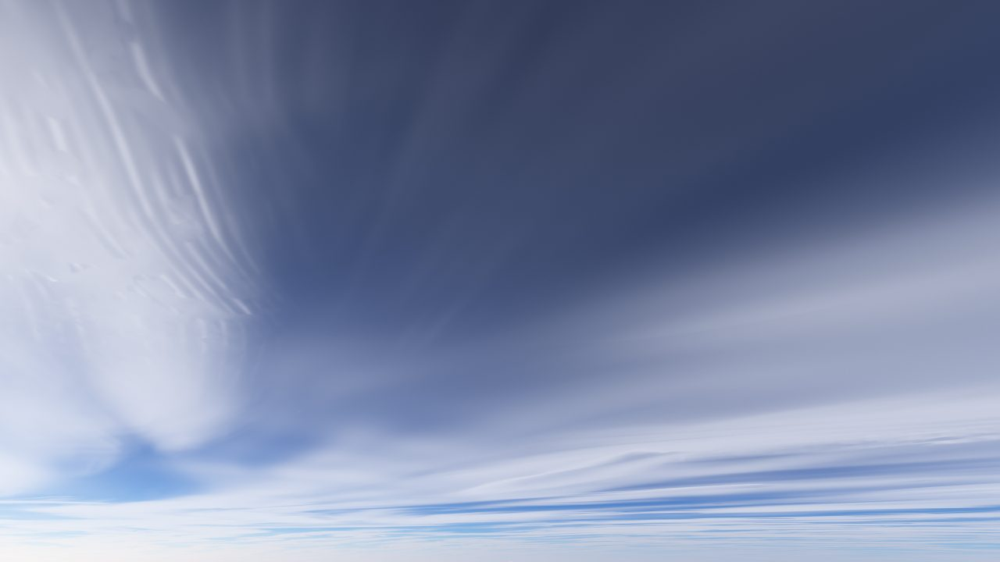

# How Sky draws a frame

This document follows one frame from the address bar to the pixel. It
describes the code on `main` as it is. Names are those of `index.html`:
functions, constants, uniforms and element ids. Plans and known flaws are
in the [issues](https://github.com/sf624/sky/issues), not here.

## The page

`index.html` holds everything: the markup, the CSS and ten `<script>`
blocks. It loads no other file.

| Block | Kind | What it is |
|---|---|---|
| (no id) | JS | `TEXT`, the strings in Japanese and English, and `applyLanguage`. It runs right after the panel. |
| `stars` | data | The star catalogue, base64 (see [Stars](#sun-moon-stars)). One very long line: never print it. |
| `noise` | fragment shader | Draws the cloud noise and the weather map once, at start. |
| `waves` | fragment shader | Draws the map of the waves on the sea once, at start. |
| `fs` | fragment shader | The scene: air, clouds, sea, cirrus, sun, moon, stars. With `SHADOW_MAP` defined, the map of the clouds' shadow. |
| `mean` | fragment shader | Joins each new frame of the aircraft's view to the picture so far. |
| `show` | fragment shader | Copies that picture to the canvas, with dither. |
| `meter` | fragment shader | Meters the picture for the exposure, block by block. |
| (no id) | JS | `SkySound`: the background sound (see [Sound](#sound)). |
| (no id) | JS | Everything else, in one function that runs at load and starts the loading. |

There is one canvas, `#sky`, the hero: the view from an aircraft. Clouds,
sea, cirrus, glare. It flies (900 km/h by default) and is drawn as a mean
over frames. It fills the window, and the page does not scroll.
`makeSky(canvas, view, { done, shown })` makes its renderer, a step at a
time (see the next section).

## Conventions

- **Lengths** are in km, in the shaders and in the JS.
- **Axes**: x west, y up, z south. The centre of the planet is the origin.
  The eye is at `(0, RG + uAlt, 0)`, with `RG` = 6360 km (the ground) and
  `RT` = 6460 km (the top of the air).
- **Directions**: `yaw` 0 looks south, 90 degrees west, -90 degrees east;
  a larger `yaw` turns the view to the right (clockwise seen from above),
  and a drag to the right lowers it. `pitch` is positive upwards.
  `camera(yaw, pitch)` gives the column-major `uCam`: right, up, forward.
  `uTan` is the tangent of half the vertical field of view (`FOV` = 62
  degrees for the hero).
- **Spectra** are twelve wavelengths, 405 to 680 nm in steps of 25 (`WL`),
  stored as `vec4 X[3]`: four wavelengths per `vec4`. Loops run
  `for (int k = 0; k < 3; k++)`. `uWL` holds each wavelength divided by
  550 nm.
- **Light** is in units of the sun's irradiance. The weights `uWR`, `uWG`,
  `uWB` turn a spectrum into linear sRGB with the solar spectrum folded in
  (`W` in the JS, from the CIE 1931 functions `CMF` and `SOLAR`); the bare
  sun has luminance 1. `main` multiplies by `ISUN` = 20.
- **The way flown.** The aircraft does not move: the world does. `state.drift`
  is the way made over the sea, in km, wrapped to `[0, WEATHER_KM)` with
  `WEATHER_KM` = 256 so that it keeps its precision in single-precision
  floats. The shader reads clouds, sea and cirrus at `p.xz + uDrift`. When
  the drift wraps, every pattern read there jumps by 256 km, so **every
  pattern must repeat a whole number of times in 256 km**, or a seam shows.
  Hence `BASE_KM` = 8 (32 tiles of the noise), `DETAIL` = 7 (whole tiles of
  the fine noise per tile), the wave bands and the cells of the foam
  rounded to whole numbers per map (`rep`, `cells`), the swells with whole
  numbers of crests (`SWELL`), the cirrus frame stepping by whole numbers
  (`CI_DIR`, `CI_FREQ`, `CI_FIB`, `ciNoise` with a whole `period`), and the
  `bend` of the cirrus written with whole-number frequencies. The `bend`
  sum appears twice, in `noise` and in `ciDepth`: change both together.
- Comments in the code are plain English sentences that say what and why.

## From the address bar to the first frame

The page shows at once in its loading state: the hero is dark (`.loading`,
a gradient of a night sky), with the title over it. After 0.3 s a thin line
of progress and a word (`TEXT.loading`) fade in, so a quick start shows only
the dark. The panel and the full-screen button stay hidden (no clicks, no
focus) until the first picture. All of this is HTML and CSS: it needs no
script.

The JS then runs once, at load, and does little:

1. **Inputs.** URL parameters with the id of a slider set that slider's
   value (the browser clamps it to the slider's range and step). Then
   `readInputs()` copies the sliders into `state`. `now`, `rate` and `play`
   then act as the now button, the select and the play button, but the
   time does not run yet (see below). `yaw`, `pitch`, `heading`, `at`,
   `pixels` and `res` are read directly (see
   [development.md](development.md#url-parameters)). Without `yaw`, the view
   starts 65 degrees to the side of the sun; without `heading`, the
   aircraft flies 60 degrees to the left of the view.
2. **The loading.** After the first paint (an animation frame, then a
   message), `makeSky` for `#sky` makes the renderer. It is an `async`
   function: it waits a frame (`nextFrame`) wherever it would otherwise
   hold the main thread or wait for the GPU. Its steps:
   - `getContext`, and the extensions.
   - Every program (`fs`, `noise`, `waves`, `mean`, `show`, `meter`) is
     compiled and linked at once, and nothing asks how it went yet. With
     `KHR_parallel_shader_compile`, the GPU process compiles them on threads
     of its own; the page asks `COMPLETION_STATUS_KHR` once a frame. Without
     it, asking waits, so the page asks for one program a frame. A failed
     program throws the compiler's or the linker's message.
   - Meanwhile the tables of the CPU, in slices of about 8 ms, one a task
     (`slices`). Each is a generator (a job) that yields every little while;
     `finish(job)` runs one at once.
     - `odTable` (`buildDepths`): optical depth to the top of the air
       towards the sun, over altitude (48 rows, squared spacing) and the
       cosine of the sun's zenith angle (96 columns from -0.2), 64 steps
       each. Read by `sunDepth()` in the JS only.
     - `starData` (`buildStars`): the star texture.
     - the table of `depthToTop` (`depthTable`, see [The air](#the-air)).
     - `msData` (`buildMultiScatter(haze)`): the multiple-scattering table
       (see [The air](#the-air)), for the haze given, the longest (0.2 to
       0.3 s). It reads `odTable` (through `sunDepth`), so it starts when
       that is done, and goes on beside the star and depth tables, while the
       GPU compiles the programs and draws the textures; the first frame
       waits for it.
     - The slices of all these are paced by timers (`soon`), not by frames:
       while the page starts and the GPU draws the textures, a frame comes
       only every 50 ms or so. Paced by frames, after the other tables, the
       multiple-scattering table took 1.8 s and held the first picture back
       by 0.4 s.
     - With them goes a constant, `NIGHT`: the moonless night sky
       (airglow), 8.59e-10 of the sun's irradiance, about 4e-8 of the
       daytime sky.
   - The textures (see [Textures made at start](#textures-made-at-start)).
     The noise and the weather map are drawn in batches (`batches`), the
     weather map in strips of 64 rows (the scissor; each pixel is the
     same as from one draw). After each batch the page waits for a fence
     (`settle`); a batch doubles while the GPU gets through it in under
     100 ms and halves over 250 ms. The GPU process draws the whole
     browser, and a slow GPU given seconds of work at once would freeze it.
   - `prime`: the first frame is drawn as the first frame will draw it
     (`render` as a probe, which then puts its state back), and `show` once
     without a pixel (the scissor). Some drivers finish a program only at
     its first draw, which can take a second: that happens now. Once a
     fence says the GPU is done, the meter of that frame is read: the read
     does not wait.
3. **The hand-over.** The hero's `data-sky` becomes `ready` (`failed`
   without WebGL2 or if a program failed: the error goes to the console,
   the loading state fades out, and the canvas keeps its CSS gradient).
   `kick()` asks for the first frame; a time-lapse asked for in the address
   starts now; the title's and the panel's timers start (see `.told` and
   `.still`). Before this, `kick()` and `schedule()` do nothing.
4. **The first picture.** The first frame is only metered, as always (see
   [Exposure](#exposure-and-the-tone-curve)); if what it is drawn from is
   what `prime` drew, prime's reading stands, else it reads the meter at
   once. The second frame goes to the canvas, and `render` calls `shown()`:
   the hero gets `.shown`, and the loading state fades out over the picture
   in 0.8 s (it lets the pointer through at once), while the panel fades
   in. The class and the picture reach the screen in the same frame, and
   the fade starts from opaque: nothing empty or half drawn shows.

So no step holds the main thread for long, except `getContext` itself.
The pictures are the same as when everything ran at once: the jobs and
batches only split the same work.

A hidden tab has no animation frames: there `nextFrame` waits 100 ms
instead (the browser slows that down further), so the loading goes on
slowly; the first frame waits until the tab is shown.

**The loop.** `update()` marks the state changed and calls `kick()`,
which asks for one `requestAnimationFrame(frame)`.

`frame(now)` then:

- does nothing in a hidden tab;
- if something changed: rebuilds `msData` when the haze has changed (at
  once, with `finish`; it takes about a quarter of a second: while the haze
  slider moves, it is built `HAZE_WAIT` = 250 ms after the last move), runs
  `celestial()` and sets the panel's labels;
- moves the aircraft: `state.drift` grows by `speed / 3600 * dt` along
  `state.heading` (`dt` capped at 0.1 s, and 0 after a pause, so the
  aircraft never jumps);
- calls the renderer, which draws the clouds' shadow map first when it
  is out of date (see [The clouds' shadow](#the-clouds-shadow));
- asks for another frame only if the renderer returned true.

The renderer returns true while the aircraft flies, while its picture is
still settling, or while the exposure moves. So the page draws nothing at rest once the picture is
clean, or in a hidden tab. `visibilitychange` calls `kick()` again.

**Playing.** The play button runs the time at the rate of the select beside
it (`pace`, a factor of real time; 960 at first, a day in a minute and a
half). Each `tick()` moves the time by the time elapsed since the last tick
(`performance.now()`) times the rate. A gap longer than a quarter of a second
is not a frame (the tab was hidden): at real time the time catches up with
it, at the faster rates it counts as 0.25 s, so the time does not leap. A
new rate applies from the moment it is chosen. Past 24:00 the date moves
on by a day, and from the last day of the year to the first. The moon's age
runs on with the time, a day of age a day, and so does the sun on the
ecliptic (`state.dayShift`, see below): nothing jumps at midnight. At the
faster rates, ticks come with the frames (`requestAnimationFrame`), and
every frame is drawn again.

**Real time.** The sun moves a quarter of a degree a minute. At the default
drawing limit (WQHD, 1440 rows over the 62 degrees of the view) that is
less than a pixel in 10 s. So at real time the ticks come from a timer,
once a second, and the time that is drawn (`state.time`) moves in steps of
10 s (`REAL_STEP`): each step draws the picture again and lets it settle
(39 frames), and nothing is drawn in between, about 6 % of the frames.
The panel's clock shows the minute, which changes only on a step. In a
hidden tab the timer runs on (the browser slows it); `visibilitychange`
brings the time to the present at once. In flight every frame is drawn
anyway.

**Now.** The now button sets the date to today, the time to the device's
clock (taken as local solar time), the moon's age as moving the date does,
the rate to real time, and plays.

## Sun, moon and sky in the JS

`celestial()` places the sun, the moon and the stars for `state.day` and
`state.time`:

- The observer is at `LATITUDE` = 35 degrees north. The time is local solar
  time: the sun is due south at 12:00.
- The sun moves along the ecliptic (`OBLIQUITY` = 23.44 degrees), at
  longitude 0 on day 80.
- The moon runs ahead of the sun along the ecliptic by its age
  (`state.moonAge / 29.53` of a turn). Its orbit's tilt is left out.
- Moonlight is 2.5e-6 of sunlight at full moon, falling with the phase
  angle. It counts (`state.moonI`) only when the sun is below -3 degrees and
  the moon above -18.
- `state.sunOn` (`uSunI`) fades from 1 to 0 as the sun goes from 18 to 21
  degrees down (a smoothstep), so that no step shows when it stops
  mattering.
- One light for the clouds and the sea (`uLight`, `uLightI`): the sun while
  it is above -3 degrees, else the moon.
- `state.sky` (`uSky`) turns J2000 equatorial directions into local axes.

The date slider covers the current year. The moon's age starts from the
date (`moonAgeOn`: the mean lunation, from the new moon of 6 January 2000)
and is set again whenever the date slider moves; the moon slider then
changes it alone. With `date` and no `moon` in the address, it follows the
given date.

The sun's place on the ecliptic comes from the day number, one step a day.
While the time plays past midnight, `state.dayShift` (in days) holds the
sun where the time has carried it: it grows with the time and loses a day
when the date moves on, so the sun and the stars turn on smoothly. Setting
the date or the time sets it back to 0.

## The air

`main` in `fs` marches along the view ray from the eye to the top of the
air, or to the sea. The air is three species, with densities from
`density(h)`:

- Rayleigh: `exp(-h / HR)`, `HR` = 8 km; scattering `uBR` = 13.558e-3 per km
  at 550 nm, falling with the fourth power of the wavelength (`BR`).
- Mie (aerosol), after published profiles of the background aerosol
  (OPAC, Hess et al. 1998; Shettle and Fenn 1979; SAGE II for the
  stratosphere). The haze of the lowest kilometres, the boundary layer,
  is well mixed up to `BL` = 1.5 km and falls off over about 0.3 km above
  it (`boundaryLayer`: a logistic step, 1 at sea level); above it two thin
  layers (`AERO_FREE`, `AERO_STRAT` in `fs`, `AERO_UP` and `mieUp` in
  the JS): 0.048 of the sea level's density at 6 km (half-width 5 km, the
  free troposphere) and 0.004 at 20 km (half-width 8 km, the
  stratosphere). Scattering `BETA_M` = 0.044 per km at sea level times
  `uHaze` (the haze slider, 1 by default), extinction `MIE_EXT` = 1.05
  times that (a single-scattering albedo of 0.95: between maritime air,
  0.99, and continental, 0.92). By wavelength, times
  `(550 nm / wavelength)^ANGSTROM`, `ANGSTROM` = 1.3 (`MA` in the JS,
  `uMA` in `fs`): a little bluer. At the default haze the optical depth
  at 550 nm is 0.070 in the boundary layer, 0.019 in the free troposphere
  and 0.0026 in the stratosphere, 0.091 in all: a clear day of fair
  weather (0.05 to 0.15 over the sea and the coast; a visibility of about
  65 km at sea level). The slider scales all three: 0.3 is very clean air
  (0.03), 3 to 6 hazy (0.3 to 0.55).
  The default was chosen from a series of haze values beside photographs
  of clear days, from the sea and from the air, by day and at dusk
  (round 10). Round 9 had 0.14 in all, and with the phase function
  of the time the sky near a sun at 30 degrees, seen from near the sea,
  was a milky beige column from the top of the picture down to the
  horizon, and a sun 2 degrees up dimmed so much that its glitter was
  nearly gone.
  Before (round 8), the boundary layer was `exp(-h / 1.2)` with 0.0014 per
  km: an optical depth of 0.002, some 50 times less than real air; the
  horizon was crisp, distant clouds and sea did not fade, and at dusk the
  ground below the band of glow was dark blue where photographs show a
  brown-orange haze.
- Ozone: a triangle from 10 to 40 km, peaking at 25 km; absorption `uBO`
  from the Chappuis cross-sections (`OZONE`) for 300 Dobson units.

Phase functions (`phases`): Rayleigh, and for the aerosol the
Cornette-Shanks form (`cornetteShanks`), by height:

- In the boundary layer, two lobes: a sharp one, `MIE_PHASE` = (0.149,
  0.932, 0.609) — 0.149 of the light with parameter 0.932, from the
  larger particles (sea salt, dust) — and a broad one with 0.609. Fitted
  to Mie theory (computed for this, from Bohren and Huffman's
  recurrences) for humid maritime and continental aerosol after OPAC: the
  mean of the two is matched within 8 % from 2.5 to 90 degrees off the
  light. The asymmetry is 0.715. The sun's aureole is round and bright
  within a few degrees and falls off fast: 2 to 4 times the single
  lobe's (`g` = 0.7) within 2.5 degrees of the sun, 0.8 of it from 10
  to 20 degrees. The
  single lobe of round 9 made the sky from 10 to 30 degrees off the sun
  too bright, and as bright near the horizon as up by the sun: from near
  the sea it drew a pale column under a high sun, with a nearly vertical
  edge.
- Above it (`MIE_G_UP` = 0.6, an asymmetry of 0.66), one broad lobe: the
  free troposphere and the stratosphere hold small sulphate particles,
  whose Mie phase function has no sharp peak (fitted the same way). With
  the boundary layer's lobes there, the stratospheric layer drew a small
  white core over the set sun from cruise.
- `densities(h)` gives the boundary layer's share of the aerosol at `h`
  (its `w`), and `addLight` mixes the two by it. `buildMultiScatter`
  does the same (`phaseM`, `phaseUp`).

**The march.** `NV` = 20 samples at
`t = tmax * f * f`: denser near the eye. In twilight the view ray may pass
through the planet's shadow: in parallel light, a cylinder of radius `RG`
behind the planet (`shadowSpan`). Then the march has three runs, each
denser at its start: `NV` samples from the eye to the shadow, `NSHADE` = 8
in it, and `NFAR` = 16 in the lit air beyond (a run of no length is
skipped). The light scattered once rises steeply from the shadow's edge;
20 samples over the whole ray left layers of colour above the band of
glow that came and went with the angle (a purple one at 7 degrees with the
sun 14 degrees down). A ray that misses the shadow is marched as before,
so the day's picture is unchanged. Each sample adds, for the sun and for
the moon, `addLight`:

- light scattered once, if the planet does not hide the source: the
  transmittance from the eye to the sample and from the sample to the top
  (`depthToTop`) times the phase functions, times `direct`: the share of
  the light that the clouds let through there (below);
- light scattered many times: the multiple-scattering table times the
  local scattering coefficient, times the transmittance to the eye; and
  for the aerosol, which sends light on forwards, `MIE_LEAN` = 4 times the
  table's lean (below) towards the view, where it is positive: more of
  that light when the view looks where it comes from.

The clouds and the cirrus enter the march as two layers (see
[Low clouds](#low-clouds) and [Cirrus](#cirrus)). At each layer the march
ends a sample exactly there (`tLayer`), adds the layer's light (`C` or
`H`) dimmed by the air before it, and multiplies what lies beyond by the
layer's transmittance (`vis *= Tc` or `Th`). Behind a thick cloud
(`vis` = 0) the march stops.

Light from below the local horizon grazes the planet on its way, through
hundreds of kilometres of the boundary layer, which takes it out. Until
round 8 the air was so clean that this light came through deep red, and
a cut (`grazeCut`) removed light that passed lower than 1 km; with the
real boundary layer the reference and the page agree without it (to 2 %
in the planet's shadow), so it is gone.

**Shafts.** Below the tops of the clouds, `direct` comes from the clouds'
shadow map (`cloudShadow`), sampled more finely than the march: `SHAFTS`
= 16 samples over the part of the ray below `CT` (`ca` to `cb`), denser
near the eye (`f * f`), at new places each frame (`ign`). Each step of the
march takes the mean of `exp(-tau)` over the samples that fall in it,
weighed by the air's scattering there (Rayleigh at 550 nm and Mie), or
reads the map once at its middle if none does. Lit and shaded air
alternate along the ray: shafts of light between the clouds, and the
clouds' shadows in the haze. Above the tops `direct` is 1. Without low
clouds, or without a light, nothing is sampled.

**`depthToTop(p, d)`**, the optical depth from `p` to the top of the air:

- One filtered read of the depth table `uDepth` (512 by 128, `DEPTH_MU` by
  `DEPTH_R`), made at start in `makeSky` by a 16-step midpoint sum. Its axes follow Bruneton (2017): the distance to the top, between
  its least and its most at that height, and the distance to the horizon
  (`rho / H_TOP`). The table is RGBA32F where the GPU can filter full floats
  (`OES_texture_float_linear`), else RGBA16F.
- The table repeats the density profile. The profile is written out twice:
  `densities()` in `fs`, and in the JS (`boundaryLayer`, `mieUp` and
  `mieDensity` for the aerosol, used by `buildDepths`, `buildMultiScatter`
  and this table in `makeSky`).
  Change both.

**Multiple scattering** (`buildMultiScatter`, after Hillaire, 2020): for
each altitude (`NH` = 12 rows, squared spacing) and cosine of the sun's
zenith angle (`NMU` = 40 columns from `MS_MU_MIN` = -0.35), the mean light
that reaches a point, to be times the scattering coefficient there:

- The light scattered once is gathered over the sphere, with the phase
  functions of the air and the aerosol (each layer's) for the sun's light scattered
  towards the point, and with sunlight bounced off the ground (`ALBEDO` =
  0.07). In twilight that light comes from the lit air towards the sun,
  scattered forwards; gathered as if isotropic, the table held 0.65 to
  0.75 of the reference's (below) in the planet's shadow, now 0.85 to 0.95:
  16 bands of height, narrower near the horizon (edges at `x |x|` for
  even `x`), each counted by its share of the sphere, times 4 directions
  over half the sphere, mirrored; 14 steps each. In twilight that light
  comes from the lit air low on the horizon: 8 even bands, the nearest
  3.6 degrees off it, missed most of it, and the sky of nautical twilight
  came out 3 to 5 times too dark.
- The higher orders follow as a geometric series (Hillaire).
- Then, while the sun stands lower than 17 degrees (blended in down to
  9), one more gathering of that field itself, an order computed rather
  than guessed. The series keeps the colour of the light scattered twice;
  in deep twilight that is the red glow on the horizon, and the air came
  out orange where the sky above is blue. One more order is enough: a
  second changes the table by less than 1 %.

A second table holds the sky's light on the low clouds (`cloudSky`): as
bright as the mean light, but in the colour of the light from above on a
level surface (gathered over the upper half of the sphere times the
cosine, all orders). It is the mean light itself while the sun stands
higher than 6 degrees, and fully the light from above from -3 degrees
down. By day the mean light stands for all that lights a cloud besides
the sun, the sunlit cloud and sea around it among them; once the sun is
down only the sky is left. The colour was taken relative to that of the
mean light with the sun at 30 degrees: it kept the day's warm share into
the twilight, and a deck after sunset came out grey-brown where
photographs show it blue-grey. With the mean light alone, the clouds
were mauve and brown under a blue sky.

A third and fourth hold the mean light's lean (`msLean`): the light
gathered times the direction it comes from (pass 0 and the computed
order), towards the sun's side and up. The table's light is a mean over
directions, but the aerosol scatters forwards: below the band of glow,
seen from cruise, the reference's light (scattered many times by the
boundary layer, coming from the glow) was twice the table's and
brown-orange where the table's was blue. The lean's first moment would
weigh it by 3 times the asymmetry (2.1 in the boundary layer); with the forward peak sharper
than that, 4 fits the reference best, and taking it only where it is
positive keeps the views away from the light as they were (the first
moment taken there too left the sky away from the sun 0.65 of the
reference's).

One value per wavelength. The texture is `NMU` by `12 * NH`: the three
groups of four wavelengths of the air stacked in y, then those of the
clouds, then the lean towards the sun's side and up. It depends on the haze, so `frame` rebuilds it when the haze
changes, and the renderer uploads it again. `fs` reads it through the
GPU's filter (`textureLod`; RGBA16F when full floats cannot be filtered).

**Against measurements** (a float64 copy of the model of round 8, with
its thin aerosol and `grazeCut`; not measured again since). Integrated
over the sky at sea level (haze 0.35 of that aerosol, 128 klx of sunlight outside the air), the model gives, against the
horizontal illuminance table in Schlyter, "Radiometry and photometry in
astronomy": sun at 0 degrees, 937 lx (measured 759); -6, 6.3 lx (3.4);
-12, 0.016 lx (0.008). The zenith, against a fit to sky quality meter
readings (hnsky.org, "SQM twilight"): 0 degrees, 148 cd/m2 (216); -6, 0.89
(0.63); -10, 0.014 (0.013); -14, 5.1e-4 (4.7e-4). Within a factor of two
throughout. The layers and the cut change these figures by less than
10 %: they matter for the colours low in the sky, not for these totals. Before the bands, the extra order and the shadow's runs, the
zenith at -10 and -14 degrees was 3 and 6 times too dark.

**Against a reference** (November 2026). A Monte Carlo solver of the same
atmosphere (spherical shells, the twelve wavelengths, Rayleigh, the
aerosol profile above with its phase functions by height, ozone, a ground
of albedo 0.07, every order; the light scattered once by a fine march,
the rest by paths with a track-length estimate of the sun's light on each
segment and the hero wavelength scheme of Wilkie et al., 2014), against a
float64 copy of `fs`'s march with the page's own tables, over elevations
-10 to 60 degrees at 0, 90 and 180 degrees from the sun, from 0.3, 4 and
11 km, the sun at 30, 2, -2, -4, -6 and -10 degrees (round 10, the
default haze, 4096 paths a ray). Medians over each set of rays:

- The light scattered once agrees within 3 % (1.00 almost everywhere).
- The sky (from the horizon up): 0.90 to 1.0 of the reference by day and
  towards and away from the sun in twilight (0.97 to 1.0 from 4 and
  11 km), with its colour (the r-chromaticity within 0.02). The
  anti-twilight arch and the planet's shadow away from the sun follow the
  reference closely: the pink band is a narrow one in the reference too
  (warm from 0 to 5 degrees, at its warmest at 3). Away from the sun in
  deep twilight from 0.3 and 4 km, 1.2 to 1.35.
- To the side in deep twilight the page is too bright: 1.1 to 1.2 at -6,
  1.6 to 1.8 at -10 (the table's light gathered as a mean).
- Below the horizon towards the sun in twilight (the haze over the ground
  under the band of glow): 0.7 to 1.0 of the reference (0.96 to 0.98 from
  11 km), a little bluer (r-chromaticity up to 0.06 lower); before the
  lean, 0.44 and blue where the reference is brown-orange. By day below
  the horizon, 0.8 to 0.96 (the sea there is the page's own, not the
  reference's grey ground).

So the light of the sky is the page's atmosphere's; what still differs
from photographs is mostly how much aerosol there is, and the exposure
and tone curve (see [Exposure](#exposure-and-the-tone-curve)).

## Low clouds

Low clouds live in a shell from `CB` = 0.6 km to `CT` = 5 km. `CB` is
the shell's lower bound, not the height of the bases: they stand 150 to
300 m higher (below), so that nothing that reads `CB` (the march's range,
the shade of the clouds on the sea and the low air) has to change.

Places in the clouds are given from the eye (`p` less `eye()`), and
`heightAt` finds their height. At the Earth's radius a float steps by half
a metre, and the finest noise showed those steps as terraces.

**The field.** A signed field says where cloud is: positive inside,
rising by about 1 per km of depth under the surface. `cloudShape` builds it
as a sum (a height field; heaps that stand alone and towers have a 3D body
instead, below):

- the weather map `uWeather` at `p.xz + uDrift` (R: cover, G: how high
  the heap stands),
  against a level set by `uCloud` (a cubic in `uCloud`). `weather` reads
  it: through the GPU's filter, which bends where the map's texels meet
  (every 250 m). Near the eye (where a pixel is finer than 8 m) the place
  within a texel is first eased by a smoothstep (Quilez, "improved texture
  interpolation"), so that the map bends smoothly, in one read still:
  else the sides of clouds within a few km show those bends as upright
  streaks. Where a pixel is finer than 4 m, for the normals, the read moves
  by up to half a texel each frame (`shake`), and the mean over the frames
  smooths the bends (a cubic B-spline, four filtered reads, did the same at
  four times the cost);
- less what height costs: a dome over a flat base (`y` cubed over the
  cube of `top`), thicker where the map is higher. `top` follows G: each
  heap of the map is a dome 0.5 to 1.2 km over a deck between heaps and
  up to 1.9 km over its base on the highest heaps; the tallest (G over
  0.55) are towers, a kilometre higher still. A tower rises over its
  heap as a dome, `t (2 - t)` of its height with `t` going from 0 to 1 as G
  goes from 0.46 to 0.76, 70 to 100 % as high as the heap's G says: when
  its top rose with G in a straight line, towers were cones, like
  mountains; on the whole middle of the heap at once (G from 0.48 to
  0.62), they were columns with flat tops and upright walls, like
  tombstones. So a field of cloud is a
  field of domes of many sizes even where the cover is whole; before,
  the top was one height wherever the cover was whole, and the noise of
  the tile made all the forms: one size of lumps with pits in them, like
  crumpled paper. Where the cover is thickest (`deck`) the domes flatten
  to a third of their height and the noise's 500 m cells take over
  (stratocumulus). A deck swells a little where the map is high
  (`swell`, a share of the height, not a fixed one); the lowest 180 m
  rounded off (`rim`). `y` counts from the base's `level`: 150 to 300 m
  over `CB`, higher or lower across tens of km (it follows the gusts'
  map, B, as a slow pattern);
- plus the noise of the tile (`uNoise`, one tile per `BASE_KM` = 8 km),
  read at a depth that drifts from place to place (`far`) so that no two
  tiles look alike. Worley values are rounded into domes (`v (2 - v)`).
  Its billows (`lump`: Worley cells of 2 km, 1 km and 500 m) weigh 0.9,
  0.7 and 0.35 on a sheet, the big ones most (with the 500 m ones first,
  the tops of a deck from above were a carpet of lumps of one size, where
  photographs show smooth billows of a kilometre or more), and 0.35, 0.75
  and 0.9 on heaps that stand alone and on walls (with the big ones first
  there, heaps were smooth domes, like balls of putty; in photographs a
  heap is turrets on turrets, a third of its width and less). They are as
  large as the heap is high (`0.7 + 1.3 G`), bulge out more than they
  dent in (dents count 0.6, by a smooth curve: a kink at nought showed as
  ridges) and fade to 30 % deep in a body (over the first 0.6 of the
  field inside, as `steep` scales it), so that they shape its outside and
  cannot punch holes through it: with full billows everywhere, the forms
  from 4 km had dark pits.
- **`steep`**: the billows, and the fine noise below, are scaled by how
  steep the heap's field is where its surface over that place stands
  (at `yt = top rise^(1/3)`, `rise` = `thick + swell`), against the top
  of a whole dome (where it rises by `4.8 / top` per unit of `y`): about
  1 over a top, up to 6 on a wall. So they move the surface by as many
  metres on a steep wall as on a top. Added to the field alone, they moved
  the walls of towers and big heaps, where the field is four to eight
  times as steep, by a few metres, and those were smooth pillars. The
  slope across comes from the slope of the weather map (`uSlope`, a
  texture made from it at start: R and G per km along x and z), through
  the derivatives of `thick` and `top`. Taken at the place's own height,
  the slope grew with the height over a wall's foot (the field goes with
  `y` cubed), and billows scaled by it stood above the walls as spikes.
  It costs 2 ms of the frame at 1440p among the tops (a register-heavy
  part of every read of the field): reads that sum a depth over long steps
  (the shadow map, the depth overhead, the light's later steps and far
  shadows, the hollows, the sky's reach, `coarse`) leave it at 1, which
  saves another 2 ms; they smooth the billows over far more than a wall's
  anyway.
  Where a pixel is finer than 16 m, the reads that see the fine noise (of
  the march and of the normals) move by up to half a texel each frame
  (`shake`): the GPU's
  filter bends where its texels meet, every 62 m, and lit and shaded sides
  showed the bends as upright streaks and a grid of facets; the mean over
  the frames is smooth. A cubic B-spline (eight filtered reads) did the
  same, at 7 ms more among the tops at 1440p. From inside a cloud's
  fringe, the march's reads, unshaken, made the fog a set of flat grey
  polygons with straight edges: the facets of the filter's surfaces. The
  march shakes them where a pixel is finer than 1 m (to 16 m, it cost
  2.4 ms more at 2 km of altitude).
  `lump` says how far a place stands out of the billows; `body` how thick
  the cloud is there; `q.w` how rough; `thin` how near the edge of its
  heap's foot (`rise` under 0.4; nought on a sheet).

**The 3D body of heaps and towers.** The field above is a height field:
for each column of the weather map one top, and billows that push that
surface. It cannot overhang, nor hold a cleft that goes in under a
turret, and its walls are the walls of the dome whatever the billows do:
towers and big heaps came out as lumpy columns, scattered cumulus as round
heaps of one size. So where the cover breaks into heaps (no sheet, below),
and for towers wherever they stand, the heaps have a 3D body instead
(`solid`: `(1 - max(deck, level1)) max(1 - sheet, tower)`, smoothly; the
sheet, the deck and the top of the slider keep the field above, which is
closest to photographs there). After Schneider (2015, 2017): a broad
envelope from the weather map, with a 3D shape on its surface.

- The envelope `env` is how deep a place lies in its heap, from the same
  terms as the dome: `rise - y^3 / top^3`, with `rise` = `thick + swell`
  (1 at the foot of a heap's middle, 0 where the dome's top would stand).
  Where the body gives way to the field above (on a sheet, where a tower
  ends) `rise` shrinks with the body's share: else the heap under a tower
  filled the whole sheet, and the body stood up as a plateau cut off by
  where towers grow, a pillar with upright walls.
- `env` is turned into a distance (km, `dEnv`): divided by how fast it
  rises across its surface over this place, `3 steep / (top (CT - CB))`
  (`steep` as below, read from `uSlope` for the body too; reads that sum a
  depth over long steps (`coarse`) take it as over a top, which saved 1.5
  to 3 ms of the frame at 1440p).
  As `env` itself, the surface of round 11 had a gentle slope across the
  side of a heap, and the turrets alone made its outside: a union of free
  balls, with more of them standing off the heap.
- On that surface stand the turrets of `uBody` (see
  [Textures made at start](#textures-made-at-start)), read at the same
  place in the noise as the billows (`q`), as bumps: each size moves the
  surface out by up to `BODY_K` (700, 400, 250 and 140 m for the turrets
  of 2 km, 1 km, 500 m and 250 m), in by less (`BODY_C` = 0.45 is the
  value that moves it neither way). So the smaller ones sit on the larger
  ones, a cauliflower; each bump rises about as fast as the envelope
  falls, so a bump cannot stand alone in the air. A size counts only on
  heaps whose dome may be as high as half of it and more
  (`smoothstep(0.5, 1.5, top (CT - CB) / size)`).
- The field is `BODY_G (dEnv + bumps + shift)`, with `BODY_G` = 2 per km.
  `shift` (`BODY_B` = -200 m, 120 m less from `cloud` 0.4 to 0.7) sets the
  cover of the slider: straight down from 13 km, the share of bright cloud
  is 6, 7, 11, 28 and 86 % at `cloud` 0.2, 0.35, 0.5, 0.65 and 0.8 (round
  11: 6, 8, 13, 28, 82 %, measured the same way; the greyer clefts count
  less). A smaller shift (-160 to -180 m) matched round 11 better, but put
  a clump of heaps at the bottom of the `flight` check's cruise view, and
  the exposure there moved by more than its limit.
- The fine noise (`cloudDetail`) is weighed `BODY_D` = 1.3 on the body
  (`steep` there): billows of 300 m down to 20 m on the turrets. At 1, the
  heads were smooth lobes, like putty; at 4, ragged, with shreds round them;
  at 1.6 and more, a flight differed from a still at the place reached by
  more than the `flight` check allows.
- `body` (how dense the cloud is) is at least 0.7 of the heap's top over
  the whole body: from the column under them, the heads that overhang a
  heap's thin foot were translucent, and the cloud behind showed through
  them as patches with sharp outlines. The heads of big heaps do not fray
  (`thin`).
- The edge (`cloudField`) is 12 m deep on the upper part of a heap (its
  rising heads) and 70 m on its lower sides (a veil), by `heapUp`, the
  height over the base against the envelope's top there.
- The early ways out of `cloudShape` take the field as if the bumps were
  at their highest there (`bodyMax`; before the slope is read, with the
  envelope at the steepest or the gentlest slope it may have). The reads
  of the normals do not take them (`smoothReads`): where some of a
  normal's reads stopped early and some did not, the bound and the field
  differ, the normals pointed anywhere, and lit sides had dark patches
  with sharp outlines.
- `uSlope` is read eased for the normals, as the weather map is (see
  `weather`): read through the GPU's filter alone, its bends drew upright
  bands on the body's sides. (Eased for the march and the light too, it
  cost 9 ms of the frame at 2 km.)
- Everything that reads the field reads the body: the march, the light's
  steps (so bumps shade the clefts beside them), the depth overhead,
  the shadow map, the sea's shadows.

Where the cover breaks into heaps, two more things shape the map's heaps
(weighed by `1 - sheet`, so the sheet and the deck are as they were):

- **Their outlines** (`WARP` = 5): the map is read at a place moved by up
  to some 1.5 km, by the map's own cover and height of heaps (R, G) far
  from here, at mip level 2.5 (texels of 1.4 km). The heaps of the map are
  round domes, and from above the clouds were discs; moved, their outlines
  are lobed and drawn out. (The noise's Worley cells, eased, did the same
  at 3 ms more.)
- **Clumps and gaps** (`CLUMP` = 2): `e` gains twice the cover of `far`
  (the map over some 11 km, elsewhere on it) less a half: heaps grow and
  merge in some places and shrink, leaving open sea, in others. Straight
  down from 13 km (cloud 0.35 to 0.65, four places each), the clouds'
  number falls as about the -2.3rd power of their width (round 11: -2.0),
  with more small ones and larger large ones (the largest 1.3 times as
  wide). (At 4, a big clump at the bottom of the `flight` check's cruise
  view moved its exposure by more than the limit.)

The light was made for a height field in three places. On the body, above
the lowest 150 to 400 m (`solidHere`): `column` (the light through a deck
above) does not dim it (faces turned down it did dim: the depth straight
over a side jumps where the column meets a bump above, and the sides
showed upright bands); the underside of a head, which bulges
out, is lit as the side of a billow, not as a base
(`below`), nor is its depth towards the light that of a slab. Lit as a
base, such undersides were blue-grey crescents round each big head, and
sides under a head were grey patches. And a cleft between its bumps
(where the bumps, smoothed over 250 m, are at their lowest: `cleftL`, two
mip levels up from the march's read, once per cloud the ray enters) gets
up to `CLEFT` = 60 % less of the light scattered many times and of the
sky's: grey, as in photographs; it was as white as the heads. (Read at the
sample itself, it changed with where the steps fell, and the picture
flickered.)

**The sheet.** With much cloud the heaps stand on a sheet
(stratocumulus): from below a closed deck, from above cells. How much
sheet (`sheet`) follows `uCloud` and the cover over some 20 km (the
weather map's mip 6.5, `region`), from 0.6 to 0.85, so that it breaks up
first where the cover is less; at 0.78 most of the sky is closed from
below. Its top is 250 to 720 m over the bases. On it lie cells, domes of
the noise's 1 and 2 km Worley cells that meet in creases (thinner at the
creases, so they are less white there), and over more than half of it (`far.a`) rows of
rolls 1.2 km apart across the wind (whole numbers of them across the map,
bent over tens of km), each swelling and thinning every 2 km along its
length, half a step on from the roll beside it: cells in ranks, as
photographs of stratocumulus from above show them. The heaps on the sheet
stand in the same ranks, with smaller billows (`rank`); with rolls in a
few places only, the sheet from above was lumps without order. The
billows of the tile lie on top. Sheet and
heaps merge by a smooth max. Near the top of the slider (`level1`, 0.85
to 1) the heaps on the sheet flatten to 40 % and few towers rise out of
it: at `cloud=1` the domes stood up to 1.9 km over 1 to 3 km and looked
like a range of mountains. Towers (G over 0.48) are a little more common
than before among fields of cumulus. The early way out of `cloudShape`
allows for the sheet's cells and billows (`fsMax`): with a fixed margin
they were cut flat, as mesas with a hatch on them.

The base is a field of its own (`base`: twice the height over `level`,
in km, so that it is dense 15 to 30 m in),
up to 120 m lower under the thick middle of a cloud and under the swells
of a deck (`e`, from the smooth weather map), and a little higher or
lower from place to place (`n.r`, `lump`: little, since the noise of the
tile is read through the GPU's filter, and its facets would show on a
surface as smooth as a base). The cloud is the lesser of the two fields.

`cloudDetail` gives the fine noise: `DETAIL` = 7 tiles per tile, billows
of 300 m down to about 20 m, weighed by `RELIEF` = 0.85 (1 made the
small lumps stand out like a cauliflower in photographs' place of soft
domes). The 300 m billows stand out about a third of
their width, the smaller ones up to a half, so that small billows sit on
large ones: a cauliflower (equal weights made a foam). Near the eye the
same noise, 8 and 64 times finer (billows of 36 m down to 1 m), adds
smaller billows still, each only where a pixel is fine enough to show it
(`MICRO`; turned about the vertical by whole numbers, so that it repeats in
the tile). The weights fall by about 0.26 for each eighth of the size.
Without them, clouds 0.3 to 3 km away had nothing smaller than 20 m, a
texture blown up 20 to 60 times: soft mounds. `cloudField` adds it near the
surface only (`min(f, base) > -0.25 * RELIEF * steep`), scaled by `steep`
on the sides and tops as the billows are, more strongly on thin
cloud:

- on the sides and tops; not on the base, which is flat and shows its
  broad mottling only;
- under the base where the noise swells most: shreds that hang below it,
  with a deep, faint fringe (`edge` 100 m), so that they are ragged and
  thin.

Fine noise carved into a base (Worley creases cut by a plane) looks like
veined marble from under it; one height for every base makes a straight
line of them, seen from their own height.

`cloudExtinction` turns the field into extinction: `SIGMA` = 90 per km
once the field is past the edge, with more water higher up and in thicker
clouds. The edge (`edge`, from `cloudField`) is 10 m deep on hard,
growing turrets and `EDGE` = 30 m on older, softer cloud; the extinction
rises with the square of the depth there, so the outer part is a thin,
translucent fringe. Billows smaller than the edge melt into it: with
edges of 25 to 60 m every near top looked like cotton wool. Thin cloud
(`thin`: the edge of a heap's foot, and the fragments beside it) frays: its
edge is up to 0.4 of the field deep, some 100 m on a small heap's side,
from 4 to 10 km away on (nearer, a fringe that deep is many pixels wide,
the march and the light crossed it in many steps, 18 ms of the frame among
the heaps at 2 km, and near heaps in photographs have crisp edges). From
11 km, scattered cumulus were cut out of the sea with hard outlines; in
photographs their edges are thin and ragged. (On the 3D body the fringe
is 30 m deep: deeper, small heaps from 5 km were a grainy fog.) Where the field is
smoothed over a pixel wider than the edge, the smoothing sets the width
and the rise is linear.

**The march** (`clouds`) runs from where the ray enters the shell (`ta`) to
where it leaves it (`tb`, at most 600 km). A ray that goes on to the sea
leaves it at the cloud base; from under the base, such a ray has no
clouds.

- The steps grow with the distance: `ds = max(DS_NEAR, t * min(DS_REL *
  (1 + t / L), rel))`, with `DS_NEAR` = 8 m and `DS_REL` = 0.0045 (the
  steps were 20 m up to 4.4 km). Strides through clear air are planned as
  before, with `dsAir = max(DS_MIN, ds)` and `DS_MIN` = 20 m; so are the
  steps under a base, which has no fine noise (rays that grazed it crept
  along it). Steps of 3 m looked the same and cost half as much again. On a
  long path the march must end within its budget (`COARSE * 80` steps'
  worth), all of it for the part beyond the knee (`DS_MIN / DS_REL`, 4.4
  km), wherever the ray enters the shell. The budget used to pay for the
  part before the knee too: once the eye came within about 6 km of the
  tops (below some 6.5 km, looking down 20 degrees), that part ate it,
  the steps beyond grew up to three times longer and the noise read with
  them was smoothed as much, so the clouds went soft between 6.5 and
  5.2 km of altitude. `CLOUD_STEPS` pays for the near part. `rel` is the one rate for the whole ray that does so; `L` the
  distance past which steps of `DS_REL * t` grow by `1 + t / L` and do so
  too (the sum of `dt / ds` from `max(ta, DS_MIN / DS_REL)` to the end has
  a closed form). The lesser of the two keeps the steps fine near the eye
  and as before far off. With `rel` alone, clouds 2 to 5 km off were
  marched in steps of 100 to 200 m on rays that end far away, and their
  edges came out as thin dark squiggles and a hatch. At most
  `CLOUD_STEPS` = 400 steps, and the march stops when less than 1 % gets
  through (320 ran out on a few rays along the horizon under a deck once
  the near part no longer took from the budget). With 160, rays that pass under a deck towards the horizon ran
  out of steps before they met it, and the sky behind showed as a thin
  pale-blue line.
- The plan must not jump where the end of the ray does: a ray that meets
  the sea is planned as if the sea were a mirror and the ray went on up to
  `CT`. So a cloud in front of the horizon looks the same above and below
  it.
- In clear air the field tells roughly how far the next surface is: steps
  of `0.35 * |f|`, between `FINE * ds` and `COARSE * dsAir`. A long stride
  that lands inside a cloud steps back, and the next three steps in clear
  air are at most `ds`, so edges come out crisp. Inside, steps of
  `0.5 * f`, at most `ds` while more than 60 % gets through, growing to
  `dsAir` where little does; in a faint fringe as long as takes a seventh
  of the light, up to `dsAir`.
- The detail of the noise read (`lod`) follows the pixel's footprint at
  that distance, or a fifth of the step if that is larger.
- The start is jittered per pixel and per frame
  (`ign(gl_FragCoord.xy + 5.588238 * uPass)`, interleaved gradient noise)
  over a whole stride (`COARSE * dsAir`); the mean over frames removes the
  noise. Jittered over a fine step only, the strides landed in the same
  places frame after frame, and clouds 3 to 5 km off showed ripples.
  With the eye in a cloud, the first stride lands in it and steps back to
  the eye: there the start keeps a jitter over one fine step. It went back
  to the eye itself in every frame, the steps through the fog were the
  same each time, and where the fog thinned out its edge came out as
  flat facets with stepped outlines.

**Two stages.** The light is most of the cost, and much of it changes
slowly across the picture. So the hero draws `fs` twice a frame
(`uStage`): stage 0, at half the width and height, marches each ray to
the first cloud it meets and keeps the slow parts of its light there
(`uLightA`: the distance, the depth towards the light past its first two
steps with the long shadows below, the depth overhead (`overhead`), the hollows;
`uLightB`: the billows' normal and how steep the field is; `uLightC`: the
fine normal's cosines to the light and to the up, `occ`, and the depth
over the light's first two steps, `crisp`), in three textures of half
floats; stage 1 draws the picture and, at its first light, takes those
from those of the four nearest texels whose ray met the cloud at the same
distance (within 4 % plus 30 m: a bilateral upsampling, after Kopf et al.
2007), by their weights, however small. (A billow of the fine noise is
many pixels wide wherever the fine normal is worked out, within 8 km.
Worked out at every pixel, the fine normal and `crisp` took 9 ms of the
frame among the tops at WQHD; with at least 30 % of the weight asked of
the texels that matched, the outlines took 2.5 ms more and looked the
same.) It does so for any cloud along the ray whose distance
matches, not only the first: a ray that grazes the fringe of a billow
and goes on to the one behind it (along the outlines of billows seen
against others) worked out the second in full, 4 ms of the frame among
the tops. Where none did (along outlines), it works them out
itself, without the hollows and the long shadows, and with the normal of
whole billows for the fine one: a few such pixels made
whole groups of their neighbours on the GPU wait. Deeper in the same
cloud, the next light keeps the slow parts of the last, the fine normal
and `crisp` with them. Without float
targets there is one stage (`uStage` -1), which works out all of it.
The smooth reads of the weather map (eased, and shaken nearer) serve the
normals only (`smoothReads`): along the march and towards the light, its
bends move a surface by less than a metre, and they cost a third of the
frame. The shaken reads of the tile's noise serve the march too (see the
field).

**The light** is worked out at the first sample of each cloud the ray
enters, unless the clouds in front already hide more than 85 % of what
lies behind (it then keeps their light: it would show little of its own,
and the light is most of the cost), and again while more than 40 % of the
light still gets through, each time 30 % more of it has gone (not at
every step); deeper samples share the last result. At a
sample just past the surface it is worked out on the surface itself,
found between the last two samples. For each:

- `lightDepth`: steps towards the light, growing by 1.6 each, from
  `0.00625 t` (at least `LIGHT_MIN` = 15 m, at most 50 m), until they reach
  27.8 first steps' worth (six steps). The levels at which they read the
  noise shrink with the first step below 50 m, so that a cloud 3 km off is
  shaded as one 8 km off, at a third of the size. The first
  two see the fine noise, smoothed over at least 15 m far off (`crisp`:
  soft shadows of the small billows; light spreads over tens of metres in
  a cloud), and so does the third. The later ones are moved sideways each
  frame (`off`, up to `PENUMBRA` = 60 m), each a third of a turn from the
  one before, at an angle from interleaved gradient noise: over the frames
  the shadows soften (white noise there leaves a grain in the settled
  picture).
- Beyond the light's own steps, three reads of the field without the fine
  noise, 0.5, 0.7 and 2 km long, find the next domes towards the light:
  they cast shadows into the gaps between them, as long as a dome is
  high. Under a deck, on what faces down, with more than 8 to 14 of depth
  overhead and the light above, the depth towards the light is that of a
  flat sheet (`above / sunUp`, by degrees: a sudden change drew lines), and
  its steps are not taken. On a side under a bulge of its own heap the
  sheet made the light's path run through all of the bulge: with the sun
  low, such places were black pits on lit cloud.
- The hollows (`cav`): three places 600 m off sideways and 150 m up, at
  angles that turn from pixel to pixel and from frame to frame; cloud there
  is a wall round the place, which then sees less of the sky and of the
  light scattered in the cloud round it (`deepL`, down to 40 %, `CAVITY`).
  Only on what faces up, and only at a surface the ray came to from clear
  air (from inside a cloud, or from a base, the places are in the cloud).
  The cloud tops from above were white all over with thin dark creases,
  like a snowfield; in photographs the gaps between billows are deep and
  grey.
- `facing` comes from the normal: the gradient of the field with the fine
  noise smoothed as for `mid` (below), over 1.5 first steps along the light and two
  axes across it, normalised; `facing` takes it at 40 %, and the normal of
  whole billows (below) at 60 % (with the small billows' normal alone,
  and their crisp shadows at full depth, the tops were a carpet of small
  lumps; light spreads inside a cloud). Beyond 8 km, where the first step is 50 m,
  the normal of whole billows (below) serves instead: four reads of the
  fine noise fewer, and a mean difference under a level. The slope towards the light alone was lit or
  dark and nothing between, as the field is steep: flat white with blue
  patches, like snow. A wrap of 0.3 lets a side turned a little away still
  catch some light. The same normal at the size of whole billows (the
  field without the fine noise, over at least 120 m) gives `shapeL`: the light scattered
  many times falls from 110 % on a billow's lit top to `SHAPE` = 28 % on
  its side turned away, by a smooth curve; with the sun under 20 degrees
  (`low`), to half that, and `DEEP` (below) is halved too: at a low sun a
  side turned away is lit by the sky, blue-grey against the warm lit side,
  not by sunlight that went through the cloud. In photographs the light falls
  off over a whole billow and its small bumps are only faintly shaded; the
  normal of the small bumps alone made the clouds white all over, with
  small dark creases.
- `occ`: out along the normal, over 3 first steps, the field falls as fast
  as it rises at the surface on a billow in the open, and less in a crease;
  `crease` dims the light of a crease by up to `CREASE` = 25 %, and `open`
  takes half its value from the normal's tilt towards the sky. Together
  they give each billow a lit top and a grey underside, as cotton wool.
- `lean`: with the sun low (`low`), the sky's light comes more from the
  sun's side, the glow, than from the other. `main` adds to a face twice
  the lean of the mean light towards the sun's side (`msLean`), times how
  far the whole billow's normal faces that way. This is a first moment: a
  face towards the glow gets 1.4 times the mean at +2 degrees, 1.7 at -4
  and 2.0 at -6, as a Monte Carlo study found. A face turned away gets
  less, the blue of the sky above, but at least a quarter, where the first
  moment would leave no red. It does not apply through a deck, nor by
  day, where the sky's gains were set with the mean light alone. The
  sky's light was the same on every side: at dusk the shade of a heap was
  as warm as its top.
- `hollow` dims the hollows between those billows (where `mid`, what the
  fine noise smoothed over a few first steps adds at the surface, is
  negative) towards 75 %, and lifts their tops towards 110 %, by a smooth
  curve (a clamp left flat grey patches with sharp outlines, and `mid` was
  cut off where the field over the base passed 0.3: their edges).
  On a surface that faces down it also shows the cells of a deck: Worley
  cells of the noise read at 3.5 and 10 times the tile's frequency (some
  600 m and 100 m across; texels of 18 and 6 m, whose facets do not show),
  darker in the thick middle of a cell and lighter at its thin rim, by up
  to half and 60 % more (with 40 % either way, a base seen from just
  under it was a smooth blur). They are read in one level layer of the noise: a base is nearly
  level, and where it crossed from one layer to the next the bends of the
  GPU's filter drew long straight lines.
- The rise of the field without the fine noise towards the sky over
  `reach` gives `open`: how much skylight a place gets.
- `above`, the depth straight up (`overhead`): steps of 60 m growing by
  1.8 each (six, then one for the rest of the shell), so that the sheet
  just over a base is read at the size of its cells; the mean of two
  columns up to `SPREAD` = 150 m to either side, at angles new each frame
  (light spreads sideways on its way down through a deck; read at one
  place, the creases between the noise's Worley cells showed on a base as
  tiles with straight edges, and one column a frame farther off left a
  grain in flight); times
  `(1 + relief)^2`, where `relief` is how far the sheet's cells and rolls
  raise it, the mean of three samples 100 to 550 m up (in a cloud that rises as one, the water grows
  with the height over the base, so the depth with the square of the
  thickness). Five samples from the shell's bottom smoothed the field over
  hundreds of metres: under a deck it was one value everywhere, and on
  cloud tops it found cloud over them.
- `column`: light that comes down through the cloud above, the sky's and
  the sun's that went deep, is what a slab of that depth lets through:
  `1 / (1 + COLUMN (above - 5))`, with `COLUMN` = 0.11 ((1 - g) 0.75 for
  g = 0.85), once per cloud the ray enters (once per pixel left grey
  patches with sharp outlines on the sides of towers). `through` is the
  sunlight that fell on the top and came down: `THROUGH` = 0.1 times
  `column`, times the sun's height over the horizon there (so little with
  the sun low), and nothing on a top itself (`1 - exp(-0.1 above)`).
  Light through a deck spreads; it does not die away with the slant depth
  to the sun, as the terms below do.
- **Seen from below**, what faces down under more than 2 to 6 of depth
  (`below`) shows the light that came down through the cloud, of the sun
  and of the sky, spread out (`throughDeck`, which the sea's mirror uses
  too): a slab lets through `tDown = 1 / (1 +
  COLUMN above)` of what falls on it (two streams), the sun's light a
  little more with the sun high (`0.5 + 0.75 mu0`), and what comes out of
  the base is brighter overhead than aslant (`3 (1 + 2 cos) / 7`, the
  overcast sky of the CIE). The sun's part has a gain of `BELOW` = 0.5,
  set against photographs (with 1, a ceiling at the present exposure
  under a deck was as white as the tops from above, and lighter than the
  gap at the horizon); the sky's part none, plus the 6 % the sea sends
  back up, so that a deck is a little blue against sunlit cloud, as in
  photographs. So a base follows the depth over each place: dark under
  thick cells and rolls, light under thin parts. It was lit as a top is,
  by the open sky (`open`): nearly white, neutral and smooth by day, and
  black at sunset, when only the sky's light is left.
- **Inside a cloud** (the eye in it), the light is that of two streams in a
  slab, one down and one back up: the stream down goes from about all of
  it near the top to `tDown` at the base, as the depth under the place
  (`under`, `overhead` straight down) is to the whole: `(1 + COLUMN under)
  / (1 + COLUMN (above + under))`; the stream up is that less what the
  whole slab lets through (`r` of the stream down). Looking along a
  direction at cosine `cv` to the up, the eye sees `3 / 7` of
  `(1 + 2 cv) + r (1 - 2 cv)` (Eddington's form, with the base's own
  `1 + 2 cv`): brighter looking up, darker looking down, a smooth
  gradient, the same grey all round deep in a thick deck, and the dark sea
  showing through near its base. It was lit as a surface, and the fog was
  a flat, dark grey; then the light looking down was that of the horizon,
  and a line ran across the fog there.
- `inc`: a thick cloud is lit once, and a few times (`p1`, `p2`), only
  where light falls on it, by the billows' normal: a side or a base that
  the light grazes gets little, though light runs in its fringe. With the
  sun on the horizon the whole underside of a deck glowed red-orange.
- On a base, which has no fine noise, the billows' normal serves for the
  fine one, and a base has no creases (`occ` fades as the field over the
  base passes 0.1; it drew lines). Seen from below, the deck's cells fade
  beyond 2 to 6 km: so far aslant they made streaks.
- Five phase terms stand for the orders of scattering: `p0` (scattered
  once: two Henyey-Greenstein lobes, dimmed by the whole depth; the
  forward one halved with the sun on the horizon, where thin fringes
  towards it glowed like red-hot wire) and `p1` to
  `p4` (scattered many times: wider lobes that go deeper). On a side turned
  from the light, `p3` keeps `DEEP` = 50 % (light that went deep forgets
  where it came from); `p3`, `p4` and the sky's light are dimmed by
  `column`. `white` makes
  only thick clouds brilliant; `billow` lights the tops of the big billows
  far off, where the fine ones are below a pixel; `bounce` lights a side
  turned from the sun with the sunlit cloud around it. The light scattered
  many times has a gain of `SUNLIT` = 0.6 and the sky's light one of
  `SKYLIT` = 0.85. With 1.5 for the sky, the sky's light alone made cloud
  tops nearly white everywhere, and their shade was too light: the
  luminance of the tops from 4 km sat between 163 and 223 (5th to 95th
  percentile) where photographs spread from 100 to 216.

`clouds` returns what gets through (`Tc`), the light per unit of sunlight
scattered once (`sOne`) and many times (`sMany`), per unit of skylight
(`sAmb`; `sLean`: its part on faces towards the sun's side), and the mean distance it comes from (`tBar`). `main` turns them
into the spectrum `C` at `tBar`: sunlight through the air above (and
through the cirrus, `cirrusShadow`), plus skylight from the
table of the sky's light on the clouds (`cloudSky`, see
[The air](#the-air)), plus airglow.

The clouds' own light is worked out inside them, as above. Everything
outside them (the air, the sea, the glare) reads their shadow from one
map: the next section.

## The clouds' shadow

One map holds, for everything outside the clouds, how deep in their shadow
a point is: the optical depth of the clouds towards the light (`uLight`:
the sun, or the moon at night). It is drawn by `fs` itself, compiled a
second time with `SHADOW_MAP` defined (`shadowProg` in `makeSky`), into a
`SHADOW` = 1024 texel square texture on unit 14 (`uShadow`). After the
opacity shadow maps of Kim and Neumann (2001).

- **The plane.** The map lies on a plane across the light, through the
  eye, with axes `shX` and `shY` (`shadowAxes`). Each texel is a line of
  light. The plane is warped, `x / (SHADOW_K + |x|)` per axis with
  `SHADOW_K` = 40 km: a texel is 78 m wide at the eye, 310 m at 40 km,
  1.25 km at 120 km, and the map's edge is infinitely far. So the map has no
  edge to fade at: far shadows blur into a mean shade. Across the light, a
  low sun's long shadows take few texels: a shadow 100 km long on the sea
  under a sun 3 degrees high is 5 km long on the plane.
- **A texel** (`shadowTexel`) marches its line from where it rises
  through the base `CB` (or its lowest point, if that is higher) to the
  tops `CT`, in equal steps of `cloudDensity` without the fine noise:
  about `SHADOW_DS` = 0.2 km each, as many as the light's height asks for,
  between 24 and 96. The field is smoothed to half a step or to the
  texel, whichever is larger. Under a sun on the horizon a line climbs
  the shell over some 240 km; its steps are then 2.5 km long, and the
  shadows as smooth along the light.
- **Heights.** Each texel keeps the depth from four heights along its line
  to the light (`SHADOW_H`: 0.6, 1.3, 2.3 and 3.5 km): all of it below the
  base, less higher up. It is 0 at `CT`. `cloudShadow(p)` takes the depth
  at `p`'s height, linearly between them. A line that passes its lowest
  point in the air (a sun below the horizon of a point) is read as if it
  only rose: the clouds on its way down are left out.
- **Storage**: `tau / (tau + SHADOW_ENC)`, `SHADOW_ENC` = 4, in RGBA16F
  where the GPU can draw to half floats, else RGBA8: 8 bits keep thin
  shadows and deep ones apart. It is read through the GPU's filter.
- **When it is drawn.** Before a frame whose light, altitude or cloud
  amount has changed, and once the aircraft has flown `SHADOW_STALE` =
  0.5 km since it was last drawn: every 2 s at 900 km/h, every 0.6 s at
  3000. Drawn again, the map is centred on the eye anew; its texels near
  the eye are fine for a few km. In between, the frames read it where each point was when it
  was drawn (`uShadowShift`, wrapped like the way flown), so the shadows
  stay fixed to the clouds. At rest it is drawn once. Without low clouds
  or without a light it is not drawn, and `cloudShadow` returns 0.

What reads it:

- the air: `direct` in the march (see [Shafts](#the-air)). The cirrus is
  not in the map: as before, its shadow where the ray meets the sea
  (`ciShade`) dims the air below 2 km;
- the sea: the shadow passed to `addSea`, with the cirrus's
  (`cirrusShadow`). The sea reads it through `seaShadow`, with soft
  edges: the light `exp(-tau)` is averaged over `SHADOW_TAPS` = 8 points
  across the light, out to a radius of `SHADOW_PEN` (0.035) times the way
  along the light from clouds `SHADOW_OCC` = 1.5 km high (at most 0.75 km),
  spaced evenly out from the middle and turned by a new angle each frame
  (`ign`), and only then made a depth again. That is about 60 m under a
  high sun and 500 m under a sun 6 degrees high; on the sea the edge is
  longer along the light by 1 / sin of its height. The sun is a disc, and
  the light through a cloud's thin edge is spread around it by the
  droplets' forward scattering: a real shadow on the sea fades over tens to
  hundreds of metres. Read once, the map's contour was the edge of the
  glitter, which shows white down to a hundredth of its light: the glitter
  was cut out along it, hard, and with a low sun into blocks (one texel is
  drawn out along the light on the sea). Points spaced evenly over a disc
  left round blots; spaced evenly out from the middle, they weigh it more;
- the glare: the clouds towards the sun dim it (`cloudShadow(o)`).

The clouds' own light march (`lightDepth`) does not read it: it sees the
cloud around each sample in finer detail than the map can hold.

The light of the sky in the air below 2 km is dimmed by the cloud amount,
to `UNDER` = 30 % under a full deck: else the air under a deck, a hundred
km of it towards the horizon, glowed as a pale-blue band.

## The sea

`addSea`, where the ray meets the sphere `RG`:

- **Wind.** `uWind`, varied by gusts (B of the weather map) and streaks (A of
  the wave map). The slopes have the variance of Cox and Munk (1954):
  `s2 = 0.003 + 0.00512 * wind`.
- **Waves the picture shows.** Three bands of wind waves read from the wave
  map `uWaves` (R, G: slopes) at sizes a factor 6 apart, the longest set by
  the wind; and eight swells (`SWELL`), each smoothed over the footprint.
  Reads use `textureGrad` with the pixel's footprint on the sea (long when
  seen aslant). What the footprint averages away stays in the variance
  (`hidden`, from B of the wave map), so the glitter has the same light
  from near and from far.
- **Glitter.** The share of slopes that mirror the light to the eye, with
  Fresnel and Smith's shadowing term (`waveShade`, in the rational form of
  Walter et al., 2007).
- **Mirrored sky.** `skyAt` marches 8 steps of air in the mirrored
  direction of the tilted footprint. Rough water mirrors less at grazing
  angles (the mean Fresnel factor of Bruneton et al., 2010).
- **Clouds in the mirror.** The waves too small to show (`s2r`) spread
  what the sea mirrors over some ten to twenty degrees each way, so the
  sea shows the mean light of a wide patch of the clouds, never their
  single cells. Four directions stand for the spread: the slopes of the
  footprint plus or minus `sigma` along and across the view, each weighed
  by how much of its facets the eye sees (more of those tilted towards
  it, so the mirror shows a higher, brighter part of an overcast). Each
  reads the cloud straight up through the shell where it meets the
  clouds' middle (four reads, from 0.2 km under to 1.8 km over it),
  smoothed over the patch it stands for (the spread of a quarter of the
  slopes at that distance and slant: kilometres towards the horizon), with
  the edge of the field as narrow as near (widened with the smoothing, it
  let nearly all the light through a deck far off, and the sea towards
  the horizon mirrored a white sky). From that depth: what is left of the
  sky behind it, and the base's light there as `clouds` draws it
  (`throughDeck`, the sun's part times `BELOW`), seen aslant. Mirrored
  along one direction, three samples up the layer made a deck's cells
  sharp dark ovals on a pale sheet, like wet sand; under a deck the sea is
  now a dull grey, darker than the sky and lighter towards the horizon, as
  in photographs. Without clouds the old blend stays, so that `cloud=0`
  draws as before, bit for bit.
- **Light from below.** `SEA`: blue light scattered back out of clear water.
- **Foam.** Whitecaps cover `2.95e-6 U^3.52` of the sea (Monahan and
  O'Muircheartaigh, 1980), as separate breakers in a grid of cells: counted
  sharp from near, averaged from far.

The shadow on the sea is the `tau` passed in: `shadow` in `main`, the
depth of the clouds (`seaShadow`: the map, with soft edges) and of the cirrus
(`cirrusShadow`) towards the light. It hides the glitter and the direct
light on the water; the light that a cloud lets through diffusely
(`soft`) falls more slowly.

## Cirrus

`highCloud`. The cirrus fills a shell from `CI_LO` =
12.2 to `CI_HI` = 12.8 km, but its pattern is drawn on one height: where
the ray crosses the middle of the shell (or halfway along a ray that only
grazes it).

The crossings of the eye's ray with `CI_LO`, `CI_HI` and the middle height
come from `eyeSphere`, which takes them from the heights, not from
`raySphere`: the slider stops on all three heights, and from an eye at a
sphere's own height `raySphere` puts the near crossing a hair ahead or
behind, ray by ray (see [development.md](development.md#glsl-rules)). From
`CI_LO`, a ray down leaves the shell at once.

- `ciDepth` gives the vertical optical depth at a place on the map: patches
  from A of the weather map, against a level set by `uCirrus`; streaks drawn
  out along the wind (three octaves, `CI_DIR`, `CI_FREQ`); lumps and tufts;
  Worley noise from `uNoise` eating into the edges; and from near, fine
  fibres (`CI_FIB`). Each octave fades out before it gets finer than the
  pixel's footprint (`foot`, `across`, `fibre`), so the pattern is filtered
  rather than aliased.
- The depth along the ray is that times the path through the shell over
  the shell's thickness.
- Light: forward scattering by ice (three Henyey-Greenstein lobes), the
  22-degree halo with the dispersion of ice, light scattered once with the
  sheet's own shadow, a share scattered many times, skylight from the
  multiple-scattering table, and light from the low clouds below.
- `cirrusShadow` dims the direct light on the low clouds and the sea (half
  the depth counts: ice scatters mostly forward).

`highCloud` returns `Th`, `H` and `tHigh`; the march through the air treats
it as its second layer.

## Sun, moon, stars

Rays that reach the top of the air (no sea, not behind a thick cloud) get,
all dimmed and reddened by the air:

- **The sun**: a disc of 0.267 degrees radius, of a fixed brightness (2000
  in these units).
- **The moon**: a sphere lit by the sun (`uSun`), so its phase comes out by
  itself, with darker seas from noise. The dark side holds a dim grey
  (`uEarth`: earthshine, capped so the night exposure does not burn it out).
- **Airglow** (`uNight`), brighter towards the horizon (van Rhijn's factor),
  and **the Milky Way** (`milkyWay`): a noise pattern on the real galactic
  plane, brighter towards its centre.
- **Stars** from Wikidata (CC0), to magnitude 6.5 (the `stars` block: six
  bytes per star, brightest first, about 8,800 stars; built by
  `tools/make-stars.py`, the source is named in `THIRD_PARTY_NOTICES.md`). About a hundred
  stars that Wikidata gives no V magnitude have one estimated from their
  other bands.
  `buildStars` puts them into a `GRID` by `GRID` (128) octahedral map of the
  sphere with up to `SLOTS` = 8 stars per cell, and enters each star in
  every cell its disc can reach, so the shader reads one cell per pixel
  (`starCell`). A star is a spot about a pixel wide, with a colour from its
  B-V index (Ballesteros's temperature, then a tilt of the spectrum) and a
  compressed brightness (a "look"). The brightest get diffraction spikes
  fixed to the screen.

**Glare**: a glow of a few degrees around the sun, as strayed
light in a lens, dimmed by the clouds (the shadow map at the eye) and the
cirrus towards the sun.

## Exposure and the tone curve

The exposure follows the picture, as the eye or a camera's automatic
exposure does: it is set from what the view shows, sky, clouds, sea,
glitter and the inside of a cloud alike.

**The level.** `fs` writes, in the alpha of each frame, the level of the
pixel: log2 of its luminance before exposure, coded from 0 to 1 over
`LOG_RANGE` (-34 to 18, `uLogRange`). `mean` carries it along with the
colour, so the picture's level is as clean as its colours. The sun's
disc and glare and its glitter on the sea (and the moon's glitter) count
in it at only `METER_GLINT` = 0.15 of their light (`G` in `main` and
`addSea`): a camera lets the sun and its mirror image run into white and
exposes for the rest. Photographs from cruise keep the sky as light
facing the sun as away from it (h11-vueling01 and 03); counted in full,
the glitter held the view towards the sun 1.5 to 2.4 stops below the
view away, and the sky there was navy (round 10).

**The meter.** After `mean`, the shader `meter` draws a target of 64 by 36
texels (`METER`): each is a block of the picture and holds the mean level
of 4 by 4 points in it, in 16 bits over two 8-bit channels. The JS reads
it back `METER_LAG` = 3 frames later, when the GPU has long drawn it, so
that the read does not wait for the GPU's work. Counting frames, not
polling a fence, keeps the page's frames the same from run to run on a
stepped clock (the tools' fake clock). A read still costs a round trip to
the GPU process (about 2 ms on the test machine), so the meter is read at
most every `METER_MS` = 100 ms of the page's time. The first frame of
the page is metered at once, not shown, and drawn again at its exposure:
the page starts adapted. The loading has drawn that frame before and read
its meter without waiting (`prime`, see
[From the address bar](#from-the-address-bar-to-the-first-frame)); only if
something changed since (a resize, say) does the first frame read it
itself, the one read that waits.

**The exposure the picture asks for** (`exposureFor`, log2) comes from the
2304 block levels, sorted:

- `low`, the level of the darker quarter (`LOW_SHARE`), but at least
  `NIGHT_LEVEL` = -25.5 (a moonless night sky);
- `high`, the level that only the brightest 3% of the blocks pass
  (`HIGH_SHARE`);
- `key` = `KEY` - `EYE` * `low` (`KEY` = -1.3): as the view darkens,
  the eye opens up `EYE` = 0.85 stops for each stop, not all the way. So
  a night is darker than a day and dusk is in between, and black sea at night is exposed as
  the night sky, not lifted into noise;
- `white` brings `high` to `WHITE` (2^0.3 before the tone curve: just
  below white) in daylight (`high` at `DAY_HIGH` = 0.5 or more), and `DIM`
  = 0.6 stops lower for each stop that `high` is below that: the
  brightest parts of a dim view are not white either (the moonlit clouds
  of a night);
- `mid`, the median level, but at least `NIGHT_LEVEL`;
- by day and by night, the exposure is the lesser of `key` and `white`, but not less than a
  floor: the exposure that takes `mid` only `DEEP` = 0.8 of the way from
  the key's level down to the night's (`MID_GAP` = 0.5: in a night sky the
  median stands about half a stop above the darker quarter), and never
  more than `key`. So dusk darkens steadily into the night, rather than
  reaching the night's level early and staying there. The floor is on the
  median, not on the darker quarter: after sunset the sea and the clouds
  below darken sooner than the sky, and a floor on them brightened the
  sky again for some ten minutes;
- in twilight another exposure takes over, blended in as the sun goes
  from `DUSK` = 8 to 1 degrees (a smoothstep, times `sunOn`): one set
  by the sky, the level that the brighter third of the picture passes
  (`DUSK_SHARE` = 0.65), so that the view is shown as the eye sees it and
  not held down by its highlights. That level is shown at `DUSK_SHOWN` =
  -0.8 (log2 after exposure) when it stands at `DUSK_MID` = -3 (about
  sunset), and at the night's level (the key's, `KEY - EYE * NIGHT_LEVEL
  + NIGHT_LEVEL + MID_GAP`, -4.6) when it stands at the night's
  (`NIGHT_LEVEL + MID_GAP`); in between along the power `DUSK_POW` = 0.7
  of its distance from the night's, so that it darkens slowly at first:
  through civil and nautical twilight the eye still sees colours. The
  highlights may stand up to `ABOVE` = 3.5 stops above white, an
  allowance that grows over `ABOVE_SPAN` = 5 degrees after the blend. The
  sky, not the median nor the darker quarter: the clouds and the sea
  below darken sooner than the sky after sunset, and an exposure that
  followed them brightened the sky through sunset. But the band of glow,
  the brightest part of a view towards the sun (the level that only
  `PEAK_SHARE` = 0.2 % of the blocks pass, a few rows of them), stands at
  most `PEAK_ABOVE` = 1 stop above white, and `DIM_BAND` = 0.1 stops
  lower for each stop that it is dimmer than daylight's highlights
  (`DAY_HIGH`), at most `DROP` = 1.5 stops lower. As a camera's sensor
  does, the tone curve then takes each channel on its own (below): the
  band's strongest channel runs into white at its core, and it comes out
  white-yellow there, orange at its edges, pale above, under a deep
  blue-grey sky, as in photographs from the air; deep in the twilight it
  is a thin orange line under a near-black sky (an A330's at about -8
  degrees). In deep twilight the band gives way: it holds the sky at most
  `GLOW_HOLD` = 1 stop down for each stop that it stands more than
  `GLOW_FREE` = 3.5 stops above the sky. From cruise the band is a thin
  line some 7 stops over a dark sky, and the sky stays near black; near
  the sea, where it is a wide glow 4 stops over the sky, the sky and the
  sea keep a visible deep blue (they were near black at -10 degrees,
  where photographs show them deep blue). A view away from the glow holds
  no such peak and keeps the exposure of its sky;
- and as the sun goes down the picture never grows brighter. The
  exposure is at most what the same view would get with the sun higher,
  at every `MONO_STEP` = 0.25 degrees up to the start of the blend: the
  same view with all its levels raised by `MONO_RATE` times the
  stops that the air's mean light at the eye's height (`airLevel`, from
  `msData`) is brighter there, and its exposure lowered as much. The
  meter's statistics are sorted once, so this costs some 60 evaluations
  of a few lines. With a uniform darkening the shown picture is then
  monotone. `MONO_RATE` is 1 through civil twilight and 0.8 from the sun
  6 degrees down (`MONO_DEEP`, -3 to -6, a smoothstep): at 0.8 throughout
  (round 9) the sky away from the sun after sunset was held near the
  late afternoon's level, darker and deeper blue than photographs from
  cruise show it (r3, A3f: pale blue); 1 throughout lifted deep twilight
  near the sea by up to a stop. The picture as a whole still never
  brightens after sunset; the sky part of a view away from the sun does
  rise (80 to 138 of 255 at 11 km between 8 degrees up and 2.4 down), as
  the deck below darkens sooner than the sky. Not seen by the envelope:
  facing a sun that is still up from near the sea, the view brightens
  by 3 to 9 levels per 0.4 degrees from 5 to 1 degrees up, as the
  sun's aureole in the haze dims faster than the rest. An envelope that
  also lowered the highlights by the sun's own dimming held that, but
  jumped by 100 levels where the sun went below the eye's horizon. Before
  (round 8), the twilight's exposure was blended in from 2.5 to -0.5
  degrees and lifted the picture by up to `DUSK_LIFT` = 1.2 stops (gone
  now): in a time-lapse the sky away from the sun went from 75 to 148
  (of 255) between sunset and 2 degrees below it, and the view towards
  the sun from near the sea rose by 23 levels as the sun's disc set.

`exposureFor` returns the exposure.

**Adaptation.** Each frame the exposure moves
towards its target by the page's clock (`now`, at most 0.1 s a frame): exponentially in stops, with
a time constant of `ADAPT_FAST` = 0.2 s towards less exposure (a brighter
view) and `ADAPT_SLOW` = 0.5 s towards more. It starts when the target is
`ADAPT_START` = 0.03 stops away and stops within `ADAPT_STOP` = 0.01, so
that the noise of the picture does not keep it moving. In flight, which
draws anyway, it keeps within `ADAPT_TRACK` = 0.002 of the meter.

**The flight check and the meter.** A flight of 61 frames from the
page's load (the tools' `flight` check) is compared with a still at the
place reached. Each page starts at the meter of its first, single frame;
the still keeps it (within `ADAPT_START` of the settled picture's) and
the flight follows the meter of its own, noisier picture, so they ended
0.01 to 0.02 stops apart, a uniform 1 to 1.5 %: 1.55 levels against
main's 1.13 at cruise, 1.48 against 1.09 at 3 km. That was an artefact of
the comparison, so the check now reads the flight's exposure at its last
frame (`window.__exposure`, log2) and draws the still at it (`?expo=`
pins the exposure): 1.21 and 1.12. Separately it asserts that the
exposure stays steady, moving under 0.01 stops over the last 20 frames
(measured 0.0024 and 0.0030). `res` draws its still the same way. The
base has neither, and is compared as it comes.

At the end of `main`:

1. Spectrum to linear sRGB, times `ISUN`; the level for the meter is
   taken here; then times `uExposure`.
   No shoulder keeps the hue: each channel meets the curve of steps 4 to
   6 on its own, as on a camera's sensor.
2. The white balance `uBalance` (`balanceFor`). By day a camera's for
   daylight, `DAY_BALANCE` = (0.932, 1.013, 1.074). In twilight it goes
   `BALANCE_ADAPT` = 0.5 of the way (in log) towards the colour of the
   light on the level ground (the sky's from above, `upData`, kept by
   `buildMultiScatter`, and the sun's while it is up), relative to that
   light with the sun at 30 degrees, as an automatic white balance does
   and as the eye adapts. Blended in as the sun goes from 2.5 to -0.5
   degrees (`BALANCE_IN`), and out again as the sun goes from 4 to 9 degrees down
   (`BALANCE_OUT`), and with height, from 2 to 11 km (`BALANCE_HIGH`):
   from cruise the view is the high sky and the deck far below, which
   photographs keep as blue as by day; this correction, warm for the
   light of the low air, turned that sky lavender-grey and the deck pink.
   Without it the sky away from the sun came out
   lavender and the Belt of Venus magenta, where photographs show a pale
   blue sky and a pink belt; held into the deeper twilight, it turned the
   blue sky grey and the clouds brown. Tried again without
   `BALANCE_HIGH` (round 10): towards the sun from cruise at -4 degrees
   the sky came out grey-lavender as in A1d, but away from it grey where
   r3, A3f and A3a are pale blue; kept.
3. A camera's saturation by day, `uSaturation` (`saturationFor`):
   `DAY_SATURATION` = 1.3 about the luminance, in linear light, falling to
   none as the sun goes from 8 to 1 degrees (`DUSK`) and none at night.
   The light of the clear sky from cruise is almost pure Rayleigh, red a
   quarter of the blue in linear sRGB; photographs from the air show it a
   strong azure, red a tenth or less (the camera's colour). Twilight and
   night were set without it, and keep their colours.
4. Light far too strong for the screen (1 to 6 times white) turns towards
   white, as on film.
5. A "look": `pow(col, uLook)`, with `AIR_LOOK` = 1.4.
6. Tone mapping `1 - exp(-col)`, channel by channel, then the display
   power `1 / 2.2`. Steps 2, 4, 5 and 6 are those of `main`.
7. Rounding at random to the storage steps (next section).

## The hero's mean over frames

One frame of the hero is noisy: each frame shifts the rays within the
pixel (`uJitter`, Halton (2, 3)) and the samples through the clouds
(`uPass`). The picture is the mean of many frames. `makeSky` keeps three
textures for it, each with a second 8-bit texture beside it (`aux`):

- `light`: the first stage of the clouds' light (`lightMap`), drawn by
  `fs` with `uStage` 0 at half the width and height into three textures
  of half floats on units 10 to 12, before the frame (see Low clouds);
- `shot`: the new frame, drawn by `fs` into two outputs: the colour with
  the level in alpha (`outColor`) and the distance of what each pixel
  shows (`outAux`);
- two `pictures` that take turns: the one so far is read while the next is
  drawn by `mean`; then `show` copies the new one to the canvas.

**Storage.** Half floats (RGBA16F) where the GPU can draw to them
(`EXT_color_buffer_half_float` or `EXT_color_buffer_float`, and the
framebuffer is complete), else RGBA8. Values are kept in steps of
`1 / uSteps` (2048 or 255), rounded up or down at random each frame, so
that the mean neither bands nor sinks. `show` dithers by one 8-bit step
when the picture is in half floats.

**The distance code** (`distanceCode`, read back by `decode` and
`nearness`): `0.5 + log2(t) / 20`, in 16 bits over two 8-bit channels; the
sky is infinitely far (code 1, nearness 0). The pixel's distance is that
of the clouds if they hide a tenth of what is behind or give a twentieth
of its light (`C` against `L`, in one band of wavelengths: a wisp in
front of the dark sea), else of the sea, else
infinity; a cirrus sheet counts when nothing else is there, or when it
hides the rest.

**Reprojection** (`whence` in `mean`): each pixel finds where what it shows
now was a frame ago. Clouds and sea have come nearer by the eye's way since
(`uWay`, from the change of `state.drift` and altitude), at the same height
over the curved ground; the sky stays (the air moves with the eye). The
old camera (`uCamPast`) gives the old pixel. If something nearer was there
a frame ago (the ragged edge of a cloud), the pixel reads the past instead
where a thing at that nearer distance, on this pixel's ray now, was a
frame ago.

**The read** of the past is a Catmull-Rom filter in nine bilinear reads
(Jimenez, 2016), clamped to the four texels around, which also give the
number of frames in the mean (B of `aux`, over 64) and the past distance.

**The neighbourhood check.** If the past was nearer or further by enough to
slip a fraction of a pixel (`doubt`, from the parallax), it counts only as
far as it fits the 3 by 3 neighbourhood of the new frame (clamped to its
minimum and maximum). A past that had to change much was something else:
its count drops to 1.

**The picture's distance** (R, G of the picture's `aux`): the nearer of
the new frame's distance and a mean of the past one and the new one, with
the new one weighed as the new frame's colour is (without a past, the
new frame's distance). So after a miss a
cloud's distance fades only as fast as its light does. While the picture
holds a near cloud's light, the pixel moves with that cloud; once the
cloud has gone, the neighbourhood check lets its light go. If the
distance went back to the sea sooner, the light would stay on the sea
and trail behind a near cloud in flight, in streaks.

**The weights.** The new frame weighs `1 / (n + 1)`, with `n` the past's
count, capped by `uTrust`, which the JS sets per frame:

| Situation | `uTrust` | New frame weighs |
|---|---|---|
| First frame, canvas resized, or a jump of more than 1 km | 0 | 1 |
| The light changed (`look`: time, date, moon, haze, wind, cirrus, altitude, cloud), for `RELIGHT` + 1 = 7 frames | 1 | 1/2 |
| The view moves, the aircraft flies, or the exposure moves | `IN_MOTION - 1` = 9 | 1/10 |
| At rest | 63 | 1/(n + 1): the plain mean |

The frames are tone-mapped before they join the mean, so a frame drawn
at another exposure would linger in it. While the exposure moves, the
mean therefore weighs the frames as in motion: the picture lags the
exposure by a few frames, and once the exposure stops, the plain mean
takes over.

**When drawing stops.** At rest (speed 0, no drag), the renderer counts
the frames since the last change or the last move of the exposure
(`calm`) and stops once it reaches `SETTLE + RELIGHT` = 38: 39 frames in
all after the last change, if the exposure does not move. While the
aircraft flies, it never stops. Playing at real time, each step of 10 s
starts the count again (see [Playing](#from-the-address-bar-to-the-first-frame)).
A still picture for testing therefore needs `speed=0`, and from page load
about 48 frames: the first frame is only metered, and the next ones may
start the mean again (a restart if the drawing size grows).

## The drawing size

`fit()` sizes the canvas: its CSS size times the device pixel ratio (at
most 2), but no more pixels than the resolution choice (`#pixels`,
`HERO_PIXELS`): Full HD (1920 x 1080 pixels' worth), WQHD (2560 x 1440,
the default) or 4K (3840 x 2160). It comes from `?pixels=`, else from
`localStorage` (`sky.pixels`, written when the choice changes), else WQHD.

**Dynamic resolution.** While the view moves or the light
changes (within 150 ms of the last such frame), the frame and the picture
are drawn at `scale` times the canvas size, and `show` stretches them.
The wall clock measures frames that follow one another: two measures in a
row slower than 40 ms shrink `scale` (by `sqrt(30 / ms)`, down to
`MIN_SCALE` = 0.35); faster than 24 ms grows it by 1.12, up to 1. At rest
the picture is drawn at full size; the smaller past then counts as one
frame. `?res=` fixes `scale` for tests.

## Textures made at start

All are made during the loading, in `makeSky`:

| Texture | Unit | Size and format | Made by | Holds |
|---|---|---|---|---|
| `uMS` | 0 | 40 x 72, RGBA32F, or RGBA16F without float filtering | JS, `buildMultiScatter` | Multiple scattering; the sky's light on the clouds |
| `uStars` | 1 | 1024 x 128, RGBA32F, nearest | JS, `buildStars` | Star catalogue |
| `uNoise` | 2 | 128^3, RGBA8, mipmapped, repeating | `noise` shader | R: Perlin-Worley; G, B, A: Worley at 4, 8 and 16 cells per tile (G and B rounded at their points) |
| `uWeather` | 3 | 1024^2 over 256 km, RGBA8, mipmapped, repeating | `noise` shader | R: cloud cover; G: height of the heaps; B: gusts on the sea; A: cirrus |
| `uWaves` | 4 | 512^2, RGBA8, mipmapped, anisotropic where available | `waves` shader | R, G: wave slopes; B: slope squared; A: streaks |
| `uDepth` | 5 | 512 x 128, RGBA32F or RGBA16F | JS, in `makeSky` | Depth to the top of the air |
| `uBody` | 15 | 128^3, RGBA8, mipmapped, repeating | `noise` shader (`uZ` 2 to 3) | The heaps' turrets (`turrets`), at 4, 8, 16 and 32 cells per tile (2 km to 250 m) |
| `uSlope` | 13 | as `uWeather`, RGBA8, mipmapped, repeating | `slope` shader, from `uWeather` | The weather map's slope: R and G along x and z, per km (0 to 1 for -`SLOPE_MAX` to `SLOPE_MAX` = 2), for `cloudShape`'s `steep` |

Units 6 to 9 hold the frame and the picture so far for `mean`; `show`
and `meter` read unit 6. Units 10 to 12 hold the first stage of the
clouds' light (see Low clouds). Unit 14 holds the clouds' shadow map
(`uShadow`, `SHADOW` texels square, RGBA16F or RGBA8, linear), drawn
while the page runs (see [The clouds' shadow](#the-clouds-shadow)).

The weather map draws, on 256 km: systems of some 80 km, open cells of
30 km with cloud along their walls, streets 5 km apart, clumps from 6 km
down to 1 km, and heaps (`heaps`): single clouds, each a dome round a
point of a jittered grid of 4 km, 1.6 km and 670 m cells (the smaller
ones where the clumps are, the smallest also round the big ones: clusters
of many sizes), of its own width (0.3 to 0.75 of a cell) and strength;
where two meet, a smooth max merges them without a crease. Cover (R)
takes the heaps squared; G is the heap's height, higher where towers
grow (the old map of towers). Then gusts on the sea, and
the patches and bands of cirrus. The wave map is a sum of plane waves, each
a whole number of times across the map.

The turrets of `uBody` are cells of a jittered lattice (each point kept
0.15 of a cell off the cell's sides), each a round head of a radius of
0.45 to 0.75 of a cell, a little flatter than wide (its height over the
point counts 1 / 0.85). A cell holds the height of a sphere of that
shape (`sqrt(1 - d^2)`; outside it, `1 - d^2`, below nought), so that two
heads meet in a sharp crease; where two meet the higher wins, rounded over
0.2 (`SOFT`): a cleft between them. (As domes, `1 - d^2`, the heads melted
into smooth lobes, like putty; heads on stems, longer below than above,
drew upright fins and streaks on the body's sides, like ice.) Drawn with
`noise` slice by slice after the noise texture, the 128 slices take about
as long again: on a desktop GPU the first picture comes about half a
second later.

The Worley noise of the noise texture's G and B is rounded at each
feature point over a quarter of a cell (`1 + r0 / 4 - sqrt(d^2 + r0^2)`,
nearly the same mean): its cones made pointed billows. A keeps its cones,
as the cirrus reads it.

Their random numbers come from one integer hash, `ihash`: Wellons'
lowbias32 (two rounds of xor-shift and multiply, from hash-prospector, in
the public domain). The `noise` shader hashes a lattice cell's
coordinates, packed into one word, plus the seed; the `waves` shader the
number of the wave. The word, and its low 21 and 10 bits moved up, are
three random numbers, with 11, 11 and 10 bits of their own. The cirrus's
`ciNoise` in `fs` uses the same hash per pixel: one word per lattice point,
which with its low half moved up is the gradient.

## Sound

`SkySound`, in its own script block, makes the background sound with the
Web Audio API. Nothing is loaded: every part is noise or a tone, filtered
to stand for one source of the real sound. `engine(ctx)` builds the graph
on any `BaseAudioContext`, so that a test can render it in an
`OfflineAudioContext`. `attach({...})` runs it in the page: the controls,
the address, `localStorage`, and the `AudioContext`.

**The noise bed.** One source of noise feeds every branch: Gaussian noise
in a stereo buffer of 11 s (the right channel 0.6 correlated with the
left, for some width that stays safe in mono), multiplied by random signs
from a mono buffer of 10.3 s. The product is Gaussian noise again, and it
repeats only when both loops line up, which is never in practice. A branch
that overlaps others in frequency takes the same noise 0.1 s later
(`late`), so that it neither adds to them nor cancels them.

**The output.** The voices are mixed (cruise near -27 dBFS), high-passed
at 25 Hz, compressed (threshold -24 dB, ratio 4, a look-ahead of a few
ms), trimmed, and held below -1.4 dBFS by a tanh curve; then the volume
(its square) and a fader for the hidden page. At volume 1 the cruise is
near -21 dBFS and the loudest state peaks near -6 dBFS.

**The variations.**

| Variation | Branch | Stands for |
|---|---|---|
| airliner | noise, low-passed twice (450 and 1500 Hz, times `bright`), low shelf | the boundary layer's rush, through the fuselage wall |
| | noise under 85 Hz | the airframe shaking in light turbulence |
| | two tones of 56 Hz with 9 harmonics, panned ±0.35 | the engines' fan shafts; the second 8 to 22 cents faster, so they beat |
| | noise, band-pass at 1340 Hz | the fans' whirr (24 blades) |
| | noise, 1.8 to 7 kHz | the air conditioning |
| airliner-whine | all of the above, and per engine: | |
| | a tone of 1340 Hz with its 2nd and 3rd harmonics | the fan's blade-passing tone |
| | orders 8 to 40 of the shaft, irregular, around 1.1 kHz | buzz-saw: shocks at the fan's tips |
| | a tone of 3.46 kHz | the high-pressure compressor's whine |
| | narrow noise at the fan tone and at the whine; all low-passed at 3.5 kHz | their broadband part; the cabin wall |
| wind | noise, high-pass at 45 to 170 Hz (higher in thinner air), low-pass at 800 Hz times `bright` | the rush past the ears and the frame |
| | noise under 110 Hz | buffeting |
| | two narrow bands (Q 22) at 700 and 1130 Hz times `bright` | whistles on edges |

**What follows the sliders.** Only the air. `flight(alt, speed)` gives the
density (`sigma`, scale height 8 km), the rush's level from the dynamic
pressure (density times speed squared, with a light breeze at speed 0;
0.7 of its change in dB, held softly under +9 dB), `bright` (the square
root of the speed: the rush's low-pass cutoffs and the whistles' pitch
rise with it) and `body` (a low shelf from the density: thin air has less
low end). The engines do not follow the speed: the slider is how fast the
view goes by, not a throttle, and in cruise an airliner's engines hold a
steady speed. They stay at N1 0.9 (`N1`, `SHAFT`), at the level of cruise,
whatever the speed and the altitude. The wind variation has no engine and
follows both sliders. Changes glide (`setTargetAtTime`, 0.4 to 0.6 s).

**Slow movement.** Gusts, swells of turbulence and the wander and beat of
the engines are knots of random values, each voice's `tracks`.
`tick(until)` schedules them on the audio clock; in the page a timer calls
it every second for the next 4 s. It does not depend on the drawing loop,
which stops at rest, and it never asks for a frame.

**In the page.** No `AudioContext` exists before the first click or key
press: a sound chosen in the address or on an earlier visit waits for it,
and the panel says so. Switching variations crossfades (0.15 s time
constant). Off fades out and suspends the context; so does hiding the
page, and showing it again resumes. Without `window.AudioContext` the two
controls are hidden.

