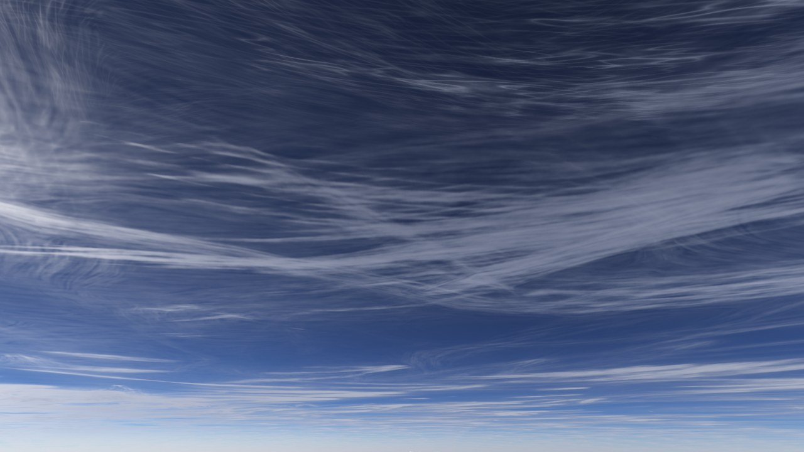

# How Sky draws a frame

This document follows one frame from the address bar to the pixel. It
describes the code on `main` as it is. Names are those of `index.html`:
functions, constants, uniforms and element ids. Plans and known flaws are
in the [issues](https://github.com/sf624/sky/issues), not here.

## The page

`index.html` holds everything: the markup, the CSS and nine `<script>`
blocks. It loads no other file.

| Block | Kind | What it is |
|---|---|---|
| (no id) | JS | `TEXT`, the strings in Japanese and English, and `applyLanguage`. It runs right after the panel. |
| `stars` | data | The star catalogue, base64 (see [Stars](#sun-moon-stars)). One very long line: never print it. |
| `noise` | fragment shader | Draws the cloud noise and the weather map once, at start. |
| `waves` | fragment shader | Draws the map of the waves on the sea once, at start. |
| `fs` | fragment shader | The scene: air, clouds, sea, cirrus, sun, moon, stars. |
| `mean` | fragment shader | Joins each new frame of the aircraft's view to the picture so far. |
| `show` | fragment shader | Copies that picture to the canvas, with dither. |
| (no id) | JS | `SkySound`: the background sound (see [Sound](#sound)). |
| (no id) | JS | Everything else, in one function that runs at load and starts the loading. |

There is one canvas, `#sky`, the hero: the view from an aircraft. Clouds,
sea, cirrus, glare. It flies (900 km/h by default) and is drawn as a mean
over frames. It fills the window, and the page does not scroll.
`makeSky(canvas, view, { done, shown })` makes its renderer, a step at a
time (see the next section).

## Conventions

- **Lengths** are in km, in the shaders and in the JS.
- **Axes**: x west, y up, z south. The centre of the planet is the origin.
  The eye is at `(0, RG + uAlt, 0)`, with `RG` = 6360 km (the ground) and
  `RT` = 6460 km (the top of the air).
- **Directions**: `yaw` 0 looks south, 90 degrees west, -90 degrees east;
  a larger `yaw` turns the view to the right (clockwise seen from above),
  and a drag to the right lowers it. `pitch` is positive upwards.
  `camera(yaw, pitch)` gives the column-major `uCam`: right, up, forward.
  `uTan` is the tangent of half the vertical field of view (`FOV` = 62
  degrees for the hero).
- **Spectra** are twelve wavelengths, 405 to 680 nm in steps of 25 (`WL`),
  stored as `vec4 X[3]`: four wavelengths per `vec4`. Loops run
  `for (int k = 0; k < 3; k++)`. `uWL` holds each wavelength divided by
  550 nm.
- **Light** is in units of the sun's irradiance. The weights `uWR`, `uWG`,
  `uWB` turn a spectrum into linear sRGB with the solar spectrum folded in
  (`W` in the JS, from the CIE 1931 functions `CMF` and `SOLAR`); the bare
  sun has luminance 1. `main` multiplies by `ISUN` = 20.
- **The way flown.** The aircraft does not move: the world does. `state.drift`
  is the way made over the sea, in km, wrapped to `[0, WEATHER_KM)` with
  `WEATHER_KM` = 256 so that it keeps its precision in single-precision
  floats. The shader reads clouds, sea and cirrus at `p.xz + uDrift`. When
  the drift wraps, every pattern read there jumps by 256 km, so **every
  pattern must repeat a whole number of times in 256 km**, or a seam shows.
  Hence `BASE_KM` = 8 (32 tiles of the noise), `DETAIL` = 7 (whole tiles of
  the fine noise per tile), the wave bands and the cells of the foam
  rounded to whole numbers per map (`rep`, `cells`), the swells with whole
  numbers of crests (`SWELL`), the cirrus frame stepping by whole numbers
  (the tile of the ice twice in a unit of it, and every noise in the ice
  with a whole number of cells to the tile), and the `bend` of the
  cirrus's bands in the weather map written with whole-number
  frequencies.
- Comments in the code are plain English sentences that say what and why.

## From the address bar to the first frame

The page shows at once in its loading state: the hero is dark (`.loading`,
a gradient of a night sky), with the title over it. After 0.3 s a thin line
of progress and a word (`TEXT.loading`) fade in, so a quick start shows only
the dark. The panel and the full-screen button stay hidden (no clicks, no
focus) until the first picture. All of this is HTML and CSS: it needs no
script.

The JS then runs once, at load, and does little:

1. **Inputs.** URL parameters with the id of a slider set that slider's
   value (the browser clamps it to the slider's range and step). Then
   `readInputs()` copies the sliders into `state`. `now`, `rate` and `play`
   then act as the now button, the select and the play button, but the
   time does not run yet (see below). `yaw`, `pitch`, `heading`, `at`,
   `pixels` and `res` are read directly (see
   [development.md](development.md#url-parameters)). Without `yaw`, the view
   starts 65 degrees to the side of the sun; without `heading`, the
   aircraft flies 60 degrees to the left of the view.
2. **The loading.** After the first paint (an animation frame, then a
   message), `makeSky` for `#sky` makes the renderer. It is an `async`
   function: it waits a frame (`nextFrame`) wherever it would otherwise
   hold the main thread or wait for the GPU. Its steps:
   - `getContext`, and the extensions.
   - Every program (`fs`, `noise`, `waves`, `mean`, `show`) is
     compiled and linked at once, and nothing asks how it went yet. With
     `KHR_parallel_shader_compile`, the GPU process compiles them on threads
     of its own; the page asks `COMPLETION_STATUS_KHR` once a frame. Without
     it, asking waits, so the page asks for one program a frame. A failed
     program throws the compiler's or the linker's message.
   - Meanwhile the tables of the CPU, in slices of about 8 ms, one a frame
     (`slices`). Each is a generator (a job) that yields every little while;
     `finish(job)` runs one at once.
     - `odTable` (`buildDepths`): optical depth to the top of the air
       towards the sun, over altitude (48 rows, squared spacing) and the
       cosine of the sun's zenith angle (96 columns from -0.2), 64 steps
       each. Read by `sunDepth()` in the JS only.
     - `starData` (`buildStars`): the star texture.
     - `msData` (`buildMultiScatter(haze)`): the multiple-scattering table
       (see [The air](#the-air)), for the haze the page starts with
       (`NIGHT_HAZE`, the slider's own value).
     - `NIGHT` (`nightSky`): the moonless night sky (airglow), 4e-8 of the
       metered sky with the sun at 42 degrees, at `NIGHT_HAZE`.
     - `msData` again, if the address gives another haze, for that one.
     - the table of `depthToTop` (`depthTable`, see [The air](#the-air)).
   - The textures (see [Textures made at start](#textures-made-at-start)).
     The noise and the weather map are drawn in batches (`batches`), the
     weather map in strips of 64 rows (the scissor; each pixel is the
     same as from one draw), and so are the cirrus's ice and its fibres in
     pieces of 512 x 512, if the page starts with cirrus (else `render`
     draws them all at once when cirrus is first shown; see
     [Cirrus](#cirrus)). After each batch the page waits for a fence
     (`settle`); a batch doubles while the GPU gets through it in under
     100 ms and halves over 250 ms. The GPU process draws the whole
     browser, and a slow GPU given seconds of work at once would freeze it.
   - `prime`: the first frame is drawn as the first frame will draw it,
     up to the canvas (`render` as a probe, which then puts its state
     back), and the page waits for a fence. Some drivers finish a program
     only at its first draw, which can take a second: that happens now,
     behind the loading state. The first frame starts afresh and draws
     over all that the probe drew.
3. **The hand-over.** The hero's `data-sky` becomes `ready` (`failed`
   without WebGL2 or if a program failed: the error goes to the console,
   the loading state fades out, and the canvas keeps its CSS gradient).
   `kick()` asks for the first frame; a time-lapse asked for in the address
   starts now; the title's and the panel's timers start (see `.told` and
   `.still`). Before this, `kick()` and `schedule()` do nothing.
4. **The first picture.** The first frame goes to the canvas, and
   `render` calls `shown()`: the hero gets `.shown`, and the loading state
   fades out over the picture in 0.8 s (it lets the pointer through at
   once), while the panel fades in. The class and the picture reach the screen in the same frame, and
   the fade starts from opaque: nothing empty or half drawn shows.

So no step holds the main thread for long, except `getContext` itself.
The pictures are the same as when everything ran at once: the jobs and
batches only split the same work.

A hidden tab has no animation frames: there `nextFrame` waits 100 ms
instead (the browser slows that down further), so the loading goes on
slowly; the first frame waits until the tab is shown.

**The loop.** `update()` marks the state changed and calls `kick()`,
which asks for one `requestAnimationFrame(frame)`.

`frame(now)` then:

- does nothing in a hidden tab;
- if something changed: rebuilds `msData` when the haze has changed (at
  once, with `finish`), runs `celestial()`, sets the exposure
  (`state.airExposure`) and the panel's labels;
- moves the aircraft: `state.drift` grows by `speed / 3600 * dt` along
  `state.heading` (`dt` capped at 0.1 s, and 0 after a pause, so the
  aircraft never jumps);
- calls the renderer;
- asks for another frame only if the renderer returned true.

The renderer returns true while the aircraft flies or while its picture is
still settling. So the page draws nothing at rest once the picture is
clean, or in a hidden tab. `visibilitychange` calls `kick()` again.

**Playing.** The play button runs the time at the rate of the select beside
it (`pace`, a factor of real time; 960 at first, a day in a minute and a
half). Each `tick()` moves the time by the time elapsed since the last tick
(`performance.now()`) times the rate. A gap longer than a quarter of a second
is not a frame (the tab was hidden): at real time the time catches up with
it, at the faster rates it counts as 0.25 s, so the time does not leap. A
new rate applies from the moment it is chosen. Past 24:00 the date moves
on by a day, and from the last day of the year to the first. The moon's age
runs on with the time, a day of age a day, and so does the sun on the
ecliptic (`state.dayShift`, see below): nothing jumps at midnight. At the
faster rates, ticks come with the frames (`requestAnimationFrame`), and
every frame is drawn again.

**Real time.** The sun moves a quarter of a degree a minute. At the default
drawing limit (WQHD, 1440 rows over the 62 degrees of the view) that is
less than a pixel in 10 s. So at real time the ticks come from a timer,
once a second, and the time that is drawn (`state.time`) moves in steps of
10 s (`REAL_STEP`): each step draws the picture again and lets it settle
(39 frames), and nothing is drawn in between, about 6 % of the frames.
The panel's clock shows the minute, which changes only on a step. In a
hidden tab the timer runs on (the browser slows it); `visibilitychange`
brings the time to the present at once. In flight every frame is drawn
anyway.

**Now.** The now button sets the date to today, the time to the device's
clock (taken as local solar time), the moon's age as moving the date does,
the rate to real time, and plays.

## Sun, moon and sky in the JS

`celestial()` places the sun, the moon and the stars for `state.day` and
`state.time`:

- The observer is at `LATITUDE` = 35 degrees north. The time is local solar
  time: the sun is due south at 12:00.
- The sun moves along the ecliptic (`OBLIQUITY` = 23.44 degrees), at
  longitude 0 on day 80.
- The moon runs ahead of the sun along the ecliptic by its age
  (`state.moonAge / 29.53` of a turn). Its orbit's tilt is left out.
- Moonlight is 2.5e-6 of sunlight at full moon, falling with the phase
  angle. It counts (`state.moonI`) only when the sun is below -3 degrees and
  the moon above -18.
- `state.sunOn` (`uSunI`) is 0 when the sun is below -21 degrees.
- One light for the clouds and the sea (`uLight`, `uLightI`): the sun while
  it is above -3 degrees, else the moon.
- `state.sky` (`uSky`) turns J2000 equatorial directions into local axes.

The date slider covers the current year. The moon's age starts from the
date (`moonAgeOn`: the mean lunation, from the new moon of 6 January 2000)
and is set again whenever the date slider moves; the moon slider then
changes it alone. With `date` and no `moon` in the address, it follows the
given date.

The sun's place on the ecliptic comes from the day number, one step a day.
While the time plays past midnight, `state.dayShift` (in days) holds the
sun where the time has carried it: it grows with the time and loses a day
when the date moves on, so the sun and the stars turn on smoothly. Setting
the date or the time sets it back to 0.

## The air

`main` in `fs` marches along the view ray from the eye to the top of the
air, or to the sea. The air is three species, with densities from
`density(h)`:

- Rayleigh: `exp(-h / HR)`, `HR` = 8 km; scattering `uBR` = 13.558e-3 per km
  at 550 nm, falling with the fourth power of the wavelength (`BR`).
- Mie (aerosol): `exp(-h / HM)`, `HM` = 1.2 km; scattering `BETA_M` =
  3.996e-3 per km times `uHaze`, extinction `MIE_EXT` = 1.11 times that.
  Grey: the same at every wavelength.
- Ozone: a triangle from 10 to 40 km, peaking at 25 km; absorption `uBO`
  from the Chappuis cross-sections (`OZONE`) for 300 Dobson units.

Phase functions (`phases`): Rayleigh, and the Cornette-Shanks form for Mie
with `g` = 0.8.

**The march.** `NV` = 20 samples at
`t = tmax * f * f`: denser near the eye. Each sample adds, for the sun and
for the moon, `addLight`:

- light scattered once, if the planet does not hide the source: the
  transmittance from the eye to the sample and from the sample to the top
  (`depthToTop`) times the phase functions, times `direct`,
  which the shadow of the clouds lowers near the sea;
- light scattered many times: the multiple-scattering table times the
  local scattering coefficient, times the transmittance to the eye.

The clouds and the cirrus enter the march as two layers (see
[Low clouds](#low-clouds) and [Cirrus](#cirrus)). At each layer the march
ends a sample exactly there (`tLayer`), adds the layer's light (`C` or
`H`) dimmed by the air before it, and multiplies what lies beyond by the
layer's transmittance (`vis *= Tc` or `Th`). Behind a thick cloud
(`vis` = 0) the march stops.

**`depthToTop(p, d)`**, the optical depth from `p` to the top of the air:

- One filtered read of the depth table `uDepth` (512 by 128, `DEPTH_MU` by
  `DEPTH_R`), made at start in `makeSky` by a 16-step midpoint sum. Its axes follow Bruneton (2017): the distance to the top, between
  its least and its most at that height, and the distance to the horizon
  (`rho / H_TOP`). The table is RGBA32F where the GPU can filter full floats
  (`OES_texture_float_linear`), else RGBA16F.
- The table repeats the density profile. The profile is written out five
  times: `density()` in `fs`, and in the JS `buildDepths`,
  `buildMultiScatter`, `skyLuminance` and this table in `makeSky`. Change
  all five.

**Multiple scattering** (`buildMultiScatter`, after Hillaire, 2020): for
each altitude (`NH` = 12 rows, squared spacing) and cosine of the sun's
zenith angle (`NMU` = 40 columns from `MS_MU_MIN` = -0.35), the light
scattered twice is gathered over the sphere as if scattering were
isotropic (8 by 4 directions over half the sphere, mirrored; 14 steps
each), with sunlight bounced off the ground (`ALBEDO` = 0.07); the higher
orders follow as a geometric series. One value per wavelength, per unit of
scattering coefficient. The texture is `NMU` by `3 * NH`: the three groups
of four wavelengths stacked in y. It depends on the haze, so `frame`
rebuilds it when the haze changes, and the renderer uploads it again.
`fs` reads it through the GPU's filter (`textureLod`; RGBA16F when full
floats cannot be filtered).

The JS keeps a copy of the march, `skyLuminance()`, to meter the exposure
(see [Exposure](#exposure-and-the-tone-curve)).

## Low clouds

Low clouds live in a shell from `CB` = 0.6 km to `CT` = 5 km.

**The field.** A signed field says where cloud is: positive inside,
rising by about 1 per km of depth under the surface. `cloudShape` builds it
as a sum:

- the weather map `uWeather` at `p.xz + uDrift` (R: cover, G: towers),
  against a level set by `uCloud` (a cubic in `uCloud`);
- less what height costs: a dome over a flat base (`y` cubed over the
  cube of `top`), thicker where the map is higher; the lowest 180 m
  rounded off (`rim`);
- plus the noise of the tile (`uNoise`, one tile per `BASE_KM` = 8 km),
  read at a depth that drifts from place to place (`far`) so that no two
  tiles look alike. Worley values are rounded into domes (`v (2 - v)`).
  `lump` says how far a place stands out of the billows; `body` how thick
  the cloud is there; `q.w` how rough;
- a flat base, 30 to 80 m over `CB`.

`cloudDetail` adds the fine noise: `DETAIL` = 7 tiles per tile, and a
finer octave still when the pixel is small against it (`lod < -1`).
`cloudField` adds it only near the surface (`f > -0.35 * RELIEF`), more
strongly on thin cloud, whose edge frays.

`cloudExtinction` turns the field into extinction: `SIGMA` = 90 per km
once the field is past the edge (`EDGE` = 0.04, wider where the field is
smoothed), with more water higher up and in thicker clouds.

**The march** (`clouds`) runs from where the ray enters the shell (`ta`) to
where it leaves it (`tb`, at most 600 km). A ray that goes on to the sea
leaves it at the cloud base; from under the base, such a ray has no
clouds.

- The steps grow with the distance: `ds = max(DS_MIN, rel * t)`, with
  `DS_MIN` = 20 m and `rel` at least `DS_REL` = 0.0045. On a long path
  `rel` grows so that the march ends within its budget (`COARSE * 80`
  steps' worth); the near steps stay fine. At most `CLOUD_STEPS` = 160
  steps, and the march stops when less than 1 % gets through.
- The plan must not jump where the end of the ray does: a ray that meets
  the sea is planned as if the sea were a mirror and the ray went on up to
  `CT`. So a cloud in front of the horizon looks the same above and below
  it.
- In clear air the field tells roughly how far the next surface is: steps
  of `0.35 * |f|`, between `FINE * ds` and `COARSE * ds`. A long stride
  that lands inside a cloud steps back, and the next three steps in clear
  air are at most `ds`, so edges come out crisp. Inside, steps of
  `0.5 * f`, at most `ds`.
- The detail of the noise read (`lod`) follows the pixel's footprint at
  that distance, or a fifth of the step if that is larger.
- The start is jittered per pixel and per frame
  (`ign(gl_FragCoord.xy + 5.588238 * uPass)`, interleaved gradient noise);
  the mean over frames removes the noise.

**The light** is worked out at each sample inside a cloud while more
than a quarter of the light still gets through, and at the first sample
of each cloud the ray enters; deeper samples share the last result. At a
sample just past the surface it is worked out on the surface itself,
found between the last two samples. For each:

- `lightDepth`: six steps towards the light, growing by 1.6 each. The first
  two see the fine noise (`crisp`: the shadows of the small billows). The
  last three are moved sideways at random each frame (`off`, up to
  `PENUMBRA` = 60 m): over the frames the shadows soften. The third has
  neither. It also gives
  the slope of the field towards the light, hence `facing`.
- The rise of the field towards the sky over `reach` gives `open`: how much
  skylight a place gets.
- Five phase terms stand for the orders of scattering: `p0` (scattered
  once: two Henyey-Greenstein lobes, dimmed by the whole depth) and `p1` to
  `p4` (scattered many times: wider lobes that go deeper). `white` makes
  only thick clouds brilliant; `billow` lights the tops of the big billows
  far off, where the fine ones are below a pixel; `bounce` lights a side
  turned from the sun with the sunlit cloud around it.

`clouds` returns what gets through (`Tc`), the light per unit of sunlight
scattered once (`sOne`) and many times (`sMany`), per unit of skylight
(`sAmb`), and the mean distance it comes from (`tBar`). `main` turns them
into the spectrum `C` at `tBar`: sunlight through the air above (and
through the cirrus, `cirrusShadow`), plus skylight from the
multiple-scattering table, plus airglow.

**Shadows.** `shadowDepth` sums the clouds' depth towards the light from a
point under their tops (ten samples, denser low down). `main` uses it for
the sea's shadow and the glare. Where the ray meets no sea, the air near
the sea is dimmed by the cloud amount alone (`shade`).

## The sea

`addSea`, where the ray meets the sphere `RG`:

- **Wind.** `uWind`, varied by gusts (B of the weather map) and streaks (A of
  the wave map). The slopes have the variance of Cox and Munk (1954):
  `s2 = 0.003 + 0.00512 * wind`.
- **Waves the picture shows.** Three bands of wind waves read from the wave
  map `uWaves` (R, G: slopes) at sizes a factor 6 apart, the longest set by
  the wind; and eight swells (`SWELL`), each smoothed over the footprint.
  Reads use `textureGrad` with the pixel's footprint on the sea (long when
  seen aslant). What the footprint averages away stays in the variance
  (`hidden`, from B of the wave map), so the glitter has the same light
  from near and from far.
- **Glitter.** The share of slopes that mirror the light to the eye, with
  Fresnel and Smith's shadowing term (`waveShade`, in the rational form of
  Walter et al., 2007).
- **Mirrored sky.** `skyAt` marches 8 steps of air in the mirrored
  direction of the tilted footprint. Rough water mirrors less at grazing
  angles (the mean Fresnel factor of Bruneton et al., 2010). Three samples
  of `cloudDensity` up the layer tell how much of that sky the clouds hide.
- **Light from below.** `SEA`: blue light scattered back out of clear water.
- **Foam.** Whitecaps cover `2.95e-6 U^3.52` of the sea (Monahan and
  O'Muircheartaigh, 1980), as separate breakers in a grid of cells: counted
  sharp from near, averaged from far.

The shadow on the sea is the `tau` passed in: `shadow` in `main`, the
depth of the clouds (`shadowDepth`) and of the cirrus (`cirrusShadow`)
towards the light.

## Cirrus

`highCloud`. The cirrus fills a shell from `CI_LO` = 12.2 to `CI_HI` =
12.8 km, split into `CI_LAYERS` = 2 decks of 0.3 km, each with ice of its
own: the upper and the lower deck of cirrus. Where both have ice, their
trails cross at different angles, and in flight the decks slide over each
other.

Each deck is read where the ray crosses its middle height (or halfway
along a ray that only grazes it), and its depth counts as many times as
the ray's way through the deck is longer than the deck is thick. The
crossings come from `eyeSphere`, which takes them from the heights, not
from `raySphere`: the slider stops on these heights, and from an eye at a
sphere's own height `raySphere` puts the near crossing a hair ahead or
behind, ray by ray (see [development.md](development.md#glsl-rules)).

**The ice** (`uIce`, below) holds the forms. It is not noise drawn out
along the wind but the result of a process, followed at start for every
texel: ice is made in generating heads, falls out of them, and the wind
shear draws what falls into a trail behind each head; eddies stir the
trails.

- **Heads** sit one to a cell of 4 km, in the middle 40 % of the cell,
  and reach no further than 0.3 of a cell: so one cell is enough at each
  step, and nothing changes where a way crosses into the next. A random
  number and two octaves of noise (20 and 8 km) set their strength: they
  gather in groups with wide gaps between, and weak heads lie between the
  groups (they show only where the weather gives much cirrus). A head is a
  Gaussian puff of 150 to 300 m that grows with age (to some 400 m) and
  wobbles a little in time. Half the heads have died out at an age of
  their own: they left a trail without a head (cirrus fibratus).
- **The trail.** The shear draws the ice away from its head, slowly at
  first (a dense head), then at full speed, along a direction that turns
  with age (`veer`: a hook, cirrus uncinus). The direction, the turn, the
  length of the trails (some 7 to 23 km) and the strength of the eddies
  change over the tile (slow noise), so that one place has straight
  fibratus and another tangled hooks.
- **Splay.** A head's ice falls apart into `ICE_STREAMS` = 3 streams that
  fall at different speeds: the shear draws each out by its own length and
  turns it 22 degrees away from the others, so a trail splays like a
  feather and is wide.
- **Eddies**: the curl of a noise potential at 13, 5 and 2 km (divergence
  free), which changes in time (its gradients turn), the smaller the
  faster, with speeds as Kolmogorov's law gives them; and a gentle
  divergent part, the gradient of the middle size, as the ice spreads and
  gathers where the air rises and sinks. They bend the trails gently and
  stretch them into filaments; stronger eddies curled them into smoke and
  spirals, which cirrus seldom shows.
- **Threads.** A head makes its ice unevenly across the trail (value
  noise across, 50 to 150 m, drawn out in time) and in thin bright
  threads; the shear and the eddies then draw them out along the trail's
  own way, so they follow the local form. Some outlive the rest, so a
  trail ends in fine threads.
- **How.** For each texel, the eddies are followed back in time
  (`ICE_STEPS` = 36 steps over a life of the ice; the method of
  characteristics). At each age, the ice of that age at the texel came from
  where the eddies bring it from, less the trail's drift; a head there made
  it then. Each step is a segment, and each head's puff is integrated along
  it (with `erf`), so that no step shows. Nothing is resampled step after
  step, so nothing blurs, and each texel is computed by itself: the field
  does not depend on the order of the draws, and repeats with the tile.
  The sum is stored as `1 - exp(-30 x)`.

**The fibres.** Photographed cirrus is made of many fine, nearly parallel
streaks inside each tuft, down to hair-fine ones; the ice's 10 m texels
hold only the coarser ones, and seen from near the shell they are
magnified to mush. Two more textures are drawn from the ice, and the
scene adds the finest streaks itself:

- **The way** (`uIceWay`): where the ice runs, for both decks, from its
  structure tensor (the mean of its gradient times itself over 3 x 3
  texels of 40 m), stored as the gradient's direction at twice its angle,
  `(Jxx - Jyy, 2 Jxy)` over the trace. A gradient and its opposite then
  add up, so the mipmaps average the way over a footprint, and its length
  says how much the ice runs one way (near 1 along a trail, near 0 in a
  round head). The fibres run across the gradient.
- **The fibres** (`uIceFib`): grains of 25 and 90 m summed along the line
  that follows the way through each texel, 24 steps of 25 m each side
  under a Hann window (line integral convolution, after Cabral and
  Leedom, 1993): streaks of some 1.2 km that bend with the trails, crowd
  and splay. The line follows the way over 80 m and more of it over
  320 m: round a head the gradient runs round, and the streaks would ring
  it. They are read like the ice (`textureGrad`, mipmaps, the anisotropic
  filter), so from afar they average out by themselves.
- **The finest streaks** (`ciFibres`): three octaves from 24 m down to
  3 m, 14 times as long as wide, the zeros of gradient noise drawn out
  along the way (thin bright lines on a mean of 1). Noise turned to
  follow the way would shear its streaks apart far from the centre of the
  turn, so they are drawn on `CI_WAYS` = 16 fixed ways that repeat with
  the tile (whole-number steps across it, such as (2, 1) or (1, 4)), the
  two nearest the ice's way blended with weights over the root of their
  squares' sum (so the contrast stays), and they wander from side to
  side. An octave fades out before it gets narrower than the footprint
  across it, or than most of the footprint's length: seen aslant, the
  streaks that point at the eye would otherwise outlast the others and
  fan out towards the horizon.

The fibres modulate the ice (a factor around 1) before and after the
ramp below, strongest where the ice is thin and runs one way: thin parts
break up into streaks, dense cores stay milky with a sheen of fibres.

From just under the shell (11.9 km), aslant, the streaks of the deck
overhead converge on the horizon, as the lines of any ceiling do: that is
perspective of the patch overhead, not a direction shared by the whole
sky (at another place the streaks run another way).

`ciDensity` gives a deck's share of the vertical optical depth at a place
on the map.

- **The weather.** A of the weather map, against a level set by
  `uCirrus`, gives how much cirrus there is (`m`). The lower deck reads
  another place of the map and needs more of it, so that the decks come
  and go apart and two decks cross only in places. Over some
  16 km (a coarse level of the map) it tells where there is none, and most
  of the sky costs little. The weather now holds patches and bands only;
  the forms are in the ice.
- **The ice** is read in the cirrus's frame (along (3, 1), across
  (-1, 3), two tiles to a unit of 81 km) with `textureGrad` over the
  pixel's footprint (`f1`, `f2`: the footprint's axes on the map, drawn
  out along the ray's way and a little by the way through the deck),
  through the mipmaps and, where the GPU has it, its anisotropic filter.
- **The slider.** Little cirrus shows only the densest ice: the ice passes
  through a soft ramp at `1 - m`, so a cloud fades in as a whole and has no
  outline. More cirrus shows the thin parts too, and much cirrus adds a
  milky veil where there is much ice around (the ice over some 2.5 km, a
  coarse level of its mipmaps).
- `ciBody` is the ice over a footprint six times as wide: the light inside
  the sheet feels it. `ciVeil` is the share of the veil: it draws the halo.
- Light: forward scattering by ice (a narrow diffraction peak within a
  degree or two of the sun, so that the glow round the sun stays small; a
  broad refraction lobe; and a flat part to the side and back, some 0.3 of
  the mean, as ray tracing of ice crystals gives it), the 22-degree halo
  with the dispersion of ice (faint and soft, and only where there is a
  veil: a halo needs the even, smooth crystals of cirrostratus), light
  scattered once with the sheet's own shadow (a low sun enters the sheet
  within some seven times its thickness, between the clouds, so cirrus at
  sunset is lit gold), a share scattered many times,
  skylight from the multiple-scattering table, and light from the low
  clouds below, at the mean distance of the decks seen. A fibre in a thick
  body of ice is lit through the body (`ciBody`), so dense patches are grey
  inside and their thin edges bright. Sunlight reaches the shell through
  the air above it (`ciDepthToTop`): at a low sun it is reddened.
- **Towards the sun** the sheet sends thirty to fifty times the light of
  the sky round it, more than the screen shows: its thick and thin parts
  would be one white glow, where a photograph through such a veil keeps
  them apart. The light scattered forward rolls off smoothly towards
  `CI_ROLL` = 2.2 times the screen's white (after the exposure,
  `x -> R (1 - exp(-x / R))`), so the texture of the ice stays up to a
  small sun. The rest of the cirrus's light is untouched.
- `cirrusShadow` dims the direct light on the low clouds and the sea (half
  the depth counts: ice scatters mostly forward). It reads the mean of the
  two decks over 0.5 km (`cirrusDepth`), and so does the glare.

`highCloud` returns `Th`, `H` and `tHigh`; the march through the air treats
it as its second layer.

**The ice's textures.** `uIce` (4096 x 4096, RG8, a tile of 40.5 km, 10 m
a texel; R: the upper deck, G: the lower, which has more heads and trails
turned 35 degrees from the upper's) is drawn by the `noise` shader (`uZ` =
-3) in pieces of 512 x 512 (`ICE_PIECE`), so that no single draw keeps the
GPU long; then `uIceWay` (a quarter as wide, RGBA8: RG the upper deck's
way, BA the lower's; `uZ` = -4, one draw from the ice's mipmaps) and
`uIceFib` (as wide as the ice, RG8; `uZ` = -5, in pieces). They are built
during the loading, in batches, if the page starts with cirrus; else when
cirrus is first shown (`buildIce`, called by `render`, all at once), so
that a sky without cirrus never pays for them. On an RTX 3090 the three
take 0.4 to 0.5 s of GPU time. A renderer without a GPU (its name says
SwiftShader, llvmpipe, softpipe, software or Basic Render) builds them a
quarter as wide (`ICE_SOFT` = 1024, 40 m a texel, without the 25 m
grains): SwiftShader then loads a view with cirrus as fast as one without
(it took two minutes at full size). The name decides, not a timing, so
that a renderer always draws the same. Every pattern in them repeats with
the tile, and the tile twice in a unit of the cirrus's frame, which
repeats ten times over the map.

## Sun, moon, stars

Rays that reach the top of the air (no sea, not behind a thick cloud) get,
all dimmed and reddened by the air:

- **The sun**: a disc of 0.267 degrees radius, of a fixed brightness (2000
  in these units).
- **The moon**: a sphere lit by the sun (`uSun`), so its phase comes out by
  itself, with darker seas from noise. The dark side holds a dim grey
  (`uEarth`: earthshine, capped so the night exposure does not burn it out).
- **Airglow** (`uNight`), brighter towards the horizon (van Rhijn's factor),
  and **the Milky Way** (`milkyWay`): a noise pattern on the real galactic
  plane, brighter towards its centre.
- **Stars** from Wikidata (CC0), to magnitude 6.5 (the `stars` block: six
  bytes per star, brightest first, about 8,800 stars; built by
  `tools/make-stars.py`, the source is named in `THIRD_PARTY_NOTICES.md`). About a hundred
  stars that Wikidata gives no V magnitude have one estimated from their
  other bands.
  `buildStars` puts them into a `GRID` by `GRID` (128) octahedral map of the
  sphere with up to `SLOTS` = 8 stars per cell, and enters each star in
  every cell its disc can reach, so the shader reads one cell per pixel
  (`starCell`). A star is a spot about a pixel wide, with a colour from its
  B-V index (Ballesteros's temperature, then a tilt of the spectrum) and a
  compressed brightness (a "look"). The brightest get diffraction spikes
  fixed to the screen.

**Glare**: a glow of a few degrees around the sun, as strayed
light in a lens, dimmed by the clouds and the cirrus towards the sun.

## Exposure and the tone curve

The exposure is set in the JS, once per change, by `airExposure()`. It
meters the sky at the aircraft's altitude (`meterLight()`: the mean of
three points, or the glow above the sun if brighter), the band along the
horizon and the sunlit cloud tops (`cloudLuminance`), whichever is
brightest, against the same with the sun at 42 degrees (`REF_SUN`). It
opens up as the sky darkens, but not all the way. It stops down from high
up (`AIR_STOP`) and further with clouds (`CLOUD_STOP`), more so close over
the tops, and opens up under a sheet of cloud.

At the end of `main`:

1. Spectrum to linear sRGB, times `ISUN` and `uExposure`.
2. A daylight white balance, `vec3(0.932, 1.013, 1.074)`.
3. Light far too strong for the screen turns towards white (as on film).
4. A "look": `pow(col, uLook)`, with `AIR_LOOK` = 1.4.
5. Tone mapping `1 - exp(-col)`, then the display power `1 / 2.2`.
6. Rounding at random to the storage steps (next section).

## The hero's mean over frames

One frame of the hero is noisy: each frame shifts the rays within the
pixel (`uJitter`, Halton (2, 3)) and the samples through the clouds
(`uPass`). The picture is the mean of many frames. `makeSky` keeps three
textures for it, each with a second 8-bit texture beside it (`aux`):

- `shot`: the new frame, drawn by `fs` into two outputs: the colour
  (`outColor`) and the distance of what each pixel shows (`outAux`);
- two `pictures` that take turns: the one so far is read while the next is
  drawn by `mean`; then `show` copies the new one to the canvas.

**Storage.** Half floats (RGBA16F) where the GPU can draw to them
(`EXT_color_buffer_half_float` or `EXT_color_buffer_float`, and the
framebuffer is complete), else RGBA8. Values are kept in steps of
`1 / uSteps` (2048 or 255), rounded up or down at random each frame, so
that the mean neither bands nor sinks. `show` dithers by one 8-bit step
when the picture is in half floats.

**The distance code** (`distanceCode`, read back by `decode` and
`nearness`): `0.5 + log2(t) / 20`, in 16 bits over two 8-bit channels; the
sky is infinitely far (code 1, nearness 0). The pixel's distance is that
of the clouds if they hide a tenth of what is behind or give a twentieth
of its light (`C` against `L`, in one band of wavelengths: a wisp in
front of the dark sea), else of the sea, else
infinity; a cirrus sheet counts when nothing else is there, or when it
hides the rest.

**Reprojection** (`whence` in `mean`): each pixel finds where what it shows
now was a frame ago. Clouds and sea have come nearer by the eye's way since
(`uWay`, from the change of `state.drift` and altitude), at the same height
over the curved ground; the sky stays (the air moves with the eye). The
old camera (`uCamPast`) gives the old pixel. If something nearer was there
a frame ago (the ragged edge of a cloud), the pixel reads the past instead
where a thing at that nearer distance, on this pixel's ray now, was a
frame ago.

**The read** of the past is a Catmull-Rom filter in nine bilinear reads
(Jimenez, 2016), clamped to the four texels around, which also give the
number of frames in the mean (B of `aux`, over 64) and the past distance.

**The neighbourhood check.** If the past was nearer or further by enough to
slip a fraction of a pixel (`doubt`, from the parallax), it counts only as
far as it fits the 3 by 3 neighbourhood of the new frame (clamped to its
minimum and maximum). A past that had to change much was something else:
its count drops to 1.

**The picture's distance** (R, G of the picture's `aux`): the nearer of
the new frame's distance and a mean of the past one and the new one, with
the new one weighed as the new frame's colour is (without a past, the
new frame's distance). So after a miss a
cloud's distance fades only as fast as its light does. While the picture
holds a near cloud's light, the pixel moves with that cloud; once the
cloud has gone, the neighbourhood check lets its light go. If the
distance went back to the sea sooner, the light would stay on the sea
and trail behind a near cloud in flight, in streaks.

**The weights.** The new frame weighs `1 / (n + 1)`, with `n` the past's
count, capped by `uTrust`, which the JS sets per frame:

| Situation | `uTrust` | New frame weighs |
|---|---|---|
| First frame, canvas resized, or a jump of more than 1 km | 0 | 1 |
| The light changed (`look`: time, date, moon, haze, wind, cirrus, altitude, cloud), for `RELIGHT` + 1 = 7 frames | 1 | 1/2 |
| The view moves or the aircraft flies | `IN_MOTION - 1` = 9 | 1/10 |
| At rest | 63 | 1/(n + 1): the plain mean |

**When drawing stops.** At rest (speed 0, no drag), the renderer counts
the frames since the last change (`calm`) and stops once it reaches
`SETTLE + RELIGHT` = 38: 39 frames in all after the last change. While
the aircraft flies, it never stops. Playing at real time, each step of 10 s
starts the count again (see [Playing](#from-the-address-bar-to-the-first-frame)).
A still picture for testing therefore
needs `speed=0`, and from page load about 46 frames: the first frames may
start the mean again (the first reset, and a restart if the drawing size
grows).

## The drawing size

`fit()` sizes the canvas: its CSS size times the device pixel ratio (at
most 2), but no more pixels than the resolution choice (`#pixels`,
`HERO_PIXELS`): Full HD (1920 x 1080 pixels' worth), WQHD (2560 x 1440,
the default) or 4K (3840 x 2160). It comes from `?pixels=`, else from
`localStorage` (`sky.pixels`, written when the choice changes), else WQHD.

**Dynamic resolution.** While the view moves or the light
changes (within 150 ms of the last such frame), the frame and the picture
are drawn at `scale` times the canvas size, and `show` stretches them.
The wall clock measures frames that follow one another: two measures in a
row slower than 40 ms shrink `scale` (by `sqrt(30 / ms)`, down to
`MIN_SCALE` = 0.35); faster than 24 ms grows it by 1.12, up to 1. At rest
the picture is drawn at full size; the smaller past then counts as one
frame. `?res=` fixes `scale` for tests.

## Textures made at start

All are made during the loading, in `makeSky` (the cirrus's three
later if the page starts without cirrus: when cirrus is first shown):

| Texture | Unit | Size and format | Made by | Holds |
|---|---|---|---|---|
| `uMS` | 0 | 40 x 36, RGBA32F, or RGBA16F without float filtering | JS, `buildMultiScatter` | Multiple scattering |
| `uStars` | 1 | 1024 x 128, RGBA32F, nearest | JS, `buildStars` | Star catalogue |
| `uNoise` | 2 | 128^3, RGBA8, mipmapped, repeating | `noise` shader | R: Perlin-Worley; G, B, A: Worley at 4, 8 and 16 cells per tile |
| `uWeather` | 3 | 1024^2 over 256 km, RGBA8, mipmapped, repeating | `noise` shader | R: cloud cover; G: towers; B: gusts on the sea; A: cirrus |
| `uWaves` | 4 | 512^2, RGBA8, mipmapped, anisotropic where available | `waves` shader | R, G: wave slopes; B: slope squared; A: streaks |
| `uDepth` | 5 | 512 x 128, RGBA32F or RGBA16F | JS, in `makeSky` | Depth to the top of the air |
| `uIce` | 10 | 4096 x 4096 (1024 x 1024 without a GPU), RG8, mipmapped, repeating, anisotropic where available | `noise` shader, in pieces | The ice of the cirrus, two decks (see [Cirrus](#cirrus)) |
| `uIceWay` | 11 | a quarter of the ice's size, RGBA8, mipmapped, repeating | `noise` shader, from the ice | The way the ice runs, two decks |
| `uIceFib` | 12 | as the ice, RG8, mipmapped, repeating, anisotropic where available | `noise` shader, in pieces, from the way | The ice's fibres, two decks |

Units 6 to 9 hold the frame and the picture so far for `mean`; `show`
reads unit 6.

The weather map draws, on 256 km: systems of some 80 km, open cells of
30 km with cloud along their walls, streets 5 km apart, clumps from 6 km
down to 1 km, towers where the widest clumps are, gusts on the sea, and
the patches and bands of cirrus. The wave map is a sum of plane waves, each
a whole number of times across the map.

Their random numbers come from one integer hash, `ihash`: Wellons'
lowbias32 (two rounds of xor-shift and multiply, from hash-prospector, in
the public domain). The `noise` shader hashes a lattice cell's
coordinates, packed into one word, plus the seed; the `waves` shader the
number of the wave; `fs` the lattice of the finest fibres. The word, and its low 21 and 10 bits moved up, are
three random numbers, with 11, 11 and 10 bits of their own. The cirrus's
ice uses the same hash (`iceWord`: a lattice point's coordinates and the
seed, each times an odd constant, summed into one word). Its noise wraps
the lattice by hand, not with `mod()`: on the GPU here, `mod()` of a whole
number by itself gave the number back in places, and a seam ran along the
lattice line there (seen as a difference from SwiftShader).

## Sound

`SkySound`, in its own script block, makes the background sound with the
Web Audio API. Nothing is loaded: every part is noise or a tone, filtered
to stand for one source of the real sound. `engine(ctx)` builds the graph
on any `BaseAudioContext`, so that a test can render it in an
`OfflineAudioContext`. `attach({...})` runs it in the page: the controls,
the address, `localStorage`, and the `AudioContext`.

**The noise bed.** One source of noise feeds every branch: Gaussian noise
in a stereo buffer of 11 s (the right channel 0.6 correlated with the
left, for some width that stays safe in mono), multiplied by random signs
from a mono buffer of 10.3 s. The product is Gaussian noise again, and it
repeats only when both loops line up, which is never in practice. A branch
that overlaps others in frequency takes the same noise 0.1 s later
(`late`), so that it neither adds to them nor cancels them.

**The output.** The voices are mixed (cruise near -27 dBFS), high-passed
at 25 Hz, compressed (threshold -24 dB, ratio 4, a look-ahead of a few
ms), trimmed, and held below -1.4 dBFS by a tanh curve; then the volume
(its square) and a fader for the hidden page. At volume 1 the cruise is
near -21 dBFS and the loudest state peaks near -6 dBFS.

**The variations.**

| Variation | Branch | Stands for |
|---|---|---|
| airliner | noise, low-passed twice (450 and 1500 Hz, times `bright`), low shelf | the boundary layer's rush, through the fuselage wall |
| | noise under 85 Hz | the airframe shaking in light turbulence |
| | two tones of 56 Hz with 9 harmonics, panned ±0.35 | the engines' fan shafts; the second 8 to 22 cents faster, so they beat |
| | noise, band-pass at 1340 Hz | the fans' whirr (24 blades) |
| | noise, 1.8 to 7 kHz | the air conditioning |
| airliner-whine | all of the above, and per engine: | |
| | a tone of 1340 Hz with its 2nd and 3rd harmonics | the fan's blade-passing tone |
| | orders 8 to 40 of the shaft, irregular, around 1.1 kHz | buzz-saw: shocks at the fan's tips |
| | a tone of 3.46 kHz | the high-pressure compressor's whine |
| | narrow noise at the fan tone and at the whine; all low-passed at 3.5 kHz | their broadband part; the cabin wall |
| wind | noise, high-pass at 45 to 170 Hz (higher in thinner air), low-pass at 800 Hz times `bright` | the rush past the ears and the frame |
| | noise under 110 Hz | buffeting |
| | two narrow bands (Q 22) at 700 and 1130 Hz times `bright` | whistles on edges |

**What follows the sliders.** Only the air. `flight(alt, speed)` gives the
density (`sigma`, scale height 8 km), the rush's level from the dynamic
pressure (density times speed squared, with a light breeze at speed 0;
0.7 of its change in dB, held softly under +9 dB), `bright` (the square
root of the speed: the rush's low-pass cutoffs and the whistles' pitch
rise with it) and `body` (a low shelf from the density: thin air has less
low end). The engines do not follow the speed: the slider is how fast the
view goes by, not a throttle, and in cruise an airliner's engines hold a
steady speed. They stay at N1 0.9 (`N1`, `SHAFT`), at the level of cruise,
whatever the speed and the altitude. The wind variation has no engine and
follows both sliders. Changes glide (`setTargetAtTime`, 0.4 to 0.6 s).

**Slow movement.** Gusts, swells of turbulence and the wander and beat of
the engines are knots of random values, each voice's `tracks`.
`tick(until)` schedules them on the audio clock; in the page a timer calls
it every second for the next 4 s. It does not depend on the drawing loop,
which stops at rest, and it never asks for a frame.

**In the page.** No `AudioContext` exists before the first click or key
press: a sound chosen in the address or on an earlier visit waits for it,
and the panel says so. Switching variations crossfades (0.15 s time
constant). Off fades out and suspends the context; so does hiding the
page, and showing it again resumes. Without `window.AudioContext` the two
controls are hidden.

