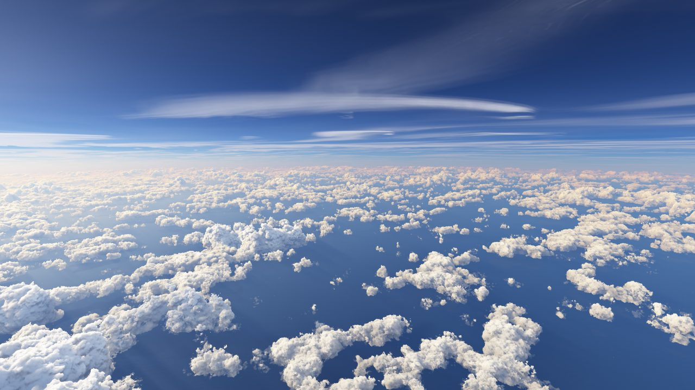
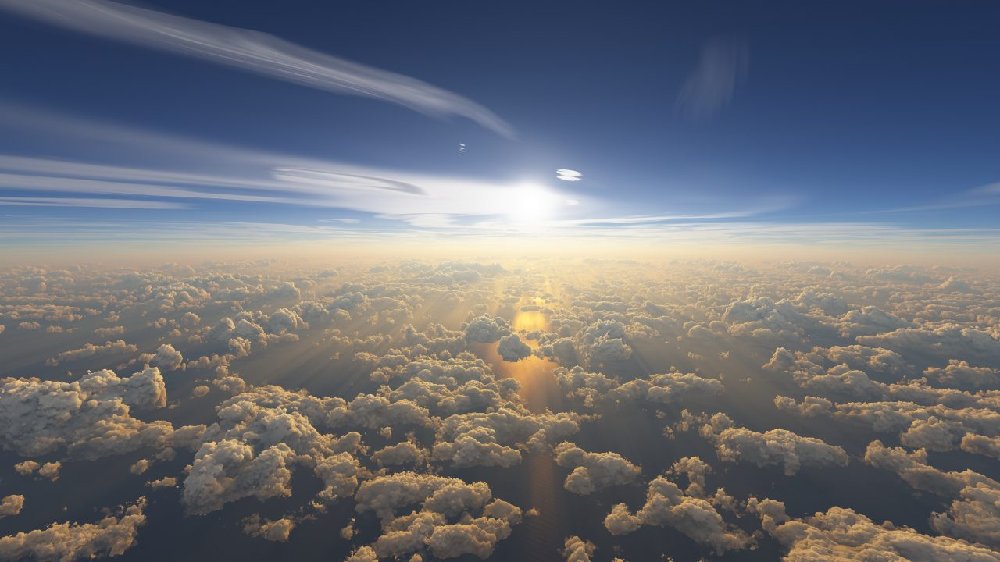
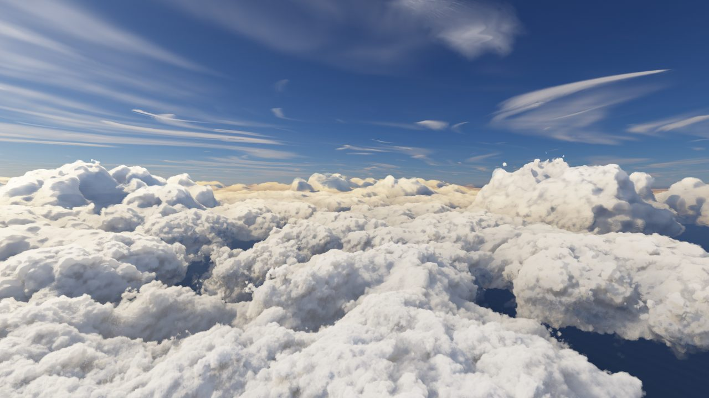
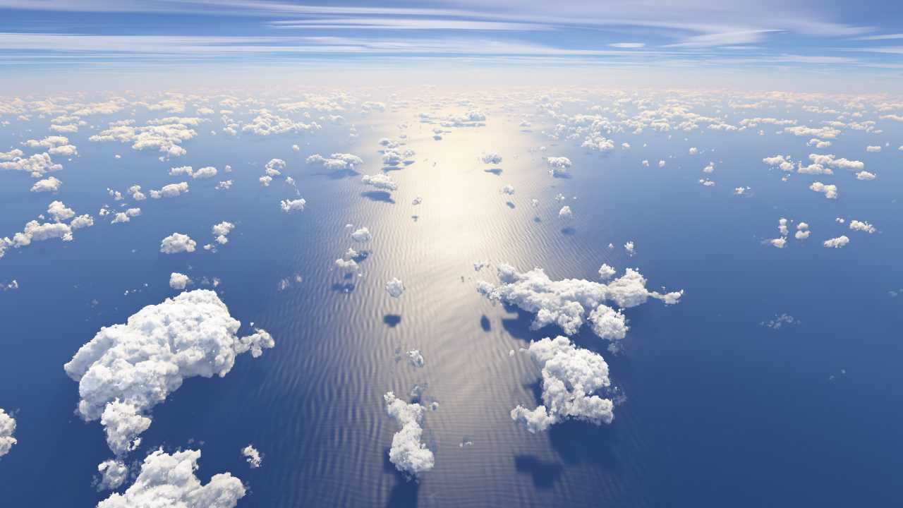
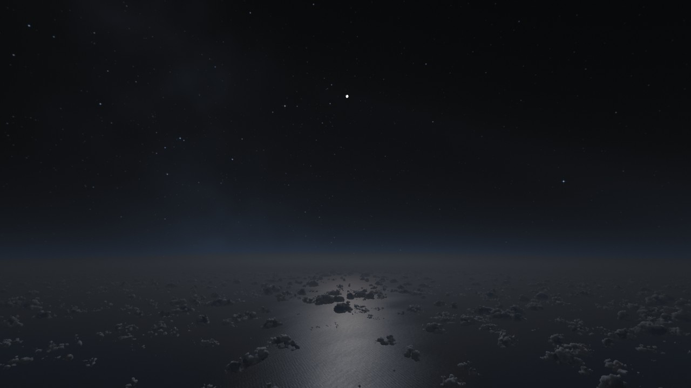

# Sky

English: [README.md](README.md)

航空機の窓から見た空を、ブラウザーで描くページです。
空気、低い雲、海、高い空の薄雲、太陽、月、星を、光の散乱を計算して描きます。

**ページ: https://sf624.github.io/sky/**

絵をクリックすると、その景色でページが開きます。

## 使い方

画面をドラッグすると、まわりを見回せます。上下は 89 度まで向けます。

航空機を操縦することもできます。キーボードでは(パネルの操作部品にフォーカスがないとき):

- **← →** または **A D**: 左右にバンクします。バンクした航空機は、実際の航空機と同じように旋回します。900 km/h では、バンク 30 度で毎秒 1.3 度、60 度(最大)で毎秒 3.9 度向きを変えます。
- **↑ ↓** または **W S**: 機首を下げる、上げる。フライトシミュレーターと同じく、↑ で機首が下がります。15 度まで上昇・降下し、高度が変わります。300 m と 40 km では水平飛行に戻ります。
- **Q E**: ラダーで向きを変えます。毎秒 3 度で、バンクはしません。
- **L**: 水平飛行に戻します。

キーを押している間はロールやピッチが続き、離すとそのときのバンクと上昇角を保ちます。タッチ画面では、左下のスティックで同じことができます(スマートフォンでは、パネルが消えると現れます)。横に倒すとバンク、下に引くと機首が上がり、小さなボタンで水平に戻ります。視線は機体と一緒に回り(同じ窓から外を見たまま)、バンクすると地平線が傾きます。太陽は空の同じ場所に留まります。速度 0 では機体は止まったままで、バンクと上昇角は機体を傾けるだけ、ラダーはその場で向きを変えます。

ページは日本語か英語で、ブラウザーの言語に従います(英語より日本語を先に選んでいるブラウザーでは日本語、それ以外は英語)。
パネルの **言語 / Language** で切り替えられます。選んだものはブラウザーに残ります。

タイトルとドラッグの案内は、数秒で消えます。
パネルと右上の全画面ボタンは、しばらく何も動かさないと消えます。
マウスを動かす、画面に触れる、キーを押す、Tab キーで入る、のどれかで戻ります(操縦のキーとスティックでは戻りません。景色を隠さないためです)。
ポインターを載せている間は消えません。
パネルが消えると、画面の上のマウスカーソルも消え、パネルと一緒に戻ります。

画面の下のパネルで、時刻や天気を変えられます。

- **▶**: 時間を進めます。速さはとなりで選べます。もう一度押すと止まります。0 時を過ぎると日付が次の日に進み、月齢も進みます。
- **いまの日時(時計)**: 日付を今日に、時刻をいまに合わせ、実時間で進めます。空は実際の時刻に合わせて変わっていきます。端末の時計の時刻を、このページの時刻(その土地の太陽の時刻)とみなします。
- **時間の進む速さ**: 実時間、1分/秒、10分/秒、16分/秒(1 日を 1 分半。初めはこれ)、1時間/秒。実時間では、空を 10 秒ごとに描き直し、その間は描きません。
- **時刻**: 0 時から 24 時まで。太陽が真南に来るのが 12 時です。場所は北緯 35 度です。
- **日付**: 1 月 1 日から 12 月 31 日まで。初めは今日です。日付を動かすと、月齢もその日のものに変わります。
- **月**: 月齢。0 日から 29.5 日まで。
- **大気の霞**: 空気中のちりや小さな水滴の量。0 から 6 まで(初めは 1。よく晴れた日の空気。0.3 でとても澄んだ空気、3 から上はかすんだ日)。多いほど、地平線と太陽のまわりが白く霞み、遠くの雲や海が霞の向こうに薄れます。
- **海上の風**: 1 m/s から 15 m/s まで。強いほど、太陽の照り返しの帯が広く淡くなり、白波が立ちます。
- **機首方位**: 飛ぶ向き。方位角で表します(0 が北、90 が東)。視線も一緒に回ります。旋回するとそれに従って動きます。
- **バンク角**、**上昇・降下**: 機体のバンク(左右 60 度まで)と、上昇・降下の角度(15 度まで。毎秒の高度の変化も出ます)。**水平飛行** のボタンで両方を 0 に戻します。
- **高度**: 300 m から 40 km まで(初めは 11,000 m)。巡航高度より上では、頭上の空が暗くなり、地平線が丸く曲がり、その上に薄く青い帯がかかります。スライダーは 1 行を使います。13 km までは均等に 20 m 刻みで動き(1 ピクセルがパソコンで約 30 m、スマートフォンで約 60 m)、その上は速く動きます(40 km でパソコンなら 1 ピクセル約 150 m)。決まった高さにするには、スライダーの横の値に m か km で打ち込みます(300 より小さい数は km、300 からは m)。
- **速度**: 0 から 3,000 km/h まで(初めは 900 km/h)。雲と海が流れていきます。0 にすると止まります。
- **雲**: 低い雲の量。なしから一面まで。
- **薄雲**: 高い空の薄い雲(巻雲)の量。
- **音**: ブラウザーの中で作る背景の音です。**なし**(初め)、**旅客機**(巡航中の客室: 胴体を流れる空気の音、エンジンの低い唸り、空調の音)、**エンジン近く**(同じ客室に、エンジンの高い音、つまりファンと圧縮機の甲高い音を多めに。エンジンに近い席のように)、**風**(エンジンはなく、空気の音だけ。風は強まったり弱まったりします)から選びます。空気の音は速度と高度に従い、エンジンは巡航のまま一定です。ブラウザーはクリックかキー操作のあとでしか音を出させないので、前に選んだ音は、ページを最初にクリックしたときに始まります。選んだものはブラウザーに残ります。
- **音量**: 0 から 100 % まで(初めは 50 %)。ブラウザーに残ります。
- **解像度**: 画面を描く画素数の上限です。フルHD、WQHD(初め)、4K から選びます。選んだものはブラウザーに残ります。画面の実際の画素数より細かくは描きません。
- **画質**: **低**、**中**、**高**、**最高**、または **自動**(初め)から選びます。低い画質ほど描く画素とサンプルが少なく、スマートフォンやノート PC でも描けます。最高は省略のない絵で、強い GPU のデスクトップ向けです。自動は、端末が自分について伝えることから画質を選び(スマートフォンは低から、最も強いデスクトップ GPU は最高から始めます)、フレームが遅すぎれば下げ、速ければ上げます(スマートフォンは中までです)。低と中は 1 フレームを半分の大きさで描き、何フレームかかけて元の大きさの絵にします。止まった眺めはくっきりし、動いている間は少しぼやけます。選んだ画質は「自動（低）」のように出ます。画質を変えると絵の準備をやり直すので、数秒かかります。始められない画質や、GPU が描くのをやめた画質は、一つ下に替わります。選んだものはブラウザーに残ります。アドレスに `?quality=low`(または `mid`、`high`、`max`、`auto`)を付けると、その回だけその画質になります。

景色はアドレスでも指定できます。たとえば `?time=16.75&yaw=60&pitch=-6` です。
指定できるものの一覧は [docs/development.md](docs/development.md) にあります。

## 絵のしくみ

- 空: 12 の波長ごとに、空気の分子とちりが光を散らす量を、視線に沿って足し合わせます。オゾンの吸収と、何度も散った光も入れています。
- 雲: 形は 3 次元のノイズで作ります。視線に沿って雲の中を進み、光の当たり方は、太陽の方へ雲をたどって決めます。
- 海: 波の傾きの分布から、太陽のきらめき、空の映り込み、水の中から戻る青い光、白波を計算します。
- 薄雲: 繊維を含んだ、やわらかく透ける氷の雲です。なめらかなところも、細かな筋の多いところもあります。氷の粒がほつれた頭から落ちて長く曲がる尾（すじ雲）や、広くやわらかな羽、長く穏やかな列、筋のある膜になります。雲は幾つかの広い帯や群れに集まり、その向きは場所ごとに変わります。あいだには青空や薄いベールが見えます。数本の尾から、乳白色のベールまで変わります。細い繊維は尾に沿って曲がります。ベールでは 22 度のかさが出ることがあり、太陽のまわりではかすかです。月の光ではベールが一様に見え、かさがはっきり出ます。
- 夜: 月は太陽に照らされた球なので、満ち欠けが出ます。星の位置・明るさ・色は Wikidata(CC0)によります。夜は目で見たように描きます。半月の夜は暗く、満月の夜はもっと明るく、光が弱まるにつれて色が薄れ、夜の目の灰色になります。満月の空は暗い青です。星はその空で目に見えるものを描きます。月のない夜は数千、月があれば少なくなります。天の川は月のない夜にははっきりした灰色の帯で、月が明るくなるにつれて見えなくなります。海に映る月の光の道は、近くでは一つ一つのきらめきで、遠くなるほど細かく密になり、水平線近くで明るい筋にまとまります。
- 1 枚の絵は、少しずつずらして描いた何枚もの絵の平均です。止まっていると数十フレームで滑らかになり、描くのをやめます。動いている間は、前の絵を動きに合わせてずらして重ねます。

## 必要なもの

- WebGL2 が使えるブラウザー。使えないときや、画質を低にしても GPU が空を描けないときは、そう表示し、理由を小さな字で添えます。
- 絵の準備ができるまで(初回はシェーダーのコンパイルに数秒かかることがあります)、暗い空と進み具合の線を出します。その間もブラウザーは操作できます。
- 速い GPU。このページは GPU に重い処理をさせます。RTX 3090 で測った、1 フレームの描画時間は次のとおりです(初めの景色、飛行中)。
  - 1920×1080: 約 5.5 ms
  - 2560×1440: 約 9.3 ms
  - 3840×2160(解像度 4K): 約 19 ms

  飛んでいる間は、毎フレーム描き続けます。ノート PC やスマートフォンでは遅くなります。
  遅いときは、動いている間だけ、描く画素数を自動で減らします。
  速度を 0 にするか、解像度をフルHD にするか、画質を下げると、軽くなります。
  端末でどれだけ重いかを見るには、アドレスに `?stats` を付けます。毎秒のフレーム数、画質、描く大きさ、GPU のメモリーと GPU の名前が小さな枠に出ます。

ページは HTML ファイル 1 つだけで、ほかに読み込むものはありません。音もブラウザーの中で作ります。

## ライセンス

MIT ライセンスです([LICENSE](LICENSE))。
ほかの人による小さなコードとデータがいくつかあり、それぞれの条件(MIT、BSD など)に従います。一覧は [THIRD_PARTY_NOTICES.md](THIRD_PARTY_NOTICES.md) にあり、Wikidata(CC0)の星のデータもそこに載っています。

## 開発する方へ

しくみと開発の手順は [docs/](docs/) にあります(英語)。

- [docs/design.md](docs/design.md): 1 フレームができるまで
- [docs/development.md](docs/development.md): 動かし方、確かめ方、決まりごと
